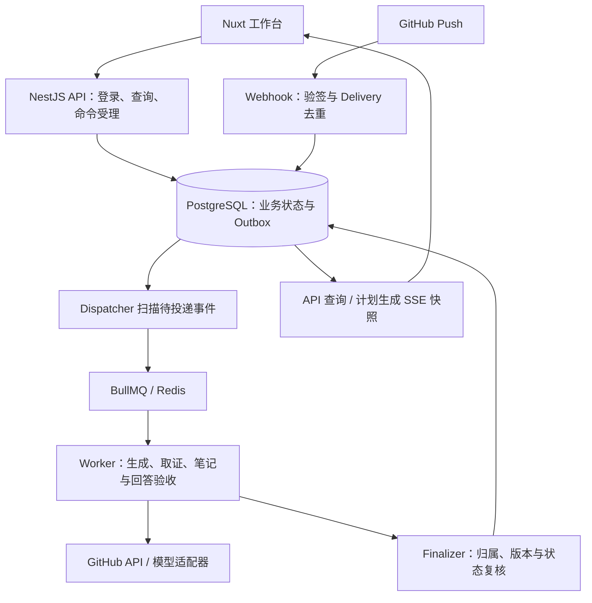

# KnowledgeOps Agent

KnowledgeOps Agent 是一个 GitHub 驱动的开发者学习验收工具。用户通过提交 Markdown 笔记提供真实学习证据，系统按确定性规则与受控 Agent 工作流生成可追溯报告和理解追问。

截至 2026-11-09，已验证 GitHub 登录与仓库绑定、异步生成计划、固定提交取证、笔记与追问回答验收、Task 通过和依赖解锁的完整链路；生产第二账号闭环及容器发布、兼容回退已有观察记录。R19 的正式发布接续、新域名业务检查及公网/续期核对由维护者确认已完成；最新产物标识与本轮证据来源说明见[交付记录](docs/demo/r19-delivery.md)。

线上入口：[KnowledgeOps Agent](https://knowops.site)，API 为 `https://api.knowops.site`，路径不带 `/api` 前缀；域名迁移过程见[生产域名记录](deploy/domains.md)。真实学习流程需要 GitHub 登录与仓库授权；当前不提供免登录公开示例或演示视频。项目讲解路线和能力依据见 [R18 事实清单](docs/demo/r18-demo.md)，简历项目表述见 [R19 材料定稿](docs/demo/r19-delivery.md)，各次验收记录见[开发计划](docs/KnowledgeOps-Agent-逐日开发计划.md)。

## 核心流程与职责



用户确认计划并开始任务后，在指定仓库、分支和路径提交 Markdown。Webhook 快速保存接收记录和待办；Worker 按固定 Commit SHA 读取证据，完成确定性检查、语义验收和追问生成。用户在页面回答追问，后台生成独立回答报告，再汇总必需标准更新 Task，满足全部前置依赖的后续任务才解锁。

`Run SUCCEEDED` 表示本次执行成功产出合法结果，报告仍可能判为错误或证据不足；Task 是否通过由全部必需标准决定。浏览器断网属于同步问题，不直接改变 Run 或 Task。

- **异步持久化**：业务意图与 Outbox 同事务保存，Dispatcher 将事件交给 BullMQ；重复消费仍由数据库状态、版本和唯一约束保护。代价是需要处理投递与消费两层恢复，不能宣称外部模型恰好调用一次。
- **前端恢复**：计划生成使用 SSE 完整快照、版本/批次隔离与 HTTP 校准、轮询兜底；任务和验收报告使用查询与轮询。没有模型逐字流或完整历史事件重放。
- **可追溯验收**：正文和 Diff 固定到提交，模型结果经过结构及引用校验；执行账本保存预算、用量和结果，完整结果可复用于落库恢复。合法引用不保证语义判断正确。
- **交付**：CI 检查与隔离容器验证通过后发布 GHCR 镜像；手动选择成功 CI 运行，由 SSH 发布脚本按摘要部署。允许维护窗口，回退需检查数据库和队列兼容性。

设计依据见 [Task 与 Run 分离](docs/adr/0003-separate-task-and-agent-run-state.md)、[异步计划生成](docs/adr/0005-durable-asynchronous-plan-generation.md)及[当前架构取舍](docs/adr/0006-verified-workflow-and-delivery-boundaries.md)。

## 仓库结构

- `apps/web`：Nuxt 公共页面与用户工作台；
- `apps/api`：NestJS 短请求、鉴权、校验与持久化入口；
- `apps/worker`：NestJS standalone 后台任务进程；
- `packages/contracts`：不依赖具体框架的 DTO、Zod Schema、状态与错误契约；
- `packages/agent-core`：模型端口、LangChain 适配器与结构化输出校验；
- `packages/database`：Prisma 数据库接入；
- `packages/observability`：API 与 Worker 共用的 JSON 结构化日志；
- `prisma`：核心领域模型与可审阅的 PostgreSQL 迁移。

## 本地启动

```powershell
corepack enable pnpm
corepack install --global pnpm@10.34.5
pnpm install
pnpm infra:up
pnpm infra:check
pnpm db:migrate:deploy
pnpm dev
```

以上命令前，首次克隆须按[本地开发指南](docs/local-development.md)创建 `.env`，配置数据库、Redis、开发 GitHub App 和模型。Windows 日常开发使用 WSL2 原生 PostgreSQL/Redis；另有 [CD01 隔离容器验证](deploy/cd01-containers.md)，不与日常开发库混用。

新克隆环境先按本地指南创建 `.env`，配置服务端模型目录、密钥与 Base URL；GLM 的配置见[模型适配说明](docs/local-development.md#51-模型目录与计划生成适配层)。进入 `http://127.0.0.1:3000/app/plan` 使用计划工作台；模型未配置或调用失败不会用 Mock 冒充成功。

API 启动后，`GET /health/live` 只判断进程是否存活，`GET /health/ready` 会真实执行 PostgreSQL `SELECT 1` 与 Redis `PING`。HTTP 响应通过 `x-request-id` 与 JSON 日志关联。

## 质量检查

```powershell
pnpm check
pnpm test:integration:r16
pnpm test:e2e:r16
```

后两项依赖专用隔离测试库和 Redis，按[本地指南](docs/local-development.md)准备后运行，不能指向生产库。浏览器闭环使用真实 API、数据库、队列和 Worker，但预设登录/绑定，GitHub 上游与模型为合成实现；它验证业务与恢复逻辑，不验证真实 OAuth 或模型准确率。

生产使用 Nginx、Docker Compose 与持久化数据卷，发布入口见 [CD03 手动发布与恢复](deploy/cd03-release.md)。推送代码只触发 CI，不自动发布生产；应用回退不回滚数据库中的新业务数据。

## 验证证据与限制

- [R11 固定评测](docs/evaluation/r11-fixed-evaluation.md)：15 份合成材料、16 项结论，v2 本轮结论一致性为 15/16；仍有含糊内容被判为错误。该数字不是总体准确率。
- R17 的一条真实闭环记录了笔记和两次回答共 15,115 Token、估算 CNY 0.171480；不含计划生成，费用不是供应商账单，也不是平均每用户成本。来源与口径见 [R18 事实清单](docs/demo/r18-demo.md)。
- [题干与必要评分点不一致](docs/issues/2026-11-04-follow-up-rubric-alignment.md)仍为 OPEN；固定评测、引用校验和成功演示都不能代替该问题的修复。
- 未承诺高并发、零停机、模型判断稳定性或学习效果提升；当前生产备份记录为同机备份，不能代表异地灾备。

产品范围以 [9 月求职版 PRD](docs/KnowledgeOps-Agent-9月求职版PRD.md) 为准，执行状态以 [逐日开发计划](docs/KnowledgeOps-Agent-逐日开发计划.md) 为准。
