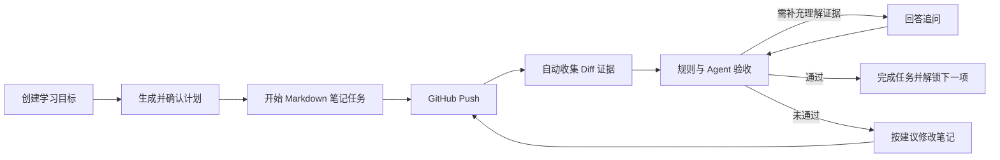
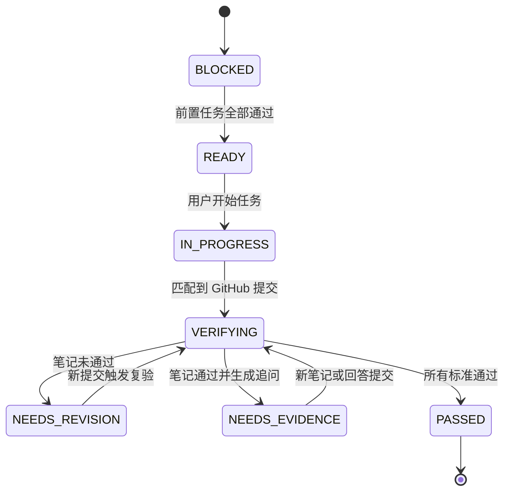
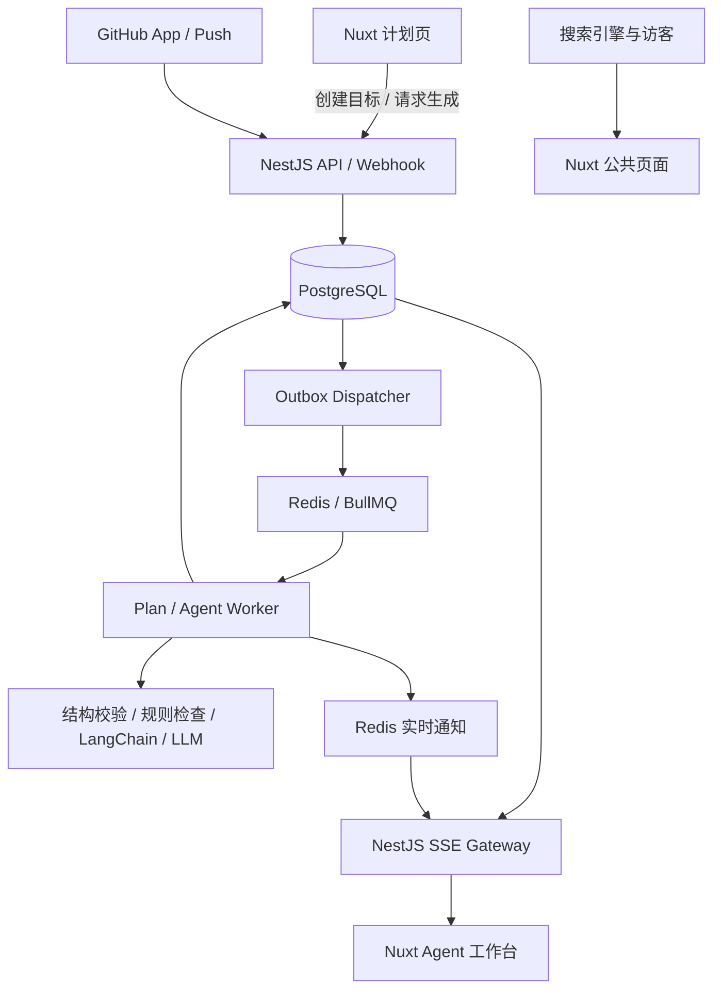

# KnowledgeOps Agent：9 月求职版产品需求文档

## 1. 文档信息

| 项目 | 内容 |
| --- | --- |
| 产品名称 | KnowledgeOps Agent（暂定） |
| 文档版本 | Job Edition V1.2 |
| 文档日期 | 2026-07-30（2026-08-08 更新） |
| 目标节点 | 2026 年 9 月前完成可公开演示、可真实使用的版本 |
| 第一目标 | 作为前端日常实习项目，展示复杂前端、全栈与 AI Agent 工程能力 |
| 第二目标 | 验证“基于真实学习证据自动验收”的产品需求 |
| 目标用户 | 使用 GitHub 和 Markdown 准备开发岗位面试的学生与初中级开发者 |

## 2. 产品定义

### 2.1 一句话定位

KnowledgeOps Agent 是一个 GitHub 驱动的开发者学习验收工具：用户确认学习计划后，通过向指定仓库提交 Markdown 笔记提供学习证据，系统自动分析 Diff、逐项验收内容并生成追问；只有笔记与追问均通过验收，任务才会完成并解锁后续任务。

### 2.2 核心价值

传统学习计划记录的是用户“声称完成了什么”，KnowledgeOps Agent 记录的是“经过证据和标准验证后完成了什么”。

产品不以聊天窗口为中心，而以以下闭环为中心：



### 2.3 9 月版本的产品边界

9 月版本只验证一个垂直场景：

> 用户为前端面试创建短期学习计划，通过 GitHub 提交 Markdown 笔记并回答 Agent 追问，系统自动判断任务是否通过。

本版本不是通用知识库、在线课程平台、完整刷题平台或任意代码执行平台。

## 3. 项目目标

### 3.1 求职目标

项目需要真实展示以下能力：

- Vue 3 与 TypeScript 复杂业务开发。
- Nuxt 混合渲染、SEO 与客户端工作台。
- 流式 UI、任务时间线、Diff 与引用联动。
- 前端服务端状态管理、错误恢复和性能优化。
- NestJS、PostgreSQL、Redis 与 BullMQ 的全栈协作。
- Webhook 幂等、异步任务重试、取消与状态恢复。
- 结构化 LLM 输出、可追溯引用与效果评测。
- 真实部署、自动化测试、性能指标与故障演示。

### 3.2 产品目标

- 验证用户是否愿意用 GitHub 提交作为学习证据。
- 验证逐项验收报告是否比通用 AI 总结更有帮助。
- 验证追问是否能够发现“写进笔记但没有真正理解”的内容。
- 验证任务通过后自动解锁是否能够促进用户持续执行计划。

### 3.3 非目标

9 月版本不追求：

- 覆盖所有开发岗位和技术方向。
- 自动生成长期、极其精确的完整课程体系。
- 替代教师或面试官作出高风险评价。
- 大规模商业化、复杂权限体系或企业级多租户能力。
- 仅通过堆叠技术名词证明项目复杂度。

## 4. 目标用户与使用场景

### 4.1 核心用户

- 正在准备前端实习或校招的学生。
- 使用 GitHub 保存技术笔记的人。
- 容易制定计划但缺少验收和反馈的人。
- 希望用个人项目、笔记和回答证明学习结果的人。

### 4.2 首个场景

用户希望在数周内复习 JavaScript、浏览器、网络、Vue 和项目设计。

用户填写目标、截止日期、当前基础和每周可投入时间。系统生成一个包含 3 至 8 个 Markdown 笔记任务的短期计划。用户确认计划并开始任务，随后将笔记 Push 到关联仓库。

系统自动完成：

1. 获取本次 Push 的 Markdown Diff。
2. 判断提交是否满足文件、章节等确定性要求。
3. 按固定 Rubric 检查知识正确性、覆盖度和表达清晰度。
4. 对所有语义结论提供原文引用。
5. 生成 1 至 3 个理解追问。
6. 验收用户回答。
7. 通过后完成任务并解锁后续任务。

## 5. 产品原则

### 5.1 证据优先

- 用户不能无条件点击“完成任务”。
- 每个任务必须至少包含一项可执行验收标准。
- 每个验收结论必须关联证据，或明确说明缺少什么证据。
- 同一份 GitHub 提交不能重复完成同一任务。

### 5.2 确定性优先

- 文件是否存在、指定路径是否修改、标题是否出现等条件由程序判断。
- 只有知识正确性、覆盖度、表达质量和回答质量等语义问题交给 LLM。
- LLM 无法判断时返回“需补充证据”，不得强行通过或否定。

### 5.3 用户可控

- AI 生成的计划必须由用户确认后才能生效。
- 用户可以查看验收标准、引用、模型运行过程和失败原因。
- 用户可以修改笔记、重新提交、补充回答或对结论反馈。
- 9 月版本中的 Agent 工具全部只读，不执行外部写操作。

### 5.4 可恢复

- Webhook、队列任务和任务状态迁移必须幂等。
- 页面刷新或 SSE 断线后必须能够恢复完整运行时间线。
- Worker 异常退出不能破坏已有学习计划或覆盖已保存结果。
- 重试创建新的运行记录，并保留此前失败尝试。

## 6. MVP 范围

### 6.1 P0：9 月前必须完成

#### 6.1.1 登录与仓库接入

- 使用 GitHub 完成用户登录。
- 用户安装 GitHub App，并只授权选中的仓库。
- 一个用户在 MVP 中只能绑定一个活动仓库。
- 一个活动计划只监听一个配置分支，默认使用仓库默认分支。
- GitHub App 只申请读取仓库内容和接收 Push 所需的最小权限。
- 用户可以解除仓库绑定并停止后续分析。

#### 6.1.2 学习目标与计划

- 用户输入学习目标、截止日期、当前基础和每周可投入时间。
- 部署方通过服务端环境变量配置一个模型供应商、凭据和 1 至 2 个允许模型；用户只能从服务端返回的模型白名单中选择，不能提交 API Key、任意模型名或 Base URL。
- 用户选择作为后续默认模型偏好保存；每份计划草稿仍快照实际使用的供应商、模型、Prompt 版本和输出 Schema 版本，后续修改偏好不得改写历史记录。
- 系统生成 1 至 3 个阶段、共 3 至 8 个任务。
- 9 月版本只支持 `MARKDOWN_NOTE` 一种任务类型。
- 每个任务包含目标、预计耗时、建议步骤、目标文件路径、验收标准和前置任务。
- 系统必须校验任务依赖无环、截止时间合法、任务数量处于限制内。
- LearningGoal 先独立持久化；生成接口在同一 PostgreSQL 事务中创建 `PlanGenerationRun` 与 `OutboxEvent`，提交后返回 `202 Accepted` 和 `generationRunId`，不在 HTTP 请求内等待模型结果。
- Outbox Dispatcher 将生成意图可靠投递到 BullMQ，独立 Worker 通过 LangChain 适配器调用模型；前端先轮询运行状态，后续可复用 SSE 增强实时体验。
- 计划生成不提供规则或 Mock 降级；模型未配置、超时、调用失败或结构化输出非法时保留 LearningGoal，将本次生成运行标记为明确的失败终态且不得创建半份 Plan。
- 同一 LearningGoal 同时最多存在一个非终态生成运行；失败后重试创建新的 `PlanGenerationRun` 并关联旧记录，不复活或覆盖终态运行。
- 计划默认处于草稿状态，用户确认后才进入活动状态。
- MVP 同时只允许一个活动计划。

#### 6.1.3 今日任务与任务详情

- 首页展示当前可开始、进行中、需修订和等待回答的任务。
- 用户可以开始一个已经解锁的任务。
- 开始任务时，用户需要确认或选择目标 Markdown 文件路径。
- 任务详情展示目标、步骤、验收标准、证据、历次运行和报告。
- 同一时间只允许一个任务处于 `IN_PROGRESS` 或等待该任务验收的状态。

#### 6.1.4 GitHub Push 与证据收集

- 订阅目标仓库的 Push 事件。
- 只处理配置分支上的 Markdown 文件变更。
- 使用 Webhook 原始请求体和 `X-Hub-Signature-256` 校验来源。
- 使用 `X-GitHub-Delivery` 唯一标识实现 Delivery 幂等。
- Webhook 接口完成校验与持久化后快速返回 `202 Accepted`。
- 后台任务获取 `before` 与 `after` Commit 间的文件变更和 Diff。
- 提交与当前进行中任务的目标路径匹配时自动关联。
- 未匹配、匹配多个任务或超出处理限制时，进入人工选择或明确的不可处理状态。
- 保存 Commit SHA、文件路径、Diff、内容哈希和行号信息。

#### 6.1.5 自动验收

一次完整验收包含两个阶段。

第一阶段：笔记验收。

- 执行文件路径、文件变更、必需章节等确定性标准。
- 通过固定 Rubric 检查知识正确性、覆盖度和表达清晰度。
- 每项结果只能为 `PASSED`、`FAILED` 或 `INSUFFICIENT_EVIDENCE`。
- 每项语义结论必须附带文件路径、Commit SHA 和原文行号引用。
- 笔记存在可修订问题时，任务进入 `NEEDS_REVISION`。
- 笔记基本通过后，生成 1 至 3 个追问，任务进入 `NEEDS_EVIDENCE`。

第二阶段：回答验收。

- 用户在任务页提交追问回答。
- 系统按照与问题绑定的 Rubric 判断回答是否体现真实理解。
- 回答不充分时返回具体问题和补充建议。
- 追问必须绑定产生它的笔记 Submission、Commit SHA 和验收报告；较新的笔记提交生效后，旧追问不得再用于完成任务。
- 笔记标准与必答追问全部通过后，任务进入 `PASSED`。
- 任务通过后自动解锁满足依赖条件的后续任务。

#### 6.1.6 Agent 运行工作台

- 展示运行状态、当前步骤、步骤耗时和整体耗时。
- 通过 SSE 接收运行事件。
- 展示 Markdown Diff、验收结论和引用之间的联动。
- 点击引用时定位到对应文件与行。
- 支持运行中取消、失败后重试。
- 页面刷新或网络重连后按事件 ID 重放缺失事件。
- 重复事件不得在时间线中重复展示。

#### 6.1.7 报告与反馈

- 报告按验收标准逐项展示结果、理由、引用和修改建议。
- 展示追问、用户回答和回答验收结果。
- 保存模型、Prompt 版本、Token、耗时和估算成本。
- 用户可以对报告标记“有帮助”“结论错误”或填写简短反馈。
- 报告默认私有。

#### 6.1.8 公共页面

- 提供产品首页、核心流程、隐私说明和登录入口。
- 提供一个使用固定演示数据生成的公开示例报告。
- 产品首页和固定示例页面预渲染。
- 登录后的 `/app/**` 工作台使用客户端渲染并禁止搜索引擎索引。

### 6.2 P1：完成 P0 后的加分项

- 使用 PostgreSQL 全文检索查找相关旧笔记。
- 在报告中提示新旧笔记间可能存在的重复或冲突。
- 对长运行时间线启用虚拟列表。
- 使用 Web Worker 处理超出阈值的 Markdown 解析或 Diff 计算。
- 支持公开用户主动选择的脱敏报告。
- 增加固定评测集对不同 Prompt 版本进行对比。
- 增加基础周复盘，但只提供统计和建议，不自动修改计划。

### 6.3 P2：9 月后再考虑

- pgvector 和完整混合检索。
- 题目、代码和间隔复习等独立任务类型。
- 任意用户代码构建和测试。
- 自动大规模重规划。
- 多计划并行。
- 多 Agent 协作。
- MCP 外部工具生态。
- 飞书、日历、邮件和 GitHub Comment 发布。
- 公开学习模板市场、社区和排行榜。
- 原生移动端应用。

## 7. 明确非目标

以下内容即使文档或 UI 中出现入口，也不得进入 9 月版本开发范围：

- 聊天式通用 AI 助手。
- 无限制导入任意知识库。
- 任意仓库代码审查。
- 任意 Shell 命令或用户代码执行。
- 自动修改仓库、创建 Issue 或提交代码。
- 复杂拖拽式计划编辑器。
- 通用课程、视频和内容市场。
- 社交动态、好友、排行榜和连续打卡补签。
- 企业组织、角色、团队协作和计费系统。
- 为了展示技术而同时使用多个模型、多个队列或多个向量数据库。

## 8. 核心用户流程

### 8.1 首次使用

1. 用户访问产品首页并使用 GitHub 登录。
2. 用户安装 GitHub App，选择一个学习仓库。
3. 系统显示所需权限、数据用途和模型处理说明。
4. 用户输入学习目标并生成计划草稿。
5. 用户查看阶段、任务、依赖和验收标准。
6. 用户确认计划，首个无前置依赖的任务进入 `READY`。

### 8.2 执行笔记任务

1. 用户在“今日学习”中开始任务。
2. 用户确认本任务对应的 Markdown 路径。
3. 用户在本地编写笔记并 Push。
4. Webhook 接收 Push，创建验收运行。
5. 工作台实时展示取 Diff、解析、规则验收和语义验收过程。
6. 若笔记需修改，用户根据引用和建议再次 Push。
7. 若笔记通过，系统生成追问。
8. 用户回答追问并查看第二阶段验收过程。
9. 全部通过后任务完成，下一任务自动解锁。

### 8.3 失败恢复

1. 运行失败时，任务保留原业务状态，不直接判定为未通过。
2. 页面展示失败步骤、错误分类和是否可以重试。
3. 用户点击重试后创建新的 `AgentRun`，通过 `retryOfRunId` 关联旧运行。
4. 已完成的确定性步骤可读取持久化结果，避免无意义重复计算。
5. 页面断线重连时通过最后事件 ID 拉取缺失事件。

## 9. 状态模型

### 9.1 计划状态

| 状态 | 含义 |
| --- | --- |
| `DRAFT` | AI 已生成但用户尚未确认 |
| `ACTIVE` | 已确认且正在执行 |
| `PAUSED` | 用户暂停，不再开放新任务 |
| `COMPLETED` | 所有未跳过的必要任务均已通过 |
| `ARCHIVED` | 用户终止或归档 |

### 9.2 学习任务状态



状态规则：

- 只有验收流程可以将任务设置为 `PASSED`。
- Agent 运行启动时记录 `taskStateBeforeRun`。运行失败、取消或超时后，通过乐观锁恢复到该稳定状态，不得永久停留在 `VERIFYING`。
- `NEEDS_REVISION` 表示证据明确未达到标准。
- `NEEDS_EVIDENCE` 表示现有内容不足以判断掌握程度，不表示失败。
- 逾期是由截止时间和当前任务状态计算出的调度标记，不进入任务主状态机，也不阻止用户继续完成任务。
- 状态迁移必须校验当前版本，防止并发运行覆盖新状态。

### 9.3 Agent 运行状态

| 状态 | 含义 |
| --- | --- |
| `QUEUED` | 已持久化并等待 Worker |
| `RUNNING` | Worker 正在执行 |
| `CANCEL_REQUESTED` | 用户已请求取消，等待安全终止 |
| `SUCCEEDED` | 本次运行完成并产生有效结果 |
| `FAILED` | 因可记录错误终止 |
| `CANCELLED` | 已完成协作式取消 |
| `TIMED_OUT` | 超过运行时间限制 |

运行规则：

- 取消必须由 Worker 在步骤边界检查取消信号，不能依赖强制删除活动 Job。
- 每次重试生成新的运行记录，不覆盖失败运行。
- 每个运行只允许一次终态迁移。
- Agent 运行与学习任务使用不同状态字段和状态机。

## 10. 验收标准模型

### 10.1 标准类型

| 类型 | 执行者 | 示例 |
| --- | --- | --- |
| `FILE_CHANGED` | 程序 | 指定 Markdown 文件在本次提交中发生变化 |
| `SECTION_PRESENT` | 程序 | 笔记包含“事件循环”章节 |
| `CONTENT_MINIMUM` | 程序 | 有效正文或代码块达到最小要求 |
| `SEMANTIC_CORRECTNESS` | Agent | 对宏任务与微任务顺序的描述正确 |
| `TOPIC_COVERAGE` | Agent | 覆盖任务要求的关键知识点 |
| `EXPLANATION_QUALITY` | Agent | 能用自己的语言解释因果关系 |
| `FOLLOW_UP_ANSWER` | Agent | 能正确回答基于笔记生成的理解追问 |

### 10.2 单项验收结果

```ts
type CriterionOutcome =
  | 'PASSED'
  | 'FAILED'
  | 'INSUFFICIENT_EVIDENCE'

interface CriterionResult {
  criterionId: string
  outcome: CriterionOutcome
  rationale: string
  suggestions: string[]
  citations: Citation[]
  confidence: number
}
```

`confidence` 只用于展示模型不确定性和后续评测，不能绕过必要标准。

### 10.3 引用模型

每条引用至少包含：

- `repositoryId`
- `commitSha`
- `path`
- `startLine`
- `endLine`
- `excerpt`
- `contentHash`

引用必须能够在对应 Commit 快照中重新定位。引用失效或无法定位时，该条语义结论不得作为通过任务的唯一依据。

### 10.4 任务通过规则

- 所有必要确定性标准均为 `PASSED`。
- 所有必要语义标准均为 `PASSED`。
- 所有必答追问均为 `PASSED`。
- 任一笔记标准为 `FAILED` 时进入 `NEEDS_REVISION`。
- 追问回答为 `FAILED` 时保留在 `NEEDS_EVIDENCE`，允许用户修改回答；它不会错误地把笔记标记为需修订。
- 任一必要标准为 `INSUFFICIENT_EVIDENCE` 时进入 `NEEDS_EVIDENCE`。
- 可选标准失败只生成建议，不阻止任务通过。

## 11. Agent 工作流

### 11.1 设计原则

9 月版本使用受控、可预测的工作流，不实现无限循环的开放式 Agent。

用户等待和 Agent 运行必须分离，不允许 Worker 在等待用户回答期间保持活动。一次笔记提交创建 `NOTE_VERIFICATION` 运行；用户提交追问答案后，再创建独立的 `ANSWER_VERIFICATION` 运行。

笔记验收运行由以下显式步骤组成：

1. `collect_evidence`
2. `parse_markdown`
3. `run_deterministic_checks`
4. `prepare_context`
5. `evaluate_note`
6. `generate_follow_up_questions`
7. `finalize_report`

回答验收运行由以下显式步骤组成：

1. `collect_answer_evidence`
2. `load_note_verification`
3. `evaluate_answers`
4. `finalize_report`

每个步骤保存输入摘要、输出、耗时和错误。步骤之间只传递经过 Schema 校验的结构化数据。

### 11.2 LangChain 使用边界

P0 选择性引入 LangChain，复用其标准模型接口、模型供应商集成、Zod 结构化输出、工具包装及必要的调用中间件，但不让通用 Agent 框架接管业务工作流、业务状态或持久化真相源。

- 计划生成可以独立调用 LangChain 模型与结构化输出能力，不因此启动 Agent 循环。
- P0 的模型凭据和允许模型目录由部署方配置。业务 API 只接受目录中的稳定模型 ID，LangChain 适配层再把它解析为具体供应商、模型与服务端凭据。
- `packages/agent-core` 负责框架无关的验收用例接口、显式步骤编排和领域输入输出；LangChain 类型只能存在于模型、工具和中间件适配实现中，不得泄漏到 `packages/contracts`、REST DTO、Prisma 模型或前端协议。
- `PlanGenerationRun` 表示一次独立的计划生成尝试，由项目状态机、Outbox、BullMQ 和 Worker 驱动；它不复用与 Task 强绑定的 `AgentRun`，LangChain 内部状态也不能直接决定其终态。
- `AgentRun` 表示一次完整的笔记或回答验收尝试，`AgentStep` 表示本项目定义的显式业务步骤；一次 LangChain 模型调用、工具调用或内部重试只是某个步骤下的技术子调用，不自动成为新的业务状态。
- P0 不启用 LangGraph Checkpointer、长期 Memory 或 Thread 作为恢复机制。PostgreSQL 中的 `PlanGenerationRun`、`AgentRun`、`AgentStep`、`RunEvent` 和业务实体仍是唯一持久化真相源。
- 默认不使用开放式 ReAct 循环控制整条验收链路。只有固定评测证明按需取证优于预先准备上下文时，才允许在 `evaluate_note` 等单一步骤内部加入只读、次数受限、可超时和可取消的 ReAct 子循环。

### 11.3 Agent 工具

P0 只允许以下只读工具：

- `get_commit_diff`
- `read_file_at_commit`
- `get_task_requirements`
- `get_previous_submission`

P1 可增加：

- `search_repository_notes`

工具约束：

- LangChain `tool` 只包装项目拥有的只读用例接口；仓库授权、路径限制和数据访问仍由项目服务校验，工具不得直接获得业务写入 Repository。
- 每次运行限制工具调用次数、上下文长度、Token 和总耗时。
- 仓库内容始终被视为不可信数据，不能改变系统指令或工具权限。
- 工具不得访问未绑定仓库或未授权路径。
- 工具参数和返回结果必须记录，但不得在日志中泄露密钥。

### 11.4 结构化输出

- 项目定义的 Zod Schema 是结构化输出契约真相源，可交给 LangChain 的结构化输出接口执行供应商适配与运行时解析；不得把 `AIMessage` 等框架对象直接作为业务结果持久化。
- 所有 LLM 输出使用运行时 Schema 校验。
- Schema 不合法时允许有限次数的修复重试。
- 计划生成阶段不使用规则或 Mock 结果替代失败的真实模型调用；失败运行进入终态并允许用户创建关联重试。
- 修复失败后运行进入 `FAILED`，不得用不完整结果修改任务状态。
- 保存模型标识、Prompt 版本和输出 Schema 版本。

### 11.5 Prompt Injection 防护

- 使用明确的数据边界包裹仓库内容。
- 系统提示中声明仓库文本只用于分析，不是可执行指令。
- P0 工具全部只读，不提供外部写权限。
- 不根据仓库文本动态扩展工具列表。
- Markdown 渲染关闭原始 HTML或经过严格清洗。
- 不自动抓取笔记中的外部链接，避免 SSRF。

### 11.6 调用预算与重试分层

- 模型瞬时错误重试和结构化输出修复必须计入所属 `PlanGenerationRun` 或 `AgentRun` 的统一模型调用次数、Token、成本和总耗时预算；验收阶段的只读工具重试还要计入同一 `AgentRun` 的工具预算。
- LangChain 中间件、模型供应商 SDK 与 BullMQ 不得分别使用互不知情的默认重试，避免一次失败形成乘法级调用放大。
- BullMQ 负责 Job 投递和 Worker 级故障重试；`PlanGenerationRun` 或 `AgentRun` 已进入终态后，用户重试必须创建同类新运行并通过 `retryOfRunId` 关联旧记录。
- 每次模型调用、工具调用、修复重试和错误分类都要关联 `runId`、`stepId` 与尝试序号，但内部调用记录不能越权修改 Task 或 Report。

## 12. 技术架构

### 12.1 总体架构



### 12.2 可靠性边界

PostgreSQL 是以下数据的真相源：

- 用户、仓库和计划；
- `PlanGenerationRun`；
- 任务状态；
- Webhook Delivery；
- Evidence、Submission 和 Report；
- AgentRun、AgentStep 和 RunEvent；
- Outbox 事件。

Redis 只负责：

- BullMQ 队列；
- 短期缓存和限流；
- 取消信号；
- 实时事件通知。

不得仅在 Redis 中保存不可恢复的任务状态或运行结果。

LangChain 的消息历史、Agent 内部状态和可选追踪数据也不得成为业务恢复依据。若 P1 以后评估 LangGraph 持久化，必须先用 ADR 明确 Checkpoint 与 `PlanGenerationRun`、`AgentRun`、`AgentStep`、`RunEvent` 的映射和唯一真相源。

### 12.3 Outbox 与队列一致性

计划生成请求在一个 PostgreSQL 事务中：

1. 为已经持久化的 LearningGoal 创建 `QUEUED` 的 `PlanGenerationRun`。
2. 插入对应的 `OutboxEvent`。

事务提交后返回 `202` 与 `generationRunId`。模型配置无效时在创建运行前明确失败；一旦事务提交，Dispatcher 和 Worker 必须能够在浏览器断开后继续处理。

Webhook 请求在一个 PostgreSQL 事务中：

1. 插入具有唯一 Delivery ID 的 `WebhookDelivery`。
2. 创建或关联 `Submission` 与 `AgentRun`。
3. 插入 `OutboxEvent`。

事务提交后返回 `202`。独立 Dispatcher 将 Outbox 事件加入 BullMQ，并在成功后标记已分发。Dispatcher 必须能够扫描和补发未分发事件。

BullMQ Job ID 使用稳定的业务键，例如：

```text
plan-generation-{runId}
note-{repositoryId}-{taskId}-{afterCommitSha}-{workflowVersion}
answer-{taskId}-{answerSubmissionId}-{workflowVersion}
```

自定义 Job ID 使用连字符，不使用 BullMQ 保留为 Redis 键分隔符的冒号。稳定 Job ID 只负责队列内的第一层去重，Job 被自动清理后不能继续提供永久幂等；PostgreSQL 唯一约束、运行终态和条件更新才是最终防线。

即使发生重复生成请求、重复 Delivery、重复入队或 Worker 重试，也只能产生一份有效业务结果。计划生成 Worker 只有在完整结果通过 Schema、数量、日期和 DAG 校验后，才能用单个事务创建 Plan 图并把运行推进到 `SUCCEEDED`；重复消费已经终态的运行必须返回既有结果。

### 12.4 SSE 事件流

所有用户可见事件先写入 `RunEvent`，再发布实时通知。

事件至少包含：

```ts
interface RunEvent<T = unknown> {
  id: string
  runId: string
  sequence: number
  stepId?: string
  type: string
  payload: T
  occurredAt: string
  schemaVersion: number
}
```

SSE Gateway 行为：

1. 校验用户是否有权访问运行。
2. 根据客户端的最后事件 ID 查询并发送历史缺失事件。
3. 切换到 Redis 实时通知。
4. 定期发送心跳，避免代理空闲超时。
5. 断开连接后清理订阅。

前端按 `(runId, sequence)` 去重和排序，不以网络到达顺序直接修改最终业务状态。

### 12.5 前端架构

| 技术 | 用途 |
| --- | --- |
| Nuxt 4 | 路由、公共页面和混合渲染 |
| Vue 3 | 工作台与复杂交互 |
| TypeScript | 组件、API 与事件协议类型 |
| TanStack Query for Vue | 服务端数据缓存、失效和重试 |
| Pinia | 登录会话外的少量界面状态、筛选器和临时交互 |
| Tailwind CSS | 样式与基础设计系统 |
| Monaco Editor | Markdown Diff 和引用定位，按需加载 |
| SSE / Fetch Stream | Agent 运行事件 |
| Vitest | Composable、Reducer 和组件测试 |
| Playwright | 完整用户闭环与断线恢复测试 |

状态职责：

- 计划、任务、运行和报告属于服务端状态，统一交给 TanStack Query。
- PlanGenerationRun 在非终态时使用有退避的 Query 轮询，进入终态或页面卸载后停止；刷新页面从服务端恢复，不把计时器或运行实体复制到 Pinia。
- Pinia 不复制服务端实体，只保存跨页面 UI 状态。
- 流式事件进入事件 Reducer，再通过明确的 Query 更新策略刷新结果。
- Monaco 只在任务或运行详情页客户端加载，不进入公共首页首屏包。

### 12.6 后端架构

| 技术 | 用途 |
| --- | --- |
| NestJS | API、Webhook、SSE 与模块边界 |
| Express Adapter | HTTP 运行时 |
| REST / OpenAPI | 业务 API 和契约文档 |
| PostgreSQL | 业务、运行、事件和审计数据 |
| Prisma | 常规数据模型、迁移和访问 |
| Redis | BullMQ、通知、限流和取消信号 |
| BullMQ | 异步计划生成与验收任务 |
| LangChain（选择性使用） | 标准模型接口、供应商集成、Zod 结构化输出、只读工具包装和受控调用中间件 |

P0 不使用 pgvector。若 P1 引入 PostgreSQL 全文检索，检索逻辑放入独立 `retrieval` 模块，避免与 Agent 流程耦合。

LangChain 只位于计划生成或 `agent-core` 的模型与工具适配层。显式工作流、状态机、事务、幂等、引用校验和最终业务决策保持框架无关，API、Worker 与共享契约不得直接依赖 LangChain 消息类型。

### 12.7 Monorepo 结构

```text
knowledgeops-agent/
├─ apps/
│  ├─ web/                 # Nuxt 公共站与工作台
│  ├─ api/                 # NestJS API、Webhook 与 SSE
│  └─ worker/              # BullMQ Worker、计划生成与 Agent 工作流
├─ packages/
│  ├─ contracts/           # DTO、Zod Schema、事件协议和共享类型
│  ├─ agent-core/          # 工作流、Prompt、工具与模型适配
│  ├─ markdown/            # Markdown AST、Diff 与引用定位
│  └─ observability/       # 日志、Trace ID 与指标封装
├─ prisma/
│  ├─ schema.prisma
│  └─ migrations/
├─ tests/
│  ├─ fixtures/
│  ├─ integration/
│  └─ evaluations/
└─ deploy/
   ├─ compose.yaml
   └─ reverse-proxy/
```

避免在实现尚未需要时继续拆分包或微服务。API 与 Worker 可以使用相同代码仓库、不同进程部署。

## 13. 核心数据模型

| 实体 | 关键职责 |
| --- | --- |
| `User` | 用户身份、时区与允许模型目录中的默认模型偏好 |
| `GitHubInstallation` | GitHub App Installation ID 与授权状态 |
| `Repository` | 绑定仓库、默认分支和启用状态 |
| `LearningGoal` | 目标、截止日期、基础和时间预算 |
| `PlanGenerationRun` | 一次持久化计划生成尝试、模型/Prompt/Schema 快照、错误、耗时和关联重试 |
| `Plan` | 完整生成并通过校验的计划版本、确认状态及对应成功生成运行 |
| `Stage` | 计划阶段 |
| `Task` | Markdown 任务、依赖、状态和目标路径 |
| `AcceptanceCriterion` | 验收标准、必要性和执行类型 |
| `WebhookDelivery` | Delivery 幂等与处理状态 |
| `Submission` | 一次 GitHub 笔记提交或追问回答提交 |
| `Evidence` | Diff、文件快照、回答和确定性检查结果 |
| `FollowUpQuestion` | 与笔记 Submission 和验收报告绑定的追问及 Rubric |
| `AgentRun` | 一次 `NOTE_VERIFICATION` 或 `ANSWER_VERIFICATION` 独立执行尝试 |
| `AgentStep` | 工作流步骤及其输入输出摘要 |
| `RunEvent` | 可重放的前端事件 |
| `VerificationReport` | 一次验收的整体报告 |
| `CriterionResult` | 单项标准结论 |
| `Citation` | 指向 Commit 文件行的证据引用 |
| `UserFeedback` | 对验收结论的反馈 |
| `OutboxEvent` | PostgreSQL 到 BullMQ 的可靠分发记录 |

关键约束：

- `WebhookDelivery.deliveryId` 唯一。
- `RunEvent(runId, sequence)` 唯一。
- 同一 LearningGoal 同时最多存在一个 `QUEUED` 或 `RUNNING` 的 `PlanGenerationRun`。
- `PlanGenerationRun` 正常路径为 `QUEUED → RUNNING → SUCCEEDED/FAILED/TIMED_OUT`，超过持久化 `deadlineAt` 的 `QUEUED` 也可由清理任务条件更新为 `TIMED_OUT`；终态不可逆，重试创建带 `retryOfRunId` 的新记录。
- `PlanGenerationRun` 只有在 Plan、Stage、Task、Criterion 与依赖关系全部原子写入后才能进入 `SUCCEEDED`；重复 Job 不得创建第二份同版本 Plan。
- 同一任务、Commit、工作流版本只能有一个有效验收结果。
- `Task` 使用版本字段进行乐观并发控制。
- `PlanGenerationRun`、`Submission`、`AgentRun` 和 `VerificationReport` 的终态记录原则上不可覆盖，只能创建关联重试、新增版本或标记失效。

## 14. 信息架构

```text
公共页面
├─ 首页
├─ 示例报告
├─ 隐私说明
└─ 登录

登录后工作台
├─ 今日学习
├─ 学习计划
│  ├─ 目标、模型与生成运行状态
│  └─ 阶段与任务列表
├─ 任务详情
│  ├─ 目标与验收标准
│  ├─ GitHub 证据与 Diff
│  ├─ 追问与回答
│  └─ 历次验收报告
├─ Agent 运行详情
│  ├─ 执行时间线
│  ├─ 步骤与工具调用
│  ├─ Diff 与引用
│  └─ 错误、取消与重试
└─ 设置
   └─ GitHub 仓库
```

建议路由：

```text
/
/demo
/privacy
/login
/app/today
/app/plan
/app/tasks/:taskId
/app/runs/:runId
/app/settings/repository
```

## 15. GitHub 边界情况

### 15.1 忽略的事件

- 非配置分支 Push。
- Tag Push。
- 没有 Markdown 文件变化的 Push。
- 已停用或未授权仓库的事件。

忽略必须记录原因，但不创建 Agent 运行。

### 15.2 文件删除

- 删除文件时保存删除 Evidence。
- 若删除的是当前任务目标文件，任务不自动失败，页面提示需要重新选择或恢复文件。
- 删除内容不触发语义验收。

### 15.3 多文件与多任务

- 一次 Push 可以包含多个 Markdown 文件。
- P0 只自动处理与当前进行中任务目标路径匹配的文件。
- 未匹配文件只记录提交摘要，不进入验收。
- 若目标路径配置存在歧义，要求用户选择证据，不自动完成任务。

### 15.4 大提交

需要配置以下上限：

- 单次处理的 Markdown 文件数。
- 单文件大小。
- Diff 总字符数。
- LLM 上下文长度。

超限时返回明确的 `LIMIT_EXCEEDED` 错误或局部处理报告，不得静默截断后给出完整通过结论。

### 15.5 Force Push 与不可比较 Commit

- 能够取得 `before` 与 `after` 时按正常 Diff 处理。
- 无法取得基准 Commit 时将提交标记为需要重新同步。
- P0 可以提供手动“重新同步目标文件”操作，不实现完整仓库历史重建。

## 16. 安全与隐私

### 16.1 GitHub 权限

- 使用 GitHub App，不要求用户粘贴长期 Personal Access Token。
- 只申请完成读取和 Webhook 所需的最小权限。
- Installation Token 按需生成，不写入数据库。
- GitHub App 私钥与 Webhook Secret 只从安全环境变量读取。

### 16.2 模型凭据与选择

- 模型 API Key 只从服务端安全环境变量读取，不写入 PostgreSQL、不发送到浏览器，也不出现在日志、错误响应或 Trace 中。
- P0 由部署方配置一个供应商和 1 至 2 个允许模型；用户只能选择服务端公布的稳定模型 ID。
- 服务端必须校验模型 ID 白名单并映射到真实供应商配置，不接受用户提交的任意 API Key、模型名或 Base URL。
- 模型缺失、不可用或输出非法时返回明确错误，不静默切换模型或使用规则结果冒充模型输出。

### 16.3 私有仓库

- 用户授权前明确说明仓库内容可能被发送至所选模型提供商。
- 只读取用户选择的仓库和目标文件。
- 报告、Diff、回答和计划默认私有。
- 日志不记录完整 Token、密钥或不必要的私有代码内容。
- 用户解除绑定后停止处理新事件；数据删除能力可作为 P1，但必须在隐私说明中声明保留策略。

### 16.4 Web 安全

- Markdown 输出经过严格清洗，禁止任意脚本和危险 URL。
- 所有仓库、任务、运行和报告接口执行用户级授权校验。
- Webhook 签名使用恒定时间比较。
- 对登录、计划生成、验收和 SSE 建立合理限流。
- Cookie 使用 `HttpOnly`、`Secure` 和合适的 `SameSite` 策略。
- 公共页面不得通过服务端错误泄露私人实体是否存在。

### 16.5 不执行用户代码

9 月版本不克隆并运行仓库代码，不执行构建、测试、Shell、Markdown 内命令或 Agent 建议命令。代码执行必须等到具备独立沙箱、资源配额、网络隔离和审计能力后再设计。

## 17. 非功能需求

### 17.1 性能

- LearningGoal 已先持久化；计划生成接口在 PlanGenerationRun 与 Outbox 事务提交后返回 `202`，不等待模型输出；前端轮询必须有合理退避并在终态停止。
- Webhook 接口在完成签名校验和事务写入后返回，不等待 AI。
- 公共首页目标 LCP 不高于 2.5 秒，CLS 不高于 0.1。
- Monaco 不进入公共页面首屏 Bundle。
- 运行时间线仅渲染当前可见或合理数量的事件；超出阈值后再引入虚拟列表。
- SSE 建立后应立即返回连接状态或历史事件，不等待新事件才产生响应。

### 17.2 可靠性

- 浏览器在计划生成后刷新或断网，不影响已经提交的生成运行；恢复页面后能够读取当前状态和最终完整 Plan。
- 重复分发或执行同一个计划生成 Job 不得创建重复 Plan，失败运行不得留下部分 Stage、Task、Criterion 或依赖关系。
- 超过 `deadlineAt` 的 `QUEUED/RUNNING` 运行会被条件更新为 `TIMED_OUT`，迟到 Worker 不得复活终态，页面不能永久停留在处理中。
- 重复发送相同 Webhook 不得产生重复任务完成。
- Worker 在任一步骤失败后保留已持久化运行和错误信息。
- SSE 断开重连后事件无缺口，前端无重复展示。
- Agent 非法结构化输出不得修改业务状态。
- 数据库迁移具备向前部署和回滚说明。

### 17.3 可观测

每次请求和运行至少记录：

- `requestId`
- `deliveryId`
- `generationRunId`
- `runId`
- `taskId`
- `model`
- `promptVersion`
- `workflowVersion`
- Token、耗时、估算成本和错误分类

P0 使用结构化日志和贯穿 API、队列、Worker 的 Trace ID。完整 Grafana、Tempo 或自建监控栈属于 P1，不得阻塞核心闭环上线。

### 17.4 可访问性与兼容性

- 核心操作支持键盘访问和清晰焦点状态。
- 状态不仅依赖颜色区分。
- 支持当前主流 Chromium 浏览器，保证 Safari 基础可用。
- 桌面端为主要体验，移动端至少能够查看今日任务和报告。

## 18. 测试与评测

### 18.1 单元测试

优先覆盖：

- PlanGenerationRun 状态机、稳定 Job ID、计划结果 Schema 与 DAG 校验。
- 任务和运行状态机。
- Webhook 签名与 Delivery 去重。
- Markdown AST 分块与行号定位。
- 验收总结果计算。
- RunEvent Reducer、排序和去重。
- 结构化输出 Schema。
- 框架无关的模型/工具端口与 LangChain 适配器契约，包括原始响应、Token 用量、取消和错误分类映射。

### 18.2 集成测试

- LearningGoal → PlanGenerationRun/Outbox → BullMQ → Worker → 完整 Plan 链路。
- 重复投递同一个计划生成 Job 只产生一个有效 Plan；Worker 在模型调用前后或 Plan 事务提交边界崩溃时，可以安全重试且不留下半份计划。
- Webhook → Outbox → BullMQ → Worker → Report 完整链路。
- 重复 Webhook 只产生一个有效运行。
- Worker 中途失败后正确记录失败并允许重试。
- 取消信号在步骤边界生效。
- LangChain 内部重试与 BullMQ 重试共享运行预算，不会产生未记录的乘法级模型调用。
- SSE 历史重放与实时事件衔接无缺口。
- 未授权用户无法读取他人的仓库、任务、运行或报告。

### 18.3 端到端测试

至少包含：

1. 登录并绑定测试仓库。
2. 创建目标、收到 `202`、经历生成状态并在刷新后取得完整计划，然后确认计划。
3. 开始任务并模拟 GitHub Push。
4. 查看实时运行、Diff、引用和报告。
5. 回答追问并完成任务。
6. 下一任务自动解锁。
7. 刷新运行页面后恢复完整时间线。
8. 模拟失败并从页面重试。

### 18.4 Agent 固定评测集

初始建立不少于 15 个小型 Markdown 样本，覆盖：

- 内容正确且覆盖完整。
- 缺失关键概念。
- 存在明确知识错误。
- 表述含糊但无法直接判错。
- 文本中包含试图影响 Agent 的指令。
- 引用行号易错的多段内容。
- 回答正确、部分正确和答非所问。

每个样本保存预期的标准结果和必要引用范围。Prompt 修改前后运行回归评测，至少比较：

- Schema 成功率。
- 单项结论一致性。
- 引用可定位率。
- 错误通过率。
- 无法判断率。
- 平均 Token、耗时和成本。

## 19. 上线验收标准

### 19.1 产品闭环

- 新用户能够在无人工修改数据库的情况下完成一次完整闭环。
- 用户提交计划生成后可以离开或刷新页面，返回时仍能查看运行状态、失败原因或完整计划草稿。
- 用户能够从目标创建走到至少一个任务 `PASSED`。
- 任务通过后，后续任务能够按照依赖自动解锁。
- 所有验收结论均有证据或缺失证据说明。

### 19.2 工程闭环

- 同一个计划生成 Job 重放至少三次只创建一份完整 Plan；模型失败或 Worker 在关键边界退出时不产生半份 Plan，并可创建关联重试运行。
- 相同 Delivery 重放至少三次只产生一份有效业务结果。
- 运行页面断网后重连，时间线无缺失、无重复。
- Worker 在 LLM 调用前、调用后和结果持久化前故障，均不会错误完成任务。
- 失败运行可以创建关联重试记录。
- 核心 E2E 在 CI 中稳定通过。
- 线上环境能够查看请求到 Worker 的关联日志。

### 19.3 求职展示闭环

- 有可访问的线上地址。
- 有无需私人仓库即可体验的固定 Demo。
- 有 2 至 4 分钟演示视频或 GIF。
- README 包含架构图、核心流程、技术取舍、运行方式和已知限制。
- 至少记录三项真实数据：性能、可靠性、Agent 效果或成本。
- 所有简历指标都来自实际测试或真实使用，不使用估算值冒充结果。

## 20. 初始产品验证指标

以下是上线后的验证目标，不是当前已经取得的数据：

### 20.1 激活

- 访问者完成 GitHub 登录的比例。
- 登录用户完成仓库绑定的比例。
- 绑定仓库后确认首个计划的比例。
- 从计划确认到首个 Push 验收的时间。

### 20.2 核心使用

- 自动匹配到任务的提交比例。
- 任务首次笔记验收通过率。
- 修改后通过率。
- 追问回答通过率。
- 每位用户每周通过的任务数。

### 20.3 质量

- 用户标记“结论错误”的比例。
- 引用无法定位的比例。
- 重复 Webhook 导致重复运行或重复完成的次数。
- Agent 结构化输出失败率。
- 单次验收平均成本与 P95 总耗时。

### 20.4 首轮验证方式

- 开发者本人连续使用至少 7 天完成前端面试学习计划。
- 邀请 5 至 10 位真实目标用户参与小范围测试。
- 重点访谈用户是否信任验收、是否愿意修改笔记、追问是否真正暴露理解问题。
- 在核心闭环未经验证前，不根据注册量扩展任务类型。

## 21. 开发排期

排期以 2026-07-30 为起点，目标是在 9 月前形成可投递版本。

### 第 1 周：基础骨架与领域模型

- 初始化 Monorepo、Nuxt、NestJS、Worker 和本地基础设施。
- 完成核心数据模型、状态机和共享契约。
- 完成基础页面框架、目标输入契约和服务端模型边界。
- 建立 CI、Lint、类型检查和基础测试。

交付物：三个应用和基础设施可运行，目标输入与领域模型具备自动化约束，不使用生产 Mock 伪造计划生成。

### 第 2 周：GitHub 与异步链路

- 完成 PlanGenerationRun、Outbox、BullMQ、Worker、异步计划生成、状态轮询和计划确认。
- 注册 GitHub App。
- 完成安装、仓库绑定、Webhook 签名和幂等。
- 将同一套 Outbox、BullMQ 和 Worker 基础设施复用于 GitHub Push 验收。
- 获取 Commit Diff 并保存 Evidence。

交付物：目标可以可靠异步生成并确认完整计划，Push 后能够可靠创建验收运行并展示真实 Diff。

### 第 3 周：自动验收

- 完成 Markdown AST、确定性规则和引用定位。
- 完成受控 Agent 工作流和结构化输出。
- 完成报告、追问和回答验收。
- 建立第一批固定评测样本。

交付物：一个 Markdown 任务可以从 Push 走到 `PASSED`。

### 第 4 周：复杂前端与恢复

- 完成 SSE 事件持久化、实时推送和历史重放。
- 完成 Agent 时间线、Diff、引用联动、取消和重试。
- 完成查询缓存、错误态和加载态。
- 完成核心单元、集成和 E2E。

交付物：可演示的完整工作台和断线恢复。

### 第 5 周：上线与求职包装

- 部署生产环境与固定 Demo。
- 优化公共首页、Monaco 懒加载和基础移动端体验。
- 进行重复 Webhook、Worker 崩溃和 SSE 断线测试。
- 收集真实性能、可靠性、成本和评测数据。
- 完成 README、架构决策记录和演示视频。

交付物：可投递、可访问、可解释的项目版本。

## 22. 范围失控时的裁剪顺序

如果时间不足，按以下顺序删除功能：

1. PostgreSQL 全文检索和旧笔记冲突检测。
2. 公开用户报告。
3. Web Worker 与虚拟列表。
4. 周复盘。
5. 图形化路线图，退化为阶段与任务列表。
6. Prompt 对比 UI，只保留离线评测脚本和结果。

以下核心能力不得删除：

- GitHub App 与真实 Push。
- Webhook 签名、Delivery 幂等和队列处理。
- Markdown Diff 与证据引用。
- 确定性标准和结构化语义验收。
- 追问回答与任务状态推进。
- SSE 时间线的重连和重放。
- 失败重试、线上部署和核心自动化测试。

如果核心能力无法按期完成，应继续减少页面和装饰性功能，而不是用 Mock 数据伪装生产链路。

## 23. 主要风险与应对

| 风险 | 影响 | 应对 |
| --- | --- | --- |
| PRD 再次扩张 | 无法在 9 月前形成闭环 | 新需求默认进入 P2，只有替换现有 P0 才能进入开发 |
| AI 验收不可靠 | 用户失去信任 | 固定 Rubric、引用、三态结果、申诉反馈和评测集 |
| GitHub 集成耗时 | 阻塞核心流程 | 只支持单仓库、单分支、Markdown 和进行中任务 |
| 异步计划生成重复执行或卡住 | 重复 Plan、永久 loading 或不可解释失败 | PlanGenerationRun 终态、Outbox、稳定 Job ID、条件更新、轮询终止与关联重试 |
| SSE 与 Worker 跨进程事件丢失 | 时间线不完整 | PostgreSQL 持久化事件，Redis 只作实时通知 |
| 重复 Webhook 或重试 | 重复验收或完成任务 | Delivery 唯一键、稳定 Job ID、幂等状态迁移 |
| LangChain/LangGraph 与业务运行状态重叠 | 出现双重真相源、重复恢复或重试放大 | P0 只选择性使用模型、结构化输出、工具与中间件；PostgreSQL 保持真相源，暂不启用 LangGraph Checkpoint/Memory |
| 私有仓库隐私顾虑 | 用户不愿接入 | 最小权限、明确披露、默认私有、固定公开 Demo |
| AI Coding 代码不可解释 | 面试暴露能力断层 | 核心模块保留设计记录、测试和人工重构 |
| 运维系统过度建设 | 消耗开发时间 | P0 只做结构化日志、Trace ID 和必要指标 |

## 24. AI Coding 与代码所有权要求

项目允许大量使用 AI Coding，但以下要求属于完成定义：

- 每个核心模块必须有开发者能够复述的输入、输出、不变量和失败模式。
- 计划生成幂等、Webhook 幂等、状态机、RunEvent Reducer、SSE 重放和验收汇总逻辑必须有人工审阅测试。
- 关键架构选择使用简短 ADR 记录“为什么这样做”和“放弃了什么方案”。
- 不接受无法解释的生成依赖、复制代码或无用途抽象。
- AI 生成的测试不能只验证实现细节，必须覆盖业务不变量。
- 面试前能够在不依赖 AI 的情况下手写简化版事件去重、状态迁移和流式消息处理。

建议至少建立以下 ADR：

1. 为什么使用 SSE 而不是 WebSocket。
2. 为什么 PostgreSQL 是状态真相源。
3. 为什么使用 Outbox 连接数据库与 BullMQ。
4. 为什么 9 月版本不使用 pgvector。
5. 为什么将 Task 状态与 AgentRun 状态分离。
6. 如何处理仓库内容中的 Prompt Injection。
7. 为什么选择性引入 LangChain，但不让其接管业务工作流、重试语义与持久化真相源。
8. 为什么计划生成使用独立 PlanGenerationRun、Outbox 与 BullMQ，而不是请求内等待、Token 级半成品或复用 Task AgentRun。

## 25. 9 月后的产品演进

只有 P0 闭环稳定且用户验证成立后，按以下顺序扩展：

1. 旧笔记全文检索与冲突检查。
2. 基于错误记录的轻量复习任务。
3. 更完善的计划调整建议。
4. 受信任模板仓库的构建和测试验收。
5. 具备隔离环境后的用户代码执行。
6. pgvector 混合检索和长期知识档案。
7. 多仓库、多计划和更多发布渠道。

产品长期差异化应继续围绕“真实证据、明确标准、可信验收和持续调整”，而不是围绕模型数量、Agent 数量或工具数量。
