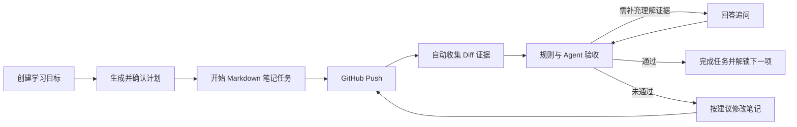
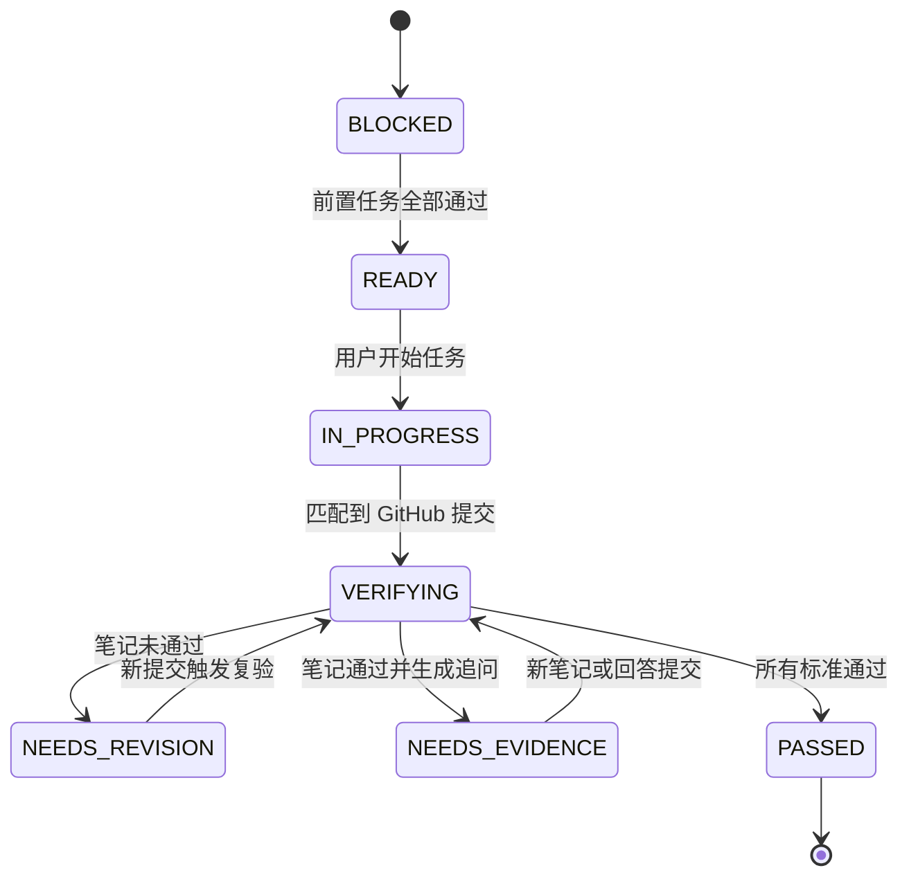
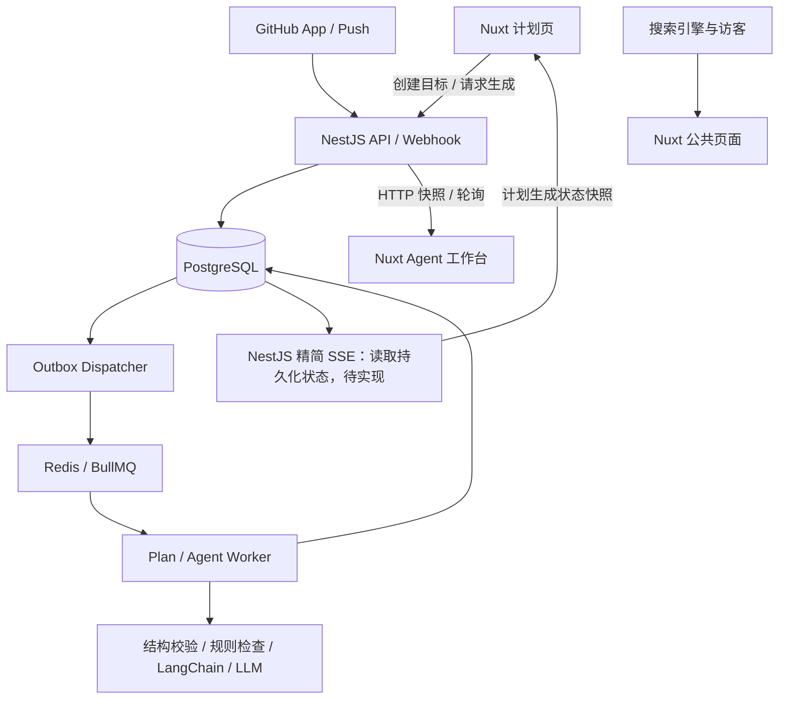

# KnowledgeOps Agent：9 月求职版产品需求文档

## 1. 文档信息

| 项目 | 内容 |
| --- | --- |
| 产品名称 | KnowledgeOps Agent（暂定） |
| 文档版本 | Job Edition V1.3：九月底投递减负版 |
| 文档日期 | 2026-07-30（2026-09-05 按用户确认重排） |
| 目标节点 | 最晚 2026-09-30 开始投递，不以完整产品或上线为前置（9/21 确认）；原 9/27 冻结、9/28 至 9/30 材料窗口暂不改 |
| 第一目标 | 作为前端日常实习项目，展示复杂前端、全栈与 AI Agent 工程能力 |
| 第二目标 | 验证“基于真实学习证据自动验收”的产品需求 |
| 目标用户 | 使用 GitHub 和 Markdown 准备开发岗位面试的学生与初中级开发者 |

### 1.1 本次已确认的范围调整

2026-09-05 用户确认：前端实习优先，九月底开始投递为硬目标。项目按工作日 2 至 3 小时、周末约 5 小时预算；算法和前端基础已有独立安排。学习与开发确定任务控制在 60 至 70 小时，具体状态以[现行开发计划](KnowledgeOps-Agent-逐日开发计划.md)为准。

本期保留真实 GitHub 提交、证据引用、笔记与回答验收、任务通过/解锁和可靠恢复；每次笔记通过后只生成一个必答追问。Monaco、额外报告视图、反馈系统、ReAct/额外工具循环及装饰性功能延期。

2026-09-16 用户确认：将精简 SSE 与 C2 前移至 R04 之后，优先在已有计划生成链路体现前端状态同步、快照恢复、版本一致性、订阅清理与轮询兜底能力，替换原 R13/R14，不增加第二份核心手写。完整历史事件时间线、cursor 重放及模型逐字流延期；快照恢复不等于事件重放。9/20 仍检查真实业务闭环与容量，但不再自动延期全部 SSE 或切换 C2。新规则见第 12.4、22 节；本次只授权计划调整，SSE 尚未实现，首次编码仍需范围讲解与授权。

2026-09-21 用户确认：保留原业务开发顺序，不采用“先上线已有计划生成版本、延后自动验收”的范围裁剪。R13/C2 已完成（`7000510` / `d7c2419`），后续继续 R05 至 R12、R15 至 R19。本文完整产品范围和真实上线目标保留，但不再承诺九月底全部交付；求职投递、面试与产品开发并行，完整闭环或上线不是开始投递的前提。未完成能力只能标注规划/开发中，不能以已写入简历或参加面试代替功能验收。原冻结和材料窗口暂不改，具体剩余容量与日期复核见现行开发计划；本轮未授权新阶段实现。

2026-10-13 用户确认：GitHub Push 改为两段式处理。Webhook 接收事务仅保存 Delivery、当时的绑定/任务上下文和取证 Outbox，提交后返回 202；后台取证确认存在需要验收的目标变更后，再原子保存提交/证据、创建或关联 AgentRun 与验收 Outbox。无关提交只记录原因、不创建验收运行；不把 GitHub 请求移入接收事务，不改变计划生成的 Run 创建时机。此调整协调原第 12.3 节与第 15.1 节，不新增框架或取消可靠性要求；实现进度以开发计划为准。

## 2. 产品定义

### 2.1 一句话定位

KnowledgeOps Agent 是一个 GitHub 驱动的开发者学习验收工具：用户确认学习计划后，通过向指定仓库提交 Markdown 笔记提供学习证据，系统自动分析 Diff、逐项验收内容并生成追问；只有笔记与追问均通过验收，任务才会完成并解锁后续任务。

### 2.2 核心价值

传统学习计划记录的是用户“声称完成了什么”，KnowledgeOps Agent 记录的是“经过证据和标准验证后完成了什么”。

产品不以聊天窗口为中心，而以以下闭环为中心：



### 2.3 9 月版本的产品边界

9 月版本只验证一个垂直场景：

> 用户为前端面试创建短期学习计划，通过 GitHub 提交 Markdown 笔记并回答 Agent 追问，系统自动判断任务是否通过。

本版本不是通用知识库、在线课程平台、完整刷题平台或任意代码执行平台。

## 3. 项目目标

### 3.1 求职目标

项目需要真实展示以下能力：

- Vue 3 与 TypeScript 复杂业务开发。
- Nuxt 混合渲染、SEO 与客户端工作台。
- 运行状态、Diff 与引用联动；计划生成精简 SSE 状态同步优先，完整事件时间线延期。
- 前端服务端状态管理、错误恢复和性能优化。
- NestJS、PostgreSQL、Redis 与 BullMQ 的全栈协作。
- Webhook 幂等、异步任务重试、取消与状态恢复。
- 结构化 LLM 输出、可追溯引用与效果评测。
- 真实部署、自动化测试、性能指标与故障演示。

### 3.2 产品目标

- 验证用户是否愿意用 GitHub 提交作为学习证据。
- 验证逐项验收报告是否比通用 AI 总结更有帮助。
- 验证追问是否能够发现“写进笔记但没有真正理解”的内容。
- 验证任务通过后自动解锁是否能够促进用户持续执行计划。

### 3.3 非目标

9 月版本不追求：

- 覆盖所有开发岗位和技术方向。
- 自动生成长期、极其精确的完整课程体系。
- 替代教师或面试官作出高风险评价。
- 大规模商业化、复杂权限体系或企业级多租户能力。
- 仅通过堆叠技术名词证明项目复杂度。

## 4. 目标用户与使用场景

### 4.1 核心用户

- 正在准备前端实习或校招的学生。
- 使用 GitHub 保存技术笔记的人。
- 容易制定计划但缺少验收和反馈的人。
- 希望用个人项目、笔记和回答证明学习结果的人。

### 4.2 首个场景

用户希望在数周内复习 JavaScript、浏览器、网络、Vue 和项目设计。

用户填写目标、截止日期、当前基础和每周可投入时间。系统生成一个包含 3 至 8 个 Markdown 笔记任务的短期计划。用户确认计划并开始任务，随后将笔记 Push 到关联仓库。

系统自动完成：

1. 获取本次 Push 的 Markdown Diff。
2. 判断提交是否满足文件、章节等确定性要求。
3. 按固定 Rubric 检查知识正确性、覆盖度和表达清晰度。
4. 对所有语义结论提供原文引用。
5. 生成一个必答理解追问。
6. 验收用户回答。
7. 通过后完成任务并解锁后续任务。

## 5. 产品原则

### 5.1 证据优先

- 用户不能无条件点击“完成任务”。
- 每个任务必须至少包含一项可执行验收标准。
- 每个验收结论必须关联证据，或明确说明缺少什么证据。
- 同一份 GitHub 提交不能重复完成同一任务。

### 5.2 确定性优先

- 文件是否存在、指定路径是否修改、标题是否出现等条件由程序判断。
- 只有知识正确性、覆盖度、表达质量和回答质量等语义问题交给 LLM。
- LLM 无法判断时返回“需补充证据”，不得强行通过或否定。

### 5.3 用户可控

- AI 生成的计划必须由用户确认后才能生效。
- 用户可以查看验收标准、引用、模型运行过程和失败原因。
- 用户可以修改笔记、重新提交、补充回答并获得修订建议；反馈系统延期。
- 9 月版本中的 Agent 工具全部只读，不执行外部写操作。

### 5.4 可恢复

- Webhook、队列任务和任务状态迁移必须幂等。
- 页面刷新或断网后必须从持久化数据恢复运行状态和已保存步骤；精简 SSE 以最新快照校准，不保证补齐每条历史事件。
- Worker 异常退出不能破坏已有学习计划或覆盖已保存结果。
- 重试创建新的运行记录，并保留此前失败尝试。

## 6. MVP 范围

### 6.1 P0：九月底投递版（精简 SSE 优先，完整事件重放延期）

#### 6.1.1 登录与仓库接入

- 使用 GitHub 完成用户登录。
- 用户安装 GitHub App，并只授权选中的仓库。
- 2026-10-27 确认：多个用户复用部署方统一的 GitHub App，各自建立 User/Session 与仓库绑定；R16 验证双用户权限和数据隔离，R17 开放 App 安装并以第二个真实 GitHub 账号验收登录、安装、绑定至任务完成的完整链路。本人账号已可用不等于其他账号接入已验收，具体证据与预算见开发计划 R16/R17 安排。
- 一个用户在 MVP 中只能绑定一个活动仓库。
- 2026-10-09 收窄：一个 GitHub 仓库同时最多由一个项目用户活动绑定，按 `githubRepositoryId` 独占，换安装或分支不能绕过；不支持多人共享仓库来分别推进学习。GitHub 访问授权与本项目绑定归属仍是两层检查，不要求绑定者一定是 GitHub 仓库所有者。
- 一个活动计划只监听一个配置分支，默认使用仓库默认分支。
- GitHub App 只申请读取仓库内容和接收 Push 所需的最小权限。
- 用户可以解除仓库绑定并停止后续分析。
- 解绑释放仓库的活动占用，其他具备权限的用户才可重新绑定；旧绑定、学习进度和已保存记录仍归原用户，不随仓库重绑转移。

#### 6.1.2 学习目标与计划

- 用户输入学习目标、截止日期、当前基础和每周可投入时间。
- 部署方通过服务端环境变量配置一个模型供应商、凭据和 1 至 2 个允许模型；用户只能从服务端返回的模型白名单中选择，不能提交 API Key、任意模型名或 Base URL。
- 用户选择作为后续默认模型偏好保存；每份计划草稿仍快照实际使用的供应商、模型、Prompt 版本和输出 Schema 版本，后续修改偏好不得改写历史记录。
- 系统生成 1 至 3 个阶段、共 3 至 8 个任务。
- 9 月版本只支持 `MARKDOWN_NOTE` 一种任务类型。
- 每个任务包含目标、预计耗时、建议步骤、目标文件路径、验收标准和前置任务。
- 系统必须校验任务依赖无环、截止时间合法、任务数量处于限制内。
- LearningGoal 先独立持久化；生成接口在同一 PostgreSQL 事务中创建 `PlanGenerationRun` 与 `OutboxEvent`，提交后返回 `202 Accepted` 和 `generationRunId`，不在 HTTP 请求内等待模型结果。
- Outbox Dispatcher 将生成意图可靠投递到 BullMQ，独立 Worker 通过 LangChain 适配器调用模型；前端现有轮询保留，按 9/16 计划接入 SSE 状态同步，持续连接失败时由轮询兜底，不改变生成与原子落库机制。
- 计划生成不提供规则或 Mock 降级；模型未配置、超时、调用失败或结构化输出非法时保留 LearningGoal，将本次生成运行标记为明确的失败终态且不得创建半份 Plan。
- 同一 LearningGoal 同时最多存在一个非终态生成运行；失败后重试创建新的 `PlanGenerationRun` 并关联旧记录，不复活或覆盖终态运行。
- 计划默认处于草稿状态，用户确认后才进入活动状态。
- MVP 同时只允许一个活动计划。

#### 6.1.3 今日任务与任务详情

- 首页展示当前可开始、进行中、验收中、需修订和等待回答的任务；等待后台验收时保留任务入口并显示“验收中”，不能误报“当前没有待处理任务”。
- 用户可以开始一个已经解锁的任务。
- 开始任务时，用户需要确认或选择目标 Markdown 文件路径。
- 任务详情展示目标、步骤、验收标准、证据、历次运行和报告。
- 同一时间只允许一个任务处于 `IN_PROGRESS` 或等待该任务验收的状态。

#### 6.1.4 GitHub Push 与证据收集

- 订阅目标仓库的 Push 事件。
- 只处理配置分支上的 Markdown 文件变更。
- 使用 Webhook 原始请求体和 `X-Hub-Signature-256` 校验来源。
- 使用 `X-GitHub-Delivery` 唯一标识实现 Delivery 幂等。
- Webhook 接口完成验签、本地绑定/任务查询与接收持久化后返回 `202 Accepted`，不等待 GitHub 比较或验收。
- 后台任务获取 `before` 与 `after` Commit 间的文件变更和 Diff。
- 提交与当前进行中任务的目标路径匹配时自动关联。
- 接收时在绑定用户的活动计划中选定唯一当前任务，固化绑定 ID/版本、taskId、任务版本和目标路径；等待修订、等待追问或正在验收的同一任务也占据当前任务位置。排队后的查询只复核原上下文，不能把旧 Push 转给后来开始的其他任务。接收时没有唯一当前任务或目标路径无效，只记录原因，不创建取证待办或验收运行。
- 接收时能够确认活动绑定的 Push，即使因无当前任务、目标路径无效或非跟踪分支而忽略，也在 Delivery 固定本项目的绑定记录 ID；原绑定的登录用户可查询“未进入取证”及安全原因，不提供取证重试按钮。解绑重绑不继承旧通知，非 Push、无绑定及无法确认历史归属的记录不按当前仓库号猜测展示。
- 未匹配、匹配多个任务或超出处理限制时，记录明确原因并展示不可处理状态；本期不增加人工多任务匹配界面。
- 保存 Commit SHA、文件路径、Diff、内容哈希和行号信息。

#### 6.1.5 自动验收

一次完整验收包含两个阶段。

第一阶段：笔记验收。

- 执行文件路径、文件变更、必需章节等确定性标准。
- 通过固定 Rubric 检查知识正确性、覆盖度和表达清晰度。
- 每项结果只能为 `PASSED`、`FAILED` 或 `INSUFFICIENT_EVIDENCE`。
- 每项语义结论必须附带文件路径、Commit SHA 和原文行号引用。
- 笔记存在可修订问题时，任务进入 `NEEDS_REVISION`。
- 笔记基本通过后，生成一个必答追问，任务进入 `NEEDS_EVIDENCE`。

第二阶段：回答验收。

- 用户在任务页提交追问回答。
- 系统按照与问题绑定的 Rubric 判断回答是否体现真实理解。
- 回答不充分时返回具体问题和补充建议。
- 追问必须绑定产生它的笔记 Submission、Commit SHA 和验收报告；较新的笔记提交生效后，旧追问不得再用于完成任务。
- 笔记标准与必答追问全部通过后，任务进入 `PASSED`。
- 任务通过后自动解锁满足依赖条件的后续任务。

#### 6.1.6 Agent 运行工作台

- 展示持久化运行状态、当前步骤、步骤耗时和整体耗时；前端请求错误不能伪造业务失败终态。
- 计划生成前移精简 SSE 与 TanStack Query 协调；笔记/回答 AgentRun 先保留轮询与刷新恢复，后续仅在容量允许时复用已验收机制，不另建一套恢复逻辑。
- 使用简单 Diff 文本与报告列表展示证据，点击引用定位到对应 Commit 文件行；本期不引入 Monaco 或额外报告视图。
- 支持运行中取消、失败后创建关联重试；刷新与运行 ID 切换后不得显示旧运行的结果。
- 精简 SSE 按 Run ID 与版本处理重复/旧快照，并正确清理订阅；首次连接、重连和刷新从持久化快照恢复。完整历史事件重放是九月后范围，不是本轮验收前提。
- 任何版本都必须处理加载、空、错误、断网和终态停止，不把内存缓存当作最终业务状态。

#### 6.1.7 报告

- 报告按验收标准逐项展示结果、理由、引用和修改建议。
- 展示追问、用户回答和回答验收结果。
- 保存模型、Prompt 版本、Token、耗时和估算成本。
- “有帮助”“结论错误”等反馈系统移入九月后 backlog，本期不创建对应 UI/API。
- 报告默认私有。

#### 6.1.8 公共页面

- 提供产品首页、核心流程、隐私说明和登录入口。
- 提供一个使用固定演示数据生成的公开示例报告。
- 产品首页和固定示例页面预渲染。
- 登录后的 `/app/**` 工作台使用客户端渲染并禁止搜索引擎索引。

### 6.2 P1：九月后再评估（本期不实现）

- Monaco Diff、额外报告视图和报告美化。
- 报告反馈系统及其 UI/API。
- 额外工具循环、ReAct 子循环；需有真实评测收益后再评估。

- 使用 PostgreSQL 全文检索查找相关旧笔记。
- 在报告中提示新旧笔记间可能存在的重复或冲突。
- 对长运行时间线启用虚拟列表。
- 使用 Web Worker 处理超出阈值的 Markdown 解析或 Diff 计算。
- 支持公开用户主动选择的脱敏报告。
- 增加固定评测集对不同 Prompt 版本进行对比。
- 增加基础周复盘，但只提供统计和建议，不自动修改计划。

### 6.3 P2：9 月后再考虑

- pgvector 和完整混合检索。
- 题目、代码和间隔复习等独立任务类型。
- 任意用户代码构建和测试。
- 自动大规模重规划。
- 多计划并行。
- 多 Agent 协作。
- MCP 外部工具生态。
- 飞书、日历、邮件和 GitHub Comment 发布。
- 公开学习模板市场、社区和排行榜。
- 原生移动端应用。

### 6.4 R18 前追加需求登记（2026-11-04）

用户确认 R17 已在 VPS 完成，希望在进入 R18 前补充以下内容，本次要求先记录：

- 构建完整 CI/CD 流：用户已选择将 Web/API/Worker 容器化，采用 GitHub Actions + GHCR + Docker Compose + SSH，保留宿主机 Nginx；先手动触发生产发布。CI 准备经过检查和镜像验证的版本，发布时核对所选提交 SHA 并按对应镜像摘要部署；串行发布、迁移备份、健康检查和兼容性约束下的回退仍待设计实现，不宣称已具备自动发布能力。
- 重构主页的前端界面：具体视觉、内容与交互方案到时讨论，沿用 DESIGN.md 的约束。
- 页面优化：目标页面、优化方向与衡量方式待讨论，不预设具体技术方案或效果指标。

用户随后确认 CI/CD 的 CD01 至 CD03 范围与 4 至 6 小时学习预算；CD01 已完成并提交（185f4a9）。11/5 继续进入 CD02，现有 CI 后接入镜像构建、隔离验证与 GHCR 交付记录；工程提交 2e47697 的三个 Actions job 已由用户观察通过，工作流职责导读已确认。用户确认四个包均为 Private、VPS 已全部拉取；CD02 短复述通过、用户实报约 25 分钟，状态 DONE 随本次本地收尾提交生效。完整摘要记录将在 CD03 选版时核对，不将镜像上传或拉取记作生产切换。CD03 已进入发布准备，待核对 VPS 当前状态和完整交付记录，尚未切换生产；主页重构和页面优化尚未启动，按[开发计划](KnowledgeOps-Agent-逐日开发计划.md)推进；原 R18/R19 演示及材料工作在其后继续，其他延期功能不随此记录自动恢复。

## 7. 明确非目标

以下内容即使文档或 UI 中出现入口，也不得进入 9 月版本开发范围：

- 聊天式通用 AI 助手。
- 无限制导入任意知识库。
- 任意仓库代码审查。
- 任意 Shell 命令或用户代码执行。
- 自动修改仓库、创建 Issue 或提交代码。
- 复杂拖拽式计划编辑器。
- 通用课程、视频和内容市场。
- 社交动态、好友、排行榜和连续打卡补签。
- 企业组织、角色、团队协作和计费系统。
- 为了展示技术而同时使用多个模型、多个队列或多个向量数据库。

## 8. 核心用户流程

### 8.1 首次使用

1. 用户访问产品首页并使用 GitHub 登录。
2. 用户安装 GitHub App，选择一个学习仓库。
3. 系统显示所需权限、数据用途和模型处理说明。
4. 用户输入学习目标并生成计划草稿。
5. 用户查看阶段、任务、依赖和验收标准。
6. 用户确认计划，首个无前置依赖的任务进入 `READY`。

### 8.2 执行笔记任务

1. 用户在“今日学习”中开始任务。
2. 用户确认本任务对应的 Markdown 路径。
3. 用户在本地编写笔记并 Push。
4. Webhook 保存 Push 的接收记录、任务上下文和取证待办，返回 202；后台确认存在需要验收的目标文件变更后创建验收运行。
5. 工作台展示取 Diff、解析、规则验收和语义验收状态；本期通过轮询或验收通过的 SSE 更新。
6. 若笔记需修改，用户根据引用和建议再次 Push。
7. 若笔记通过，系统生成一个必答追问。
8. 用户回答追问并查看第二阶段验收过程。
9. 全部通过后任务完成，下一任务自动解锁。

### 8.3 失败恢复

1. 运行失败时，任务保留原业务状态，不直接判定为未通过。
2. 页面展示失败步骤、错误分类和是否可以重试。
3. 用户点击重试后创建新的 `AgentRun`，通过 `retryOfRunId` 关联旧运行。
4. 已完成的确定性步骤可读取持久化结果，避免无意义重复计算。
5. 页面断线重连后重新读取持久化运行快照；精简 SSE 不补拉每条历史事件，也不将连接错误标记为运行失败。

笔记关联重试复用原 Submission 与固定 Commit 证据，适用于 FAILED、TIMED_OUT、CANCELLED 的最新笔记运行；不把报告中的单项未通过等同于运行执行失败。创建前复核原活动绑定、目标路径、最新提交、Run/Task 版本、任务稳定状态与无其他活动运行，并原子创建新 Run、更新 Task 和保存 Outbox。同一来源 Run 只创建一个直接后继，响应丢失或重复操作返回已有后继；后继再次失败时从后继继续重试。旧运行与报告保持不变，查询提供来源及后继链接；新运行独立取得执行配置和预算，修改笔记正文则通过新的 Push 提交。

回答关联重试复用原 AnswerSubmission、追问及固定笔记证据，不创建新答案或覆盖原运行。仅最新回答的 FAILED、TIMED_OUT、CANCELLED 运行可在原绑定、最新笔记/追问和 Task 版本仍有效时创建后继；同来源防重、新 Run 与 Task/Outbox 原子写入沿用笔记重试规则。页面以 answerId 选择回答、answerRunId 选择该回答的验收运行；未指定运行时保留首次验收入口，来源/后继链接支持历史查看，刷新不会自动 POST。运行成功但回答结论未通过时，应修改并提交新答案，不能借执行重试刷新结论。

## 9. 状态模型

### 9.1 计划状态

| 状态 | 含义 |
| --- | --- |
| `DRAFT` | AI 已生成但用户尚未确认 |
| `ACTIVE` | 已确认且正在执行 |
| `PAUSED` | 用户暂停，不再开放新任务 |
| `COMPLETED` | 所有未跳过的必要任务均已通过 |
| `ARCHIVED` | 用户终止或归档 |

### 9.2 学习任务状态



状态规则：

- 只有验收流程可以将任务设置为 `PASSED`。
- Agent 运行启动时记录 `taskStateBeforeRun`。运行失败、取消或超时后，通过乐观锁恢复到该稳定状态，不得永久停留在 `VERIFYING`。
- `NEEDS_REVISION` 表示证据明确未达到标准。
- `NEEDS_EVIDENCE` 表示现有内容不足以判断掌握程度，不表示失败。
- 逾期是由截止时间和当前任务状态计算出的调度标记，不进入任务主状态机，也不阻止用户继续完成任务。
- 状态迁移必须校验当前版本，防止并发运行覆盖新状态。

### 9.3 Agent 运行状态

| 状态 | 含义 |
| --- | --- |
| `QUEUED` | 已持久化并等待 Worker |
| `RUNNING` | Worker 正在执行 |
| `CANCEL_REQUESTED` | 用户已请求取消，等待安全终止 |
| `SUCCEEDED` | 本次运行完成并产生有效结果 |
| `FAILED` | 因可记录错误终止 |
| `CANCELLED` | 已完成协作式取消 |
| `TIMED_OUT` | 超过运行时间限制 |

运行规则：

- 取消必须由 Worker 在步骤边界检查取消信号，不能依赖强制删除活动 Job。
- 每次重试生成新的运行记录，不覆盖失败运行。
- 每个运行只允许一次终态迁移。
- Agent 运行与学习任务使用不同状态字段和状态机。

## 10. 验收标准模型

### 10.1 标准类型

| 类型 | 执行者 | 示例 |
| --- | --- | --- |
| `FILE_CHANGED` | 程序 | 正常 Push 中指定 Markdown 文件发生变化；15.5 的显式单点快照重新同步模式免检 |
| `SECTION_PRESENT` | 程序 | 笔记包含“事件循环”章节 |
| `CONTENT_MINIMUM` | 程序 | 有效正文或代码块达到最小要求 |
| `SEMANTIC_CORRECTNESS` | Agent | 对宏任务与微任务顺序的描述正确 |
| `TOPIC_COVERAGE` | Agent | 覆盖任务要求的关键知识点 |
| `EXPLANATION_QUALITY` | Agent | 能用自己的语言解释因果关系 |
| `FOLLOW_UP_ANSWER` | Agent | 能正确回答基于笔记生成的理解追问 |

### 10.2 单项验收结果

```ts
type CriterionOutcome =
  | 'PASSED'
  | 'FAILED'
  | 'INSUFFICIENT_EVIDENCE'

interface CriterionResult {
  criterionId: string
  outcome: CriterionOutcome
  rationale: string
  suggestions: string[]
  citations: Citation[]
  confidence: number
}
```

`confidence` 只用于展示模型不确定性和后续评测，不能绕过必要标准。

2026-10-16 确认：仅对 15.5 中用户主动发起的单点快照重新同步，`FILE_CHANGED` 不适用，不参与本次必要标准汇总。必须记录快照模式与免检原因，不能将其伪报为已证明变化的 `PASSED`；也不因这项免检单独判为 `INSUFFICIENT_EVIDENCE`。其他适用标准仍使用上述三种结果，不提供任意免检机制。

### 10.3 引用模型

每条引用至少包含：

- `repositoryId`
- `commitSha`
- `path`
- `startLine`
- `endLine`
- `excerpt`
- `contentHash`

引用必须能够在对应 Commit 快照中重新定位。引用失效或无法定位时，该条语义结论不得作为通过任务的唯一依据。

回答验收另保存 `answerCitations`，以不可覆盖的 `answerSubmissionId`、起止行号和原文定位用户答案，不为回答伪造 GitHub 路径或 Commit；笔记引用仍遵循上述规则。2026-10-28 单次回答验收入口已实现两类引用的分别核对：通过/失败判断均要求两类非空引用，证据不足可如实缺少对应引文；候选中任何伪造或越界引用均拒绝。同日回答消费与报告保存接入，落库前再次核对引用和来源；当前验证使用真实数据库/队列配模拟模型，不代表真实模型语义判断已被证明正确。

### 10.4 任务通过规则

- 所有适用的必要确定性标准均为 `PASSED`；唯一的模式例外是 15.5 单点快照重新同步中的 `FILE_CHANGED`。
- 所有必要语义标准均为 `PASSED`。
- 所有必答追问均为 `PASSED`。
- 任一必要笔记标准为 `FAILED` 时进入 `NEEDS_REVISION`；可选标准仍按下方建议规则处理。
- 追问回答为 `FAILED` 时保留在 `NEEDS_EVIDENCE`，允许用户修改回答；它不会错误地把笔记标记为需修订。
- 任一必要标准为 `INSUFFICIENT_EVIDENCE` 时进入 `NEEDS_EVIDENCE`。
- 可选标准失败只生成建议，不阻止任务通过。

`FOLLOW_UP_ANSWER` 是服务端保障的固定要求：每个笔记 Task 有且仅有一条 required=true 的追问标准，
模型只生成笔记标准。旧任务的兼容补齐不得改变已开始运行的验收上下文或历史报告；具体问题在笔记验收满足出题条件后生成。

## 11. Agent 工作流

### 11.1 设计原则

9 月版本使用受控、可预测的工作流，不实现无限循环的开放式 Agent。

用户等待和 Agent 运行必须分离，不允许 Worker 在等待用户回答期间保持活动。一次笔记提交创建 `NOTE_VERIFICATION` 运行；用户提交追问答案后，再创建独立的 `ANSWER_VERIFICATION` 运行。

2026-10-27 回答受理接入：答案以 `AnswerSubmission` 引用原 `FollowUpQuestion`，沿报告与笔记 Run 追溯固定笔记 Submission；不伪造 GitHub 提交字段。API 根据登录身份、原题来源、最新笔记、任务版本和运行状态确认资格，原子保存答案、Task 新版本、独立回答 Run 和 Outbox 后返回 202。同题同 requestId 且内容/期望版本一致时复用原受理凭据；修改内容后提交使用新请求编号，并要求当前没有活动运行。较新笔记生效后旧题不可新建回答运行，历史受理凭据的重放不产生新执行。本小段只完成受理与所属用户查询；消费者/模型验收尚未接入，回答 Outbox 保留待处理，202 不代表回答已通过。

2026-10-28 消费接入：回答 Outbox 经 BullMQ 交给独立 Processor；领取与最终保存均复查原题、最新笔记、绑定及任务版本。回答 Run 复用执行账本机制，独立冻结模型/价格/预算；已有完整结果可恢复落库而不重复调用，未确认的执行不重新领取额度。报告与 Run 终态原子保存，所属用户可经答案查询接口读取报告与运行状态。合法的不通过判断仍是执行成功，Task 汇总和解锁留给 R11；本次未验证真实回答模型效果或部署 VPS。

2026-10-28 R11 工程接入：笔记/回答 Finalizer 现调用结果汇总并原子更新 Task 状态与版本。回答通过后，在同一事务将同一 ACTIVE Plan 内、所有前置均已通过的直接后续任务从 BLOCKED 改为 READY，用户仍需主动开始；不自动创建后续 Run 或递归通过任务。沿用用户行锁协调并发，重复发布不重复递增版本，解锁失败连同报告和当前 Task 通过一起回滚。已完成合成模型与真实数据库验证，真实完整闭环、模型评测及生产更新尚待执行。

2026-10-29 验证补充：本地真实 GitHub Push→笔记报告/追问→已登录会话提交回答→回答报告→Task PASSED 与下一项 READY 已通过，用户已观察页面状态。回答使用用户要求的 AI 参考答案，仅作工程链路证据。另完成 18.4 的 15 份固定合成样本评测，v2 单项结论一致性 15/16、引用可定位 21/21，保留含糊笔记误判；样本与统计局限见 [R11 评测记录](evaluation/r11-fixed-evaluation.md)。R12 报告/回答页面与最新生产发布仍未完成，小样本结果不代表生产准确率。

笔记验收运行由以下显式步骤组成：

1. `collect_evidence`
2. `parse_markdown`
3. `run_deterministic_checks`
4. `prepare_context`
5. `evaluate_note`
6. `generate_follow_up_questions`
7. `finalize_report`

回答验收运行由以下显式步骤组成：

1. `collect_answer_evidence`
2. `load_note_verification`
3. `evaluate_answers`
4. `finalize_report`

每个步骤保存输入摘要、输出、耗时和错误。步骤之间只传递经过 Schema 校验的结构化数据。

### 11.2 LangChain 使用边界

P0 选择性引入 LangChain，复用其标准模型接口、模型供应商集成、Zod 结构化输出、工具包装及必要的调用中间件，但不让通用 Agent 框架接管业务工作流、业务状态或持久化真相源。

- 计划生成可以独立调用 LangChain 模型与结构化输出能力，不因此启动 Agent 循环。
- P0 的模型凭据和允许模型目录由部署方配置。业务 API 只接受目录中的稳定模型 ID，LangChain 适配层再把它解析为具体供应商、模型与服务端凭据。
- `packages/agent-core` 负责框架无关的验收用例接口、显式步骤编排和领域输入输出；LangChain 类型只能存在于模型、工具和中间件适配实现中，不得泄漏到 `packages/contracts`、REST DTO、Prisma 模型或前端协议。
- `PlanGenerationRun` 表示一次独立的计划生成尝试，由项目状态机、Outbox、BullMQ 和 Worker 驱动；它不复用与 Task 强绑定的 `AgentRun`，LangChain 内部状态也不能直接决定其终态。
- `AgentRun` 表示一次完整的笔记或回答验收尝试，`AgentStep` 表示本项目定义的显式业务步骤；一次 LangChain 模型调用、工具调用或内部重试只是某个步骤下的技术子调用，不自动成为新的业务状态。
- P0 不启用 LangGraph Checkpointer、长期 Memory 或 Thread 作为恢复机制。PostgreSQL 中的 `PlanGenerationRun`、`AgentRun`、`AgentStep` 和业务实体是持久化真相源；`RunEvent` 完整历史日志按 9/16 取舍延期，不作为精简 SSE 的新增前置依赖。
- 九月版不引入 ReAct 子循环或额外工具循环；按显式步骤准备证据并调用模型。九月后只有固定评测证明收益，才重新评估只读且受预算约束的子循环。

### 11.3 只读取证接口

九月版按显式步骤调用项目已有只读取证用例，不为通用 Agent 循环增加注册器或额外抽象。取证范围仅限：

- `get_commit_diff`
- `read_file_at_commit`
- `get_task_requirements`
- `get_previous_submission`

P1 可增加：

- `search_repository_notes`

工具约束：

- LangChain `tool` 只包装项目拥有的只读用例接口；仓库授权、路径限制和数据访问仍由项目服务校验，工具不得直接获得业务写入 Repository。
- 每次运行限制工具调用次数、上下文长度、Token 和总耗时。
- 仓库内容始终被视为不可信数据，不能改变系统指令或工具权限。
- 工具不得访问未绑定仓库或未授权路径。
- 工具参数和返回结果必须记录，但不得在日志中泄露密钥。

### 11.4 结构化输出

- 项目定义的 Zod Schema 是结构化输出契约真相源，可交给 LangChain 的结构化输出接口执行供应商适配与运行时解析；不得把 `AIMessage` 等框架对象直接作为业务结果持久化。
- 所有 LLM 输出使用运行时 Schema 校验。
- Schema 不合法时允许有限次数的修复重试。
- 计划生成阶段不使用规则或 Mock 结果替代失败的真实模型调用；失败运行进入终态并允许用户创建关联重试。
- 修复失败后运行进入 `FAILED`，不得用不完整结果修改任务状态。
- 保存模型标识、Prompt 版本和输出 Schema 版本。

### 11.5 Prompt Injection 防护

- 使用明确的数据边界包裹仓库内容。
- 系统提示中声明仓库文本只用于分析，不是可执行指令。
- P0 工具全部只读，不提供外部写权限。
- 不根据仓库文本动态扩展工具列表。
- Markdown 渲染关闭原始 HTML或经过严格清洗。
- 不自动抓取笔记中的外部链接，避免 SSRF。

### 11.6 调用预算与重试分层

- 模型瞬时错误重试和结构化输出修复必须计入所属 `PlanGenerationRun` 或 `AgentRun` 的统一模型调用次数、Token、成本和总耗时预算；验收阶段的只读工具重试还要计入同一 `AgentRun` 的工具预算。
- LangChain 中间件、模型供应商 SDK 与 BullMQ 不得分别使用互不知情的默认重试，避免一次失败形成乘法级调用放大。
- 2026-10-26 用户确认：调用结束后才获知 Token/费用超额或用量缺失，不因此丢弃已通过结构、标准身份、引用及时效检查的合法验收结果；保留结果并单独记录预算/记账警告，不再追加模型调用。没有合法结果且预算耗尽或用量未知时停止修复；此规则不放宽权限、旧证据、超时、取消及终态保护，不把费用估算描述为供应商事前硬额度或实际账单。
- BullMQ 负责 Job 投递和 Worker 级故障重试；`PlanGenerationRun` 或 `AgentRun` 已进入终态后，用户重试必须创建同类新运行并通过 `retryOfRunId` 关联旧记录。
- 每次模型调用、工具调用、修复重试和错误分类都要关联 `runId`、`stepId` 与尝试序号，但内部调用记录不能越权修改 Task 或 Report。

## 12. 技术架构

### 12.1 总体架构



### 12.2 可靠性边界

PostgreSQL 是以下数据的真相源：

- 用户、仓库和计划；
- `PlanGenerationRun`；
- 任务状态；
- Webhook Delivery；
- Evidence、Submission 和 Report；
- AgentRun、AgentStep；RunEvent 完整事件日志为九月后重放设计；
- Outbox 事件。

Redis 只负责：

- BullMQ 队列；
- 短期缓存和限流；
- 取消信号；
- 实时事件通知（九月后完整事件方案；精简 SSE 不强制新增 Pub/Sub）。

不得仅在 Redis 中保存不可恢复的任务状态或运行结果。

LangChain 的消息历史、Agent 内部状态和可选追踪数据也不得成为业务恢复依据。若 P1 以后评估 LangGraph 持久化，必须先用 ADR 明确 Checkpoint 与 `PlanGenerationRun`、`AgentRun`、`AgentStep`、`RunEvent` 的映射和唯一真相源。

### 12.3 Outbox 与队列一致性

计划生成请求在一个 PostgreSQL 事务中：

1. 为已经持久化的 LearningGoal 创建 `QUEUED` 的 `PlanGenerationRun`。
2. 插入对应的 `OutboxEvent`。

事务提交后返回 `202` 与 `generationRunId`。模型配置无效时在创建运行前明确失败；一旦事务提交，Dispatcher 和 Worker 必须能够在浏览器断开后继续处理。

GitHub Push 按两段式事务处理（2026-10-13 确认）。Webhook 请求在第一个 PostgreSQL 事务中：

1. 插入具有唯一 Delivery ID 的 `WebhookDelivery`。
2. 锁定绑定用户并复核原绑定，在 Delivery 固定接收绑定 ID；确认分支可处理后，查询其活动计划中唯一当前任务，把原绑定 ID/用户/版本、taskId/任务版本/目标路径保存为取证上下文。
3. 为有明确上下文的 Push 插入取证 `OutboxEvent`，与 Delivery 和上下文一起提交。已明确忽略的事件只保存原因，不写待办；此时不创建 Submission/AgentRun，不推进 Task 到 VERIFYING。

第一个事务提交后即可返回 `202`。独立 Dispatcher 将取证 Outbox 加入 BullMQ，并在成功后标记已分发；必须能够扫描和补发未分发事件。取证 Job 可以依据 Delivery 和上下文执行，不以 AgentRun 已存在为前提；接收成功不代表已经比较、验收或入队成功。

Worker 在数据库事务之外获取安装 Token、按固定 before/after 读取 GitHub，并在步骤边界复核原绑定。确认存在需要验收的目标变更，或已按 15.5 显式取得合法的单点快照后，第二个 PostgreSQL 事务锁用户并复核原绑定、任务身份/目标路径/版本与适用状态，幂等保存 Submission/Evidence、创建或关联 AgentRun、保存验收 Outbox 及相应业务状态；事务失败整组回滚，取证 Job 重试不得重复创建有效结果。网络调用不占用这两个事务中的行锁。

正常 Push 无 Markdown/目标文件变更时仅持久化忽略原因或提交摘要，不创建 AgentRun；删除目标文件按第 15.2 节保存删除证据，不触发语义验收。取证失败必须保留可查询原因及重试依据，不能因尚无 AgentRun 就丢失处理状态；后续页面区分接收/取证状态与验收运行状态。重复 Delivery 复用原接收记录，不能改用当前任务重建旧上下文；缺少任务快照的历史待办不得靠查询当前任务自动补齐并执行。

2026-10-18 接收忽略反馈补齐：接收归属独立于是否创建 Outbox，查询仍只允许当前活动绑定的所有者读取该绑定原先接收的最近 20 条通知。新绑定不能认领旧 Delivery；历史归属仅可从原 v2 Outbox 已冻结且核验一致的绑定/用户材料补齐，缺少材料则保留未知，不重选任务、不制造待办。无任务通知即使后来开始任务并重投同一 Delivery，也仍复用原忽略结果。

普通取证失败的手动恢复复用原接收材料，不复活或重建 AgentRun（2026-10-15 小步接入）。登录用户以 Delivery ID 和所见失败的尝试次数提交恢复命令；API 复核原活动绑定/版本、原任务/版本/路径和允许重试的失败类型，在同一短事务内保存恢复 Outbox 与 Delivery 当前恢复请求指针，再返回 202。恢复 Outbox 引用原接收 Outbox，并保存前次失败时间、代码及次数，不改写原 Commit SHA 或任务上下文。同一失败快照的重复点击返回同一请求；执行仍由 Dispatcher/Worker 完成，不在 HTTP 内访问 GitHub。旧恢复请求的迟到成功或失败不能覆盖新请求，原最终落库的权限、版本及幂等检查继续有效。基准不可读 RESYNC_REQUIRED、坏输入、已忽略/已完成或尚未结束的尝试不作为普通失败重新执行；重新同步使用 15.5 的独立显式命令，不以普通重试替代。

2026-10-16 重新同步接入：恢复 Outbox v2 显式冻结 DIFF/SNAPSHOT 模式，旧 v1 仅按 DIFF 读取；Redis 仍只传原接收 ID 和恢复请求 ID。快照读取后的普通暂时性失败可以再重试，但必须继承快照模式。Finalizer 在持锁事务内核对当前恢复请求和证据模式，不能由 Reader 自行宣布免检；Evidence.mode=SNAPSHOT 记录“显式全文重新同步”的唯一 FILE_CHANGED 免检依据，change/diff/previousPath 为 null。取证交接只创建 QUEUED 的验收运行，确定性检查、正文判断及追问仍属于后续 M4，不能把本段当作验收已通过。

2026-10-20 故障收尾：取证进程退出或数据库连接全断时，最终失败可能只留在 Redis Job 中。Worker 复用原轮询，分批核对仍 ACCEPTED 且尚未记最终失败的 Delivery；按原接收事件和当前恢复请求定位保留 Job，仅对最终 failed 补记固定安全错误码与失败时间。更新须同时匹配状态、恢复请求、尝试次数及最近尝试时间，不能覆盖已成功/忽略或新一轮结果；对账本身不执行取证、不重投 Outbox、不改 Task 或 AgentRun。缺失、等待中、运行中或已完成的 Job 不被猜成失败，数据库或 Redis 暂时不可用则等待下一轮。该恢复依赖 Job 仍被保留，不宣称 Redis 数据丢失也可自动恢复。

尝试登记可能因断连未写入 PostgreSQL：对账以“当前恢复请求冻结的前轮累计次数 + 当前 Job 的实际领取次数 attemptsStarted”补足累计次数下限，不降低已有次数、不伪造正文读取；原始请求的前轮次数为零。后续显式恢复继续使用该累计值作为所见版本，避免连续失败的恢复请求命中同一旧防重键。自动尝试耗尽后只补可查询的取证失败，不无限自动恢复；用户仍经原身份/绑定/任务版本检查显式重试。

BullMQ Job ID 使用稳定的业务键，例如：

```text
plan-generation-{runId}
evidence-{deliveryId}
evidence-{deliveryId}-retry-{retryEventId}
note-verification-{runId}
answer-{taskId}-{answerSubmissionId}-{workflowVersion}
```

初次取证 Job 按 Delivery ID 去重，手动恢复 Job 再绑定持久化的恢复请求 ID；各请求复用既有有限自动重试策略，不添加另一层无限自动重试。笔记验收的 Submission 按仓库绑定/任务/提交/流程版本保持业务幂等，初始 Run 唯一引用 Submission；队列按持久化 runId 去重，使后续关联重试 Run 可保留独立执行记录。自定义 Job ID 使用连字符，不使用 BullMQ 保留为 Redis 键分隔符的冒号。稳定 Job ID 只负责队列内的第一层去重，Job 被自动清理后不能继续提供永久幂等；PostgreSQL 唯一约束、运行终态和条件更新才是最终防线。

即使发生重复生成请求、重复 Delivery、重复入队或 Worker 重试，也只能产生一份有效业务结果。计划生成 Worker 只有在完整结果通过 Schema、数量、日期和 DAG 校验后，才能用单个事务创建 Plan 图并把运行推进到 `SUCCEEDED`；重复消费已经终态的运行必须返回既有结果。

### 12.4 精简 SSE 状态同步与延期的事件重放

#### 本期：PlanGenerationRun 最新快照同步（待实现）

- 保留 HTTP 状态查询与已有退避轮询；初次读快照后订阅，订阅建立/重连必须校准当前持久化状态，避免查询与订阅之间的变化或掉线期间的终态丢失。不得只依赖下一条通知。
- SSE 只传经过契约验证的运行状态快照或触发快照读取的通知；有效更新须携带或取得 Run ID 与版本。前端统一通过版本判断更新 Query，旧 HTTP 响应、旧连接消息、重复数据不得覆盖新状态。
- API 校验当前用户对 Run 的权限，并处理会话失效、连接上限、心跳和资源释放。Worker 与 API 是独立进程，必须从持久化状态跨进程获取变化，不能使用只在一个进程内有效的 emitter 冒充产品链路。不为本轮强制引入 RunEvent、cursor 或 Pub/Sub；若服务端采用有界数据库检查，应记录真实实现与查询成本，不宣称全链路消除了轮询。
- 连接状态与业务状态分离；断线不将 Run 改成 FAILED。切换 Run、卸载、退出及终态关闭连接和计时器。鉴权失败停止订阅并走会话恢复，不能无限重连或轮询；连续传输故障可切到已有轮询，正常 SSE 与兜底不长期双跑。
- 第一轮只面向计划生成状态，不展示未校验的半份 Plan，不提供模型 Token 流。后端装配由 AI 完成，C2 只手写有界快照归并与恢复协调。
- 部署必须验证代理不缓冲、长连接/心跳与断开清理；HTTP 快照仍为恢复依据。本地连接成功不代表生产 SSE 通过。

#### 九月后：完整持久化事件时间线（DEFERRED）

以下是保留的后续设计，不是精简 SSE 的隐含任务，也不是当前已实现能力。完整事件方案要求先写 RunEvent 再发布通知；基本运行恢复继续读持久化快照和已保存步骤。

事件至少包含：

```ts
interface RunEvent<T = unknown> {
  id: string
  runId: string
  sequence: number
  stepId?: string
  type: string
  payload: T
  occurredAt: string
  schemaVersion: number
}
```

未来完整事件 SSE Gateway 行为：

1. 校验用户是否有权访问运行。
2. 根据客户端的最后事件 ID 查询并发送历史缺失事件。
3. 切换到 Redis 实时通知。
4. 定期发送心跳，避免代理空闲超时。
5. 断开连接后清理订阅。

前端按 `(runId, sequence)` 去重和排序，不以网络到达顺序直接修改最终业务状态。

### 12.5 前端架构

| 技术 | 用途 |
| --- | --- |
| Nuxt 4 | 路由、公共页面和混合渲染 |
| Vue 3 | 工作台与复杂交互 |
| TypeScript | 组件、API 与事件协议类型 |
| TanStack Query for Vue | 服务端数据缓存、失效和重试 |
| Pinia | 登录会话外的少量界面状态、筛选器和临时交互 |
| Tailwind CSS | 样式与基础设计系统 |
| 简单 Diff 文本与行号锚点 | 本期 Markdown Diff 和引用定位；Monaco 延期 |
| SSE 状态同步 / 轮询兜底 | 计划生成优先；校验快照恢复、版本隔离与清理，不宣称完整事件重放 |
| Vitest | Composable、Reducer 和组件测试 |
| Playwright | 完整用户闭环与断线恢复测试 |

状态职责：

- 计划、任务、运行和报告属于服务端状态，统一交给 TanStack Query。
- PlanGenerationRun 目前使用有退避的 Query 轮询；精简 SSE 接入后仅在持续连接失败时启用轮询兜底，终态或页面卸载后停止；刷新从服务端恢复，不把计时器或运行实体复制到 Pinia。
- Pinia 不复制服务端实体，只保存跨页面 UI 状态。
- SSE 与 HTTP 返回的快照经过 Run/版本判断统一更新 Query；连接状态单独维护，旧运行结果不得污染当前页面。历史事件 Reducer 与重放留给九月后。
- 本期不引入 Monaco；后续采用时只在详情页客户端按需加载，不进入公共首页首屏包。

### 12.6 后端架构

| 技术 | 用途 |
| --- | --- |
| NestJS | API、Webhook、SSE 与模块边界 |
| Express Adapter | HTTP 运行时 |
| REST / OpenAPI | 业务 API 和契约文档 |
| PostgreSQL | 业务、运行、事件和审计数据 |
| Prisma | 常规数据模型、迁移和访问 |
| Redis | BullMQ、通知、限流和取消信号 |
| BullMQ | 异步计划生成与验收任务 |
| LangChain（选择性使用） | 标准模型接口、供应商集成、Zod 结构化输出、只读工具包装和受控调用中间件 |

P0 不使用 pgvector。若 P1 引入 PostgreSQL 全文检索，检索逻辑放入独立 `retrieval` 模块，避免与 Agent 流程耦合。

LangChain 只位于计划生成或 `agent-core` 的模型与工具适配层。显式工作流、状态机、事务、幂等、引用校验和最终业务决策保持框架无关，API、Worker 与共享契约不得直接依赖 LangChain 消息类型。

### 12.7 Monorepo 结构

```text
knowledgeops-agent/
├─ apps/
│  ├─ web/                 # Nuxt 公共站与工作台
│  ├─ api/                 # NestJS API、Webhook 与 SSE
│  └─ worker/              # BullMQ Worker、计划生成与 Agent 工作流
├─ packages/
│  ├─ contracts/           # DTO、Zod Schema、事件协议和共享类型
│  ├─ agent-core/          # 工作流、Prompt、工具与模型适配
│  ├─ markdown/            # Markdown AST、Diff 与引用定位
│  └─ observability/       # 日志、Trace ID 与指标封装
├─ prisma/
│  ├─ schema.prisma
│  └─ migrations/
├─ tests/
│  ├─ fixtures/
│  ├─ integration/
│  └─ evaluations/
└─ deploy/
   ├─ compose.yaml
   └─ reverse-proxy/
```

避免在实现尚未需要时继续拆分包或微服务。API 与 Worker 可以使用相同代码仓库、不同进程部署。

## 13. 核心数据模型

| 实体 | 关键职责 |
| --- | --- |
| `User` | 用户身份、时区与允许模型目录中的默认模型偏好 |
| `GitHubInstallation` | GitHub App Installation ID 与授权状态 |
| `Repository` | 绑定仓库、默认分支和启用状态 |
| `LearningGoal` | 目标、截止日期、基础和时间预算 |
| `PlanGenerationRun` | 一次持久化计划生成尝试、模型/Prompt/Schema 快照、错误、耗时和关联重试 |
| `Plan` | 完整生成并通过校验的计划版本、确认状态及对应成功生成运行 |
| `Stage` | 计划阶段 |
| `Task` | Markdown 任务、依赖、状态和目标路径 |
| `AcceptanceCriterion` | 验收标准、必要性和执行类型 |
| `WebhookDelivery` | Delivery 幂等与处理状态 |
| `Submission` / `AnswerSubmission` | 分别保存一次 GitHub 笔记提交与一次绑定原追问的回答提交 |
| `Evidence` | 笔记 Diff 与文件快照；回答正文保存在 AnswerSubmission，检查结果进入报告 |
| `FollowUpQuestion` | 与笔记 Submission 和验收报告绑定的追问及 Rubric |
| `AgentRun` | 一次 `NOTE_VERIFICATION` 或 `ANSWER_VERIFICATION` 独立执行尝试 |
| `AgentStep` | 工作流步骤及其输入输出摘要 |
| `RunEvent` | 九月后完整历史重放设计，DEFERRED；精简 SSE 不要求此表 |
| `VerificationReport` | 一次验收的整体报告 |
| `CriterionResult` | 单项标准结论 |
| `Citation` | 指向 Commit 文件行的证据引用 |
| `UserFeedback`（延期） | 后续报告反馈；本期不新增对应模型、迁移或接口 |
| `OutboxEvent` | PostgreSQL 到 BullMQ 的可靠分发记录 |

关键约束：

- `Repository` 分别以 `userId`、`githubRepositoryId` 建立仅限 `enabled = true` 的唯一约束，保证一人一个活动仓库、一仓库一个活动用户；停用的历史绑定不受活动唯一性限制，也不自动删除。
- Webhook 接收与后续执行须校验绑定 ID、用户与绑定版本；解绑/重绑不能让旧接收意图或旧证据被转给新的绑定者。
- `WebhookDelivery.deliveryId` 唯一。
- 九月后实现完整事件方案时，`RunEvent(runId, sequence)` 唯一；不是当前精简 SSE 的迁移任务。
- 同一 LearningGoal 同时最多存在一个 `QUEUED` 或 `RUNNING` 的 `PlanGenerationRun`。
- `PlanGenerationRun` 正常路径为 `QUEUED → RUNNING → SUCCEEDED/FAILED/TIMED_OUT`，超过持久化 `deadlineAt` 的 `QUEUED` 也可由清理任务条件更新为 `TIMED_OUT`；终态不可逆，重试创建带 `retryOfRunId` 的新记录。
- `PlanGenerationRun` 只有在 Plan、Stage、Task、Criterion 与依赖关系全部原子写入后才能进入 `SUCCEEDED`；重复 Job 不得创建第二份同版本 Plan。
- 同一任务、Commit、工作流版本只能有一个有效验收结果。
- `Task` 使用版本字段进行乐观并发控制。
- `PlanGenerationRun`、`Submission`、`AgentRun` 和 `VerificationReport` 的终态记录原则上不可覆盖，只能创建关联重试、新增版本或标记失效。

## 14. 信息架构

```text
公共页面
├─ 首页
├─ 示例报告
├─ 隐私说明
└─ 登录

登录后工作台
├─ 今日学习
├─ 学习计划
│  ├─ 目标、模型与生成运行状态
│  └─ 阶段与任务列表
├─ 任务详情
│  ├─ 目标与验收标准
│  ├─ GitHub 证据与 Diff
│  ├─ 追问与回答
│  └─ 历次验收报告
├─ Agent 运行详情
│  ├─ 执行时间线
│  ├─ 步骤与工具调用
│  ├─ Diff 与引用
│  └─ 错误、取消与重试
└─ 设置
   └─ GitHub 仓库
```

建议路由：

```text
/
/demo
/privacy
/login
/app/today
/app/plan
/app/tasks/:taskId
/app/runs/:runId
/app/settings/repository
```

## 15. GitHub 边界情况

### 15.1 忽略的事件

- 非配置分支 Push。
- Tag Push。
- 没有 Markdown 文件变化的 Push。
- 已停用或未授权仓库的事件。

忽略必须记录原因，但不创建 Agent 运行。

### 15.2 文件删除

- 删除文件时保存删除 Evidence。
- 若删除的是当前任务目标文件，任务不自动失败，页面提示需要重新选择或恢复文件。
- 删除内容不触发语义验收。

### 15.3 多文件与多任务

- 一次 Push 可以包含多个 Markdown 文件。
- P0 只自动处理与当前进行中任务目标路径匹配的文件。
- 未匹配文件只记录提交摘要，不进入验收。
- 若目标路径配置存在歧义，明确报错并要求修正目标路径，不自动完成任务；人工选择证据界面延期。

### 15.4 大提交

需要配置以下上限：

- 单次处理的 Markdown 文件数。
- 单文件大小。
- Diff 总字符数。
- LLM 上下文长度。

超限时返回明确的 `LIMIT_EXCEEDED` 错误或局部处理报告，不得静默截断后给出完整通过结论。

### 15.5 Force Push 与不可比较 Commit

- 能够取得 `before` 与 `after` 时按正常 Diff 处理。
- 无法取得基准 Commit 时将提交标记为需要重新同步。
- P0 提供用户主动发起的“按本次提交的全文快照重新同步”操作，仅对需要重新同步的记录开放；正常 Push 不因无变化或其他检查失败而自动切换此模式，不实现完整仓库历史重建。
- 重新同步固定原 Push 的 `after` Commit SHA、原绑定及原任务/目标路径。即使分支已前进，也不改用最新提交或其他任务。API 持久化请求后返回受理结果，GitHub 读取仍在后台；复用原有权限、版本、去重与恢复请求身份检查，最终写入前再次核实资格。
- 保存明确标识的单点全文快照、固定 Commit、内容哈希和行号，展示“快照验收，原始 Diff 不可用”；不伪造 `added`/`modified`、旧正文或 `before→after` Diff，不改写原 Push。此模式按 10.2 免检 `FILE_CHANGED`，正文结构、语义与必答追问的标准不降低；取证完成不等于笔记或任务已经通过。
- 原 `after` 或目标文件无法读取、格式不受支持、超限或原绑定/任务资格失效时，不生成可用证据或转移验收目标。缺少旧基准时，当前路径不存在也不能被当作已证明删除。其他适用标准仍可判为 `FAILED` 或 `INSUFFICIENT_EVIDENCE`，快照模式不保证通过。

## 16. 安全与隐私

### 16.1 GitHub 权限

- 使用 GitHub App，不要求用户粘贴长期 Personal Access Token。
- 只申请完成读取和 Webhook 所需的最小权限。
- Installation Token 按需生成，不写入数据库。
- GitHub App 私钥与 Webhook Secret 只从安全环境变量读取。

### 16.2 模型凭据与选择

- 模型 API Key 只从服务端安全环境变量读取，不写入 PostgreSQL、不发送到浏览器，也不出现在日志、错误响应或 Trace 中。
- P0 由部署方配置一个供应商和 1 至 2 个允许模型；用户只能选择服务端公布的稳定模型 ID。
- 服务端必须校验模型 ID 白名单并映射到真实供应商配置，不接受用户提交的任意 API Key、模型名或 Base URL。
- 模型缺失、不可用或输出非法时返回明确错误，不静默切换模型或使用规则结果冒充模型输出。

### 16.3 私有仓库

- 用户授权前明确说明仓库内容可能被发送至所选模型提供商。
- 只读取用户选择的仓库和目标文件。
- 报告、Diff、回答和计划默认私有。
- 日志不记录完整 Token、密钥或不必要的私有代码内容。
- 用户解除绑定后停止处理新事件；数据删除能力可作为 P1，但必须在隐私说明中声明保留策略。

### 16.4 Web 安全

- Markdown 输出经过严格清洗，禁止任意脚本和危险 URL。
- 所有仓库、任务、运行和报告接口执行用户级授权校验。
- Webhook 签名使用恒定时间比较。
- 对登录、计划生成和验收建立合理限流；启用 SSE 时同样限制订阅。
- Cookie 使用 `HttpOnly`、`Secure` 和合适的 `SameSite` 策略。
- 公共页面不得通过服务端错误泄露私人实体是否存在。

### 16.5 不执行用户代码

9 月版本不克隆并运行仓库代码，不执行构建、测试、Shell、Markdown 内命令或 Agent 建议命令。代码执行必须等到具备独立沙箱、资源配额、网络隔离和审计能力后再设计。

## 17. 非功能需求

### 17.1 性能

- LearningGoal 已先持久化；计划生成接口在 PlanGenerationRun 与 Outbox 事务提交后返回 `202`，不等待模型输出；前端轮询必须有合理退避并在终态停止。
- Webhook 接口在完成签名校验和事务写入后返回，不等待 AI。
- 公共首页目标 LCP 不高于 2.5 秒，CLS 不高于 0.1。
- 本期不引入 Monaco，公共页面保持轻量。
- 运行时间线仅渲染当前可见或合理数量的事件；超出阈值后再引入虚拟列表。
- 精简 SSE 建立后及时校准当前状态并提供连接状态；兜底轮询非终态适度退避，终态或页面卸载后停止。

### 17.2 可靠性

- 浏览器在计划生成后刷新或断网，不影响已经提交的生成运行；恢复页面后能够读取当前状态和最终完整 Plan。
- 重复分发或执行同一个计划生成 Job 不得创建重复 Plan，失败运行不得留下部分 Stage、Task、Criterion 或依赖关系。
- 超过 `deadlineAt` 的 `QUEUED/RUNNING` 运行会被条件更新为 `TIMED_OUT`，迟到 Worker 不得复活终态，页面不能永久停留在处理中。
- 重复发送相同 Webhook 不得产生重复任务完成。
- Worker 在任一步骤失败后保留已持久化运行和错误信息。
- 任一版本刷新或断网恢复后均可取得完整持久化状态与已保存步骤；精简 SSE 验证最新状态不回退、重复快照无副作用，不保证每条历史事件均被展示。
- Agent 非法结构化输出不得修改业务状态。
- 数据库迁移具备向前部署和回滚说明。

### 17.3 可观测

每次请求和运行至少记录：

- `requestId`
- `deliveryId`
- `generationRunId`
- `runId`
- `taskId`
- `model`
- `promptVersion`
- `workflowVersion`
- Token、耗时、估算成本和错误分类

P0 使用结构化日志和贯穿 API、队列、Worker 的 Trace ID。完整 Grafana、Tempo 或自建监控栈属于 P1，不得阻塞核心闭环上线。

### 17.4 可访问性与兼容性

- 核心操作支持键盘访问和清晰焦点状态。
- 状态不仅依赖颜色区分。
- 支持当前主流 Chromium 浏览器，保证 Safari 基础可用。
- 桌面端为主要体验，移动端至少能够查看今日任务和报告。

## 18. 测试与评测

### 18.1 单元测试

优先覆盖：

- PlanGenerationRun 状态机、稳定 Job ID、计划结果 Schema 与 DAG 校验。
- 任务和运行状态机。
- Webhook 签名与 Delivery 去重。
- Markdown AST 分块与行号定位。
- 验收总结果计算。
- 运行恢复、终态停止、旧响应隔离与缓存一致性；精简 SSE 额外覆盖版本归并、连接状态、资源清理与轮询兜底切换。
- 结构化输出 Schema。
- 框架无关的模型/工具端口与 LangChain 适配器契约，包括原始响应、Token 用量、取消和错误分类映射。

### 18.2 集成测试

- LearningGoal → PlanGenerationRun/Outbox → BullMQ → Worker → 完整 Plan 链路。
- 重复投递同一个计划生成 Job 只产生一个有效 Plan；Worker 在模型调用前后或 Plan 事务提交边界崩溃时，可以安全重试且不留下半份计划。
- Webhook → Outbox → BullMQ → Worker → Report 完整链路。
- 重复 Webhook 只产生一个有效运行。
- Worker 中途失败后正确记录失败并允许重试。
- 取消信号在步骤边界生效。
- LangChain 内部重试与 BullMQ 重试共享运行预算，不会产生未记录的乘法级模型调用。
- HTTP/SSE/刷新恢复与持久化结果一致；验证首次读取与订阅竞态、掉线期间终态恢复，以及鉴权与会话失效处理。
- 未授权用户无法读取他人的仓库、任务、运行或报告。

### 18.3 端到端测试

至少包含：

1. 登录并绑定测试仓库。
2. 创建目标、收到 `202`、经历生成状态并在刷新后取得完整计划，然后确认计划。
3. 开始任务并模拟 GitHub Push。
4. 查看真实运行状态、Diff、引用和报告；计划生成另验精简 SSE，AgentRun 可使用轮询，不据此声称所有运行都支持 SSE。
5. 回答追问并完成任务。
6. 下一任务自动解锁。
7. 刷新运行页面后恢复状态、结果和已保存步骤；计划生成 SSE 验证断网期间完成后重连恢复终态、Run 切换隔离、关闭清理及持续故障轮询兜底。
8. 模拟失败并从页面重试。

### 18.4 Agent 固定评测集

初始建立不少于 15 个小型 Markdown 样本，覆盖：

- 内容正确且覆盖完整。
- 缺失关键概念。
- 存在明确知识错误。
- 表述含糊但无法直接判错。
- 文本中包含试图影响 Agent 的指令。
- 引用行号易错的多段内容。
- 回答正确、部分正确和答非所问。

每个样本保存预期的标准结果和必要引用范围。Prompt 修改前后运行回归评测，至少比较：

- Schema 成功率。
- 单项结论一致性。
- 引用可定位率。
- 错误通过率。
- 无法判断率。
- 平均 Token、耗时和成本。

## 19. 上线验收标准

### 19.1 产品闭环

- 新用户能够在无人工修改数据库的情况下完成一次完整闭环。
- 用户提交计划生成后可以离开或刷新页面，返回时仍能查看运行状态、失败原因或完整计划草稿。
- 用户能够从目标创建走到至少一个任务 `PASSED`。
- 任务通过后，后续任务能够按照依赖自动解锁。
- 所有验收结论均有证据或缺失证据说明。

### 19.2 工程闭环

- 同一个计划生成 Job 重放至少三次只创建一份完整 Plan；模型失败或 Worker 在关键边界退出时不产生半份 Plan，并可创建关联重试运行。
- 相同 Delivery 重放至少三次只产生一份有效业务结果。
- 运行页面断网/刷新后恢复持久化快照和已保存步骤，旧运行响应不污染新运行；计划生成 SSE 通过第 12.4 节恢复与清理验收，不以完整历史重放作为本期条件。
- Worker 在 LLM 调用前、调用后和结果持久化前故障，均不会错误完成任务。
- 失败运行可以创建关联重试记录。
- 核心 E2E 在 CI 中稳定通过。
- 线上环境能够查看请求到 Worker 的关联日志。

### 19.3 求职展示闭环

- 有可访问的线上地址。
- 有无需私人仓库即可体验的固定 Demo。
- 有 2 至 4 分钟演示视频或 GIF。
- README 包含架构图、核心流程、技术取舍、运行方式和已知限制。
- 至少记录三项真实数据：性能、可靠性、Agent 效果或成本。
- 所有简历指标都来自实际测试或真实使用，不使用估算值冒充结果。

## 20. 初始产品验证指标

以下是上线后的验证目标，不是当前已经取得的数据：

### 20.1 激活

- 访问者完成 GitHub 登录的比例。
- 登录用户完成仓库绑定的比例。
- 绑定仓库后确认首个计划的比例。
- 从计划确认到首个 Push 验收的时间。

### 20.2 核心使用

- 自动匹配到任务的提交比例。
- 任务首次笔记验收通过率。
- 修改后通过率。
- 追问回答通过率。
- 每位用户每周通过的任务数。

### 20.3 质量

- 用户反馈“结论错误”的比例（反馈系统延期期间仅可人工收集，不宣称已具有站内标记数据）。
- 引用无法定位的比例。
- 重复 Webhook 导致重复运行或重复完成的次数。
- Agent 结构化输出失败率。
- 单次验收平均成本与 P95 总耗时。

### 20.4 首轮验证方式

- 开发者本人连续使用至少 7 天完成前端面试学习计划。
- 邀请 5 至 10 位真实目标用户参与小范围测试。
- 重点访谈用户是否信任验收、是否愿意修改笔记、追问是否真正暴露理解问题。
- 在核心闭环未经验证前，不根据注册量扩展任务类型。

## 21. 开发排期

2026-09-05 用户确认九月底投递计划，9/16 确认精简 SSE/C2 前移，9/21 选择保留原业务开发顺序并将投递与完整交付解耦。旧日期和已完成成果保留；实际执行以[现行开发计划](KnowledgeOps-Agent-逐日开发计划.md)为准，下表属于原窗口基线，不把已错过窗口或月底完整上线当作新承诺。R07 部署 smoke 与 M6 正式上线仍保留，但不提前插到 R05 前面；投递不等待 M6/R19 完成。

| 日期窗口 | 交付目标 |
| --- | --- |
| 9/6 至 9/8 | 队列基础入门与阶段 2 核心成功落库，真实计划生成/确认/开始任务 |
| 原 9/9 至 9/14 | R04 已完成；真实 Push 到 Diff Evidence 与部署 smoke 尚未开始，原窗口已逾期 |
| 9/16 起首个 5 至 6 小时学习窗口 | R13 精简 SSE → R14/C2；完成后立即回 R05 至 R07，不承诺一天完成 |
| M3 后顺序推进；9/20 仍为检查点 | R08 至 R11 笔记报告、一个追问、任务通过与解锁；原 9/20 闭环目标高风险，检查后按实际容量提出取舍 |
| M4 后，原 9/21 至 9/24 窗口待复核 | R12/R15 复用已验收恢复机制，完成引用联动、取消/关联重试；不重复 C2 |
| 9/25 至 9/27 | 核心回归、生产部署、固定 Demo、真实测量与功能冻结 |
| 9/28 至 9/30 | 最终 smoke、项目材料与简历定稿、开始投递；只修阻塞问题 |

原全期名义预算约 65 小时，本次用 5 至 6 小时替换 R13/R14 原 6 小时，不追加一套任务。9/16 后剩余任务目标约 52 至 53 小时，可用约 42 至 53 小时；冻结前任务约 48 至 49 小时，可用约 36 至 44 小时，存在约 4 至 13 小时缺口。预算含学习、手写与验证，不以 AI 编码速度代替用户时间。9/20 必须复核并就其他 P0 取舍取得用户确认；不自动占用冻结后准备时间、不伪称按期交付已保证。

9/21 复核更新：上述为 9/16 历史估算；当前原未完成单元约 47 小时，其中原冻结前任务约 43 小时。9/22 至 9/27 可用约 18–22 小时，缺口约 21–25 小时；9/28 至 9/30 的 6–9 小时不自动借作新功能开发。用户选择不裁掉原业务范围，按单元继续实现，完整交付日期另行复核，最晚九月底投递不变。9/20 检查已补做，结论是业务闭环未实现，不是通过；不恢复任何已延期扩展。

## 22. 范围失控时的裁剪顺序

### 22.1 本次已延期

以下内容已由用户同意移到九月后，不等进度落后再开发或移除：Monaco、额外报告视图和美化、反馈系统、ReAct/额外工具循环、全文检索/旧笔记冲突、公开用户报告、Web Worker/虚拟列表、产品周复盘、图形路线图与 Prompt 对比 UI。已有可用基础设施不推倒重写。

### 22.2 9/16 SSE 取舍与 9/20 检查

9/16 已确认用精简 SSE/C2 替换原 R13/R14，优先服务前端求职；完整历史时间线、cursor 重放、模型逐字流和通用事件平台明确 DEFERRED。取消原 cursor 小手写，C2 固定为状态快照恢复与兜底协调，仅做一次；M5 复用，不重复实现或补另一套题。

R13/R14 合计目标 5 至 6 小时，包含必要入门、导读、手写、Review 与验证；达到上限仍有 blocker 时先停止扩展、记录原因并提出取舍，不跳过鉴权、恢复或一致性验收。未通过的 SSE 不得写成已具备能力。

9/20 仍检查真实“GitHub Push → 笔记报告 → 一个追问的回答验收 → Task PASSED → 下一任务解锁”，同时核对冻结前容量：

- 不再因业务闭环未通过自动延期全部 SSE、不撤销已验收精简能力或切换 C2 题型。
- 未闭环则停止 SSE 新场景与架构扩展，优先回业务闭环与上线；AgentRun 可保留 TanStack Query 轮询与刷新恢复。
- 保留 URL 恢复、完整持久化快照、已保存步骤、终态停止、缓存一致性、旧响应隔离，以及 Diff、引用、取消/关联重试、鉴权和真实失败路径。
- 容量缺口需要新的 P0 取舍时明确请求用户决策，不擅自降低核心业务标准，也不使用加长学习日或冻结后新功能作为默认补救。
- README、演示和简历只写经过验证的 SSE 状态同步、快照恢复与兜底；不得声称完整事件断点续传、模型 Token 流或未经测量的优化指标。

即使闭环按时通过，也不自动恢复完整事件重放；未通过的 SSE 恢复问题仍须修复或明确报告，不用轮询成功冒充 SSE 验收通过。

### 22.3 不能用演示替代的核心

- GitHub 登录/App 授权与真实 Push。
- Webhook 签名、Delivery 幂等、Outbox 和队列处理。
- Markdown Diff、真实 Commit 证据与可定位引用。
- 确定性标准、结构化语义验收、一个追问的回答验收。
- Task 正确推进和依赖解锁，旧证据与迟到运行不能覆盖新状态。
- 页面刷新恢复、失败重试、线上部署和核心自动化测试。

9/27 冻结功能。若关键闭环仍有 blocker，优先修复并如实记录能力边界，不能用 Mock 或未测量数字宣布完成；其他产品范围变化需另行提出具体取舍。

## 23. 主要风险与应对

| 风险 | 影响 | 应对 |
| --- | --- | --- |
| PRD 再次扩张 | 无法在九月底形成可投递版本 | 按当前单元交付，新需求默认九月后，9/27 冻结功能 |
| AI 验收不可靠 | 用户失去信任 | 固定 Rubric、引用、三态结果、可修订/重验与评测集；反馈系统延期 |
| GitHub 集成耗时 | 阻塞核心流程 | 只支持单仓库、单分支、Markdown 和进行中任务 |
| 异步计划生成重复执行或卡住 | 重复 Plan、永久 loading 或不可解释失败 | PlanGenerationRun 终态、Outbox、稳定 Job ID、条件更新、轮询终止与关联重试 |
| SSE 与 Worker 跨进程状态同步失败 | 前端停留旧状态 | 以持久化快照恢复，覆盖初次订阅/重连竞态、版本隔离与轮询兜底；完整历史重放延期 |
| 重复 Webhook 或重试 | 重复验收或完成任务 | Delivery 唯一键、稳定 Job ID、幂等状态迁移 |
| LangChain/LangGraph 与业务运行状态重叠 | 出现双重真相源、重复恢复或重试放大 | P0 只选择性使用模型、结构化输出、工具与中间件；PostgreSQL 保持真相源，暂不启用 LangGraph Checkpoint/Memory |
| 私有仓库隐私顾虑 | 用户不愿接入 | 最小权限、明确披露、默认私有、固定公开 Demo |
| AI Coding 交付过大、基础接入缺失 | 学习负荷超过上课后的时间预算 | 每次一个新概念、约 2 至 3 个核心入口，陌生技术先最小实践；核心代码 Review 与测试保留 |
| 运维系统过度建设 | 消耗开发时间 | P0 只做结构化日志、Trace ID 和必要指标 |

### 23.1 已知验收问题

- 2026-11-04，R17 第二账号真实验收发现追问题干与必要评分点不一致：题目询问 Promise 输出顺序及最终状态，报告却因回答未说明 resolve/reject 不终止执行器及 return 用法而判证据不足。已记录为 OPEN，待核对持久化 rubric 并评估修复；本次只登记问题，不新增功能或改写既有报告。复现、证据边界与验收标准见[问题记录](issues/2026-11-04-follow-up-rubric-alignment.md)。

## 24. AI Coding 与代码所有权要求

项目允许大量使用 AI Coding，但以下要求属于完成定义：

- 每个核心模块必须有开发者能够复述的输入、输出、不变量和失败模式。
- 计划生成幂等、Webhook 幂等、状态机、验收汇总与前端恢复必须有人理解其关键测试；精简 SSE 同样覆盖版本归并、订阅清理、快照恢复与兜底。
- 关键架构选择使用简短 ADR 记录“为什么这样做”和“放弃了什么方案”。
- 不接受无法解释的生成依赖、复制代码或无用途抽象。
- AI 生成的测试不能只验证实现细节，必须覆盖业务不变量。
- 本期两项核心手写为 C1 原子成功落库（已完成）与 C2 前端运行恢复；C2 按 9/16 调整前移并固定为 SSE 快照恢复/兜底协调，不另加历史重放或另一份轮询练习。
- 其余模块按用途、输入输出/调用者、一次最小修改与验证、一个失败场景建立解释能力；学习频率和 Git 收尾按现行计划与阶段技能执行，不逐日叠加考试。
- 九月底主讲重点为前端恢复/缓存一致性和异步结果正确性；具体配置可查文档，不要求背诵全部框架实现。

建议至少建立以下 ADR：

1. 本期选择精简 SSE 与轮询兜底的原因、快照恢复保证及不提供历史事件重放的取舍。
2. 为什么 PostgreSQL 是状态真相源。
3. 为什么使用 Outbox 连接数据库与 BullMQ。
4. 为什么 9 月版本不使用 pgvector。
5. 为什么将 Task 状态与 AgentRun 状态分离。
6. 如何处理仓库内容中的 Prompt Injection。
7. 为什么选择性引入 LangChain，但不让其接管业务工作流、重试语义与持久化真相源。
8. 为什么计划生成使用独立 PlanGenerationRun、Outbox 与 BullMQ，而不是请求内等待、Token 级半成品或复用 Task AgentRun。

## 25. 9 月后的产品演进

只有 P0 闭环稳定且用户验证成立后，按以下顺序扩展：

1. 旧笔记全文检索与冲突检查。
2. 基于错误记录的轻量复习任务。
3. 更完善的计划调整建议。
4. 受信任模板仓库的构建和测试验收。
5. 具备隔离环境后的用户代码执行。
6. pgvector 混合检索和长期知识档案。
7. 多仓库、多计划和更多发布渠道。

产品长期差异化应继续围绕“真实证据、明确标准、可信验收和持续调整”，而不是围绕模型数量、Agent 数量或工具数量。
