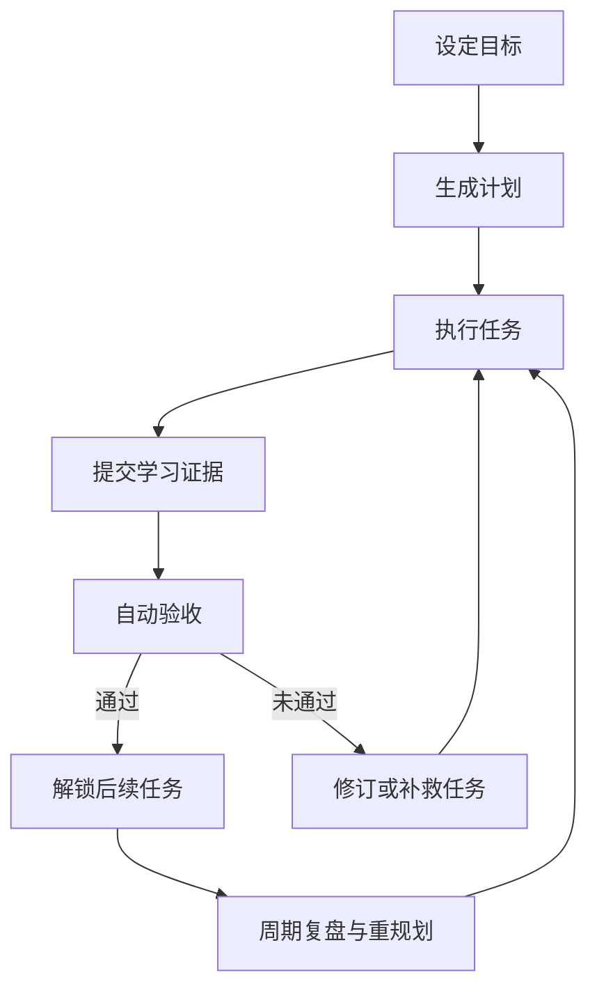
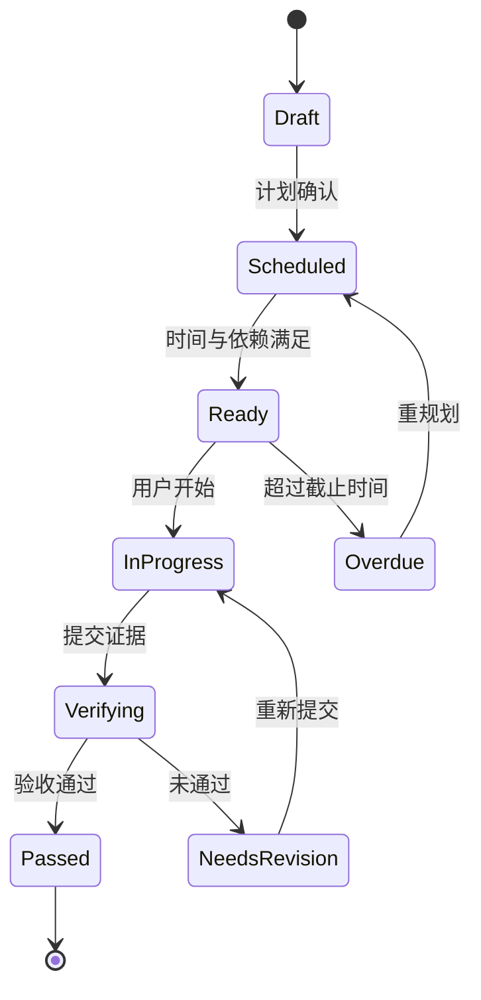

# KnowledgeOps Agent 产品需求文档

## 1. 文档信息

| 项目 | 内容 |
| --- | --- |
| 产品名称 | KnowledgeOps Agent（暂定） |
| 产品类型 | AI 学习工作流平台 |
| 目标方向 | 开发者学习、技术能力提升与面试准备 |
| 文档版本 | V0.1 |
| 当前阶段 | 产品定义与 MVP 规划 |

## 2. 产品概述

KnowledgeOps Agent 是一个面向开发者学习与面试准备的 AI 学习执行平台。

用户输入学习目标、截止时间、当前基础和可用时间后，Agent 会生成包含阶段、任务、依赖关系、预计耗时和验收标准的个性化学习计划。平台会在合适的时间开放任务，从答题结果、GitHub 提交、Markdown 笔记和代码测试中自动收集学习证据，并根据预先定义的标准判断任务是否真正完成。

当用户延期、任务未通过或暴露出知识薄弱项时，Agent 会生成补救任务或调整后续计划。用户不需要依靠手动点击“已完成”维持进度，系统记录的是经过验证的学习成果。

产品的核心闭环为：



## 3. 产品背景与问题

### 3.1 现有学习工具的问题

传统任务、番茄钟和打卡产品通常只能记录用户声称完成了什么，无法判断学习结果是否达标：

- 学习计划需要用户自己拆解，粒度和顺序经常不合理。
- 任务只有标题、时间和完成按钮，缺少明确的完成标准。
- 用户点击“已完成”不代表真正掌握了知识。
- 笔记、代码、刷题和复习记录分散在不同平台中。
- 计划一旦落后，用户需要手动重新安排全部任务。
- AI 学习工具通常只负责聊天、总结或生成计划，缺少持续执行闭环。

### 3.2 核心机会

开发者的学习过程天然会产生可验证证据：

- 刷题平台中的答案和正确率。
- GitHub 仓库中的代码与提交记录。
- Markdown 笔记中的知识内容。
- 自动化测试、构建结果和代码质量检查。
- 间隔复习中的再次作答结果。

KnowledgeOps Agent 将这些证据连接到学习任务，使学习计划从“提醒清单”升级为“可自动验收和动态调整的执行系统”。

## 4. 产品目标

### 4.1 用户目标

- 帮助用户把模糊的学习目标转化为可执行的阶段和任务。
- 让用户清楚知道每项任务为什么要做、怎么做以及怎样算完成。
- 减少手动维护计划、记录进度和重复安排任务的成本。
- 通过自动验收发现“看过但没有掌握”的知识。
- 根据真实学习进度持续调整计划，降低计划废弃率。

### 4.2 产品目标

- 建立“计划—执行—证据—验收—重规划”的完整闭环。
- 让经过验收的任务成为平台最核心的进度数据。
- 将 GitHub 笔记分析能力融入学习任务，而不是停留在内容总结。
- 形成适合开发者场景的任务模板和验收标准。

### 4.3 非目标

首个版本不计划成为：

- 面向所有生活习惯的通用打卡软件。
- 在线课程购买和视频教学平台。
- 以排行榜、社交动态为核心的学习社区。
- 可以任意替代老师作出高风险评价的全自动教育系统。
- 单纯依赖聊天窗口交互的通用 AI 助手。

## 5. 目标用户

### 5.1 核心用户

- 正在准备前端、后端或全栈实习和校招的学生。
- 需要系统学习某项开发技术的初中级开发者。
- 使用 GitHub 和 Markdown 管理学习笔记与代码的人。
- 容易制定计划但难以持续执行和复盘的人。

### 5.2 典型用户场景

#### 场景一：前端面试准备

用户希望在八周内完成浏览器、网络、JavaScript、Vue、算法和项目复习。Agent 根据当前基础生成路线，每日安排笔记、题目和代码任务，并根据错误知识点增加复习任务。

#### 场景二：学习 NestJS

用户已经具备 Express 基础，希望通过项目掌握 NestJS。计划包含模块、依赖注入、Guard、Pipe、数据库和测试任务。代码任务只有在构建成功、测试通过并完成指定功能后才算完成。

#### 场景三：维护个人技术知识库

用户向 GitHub 推送新笔记后，平台自动分析 Diff、检查知识错误、生成追问，并将通过验收的笔记关联到对应学习任务和知识点。

## 6. 核心产品概念

| 概念 | 定义 |
| --- | --- |
| 学习目标 | 用户希望在限定时间内达到的能力或成果 |
| 学习计划 | 围绕目标生成的完整执行方案，包含多个阶段 |
| 阶段 | 计划中的里程碑，用于组织一组相关任务 |
| 学习任务 | 用户需要完成的最小可调度学习单元 |
| 前置依赖 | 任务开放前必须通过的其他任务 |
| 学习证据 | 用于证明任务执行结果的数据 |
| 验收标准 | 判断任务是否完成的结构化条件 |
| 验收报告 | 对每条标准给出结论、证据和修改建议的报告 |
| 补救任务 | 因任务未通过或知识薄弱而自动生成的额外任务 |
| 有效学习日 | 至少有一个任务经过验收并通过的自然日 |
| 计划版本 | 每次确认或重规划后生成的计划快照 |

## 7. 核心用户流程

### 7.1 创建学习目标

用户填写：

- 想要学习或达到的目标。
- 期望完成日期。
- 当前掌握程度。
- 每周可投入时间。
- 偏好学习时间和不可用日期。
- 是否关联现有 GitHub 仓库。

系统可以提供诊断题，帮助用户校准自评结果。

### 7.2 生成并确认计划

Agent 生成：

- 阶段和阶段目标。
- 每个阶段下的任务。
- 任务之间的依赖关系。
- 预计耗时和建议时间。
- 所需学习材料。
- 任务验收标准。
- 计划生成依据和风险提示。

计划默认处于草稿状态。用户可以调整任务、时间和强度，确认后计划才开始执行。

### 7.3 执行今日任务

“今日学习”页面展示：

- 今天可开始的任务。
- 必须完成与可选任务。
- 预计总耗时。
- 正在进行、等待验收和需修订的任务。
- Agent 对今日安排的说明。

用户进入任务详情页查看学习步骤、资源和验收标准。

### 7.4 提交学习证据

根据任务类型，证据可以自动产生或由用户提交：

- 在平台完成题目后自动记录答案。
- GitHub Push 自动关联笔记或代码。
- 系统执行构建和自动化测试。
- 用户上传补充说明或提交复盘回答。

任务提交后进入“验收中”状态，用户可以查看实时验收过程。

### 7.5 自动验收

系统逐项执行验收标准：

1. 先判断正确率、文件、构建、测试等确定性条件。
2. 再使用 Agent 评估知识正确性、内容覆盖度和表达质量。
3. 生成带引用证据的验收报告。
4. 全部必要条件通过后自动完成任务。
5. 未通过时明确指出问题并允许重新提交。

### 7.6 解锁与重规划

- 任务通过后自动解锁满足条件的后续任务。
- 任务未通过时可以生成修改要求或补救任务。
- 任务逾期后不会直接标记失败，系统先判断剩余时间和影响范围。
- 每周生成复盘，并根据实际进度提出调整方案。
- 大范围调整需要用户确认后生效。

## 8. 功能需求

### 8.1 用户与学习档案

优先级：P0

- 用户能够创建和维护个人学习档案。
- 用户能够设置时区、每周可用时间和提醒偏好。
- 用户能够维护多个学习目标，但 MVP 同时只允许一个活跃计划。
- 系统保存档案修改记录，避免计划生成上下文不可追溯。

### 8.2 学习目标与计划

优先级：P0

- 用户能够使用自然语言描述学习目标。
- 系统将目标转换为结构化目标信息。
- Agent 能够生成阶段、任务、依赖、时间与验收标准。
- 用户能够调整计划草稿并确认。
- 用户能够暂停、恢复或终止计划。
- 所有重规划生成新版本，旧版本可查看但不可继续修改。

### 8.3 学习路线图

优先级：P0

- 展示阶段、任务和依赖关系。
- 区分未开放、可开始、进行中、验收中、已通过、需修订和已逾期。
- 展示阶段完成度和预计完成时间。
- 点击任务能够进入任务详情。

### 8.4 今日学习

优先级：P0

- 按优先级和时间展示今日任务。
- 显示今日预计总耗时和已完成耗时。
- 重点展示需修订和即将逾期任务。
- 用户可以开始任务、查看任务说明或申请调整时间。
- 不提供无条件“完成任务”按钮。

### 8.5 任务详情与执行

优先级：P0

任务详情至少包含：

- 任务目标与完成后的能力。
- 任务类型、预计耗时和截止时间。
- 前置任务与后续任务。
- 建议学习步骤与材料。
- 逐项验收标准。
- 已收集的学习证据。
- 历次提交和验收报告。

### 8.6 题目任务

优先级：P0

- 支持单选、多选、判断、简答和代码题。
- 支持设置总题数、最低正确率和关键题要求。
- 自动记录错误知识点。
- 验收失败时可以生成针对性补充题。

### 8.7 笔记任务

优先级：P0

- 支持关联 GitHub 中的 Markdown 文件。
- Push 后自动获取本次 Diff。
- 检查要求知识点的覆盖情况。
- 检查潜在知识错误、冲突和遗漏。
- 对验收结论展示原文引用。
- 可以要求用户回答基于笔记生成的追问。

### 8.8 代码任务

优先级：P0

- 支持关联 GitHub 仓库、分支和目标目录。
- 支持检查指定文件是否存在。
- 支持执行构建、测试或预设检查命令。
- 展示测试结果和失败日志。
- Agent 可以补充评审代码结构和任务要求覆盖度。
- MVP 仅支持受信任的示例项目或隔离后的执行环境。

### 8.9 复习任务

优先级：P0

- 根据用户历史错误和已通过任务生成复习内容。
- 任务在指定间隔后开放。
- 复习结果用于判断知识是否稳定掌握。
- 连续失败时生成补救任务，而不是重复推送相同题目。

### 8.10 自动验收

优先级：P0

- 每个任务必须至少包含一条可执行的验收标准。
- 验收报告必须逐项显示通过、未通过或无法判断。
- 每项结论必须关联具体证据或说明缺少什么证据。
- LLM 评审结果必须遵循固定 Rubric 和结构化输出。
- 用户能够修改内容并重新提交。
- 用户能够对无法判断或明显错误的结论发起申诉。

### 8.11 调度、逾期和计划调整

优先级：P0

- 系统根据时间和依赖条件自动开放任务。
- 截止前按用户偏好发送提醒。
- 逾期后展示对后续计划的影响。
- Agent 可以提出缩小任务、移动日期或增加补救任务等方案。
- 小范围调整在用户授权范围内自动执行。
- 改变目标、阶段或大批任务的调整必须由用户确认。

### 8.12 周复盘

优先级：P1

周复盘包含：

- 计划任务数和验收通过数。
- 预计耗时与实际耗时差异。
- 逾期和重复未通过任务。
- 高频错误知识点。
- 下周学习强度和计划调整建议。
- 新增、删除和移动任务的差异摘要。

### 8.13 学习记录与激励

优先级：P1

- 任务通过验收后自动生成学习记录。
- 至少有一个任务通过验收时计为有效学习日。
- 展示连续有效学习天数、阶段完成度和能力进度。
- 不允许通过手动点击无条件补签。
- 可以允许用户提交线下学习证据并进入验收。

### 8.14 公共产品站与分享

优先级：P1

- 提供产品首页、功能介绍和使用文档。
- 用户可以选择公开学习计划模板或部分学习报告。
- 私人任务、仓库和报告默认不可公开。
- 公开内容支持搜索引擎收录和社交平台预览。

## 9. 任务类型与验收方式

| 任务类型 | 主要证据 | 确定性验收 | Agent 验收 |
| --- | --- | --- | --- |
| 题目 | 答案、得分、错误知识点 | 完成题数、正确率、关键题 | 简答题质量、错误原因分析 |
| 笔记 | Markdown、GitHub Diff、追问答案 | 文件存在、提交时间、必需章节 | 知识正确性、覆盖度、表达质量 |
| 代码 | Commit、源码、构建和测试结果 | 文件、构建、测试、接口响应 | 架构合理性、可维护性、要求覆盖度 |
| 复习 | 再次作答结果、历史错误 | 时间间隔、正确率、完成题数 | 是否真正修正原有理解 |

验收原则：

- 能用程序确定的结果，不交给 LLM 猜测。
- Agent 只负责需要语义理解的部分。
- 一项任务可以组合多条验收规则。
- 关键条件未通过时，任务不能自动完成。
- 无法判断应返回“需要补充证据”，而不是强行给出结论。

## 10. 任务状态规则



产品规则：

- 只有验收通过可以进入 `Passed`。
- 用户可以放弃或跳过任务，但系统必须记录原因，并重新计算计划。
- 验收过程中不能重复提交，用户可以取消后重新提交。
- 同一份提交不得触发多次任务完成。
- 已通过任务原则上不会因计划调整退回未完成状态。

## 11. 信息架构

```text
公共产品站
├─ 首页
├─ 功能介绍
├─ 使用文档
└─ 公开计划与报告

登录后工作台
├─ 今日学习
├─ 学习路线
│  ├─ 阶段详情
│  └─ 任务详情
├─ 验收中心
├─ 知识库
│  ├─ GitHub 仓库
│  ├─ 笔记
│  └─ 知识点
├─ 周复盘
├─ Agent 运行记录
└─ 设置
```

## 12. 权限与用户控制

- Agent 只能通过平台提供的受控工具操作计划和任务。
- Agent 不得直接修改数据库。
- 第一次生成的计划必须由用户确认。
- 改变目标、截止时间或大批量任务的调整必须审批。
- 删除仓库、公开报告和执行外部写操作必须再次确认。
- 用户可以查看 Agent 每次调整所依据的数据和原因。
- 用户可以关闭自动重规划，仅接收调整建议。

## 13. 异常与边界情况

### 13.1 GitHub 提交未关联任务

系统保存提交记录，但不自动认定为任何任务的证据。用户可以手动选择关联任务。

### 13.2 一次提交关联多个任务

允许复用同一提交，但每个任务必须独立执行验收。

### 13.3 用户长时间未学习

系统暂停持续提醒，生成恢复建议。用户确认新的可用时间后再重新规划。

### 13.4 Agent 无法判断

任务进入“需补充证据”，展示缺失内容，不视为验收失败。

### 13.5 验收结果存在争议

用户可以申诉、补充说明或重新提交。平台保留原报告和修改记录。

### 13.6 计划已经无法按期完成

Agent 提供缩减范围、延长时间或提高每日强度三类方案，由用户选择，不擅自改变最终目标。

## 14. 非功能需求

- 私人计划、仓库和学习证据默认仅用户本人可见。
- Webhook、队列任务和状态迁移必须支持幂等。
- Agent 运行失败不能破坏已有计划和任务状态。
- 用户能够查看任务处理进度和失败原因。
- 工作台适配桌面端，并保证基础移动端可用性。
- 公共页面具备良好的可访问性、首屏性能和 SEO。
- 对模型调用记录耗时、Token、成本和错误信息。
- 对可能执行代码的任务使用隔离环境和资源限制。

## 15. MVP 范围

### 15.1 MVP 必须完成

1. 创建学习目标和学习档案。
2. Agent 生成学习计划草稿。
3. 用户确认和查看阶段路线图。
4. 任务状态机与时间调度。
5. 题目、笔记、代码、复习四类任务。
6. GitHub Webhook 和 Markdown Diff。
7. 学习证据自动关联。
8. 确定性规则与 LLM Rubric 组合验收。
9. 任务通过、需修订和逾期处理。
10. 今日学习、任务详情和验收报告页面。
11. 基础周复盘与重规划建议。
12. 公共产品首页。

### 15.2 MVP 暂不实现

- 通用课程与内容市场。
- 社区、排行榜和好友系统。
- 多用户协作计划。
- 原生移动端应用。
- 无限制执行任意用户代码。
- 完全自动且无需用户确认的大规模计划调整。
- 复杂多 Agent 协作。
- 多种外部日历和消息渠道的全面集成。

## 16. 产品成功指标

### 16.1 激活指标

- 创建目标后完成计划生成的用户比例。
- 生成计划后完成确认的用户比例。
- 用户首次计划确认到首个任务通过的时间。

### 16.2 核心使用指标

- 每周验收通过任务数。
- 任务自动收集证据的比例。
- 无需手动标记即完成的任务比例。
- 任务首次验收通过率和修订后通过率。
- 逾期任务重新进入计划并最终完成的比例。

### 16.3 留存与效果指标

- 次周仍有验收通过任务的用户比例。
- 四周内仍保持活跃计划的用户比例。
- 用户在复习任务中的知识点正确率变化。
- 用户采纳 Agent 重规划建议的比例。
- 用户对验收报告发起申诉或否定的比例。

## 17. 后续扩展方向

- 接入飞书、日历和邮件通知。
- 支持更多代码托管平台。
- 支持公开学习路线模板。
- 根据面试日期自动生成冲刺计划。
- 引入更完善的间隔重复算法。
- 支持团队培训和导师审核。
- 提供跨目标的能力图谱和长期学习档案。
