# KnowledgeOps Agent：九月底投递开发与学习计划

## 1. 当前约定

| 项目 | 已确认安排 |
| --- | --- |
| 版本与生效 | 2026-09-05 减负重排；2026-09-16 精简 SSE/C2 前移；2026-09-21 用户选择保留原业务开发顺序，投递不以完整闭环或上线为前置；历史记录不改写 |
| 硬目标 | 原最晚 2026-09-30 投递节点已过去，是否已投递未报告，不自动记为达成；10/9 用户恢复业务开发，投递不以完整闭环/上线为前置的约定保留。9/27 至 9/30 窗口保留为历史，不作为十月恢复开发的永久禁令 |
| 项目可用时间 | 工作日 2 至 3 小时、周末约 5 小时；前端基础与算法已有独立安排，不在这里另扣时间 |
| 容量估算 | 9/21 的九月容量核算仅作历史；十月每周可用时长未重新报告，不推算中断期投入或新完成日期。R06 已报告此前约 4 小时、分叉比较约 30 分钟、取证失败展示约 25 分钟、普通失败手动重试约 20 分钟、全文快照重新同步约 15 分钟、真实 Push 配置/排查/观察约 15 分钟、接收阶段忽略反馈约 15 分钟、落库后退出恢复约 20 分钟、写入失败回滚与重试约 15 分钟、合并故障收尾导读/提问/复述约 15 分钟，累计约 6 小时 50 分钟，较原 4 小时预算超出约 2 小时 50 分钟。原估算不足与多次小段切换为主要复盘原因，不归因为用户学习慢；后续不靠加班补旧排期 |
| 确定任务预算 | R14 收尾后原未完成单元合计约 47 小时，其中原冻结前任务约 43 小时，超过 9/22 至 9/27 容量约 21 至 25 小时；是待完成工作量，不是月底完成承诺。包含入门、阅读、手写、Review、验证、复述、周问答与文档 |
| 预算性质 | 用户项目投入估算，不是 AI 编码耗时或完成保证；按真实耗时复盘，剩余容量留作缓冲 |
| 当前活动阶段 | M6 `AI_IMPLEMENTING`：R16/R17 已完成；R18 前追加 CI/CD 已确认应用容器化与手动触发生产发布的选型方向，尚未启动实现；主页重构和页面优化待细化；评分一致性问题保持 OPEN |
| 当前活动单元 | R17 `DONE`（bf0a38c）：生产发布、第二账号真实闭环、测量与学习记录已齐；新增三项均 `NOT_STARTED`，待细化后按顺序启动一个活动单元，R18 尚未启动 |
| 下一步 | 先细化 CI/CD 的应用镜像、Compose 与发布工作流职责、验收和新增预算，再进入首次实现；主页具体方案到时讨论。完成追加事项后再进入原 R18 演示与材料/W4 安排 |
| 真相源 | [求职版 PRD](KnowledgeOps-Agent-9月求职版PRD.md)、[协作规则](../AGENTS.md)、[阶段技能](../.agents/skills/run-interview-project-stage/SKILL.md)、[学习档案](../问答.md) |

旧计划剩余 22 个开发日，按此前每个至少 4 小时估算已超过 88 小时，尚未包含阶段收尾。因此本次同时减少实现范围和重复学习关卡，不将旧日期整体顺延。

### R18 前追加事项（2026-11-04，需求与选型记录）

用户确认已在 VPS 完成 R17，并明确希望在进入 R18 前完成以下三项。R17 已有完成提交 bf0a38c，保留其验收记录；本次调整后续安排，不重开 R17。

| 追加事项 | 已确认意图与待讨论内容 | 状态 |
| --- | --- | --- |
| 构建完整 CI/CD 流 | 已选择 Web/API/Worker 容器化，采用 GitHub Actions + GHCR + Docker Compose + SSH，沿用宿主机 Nginx；先手动触发生产发布，具体设计与验收待细化 | `NOT_STARTED`，选型已记录，未实现 |
| 重构主页前端界面 | 重构产品主页；用户明确具体做法到时讨论，视觉与交互方案尚未确定 | `NOT_STARTED`，待细化 |
| 页面优化 | 优化涉及的页面、目标和衡量方式待讨论，暂不将其限定为性能、视觉或交互中的某一种 | `NOT_STARTED`，待细化 |

执行位置为 **R17 完成 → 上述追加事项 → R18 → R19**；三项之间的具体实施顺序、单元划分、验收和新增时间预算待细化，不直接塞入原 R18/R19 的 3/4 小时预算。沿用适量合并、架构导读与 DESIGN.md 约束。本次“先记录”只授权文档登记，不启动代码、设计或生产发布，也不自动恢复其他延期功能；原题干与评分点一致性问题继续保持 OPEN。

### CI/CD 选型与手动发布约定（2026-11-04）

用户愿意增加投入，将 Web/API/Worker 一并容器化；在讨论技术方案后明确选择“先手动触发发布”。本轮落实选型与计划记录，应用容器、镜像发布及生产自动化均尚未实现，不将选型确认记作首次实现授权或生产迁移完成。

- **选型方向**：复用 GitHub Actions，由 GitHub 托管 Runner 执行检查、测试与镜像构建，GHCR 保存私有镜像；通过 SSH 调用 VPS 上的版本化部署脚本，Docker Compose 管理各服务，宿主机 Nginx 继续负责 HTTPS、Web/API 入口及 SSE 转发。Worker 由队列驱动，不提供公网入口。
- **CI 与发布分离**：PR 执行检查与测试；`main` 的目标提交通过检查并完成镜像启动验证后，准备可发布镜像及版本记录。生产发布采用 `workflow_dispatch` 手动触发，初期不因 push 自动更新生产；以后的主分支自动部署另行决定。
- **版本选择要求（待实现）**：手动发布指定提交 SHA，流程核对该 SHA 的必要检查、镜像验证和发布记录均成功，再使用对应镜像摘要部署；Web/API/Worker 属于同一发布版本。拒绝未验证或缺少产物的版本，不以触发时的最新分支内容替换选定版本，也不在 VPS 重新构建。
- **发布与恢复要求（待实现）**：生产发布串行执行，不能沿用普通 CI 的取消旧运行行为中断部署；依次准备镜像、按 R17 约定停止写入并备份、执行迁移、切换应用、检查健康状态并保存版本与结果。第一版允许短暂维护窗口；Worker 须保留正常结束任务的时间。镜像回退须先确认数据库、状态和队列事件兼容，不自动覆盖恢复旧数据库备份。
- **迁移边界**：本项目三个应用由 PM2 迁至容器，其他项目保持原托管方式。复用现有 PostgreSQL/Redis 数据卷；密钥、环境配置与业务数据不写入镜像。Compose 网络、私钥挂载、原 PM2/systemd 自启切换和旧版本恢复路径需在迁移设计中核对。
- **下一步**：先细化应用镜像和 Compose 的职责与可观察验收，并确定新增学习预算；生产接入前验证 VPS 拉取 GHCR 私有镜像的网络与权限。后续按“应用容器化 → 验证并发布镜像 → 手动部署与恢复演练”组织连续学习，具体单元划分待定，不重开 R07/R17，也不追加未安排的手写。

### 11/4 执行粒度与架构导读调整

用户确认当前已进入 R17，并授权后续适量合并原先分开的小阶段、在业务逻辑和数据流之外增加架构设计角度。本次调整执行与学习方式，原 R17 至 R19 的范围、预算和验收要求保持，已完成 R16 及此前记录不重开；没有新增生产发布、真实账号或测量证据，不推算用户学习耗时。

| 执行分组 | 合并内容与可观察结果 | 导读重点 |
| --- | --- | --- |
| R17 发布与恢复 | 将部署现状核对、迁移/备份恢复准备、发布配置和发布后健康检查合为一批；实际执行后，以目标版本可访问、迁移结果和恢复路径证据验收 | 流量如何进入 Web/API，Worker 与数据库/Redis 如何配合；为什么按该顺序发布，各进程负责什么，代码回退与数据恢复有哪些边界 |
| R17 真实闭环与测量 | 将 App 安装配置、第二真实账号接入、真实 Push 至任务通过/解锁、关联日志和指标采集合为一次连贯观察，复用同次运行的证据 | 登录身份与仓库授权边界、异步执行与持久化职责、如何通过日志定位失败；区分真实测量、自动化测试和模拟模型结论 |
| R18/R19 演示与材料 | 共用一套固定 Demo、已验证能力与指标证据，集中准备 README/ADR、演示和简历；R18 收尾后按 R19 完成最终 smoke、链接核对和材料定稿，避免重复整理 | 围绕真实业务讲清架构选择、代价与失败恢复，材料中的每项能力/数字可追溯到验证证据 |

R17 两批共用原 4 小时预算，可跨时段；R18/R19 仍分别为 3/4 小时，不因合并宣称节省了尚未测量的时间。每批统一导读、理解确认和一次短复述，不按单个命令、文件或测试重复停顿；新陌生机制或独立风险按需拆开。跨单元共用准备不意味着同时激活或完成多个单元，W4 仍按原安排执行，不增设架构问答关卡。

后续讲解沿“业务目的 → 架构职责与取舍 → 数据流与状态 → 失败恢复及验证”展开，结合本批真实代码/配置，首轮仍约 2 至 3 个核心入口。用户同轮补充要求简要解释设计原因：每个关键设计点用一两句话说明解决的问题、适合当前规模的原因及主要代价，必要时对比一种更简单的方案。架构内容计入原导读预算，主链路图按实际实现增量更新。未满足的验收、生产操作所需授权与已延期范围不因合并改变。

### R17 发布复述（2026-11-04）

用户在集中导读后明确“ok，进入简短复述环节”。针对“新版本已保存一条回答，随后页面出现问题”的场景，用户回答：“数据库备份不含新保存的数据，如果恢复备份数据会丢失，不能恢复；代码不影响持久化数据，可以恢复”。已正确识别恢复旧备份会丢失备份之后的新数据；仍需校准两点：不能直接覆盖不等于任何情况下都不能恢复，应先保留新增数据并评估恢复方案；代码回退本身不撤销迁移，但旧程序仍可能不兼容新表结构、状态或队列事件，不能据此保证可直接启动。以本次新增 `ANSWER_VERIFICATION_REQUESTED` 事件与旧 Worker 的兼容性作一个紧密相关追问，等待用户确认这一恢复边界。当前不将 AI 补充记为用户独立答出，不记录为正式周问答，不提前标记复述通过或 R17 DONE；页面观察与实际耗时仍未报告。

用户随后回答“不能。否则会报错”，正确判断不能直接启动不识别新事件的旧 Worker。结合前一回答已识别恢复旧备份会丢失新增数据，本批短复述通过；关于恢复前保留新增数据、检查表结构/数据/事件兼容性及必要时向前修复的完整表述由 AI 补充，不记作用户独立答出。剩余仅补记页面观察与实际学习耗时，不追加考题；R17 第二真实账号闭环仍待完成，不标 DONE 或提前提交整个单元。

用户发现 GitHub App 注册中的重定向地址仍为测试地址，随后确认“ok了，我改好了。已观察，这次学习用时15分钟”。记录 GitHub 侧配置由用户修正、旧任务报告页面观察完成，本批学习投入约 15 分钟；服务器配置此前已为生产回调 `https://game.gerden-shop.cn/api/auth/github/callback`。AI 的线上登录跳转检查因沙箱网络限制及后续审批中断未完成，不将用户修正反馈记作独立探测成功。发布与恢复批次学习记录已齐，R17 回到 WORKING，接续第二真实账号闭环；不重复部署或增加复述，不以本批 15 分钟推算工程耗时或整个单元总投入。

### R17 真实闭环与测量启动（2026-11-04）

用户明确“进入下一段”，沿已有授权进入第二批。已核对产品安装入口、GitHub 用户/安装/仓库权限交集与绑定事务，并在 `deploy/README.md` 补充连续观察步骤和证据口径。主要概念为登录身份与仓库授权边界；复用既有实现，首读仓库接入页面、GitHubRepositories 和 RepositoryBindingService，不增加新功能、手写或逐步复述。已询问第二真实账号及其学习仓库的可用情况，尚未取得答复；App Public 配置、第二账号接入、真实提交至任务通过/解锁与运行测量均待执行，未记作验证通过。本轮仅准备验收和文档，不改生产配置或触发模型调用，实际学习投入仍仅有上一批实报 15 分钟。

用户随后确认第二账号和仓库均已准备好。下一步由用户通过真实 GitHub 登录与安装页面完成授权和生产绑定，反馈仓库 `owner/name`、绑定分支及接入结果，供后续定位同一次提交和运行证据；账号准备完成不等于接入已验收。

用户报告接入步骤“已完成观察”，仓库为 `NaNFuSpring/learning-staff`、分支 `main`，按前述操作清单记录第二账号登录、刷新会话、未显示第一账号私有计划、安装与绑定及刷新观察完成。生产只读查询独立确认：绑定 ID `f136b11f-ed77-43ce-ad07-1959692b3ad4`，登录用户与安装账号均为 `NaNFuSpring`，仓库/分支匹配且 enabled=true，绑定时间为 2026-11-04 03:13:24.463 UTC。查询时该用户没有计划、任务或计划生成 Run，下一步从生产页面生成并确认小范围学习计划、开始首个任务，再按实际目标路径和验收标准提交笔记。第二账号退出保护、完整业务闭环及测量仍待验收；本次没有新增模型调用或数据写入，学习耗时未新增报告。

首次真实生成出现“本次生成未完成”。只读数据库和 Worker 日志确认 Run `af47435a-a734-4163-8a94-d7f97b244575` 为 TIMED_OUT / RUN_DEADLINE_EXCEEDED：03:34:39.741 UTC 入队，03:34:40.232 开始，03:37:39.747 结束，持久化 deadline 为 03:37:39.741；约 0.491 秒领取，约 180 秒达到截止时间，没有关联 Plan。页面与终态一致，未发现本次排队积压证据。计划生成沿旧配置使用 glm-5.3 / jsonMode，不显式传 reasoning_effort；此前 low 与每 Run 1 元预算针对笔记/回答验收，不自动覆盖计划生成。官方文档声明模型默认 max，但现有日志不能区分上游排队、网络等待或模型处理慢，不能把默认 max 写成已证实根因。本轮未修改截止时间、终态或生产配置，未自动重试；后续可从页面创建一次关联重试，若重复超时再针对计划生成参数链路处理，不批量重复调用。另校准前述“两篇笔记”建议：现有计划生成提示约束为 3 至 8 个任务，本次只需先走通首个任务及其后继解锁，不要求模型恰好生成两项。

第二次只读核对确认关联重试 Run `7aa2814d-3d81-40ad-8ca8-58eea130575d` 同样为 TIMED_OUT / RUN_DEADLINE_EXCEEDED，goal 为 `ecad5dc8-6688-4fa4-8ffd-bbf09b630d63`，retryOfRunId 正确指向首次失败 Run。03:43:34.757 UTC 入队、03:43:35.439 开始、03:46:34.759 结束，没有关联 Plan。用户离开页面后找不到入口；源码确认工作台通过 URL 的 goal/run 参数恢复已有运行，可提供原 Run 的直达链接，不需要重建目标或重试。离开页面并未取消后台运行。本次只查询并提供恢复入口，连续两次超时的具体上游原因仍待定位；无新增模型调用，不将页面恢复链接视作已修复产品导航入口。

2026-11-04 用户要求排查重复超时。代码确认计划目录、Run 表与 Worker 读取缺少 reasoningEffort 传递，实际请求依赖供应商默认值；现有日志无法复原两次超时在上游的具体耗时分布。无凭据连通性检查约 0.109 秒得到预期 401，仅证明当时网络/TLS 可用。对相同目标做两次独立 low 诊断（各 180 秒截止、8192 输出 Token 上限，不写 Plan）：第一次 11.525 秒返回、MODEL_OUTPUT_INVALID，961 输入/693 输出 Token；第二次 12.990 秒通过结构及 DAG 校验，2 阶段/3 任务，961 输入/799 输出 Token。按既有价格快照总计约 CNY 0.057152，不是账单；第一次未保存原文，具体格式失败字段未知，不能抹去失败样本或宣称 low 必然成功。诊断的输出上限与原正式请求不同，不能当作严格单变量性能对照。

修复补齐可选目录参数 → API 冻结 → Run 可空列 → Worker 读取 → SDK 请求链路，新增迁移 `20261104040000_plan_generation_reasoning_effort`，旧记录保持 null；不延长 deadline、不修改两次旧终态。29 项相关单元测试、临时独立数据库中的 34 项集成/原子落库验收、API/Worker 类型检查和构建、目标 lint/格式通过。测试库已清理，未把合成夹具写入生产。沿既有发布授权备份至 `/var/backups/knowledgeops/r17-reasoning-cREmSW`，应用新增迁移并切换 API/Worker，生产目录 glm-primary 显式 low；运行时解析、进程 online、API readiness 已核对，两次旧 Run 均保留 TIMED_OUT/null。正式新 Run 生成成功仍待用户通过页面关联重试验证；R17 保持 WORKING，无新增复述或手写，实际学习投入未补报。

用户随后确认“生成成功了”。生产只读查询确认正式 Run `b3979893-0c13-4f94-976e-b591dcd2fe12` 为 SUCCEEDED，冻结参数 low，04:06:29.551 UTC 开始、04:06:43.745 完成，执行耗时 14.194 秒，计划 `895a8c88-1332-4af0-aa89-7024f4fc8ba0` 已保存为 DRAFT。该 Run 的 retryOfRunId 为 null，按独立新运行记录，不误记成前次失败的关联重试。计划有 3 项任务：Promise 基础 → 链式调用 → 错误处理；首项 `264921c9-fac8-4633-a268-b6e3767ddb28` 的路径为 `notes/promise-basics.md`，要求两个指定章节、至少 400 个非空白正文字符、真实文件变更及追问回答通过。查询时尚未确认计划，任务均为 BLOCKED；下一步先确认、开始首项，再 Push。成功单样本证明修复后的正式参数与生成链路可用，不以此宣称全部超时已消除或估算平均耗时，正式 Run 没有新增用量账本，不套用诊断费用。

用户报告补充后的回答“这次验收通过了”。生产查询确认首项 Task `264921c9-fac8-4633-a268-b6e3767ddb28` 为 PASSED/version 8，第二项 `512e951d-793d-49bd-8ce1-1496a5e29d9f` 为 READY，第三项仍 BLOCKED，符合依赖关系。真实提交 `bed7d6acd262b7cc4a63d79b7adf24950ac0ded0` → Delivery `0bf4ea7a-d806-11f1-81e5-1e3e5d29d99e`（PROCESSED）→ Submission `40db1318-0f44-4227-bdb6-b3878664a3fa` → 笔记 Run `668ca9db-f299-492e-b60a-b78a755e248f`/报告 `5e457c27-01b2-4902-b797-619e4ba4ab07` → 追问 `90e30b4d-3b77-4028-b5ca-11f4cee66dbf` → 补充回答 `0a3f6494-578f-45ab-9143-b33c06ff0e6c`/Run `ad546eaf-9293-4cc0-9b95-d19cf2cbd981`/报告 `a61b8c61-3cb4-4138-a9e0-9e0f9c6bb313` 的关联已核对。Evidence 的 sourceCommitSha 与提交一致，目标文件 70 行；取证完成和两种验收完成日志可通过相同 ID 关联。

笔记报告 4 项结果 PASSED，followUp READY；首次回答报告为 INSUFFICIENT_EVIDENCE，补充后报告为 PASSED，两次 Run 都为 SUCCEEDED，保留执行成功与业务通过的区别。笔记 Run 12.910 秒/2392 Token/估算 CNY 0.027996，首次回答 30.873 秒/8454 Token/0.095792（包含一次 INVALID_ANSWER_CITATION 后的受控修复），补充回答 15.225 秒/4269 Token/0.047692；三 Run 合计 15115 Token/CNY 0.171480，usageComplete=true、warnings=[]。费用不含计划生成及此前诊断，不是供应商账单或全站统计；这是单条人工辅助内容的真实闭环，不代表模型准确率或用户独立掌握知识。查询确认内部 rubric 第五项确实要求 return/执行器继续执行，问题记录已补证，补充答案通过不关闭该问题。已请求用户补充刷新及退出保护观察，第二批学习耗时尚未报告；不提前宣布 R17 DONE 或追加手写。

用户随后确认刷新任务状态和退出后访问原私有链接“已观察，符合预期”，补齐首项通过、第二项可开始及退出要求重新登录的页面观察。本批真实行为证据已齐，R17 进入 WALKTHROUGH：集中说明登录/安装/绑定职责、固定 Commit 至报告和回答的关联、Run 执行成功与业务结论/Task 状态区别、同事务保存与解锁的原因，以及参数随 Run 冻结和本次单样本测量边界。首读绑定 Service、回答验收 Repository 和计划模型目录三个入口，其他文件按职责引用；不重开旧手写，不把 AI 辅助的 Promise 答案作为本批架构复述。理解确认、短复述、第二批实际耗时及本地单元提交待完成，评分一致性问题仍 OPEN。

用户确认集中导读“清楚了”，第二批理解确认完成，R17 进入 RECALL。仅以本次首次回答 Run SUCCEEDED、报告 INSUFFICIENT_EVIDENCE 为一个实际场景，确认执行状态与任务解锁依据的区别；复述及第二批实际耗时尚待反馈，不预写用户答案，不重开已完成观察或手写。

用户短复述：“不能只凭单次的回答成功就解锁后续任务，还需要汇总全部标准通过之后才能通过”。正确指出应汇总必要标准而非只看单次运行，本批短复述通过。AI 补充精确术语：Run SUCCEEDED 仅表示成功产出合法报告，不等于回答结论 PASSED；Task 必要标准全部满足后通过，再检查后继任务的全部前置依赖。这些补充不记为用户独立答出。R17 进入 DOCUMENTING，仅待第二批实际耗时及提交前复核/本地提交，不追加复述或把已知评分一致性问题标为修复。

### R17 收尾（2026-11-04）

用户补报第二批学习“用时约10分钟”，加上第一批约 15 分钟，R17 用户实报学习累计约 25 分钟；不将 AI 工程、等待审批、模型调用与故障排查时长混算为用户学习投入，也不把差额视为已测量的工时节省。两批真实观察、导读理解、短复述与进度记录均已完成。

本次收尾范围包括生产迁移/发布与备份恢复演练记录、预检 SQL、计划生成 reasoningEffort 的配置与持久化修复、第二真实账号登录/绑定/真实 Push 至笔记和回答报告/Task 通过与解锁、刷新/退出保护、关联日志及单样本费用/耗时证据。保留 29 项相关单元、34 项数据库集成与原子落库验收、类型/lint/构建通过的既有结果，不因纯文档收尾重复运行产品测试或触发模型。

题干与必要评分点不一致按用户“记录”要求保持 OPEN（初始问题记录提交 6ce28a5，本次补齐真实 rubric 和补充后通过的证据），未实施修复、不标 DEFERRED/DONE，不宣称模型验收质量已稳定。原两次超时、一次诊断格式失败、首次回答证据不足及引用修复均保留，不将本条人工辅助闭环写成准确率或独立学习效果。生产备份目前仍为同机备份；新增修复的远端 CI 未执行，本轮无推送。

按明确路径复核并提交本单元代码、迁移、测试和文档，排除真实环境、私钥、备份、诊断原文及构建产物。R17 DONE 仅随本次本地 commit 成功生效，提交失败保持 DOCUMENTING。M6 尚未整体完成，下一步仅预告 R18 演示与材料批次，不自动展开新工作。

### 10/9 恢复点

用户在 2026-10-09 明确“进入下一步”，沿 9/21 保留原业务顺序的决定及既有 M3 授权恢复 R05。九月冻结与材料窗口已过去，作为历史记录保留，不据此永久阻止十月续做；不推断中断期学习耗时、投递结果或产品完成度。十月不自动恢复任何已延期扩展，单元预算和小步学习规则保留。

本次先以一组本地 HTTP 收发练习观察 Webhook 角色与重复投递，约 10 至 15 分钟计入 R05 原约 3 小时预算；练习只用合成数据，不含签名手写答案、不接数据库或真实 GitHub。恢复时尚无产品接口/Delivery 模型；同日理解确认后已接入主体，见末尾记录，签名手写和对应 Worker 消费仍未完成，不能把练习 202 当作业务可靠接收已完成。

### 9/21 容量复核与用户决策（保留业务顺序的依据）

- 用户已将项目用于简历和面试，并明确选择“保留原业务的开发顺序”，未采纳“先上线现有计划生成版本、自动验收延期”的范围调整建议。此反馈不等于确认已经投递、上线或通过面试，也不代表允许把未实现功能写成成果。
- 开发继续按 **R05 → R06 → R07 → R08 至 R12 → R15 至 R19** 推进。R07 的既定部署 smoke 和后续 M6 正式上线仍保留；不提前插入一轮完整上线，不删除原 GitHub 证据、笔记/回答验收、任务通过与解锁范围。原已延期功能仍 DEFERRED，不恢复额外 SSE 场景。
- 剩余预算核算：M3 的 R05–R07 共 10 小时，M4 共 18 小时，M5 共 5 小时，M6 共 14 小时，合计 47 小时。原冻结前任务 43 小时，未来冻结前容量 18–22 小时，缺口 21–25 小时。不得用加班、压缩基础导读或降低安全/一致性验收假装消除缺口；未完成工作不承诺九月底交付，新完成日期按实际进度复核。
- 求职与产品完成分开：最晚九月底开始投递，不以 M6/R19 完成、公开网址或原 PRD 全闭环为门槛；材料可先使用已实现的登录、异步计划生成、原子落库和 SSE 快照恢复。Webhook、自动验收和生产能力在验证前只能标注规划/开发中。用户的简历文件本轮未审阅或修改，不推断其具体措辞。
- 本次只确认开发顺序和投递不等待上线；**未自动取消原 9/27 冻结及 9/28–9/30 材料窗口**。如需在该窗口继续新功能开发，须另行确认。冻结不代表未完成单元 DONE，也不代表删除后续业务目标。
- 本轮为计划决策，不启动 R05 产品实现，不替代未来阶段授权或手写理解确认，不新增练习；历史手写和完成记录保持原样。

### 9/16 容量与执行顺序更新（历史基线）

- 当前证据仍为 R04 已完成（`49202d4`），不推断 9/11 至 9/15 的投入。9/16 至 9/30 共 11 个工作日、4 个周末日，按原预算约 42 至 53 小时；其中冻结前 9/16 至 9/27 约 36 至 44 小时，冻结后 6 至 9 小时不借作新功能时间。
- 原未完成 R05 至 R19 合计 **53 小时**；R13 收窄为 2 至 3 小时、R14 仍为 3 小时，重排后为 **52 至 53 小时**，不是额外新增 5 至 6 小时。冻结前 R13/R14、R05 至 R12、R15 至 R18 合计仍约 48 至 49 小时，超过冻结前容量约 4 至 13 小时。当前排期有明确缺口，不宣称仅调整顺序即可按时完成，也不擅自删其他 P0。
- 执行顺序：**R13 → R14/C2 → R05 → R06 → R07 → R08 至 R12 → R15 至 R19**。编号保留；R13/R14 从 M5 迁入当前 M3 的前端同步切片，M5 不再重复预算或学习，始终只有一个活动阶段和单元。
- 9/16 起的首个 5 至 6 小时学习窗口用于精简 SSE/C2，不承诺一天完成。达到上限仍有 blocker 时停止扩展并报告取舍，不追加时间硬追赶、不跳过授权或恢复验收。结束后立即回 GitHub 业务主线；9/20 强制复核实际剩余量并提出需要用户确认的其他裁剪，不能自动动用冻结窗口。
- 本次批准的是计划、范围和规则调整，不代表 SSE 已实现或取得首次编码授权。R04 不重开，R05 至 R19 不因日期到达改变完成状态。

## 2. 历史与迁移边界

完整旧计划保存在 [2026-09-05 调整前归档](archive/KnowledgeOps-Agent-逐日开发计划-2026-09-05调整前.md)，包括原始逐日状态、验证限制、实际日期和阶段说明。归档只作历史参考，不是活动执行规则。

| 历史成果 | 保留状态与证据 |
| --- | --- |
| 阶段 0 | `DONE`，协作范式于 2026-07-31 建立 |
| 阶段 1，08-01 至 08-05 | `DONE`；阶段核心手写提交 `63c8e64`，阶段收尾 `8f77a6d`，2026-08-07 完成 |
| 阶段 2，08-06 至 08-11 | 六个计划日均 `DONE`；依次为 `f5c7b00`、`9e30a7c`、`01300f6`、`5f4a915`、`d161638`、`03311f1` |
| 阶段 2 整体 | `DONE`，2026-09-09 收尾；C1、R03、W1 已独立提交，确认范围与失败路径核对通过，本地真实生成/恢复/确认/开始闭环完成；不代表 GitHub 验收或生产上线完成 |
| 已有问答与练习 | 原文和历史提交保留；本次不补考已完成日期，不将“待复习”改为“已掌握” |

旧阶段 2 的未完成核心手写迁移到 C1/R02；其未进行的宏观考试改为 W1 周问答。旧阶段 3、4、6 的强制核心手写取消，其业务代码与测试进入正常单元；旧阶段 5 的核心手写迁移到 C2/R14。这些是规则调整，不是宣称旧关卡已经完成。

| 旧未完成计划 | 新承接范围 |
| --- | --- |
| 阶段 2 核心与收尾 | R01 至 R03、W1 |
| 08-12 至 08-16 | R04 至 R07 |
| 08-17 至 08-22 | R08 至 R11 |
| 08-23 至 08-27 | R12 至 R15；9/16 将 R13/R14 精简并前移，完整历史重放延期 |
| 08-28 至 09-02、09-03 至 09-06 缓冲 | R16 至 R19 |

## 3. 九月范围与裁剪点

保留主线：创建并确认计划 → 开始 Markdown 任务 → 真实 GitHub Push → Diff Evidence → 笔记验收与可定位引用 → 回答一个必答追问 → 回答验收 → 任务通过并解锁下一项。

- 复用既有 Outbox、BullMQ、Worker、模型端口、Schema 与状态规则。
- 单用户一个活动仓库、一个分支、一个活动计划、一个执行中任务；报告先用简单列表、Diff 文本和可定位行号。
- 暂缓 Monaco、额外报告视图、反馈系统、ReAct/额外工具循环、检索、虚拟列表及装饰性功能。测试、授权、签名、业务幂等、引用有效性和真实失败路径仍保留。
- 运行状态、缓存一致性、刷新恢复、引用定位属于必交付；计划生成的精简 SSE 状态同步优先交付，保留轮询兜底。完整历史事件时间线与重放明确 DEFERRED，不因精简 SSE 完成就宣称支持。

### 9/20 的决策

检查证据必须是一条真实仓库 Push 到笔记报告、一个追问回答验收、任务 `PASSED` 与下一任务解锁的运行记录。测试 Fake 或仅有页面不能替代这个证据。

2026-09-16 用户已确认以下规则替代旧版“9/20 未闭环就延期全部 SSE”：

1. 保留优先计划的精简 SSE；不自动撤销已验收能力、不把未完成 R13 标为 DONE。完整历史事件重放已 DEFERRED，无需等到 9/20。
2. C2/R14 固定为 SSE 快照恢复与轮询兜底协调，只做一次；不在 9/20 切换成第二套练习。
3. 未闭环时停止 SSE 新场景、时间线或通知架构扩展，优先回到真实 Push、报告、任务状态与上线；R12/R15 可继续用轮询读取 AgentRun，必须保留恢复、引用、取消和关联重试。
4. 检查 9/27 冻结前剩余容量；若仍有缺口，提出具体 P0 取舍请求，不自动压缩安全、幂等或证据标准，不要求延长每日学习。
5. 简历区分“状态同步/快照恢复”与“完整事件重放”，只写实际通过验证的能力。SSE 自身未通过的恢复问题仍是 blocker，不能以连接成功代替验收。

即使业务闭环提前通过，也不自动恢复已延期的完整事件重放；空余时间优先用于上线、回归与材料。新范围需要另行确认。

决策记录：9/20 检查于 9/21 补做，结论为原业务闭环尚未实现，容量存在明确缺口，不是验收通过。精简 SSE/C2 已 DONE（`7000510` / `d7c2419`），完整历史事件重放仍 DEFERRED。用户选择保留原业务开发顺序，接受产品完整交付/上线不作为九月底投递前置；具体边界见第 1 节 9/21 决策。

## 4. 里程碑看板

预算是用户总投入，包含相关周问答；不是要求每天清空一个单元。以下日期窗口保留原基线，不再视为完整产品的月底交付承诺。原 9/27 冻结与 9/28–9/30 材料窗口暂不改；投递按实际可展示能力进行，不等所有阶段结束，不伪造上线或完成。

| 阶段/里程碑 | 日期窗口 | 预算 | 可验证终点 | 状态 | 下一关 |
| --- | --- | --- | --- | --- | --- |
| M2 阶段 2 收尾 | 9/6 至 9/8 | 7 小时 | C1 通过，真实计划生成、确认、开始任务可连续操作 | `DONE` | 实际 9/9 完成，比目标晚一天；收尾提交 `37cc373`，后续已进入 M3 |
| M3 GitHub 与证据（含前移同步切片） | 原窗口仅作历史；实际于 2026-10-25 收尾 | 原 15 小时 + 转入 5 至 6 小时；R04 超原预算约 1.5 至 2 小时，R06 约 6 小时 50 分钟，R07 至少约 3.5 小时；部分后续投入未报告，不推算阶段总时长 | 精简 SSE/C2；GitHub 登录/绑定、合法真实 Push 保存 Diff；部署环境提前 smoke | `DONE`（随本次提交生效） | R06 DONE（213f449），R07 部署/恢复观察、导读、复述与 W2 已完成；M4 未启动，取证成功不代表模型验收或任务通过 |
| M4 自动验收闭环 | 2026-10-25 至 2026-10-29；原九月窗口保留为历史 | 18 小时 | 报告、一个追问、回答验收、任务通过与解锁 | `DONE`（随本次阶段提交成功生效） | R08 至 R11 已分别提交；W3 0bff01f，约 10 分钟。用户已报 R08 约 3 小时、R09 约 4.5 小时、R10 约 3 小时 20 分钟、R11 最新约 3.5 小时，后续增量未报；真实闭环、固定评测及阶段记录完成，报告/回答页面和最新生产发布留待后续 |
| M5 前端恢复与联动 | 2026-10-29 至 2026-10-30；原 9/21 至 9/24 为历史 | 5 小时（原 11 中 R13/R14 转出，不重复计费） | 复用 C2，报告/引用、取消/重试与恢复可演示 | `DONE`（随本次本地提交成功生效） | R12 a0ec2f9 DONE，R15 五段学习和工程收尾完成；R15 实报 70 分钟。R12 首段未报，不推算 M5 精确总时长；M6 未启动 |
| M6 上线与测量 | 原 9/25 至 9/27 为历史；2026-10-30 获首次实现授权 | 原 10 小时；R18 前追加事项预算待细化 | 部署、固定 Demo、核心回归、真实指标与材料初稿 | `AI_IMPLEMENTING` | R16/R17 DONE；追加 CI/CD 已选择应用容器化与手动生产发布，实施待启动；主页重构/页面优化待细化；R18/R19 未启动，评分一致性问题 OPEN |
| M6 材料与收尾 | 原 9/28 至 9/30；完整产品收尾日期待复核 | 4 小时 | 当前能力材料与投递先行，未来补全完整产品 smoke 与材料 | 同一 M6，`AI_IMPLEMENTING`；本窗口未执行 | 产品验收依赖 R16 至 R18；投递与当前材料不依赖它们，不等本行 DONE |
| 合计 | 原 9/6 至 9/30 基线，完整交付日期待复核 | 原名义预算 64 至 65 小时；9/21 未完成工作约 47 小时 | 九月底投递目标不变，剩余容量与缺口见 9/21 决策 | — | — |

M6 两行属于同一阶段的不同窗口，不允许形成两个活动阶段。计划落地本身不消耗以上学习预算，也不把后续阶段标为已授权。

## 5. 学习单元队列

每次学习一个主要新概念，首轮约 2 至 3 个核心入口；一个单元可以分为多个时段。预算包含该单元所有用户投入，超出时记录原因，不临时增加作业。未来源码位置、验收用例和真实运行命令在单元启动时给出，不预先生成实现或声称脚本已经存在。

| 单元 | 归属 | 主要学习点与可观察结果 | 用户投入预算 | 手写安排 | 状态 |
| --- | --- | --- | --- | --- | --- |
| R01 | M2 | 最小 BullMQ 接入：入队、消费、停止/恢复；能定位项目装配 | 1 小时 | 基础操作与观察，非考试 | `DONE` |
| R02 | M2 | C1 原子成功落库：完整 Plan 与成功终态同时提交，过期/重复结果安全退出 | 原预算 3 小时；已报告 3.5 小时，后续新增修正/Review/复述时间未报告，不计作 0 | 核心 C1，原编码预算 1 至 2 小时；本轮不追加练习 | `DONE` |
| R03 | M2 | 从浏览器到完整计划的调用链：真实模型成功、失败、刷新与开始任务；阶段收尾 | 原预算 3 小时；R03 约 30 分钟 + W1 约 30 分钟，已报告合计约 1 小时；后续阶段收尾投入另记 | 不新增；W1 独立记账但计入原预算 | `DONE` |
| R04 | M3 | GitHub 身份与安装授权边界：真实登录、单仓库绑定/解绑 | 原预算 5 小时；用户估计累计 6.5 至 7 小时（含小手写约 1 小时），超出约 1.5 至 2 小时；额外代码咨询及 Vitest 不熟悉导致卡顿 | 回调 Controller 测试原预算 25 至 35 分钟，已报告约 1 小时；2026-09-10 修正 B1 后 3 项通过、Review 与短复述通过，不追加练习 | `DONE`（2026-09-10，随本次单元提交生效） |
| R05 | M3 | Webhook 可信性：签名校验；复用已学事务与 Outbox 接受 Delivery，按独占活动仓库定位单一绑定 | 原预算 3 小时；10/10 用户报告累计约 1.5 小时，包含手写约 45 分钟；后续投入未报告，不推算 | 窄范围 HMAC 原预算 25 至 35 分钟，实际约 45 分钟；Review 通过，正则由 AI 经授权补充，不追加练习 | `DONE`（2026-10-10，`6603a5c`） |
| R06 | M3 | Commit 快照与行号：compare、路径匹配、Diff/Evidence 持久化，重复 Push 安全；按 10/13 确认的 PRD 12.3 两段式事务接入任务快照、后台取证及验收创建 | 原 4 小时；用户报告此前约 4 小时、分叉比较约 30 分钟、取证失败展示约 25 分钟、普通失败手动重试约 20 分钟、全文快照重新同步约 15 分钟、真实 Push 配置/排查/观察约 15 分钟、接收阶段忽略反馈约 15 分钟、落库后退出恢复约 20 分钟、写入失败回滚与重试约 15 分钟、合并故障收尾约 15 分钟，累计约 6 小时 50 分钟，超原预算约 2 小时 50 分钟。最后一段在 20 至 30 分钟学习目标内；不新增手写，不将超预算归因于用户学习慢 | 不新增 | `DONE`（2026-10-20，随本次本地提交生效；真实取证、导读与短复述已完成，既有全 R06 集成 159 项、Worker 单元 198 项通过） |
| R07 | M3 | 部署进程边界：目标环境数据库、队列与真实 Webhook 链路；Docker 最小入门 | 原 3 小时；10/24 已报告约 3.5 小时，含环境排错；其后收尾/W2 未补报，至少超出约 0.5 小时，不推算总时长 | 不新增；W2 已独立完成（600f35b） | `DONE`（2026-10-25，随本次提交生效；部署、取证、SSE、重建恢复、PM2 配置及证书演练/钩子通过，复述纠正后用户确认理解） |
| R08 | M4 | Markdown AST 到确定性检查与行号：结果可复现、引用可定位 | 原预算 4 小时；实际累计约 3 小时，含小手写约 10 分钟；结余留作缓冲 | 章节定位小手写已通过 Review；6 项专用验收通过，不追加练习 | `DONE`（2026-10-26，随本次本地提交生效；参数展示、导读与短复述完成） |
| R09 | M4 | 候选结论到可信报告：复用模型端口，校验结构、引用、预算与失败输出 | 5 小时，分时段；2026-10-27 用户报告累计约 4.5 小时，不计 AI 编码耗时，剩余时间留作缓冲 | 不新增 | `DONE`（2026-10-27，随本次本地提交成功生效；导读、修正后复述、真实 GLM 合成证据 smoke 与用户观察均完成） |
| R10 | M4 | 用户等待与后台运行分离：一个追问、回答提交与独立验收 Run | 原预算 4 小时；10/28 用户报告累计约 3 小时 20 分钟，约 40 分钟结余留作缓冲 | 不新增 | `DONE`（2026-10-28，随本次本地提交成功生效；相关工程验证、观察、导读理解与简短复述完成） |
| R11 | M4 | 从验收结果推导 Task：拒绝旧证据、通过后解锁；真实完整闭环与固定评测 | 原预算 5 小时；10/29 最新报告累计约 3.5 小时，含手写及数据流约 40 分钟；之后评测导读/收尾未补报，不假定最终总时长或精确结余 | 结果推导小手写 Review 与短复述通过；实际手写约 20 分钟、数据流理解另约 20 分钟；[记录](handwrite/r11-task-state.md)；W3 独立安排、不阻塞单元提交 | `DONE`（2026-10-29，随本次本地提交成功生效；范围内实现、相关验证、用户观察、导读与复述完成） |
| R12 | M5 | 前端实体与页面状态边界：运行/报告、Diff、引用定位、回答提交/结果、错误/加载/空状态 | 原预算 2 小时；固定证据段约 30 分钟、回答段约 15 分钟；首段未报，不以已知 45 分钟作为单元总时长 | 不新增 | `DONE`（2026-10-29，随本次本地提交成功生效；范围内工程验证、用户观察、导读、复述及记录完成） |
| R13 | M3 前移（原 M5） | 计划生成的鉴权 SSE 状态快照、真实跨进程读取与连接清理；非 Token 流 | 原预算 2 至 3 小时；9/17 用户报告累计实际约 35 分钟，含入门、观察、导读与提问 | 取消原 cursor 小手写，预算让给 C2；不新增练习 | `DONE`（观察、导读、短复述与相关验证通过，随本次单元提交收尾） |
| R14 | M3 前移（原 M5） | C2：SSE/HTTP 快照版本协调、刷新/重连恢复、Run 切换隔离与轮询兜底 | 3 小时；R13 实际约 35 分钟，结余作缓冲不扩张范围；用户此前确认 R14 投入在计划之内，最终精确时长未报告 | 核心 C2，编码 1 至 2 小时，准备/Review/验证计入剩余时间；独立提交，只做一次 | `DONE`（2026-09-21，随本次独立提交生效；观察反馈、接入理解及短复述完成） |
| R15 | M5 | 前端命令与持久化状态一致：取消、关联重试、刷新/断网回归及移动端/键盘检查 | 原预算 3 小时；首段约 10 分钟，新 Run 发现、取消、笔记重试、回答重试各约 15 分钟，累计实报约 1 小时 10 分钟 | 不新增 | `DONE`（2026-10-30，随本次本地提交成功生效；范围内工程验证、观察、导读、复述与记录完成） |
| R16 | M6 | 测试证据的边界：核心 E2E、双用户身份/数据隔离、越权、重复与关键 Worker 故障回归；详见下方接入验收安排 | 原预算 3 小时；前九段约 115 分钟、第十段约 15 分钟，累计实报约 130 分钟（2 小时 10 分钟） | 2026-11-02 用户明确取消本次手写，改为 AI 完成离线恢复用例后导读；工程与学习记录已齐，不计作用户手写成果，不影响已完成的 C1/C2 | `DONE`（随本次收尾提交成功生效）：f6160f7 主体、7d7ea9a 测试修复；远端质量/构建、221 项集成和 14 项浏览器回归通过，报告已上传 |
| R17 | M6 | 发布后的可验证结果：生产迁移、GitHub App 开放安装、第二个真实账号完整接入 smoke、关联日志与真实测量 | 原 4 小时，两批学习实报约 15 + 10 = 25 分钟；AI 工程执行与等待时间不计入用户学习，不据此宣称整个工程仅耗时 25 分钟 | 不新增 | `DONE`（随本次本地提交成功生效；发布、真实闭环、测量、观察、导读/复述与耗时记录齐全，评分一致性问题保持 OPEN） |
| R18 | M6 | 演示与事实一致：固定 Demo、README/ADR、演示、简历初稿、功能冻结 | 原 3 小时，不包含新增三项 | 不新增；含 W4 | `NOT_STARTED`：按 11/4 用户要求，先完成追加的 CI/CD、主页重构与页面优化 |
| R19 | M6 | 项目叙述与投递准备：最终 smoke、链接和简历定稿，用户开始投递 | 4 小时，跨冻结窗口 | 不新增；只复习已有核心手写 | `NOT_STARTED` |

R04 等较长单元按“先一个最小用法，再一个产品行为”拆成时段；若首轮仍依赖三种陌生机制，应继续拆分并保持总预算，不能一次性交付所有文件。周手写是参考频率，不为凑数新增；R13 原 cursor 小手写随重放范围延期，不补做。表按编号保留，执行顺序以 9/16 更新为准。

2026-09-07 耗时调整：用户确认 C1 初版较快，累计 3.5 小时主要花在多轮修正；这已超过 R02 原单元预算，不将环境、准备和后续 Review 隐藏在编码预算外。R03 缩小阅读范围：首轮只读工作台页面和 Processor 两个入口，导读控制在约 15 分钟，不重新通读队列/数据库模块或展开锁与隔离级别专题；复用已有失败验收，保留真实模型成功、失败、刷新与确认/开始任务的闭环证据。W1 仍计入 R03 原 3 小时上限，不新增练习或以延长每天学习时间追赶。R02 收尾时用户尚未补报新增时间，实际总投入仅能确认至少 3.5 小时；M2 已知投入至少 4 小时 10 分钟（含 R01），不将未报告部分计作 0 或宣称仍在原 7 小时预算内。

### R16/R17：其他用户接入与隔离验收（2026-10-27 确认）

用户确认将其他 GitHub 账号的接入明确纳入计划。沿用部署方统一的 GitHub App；各用户以自己的 GitHub 身份登录、获得独立项目 User/Session，再安装同一个 App 并授权自己的选定仓库。此前 R04/R07 的本人账号观察不等同于第二账号已验收；本次仅调整计划，R16/R17 保持 NOT_STARTED。

- **R16 双用户隔离**：在原越权/E2E 回归中使用 A、B 两个独立用户及各自仓库，验证正常访问各自数据，以及替换资源 ID 后不能读取或修改对方的计划、任务、运行、报告和绑定；覆盖已有 SSE 的所属用户校验、不能借用他人的安装/仓库授权，以及同一浏览器退出 A、登录 B 后不残留 A 的私有缓存。保持仓库活动绑定独占与解绑后的旧上下文隔离，复用既有检查，不另开登录实现或追加手写。
- **R17 第二真实账号接入**：先通过 R16 隔离检查，再核对生产 App 配置、将安装范围开放给其他账号（Public / Any account），通过产品安装入口让第二个真实 GitHub 账号完成登录、刷新保持会话、安装 App、仅授权选定仓库及绑定。随后以该账号走通生成/确认计划、开始任务、真实 Push 取证、笔记报告、回答追问、任务通过与后续解锁，并验证退出后私有页面受保护。保存脱敏的环境、日期和结果证据；缺少第二账号或某环节失败时如实保留待验证项，不能用模拟 GitHub 响应代替生产接入证据。
- **预算与范围**：以上细化分别纳入 R16 原 3 小时和 R17 原 4 小时的越权回归与发布 smoke，合并重复观察，不新增学习单元；发现配置排错或缺陷修复超出容量时记录实际投入并重新核算。此处是多用户各自使用同一个应用，继续遵守每用户一个活动仓库、同一仓库仅一个活动绑定的规则。本次未改 GitHub/VPS 设置，也未执行真实账号授权或模型调用；实际开放属于 R17 执行步骤。

### C1：当前保留的阶段 2 核心

- 入口：`apps/worker/src/plan-generation/finalize-plan-generation-run.ts`。
- 现状：用户修正三类 blocking 后再次确认交付；15 项专用验收全通过，140 项常规测试、8 项状态/计划生命周期集成测试及 1 项工作台读取集成测试通过，Review 通过。
- 学习范围：完整 Plan 图与运行终态同事务、运行版本与 deadline、重复/迟到结果的业务幂等。
- 现有专用命令：`pnpm test:handwrite:stage-2-finalization`；专用验收与受影响回归已通过，浏览器与真实模型 smoke 在 R03 执行。
- 旧 08-11 主体理解确认已经取得，不重复导读全部历史代码；本次契约和基础缺口仍需讲清。
- 当前状态：`DONE`；2026-09-07 修正后 Review、短复述与 C1 独立本地提交完成。AI 仅机械整理源码格式，未代改业务逻辑；[C1 手写说明](handwrite/stage-2-plan-generation-finalization.md)保留两轮 Review 证据。用户已报告 3.5 小时，后续新增时间未报告，未虚构总耗时。
- 短复述记录：用户自主说明了合法性检查、事务内行锁与版本复核、图写入失败回滚，以及成功后重放返回既有 `planId`。AI 校准“版本”为 `run.version / expectedRunVersion` 而非 Plan 版本，明确锁的是对应 Run 行、全部 Task 建立后写依赖、图与 Run 的 `SUCCEEDED / version + 1` 同事务。用户本次未单独口述验证步骤；结合此前亲自多轮运行专用验收的证据，补充以重复调用时“一份 Plan、同一 planId、版本只增加一次”为验证依据，本轮理解通过，不追加考试。此为单元复述，未记为 W1 或改写历史问答。

### R13 与 C2/R14：精简 SSE 与前端恢复（9/16 替换安排）

- IN：只接现有 PlanGenerationRun，首次 HTTP 完整快照、带权限校验的 SSE 最新状态同步、重连/刷新校准、Run ID 与版本隔离、终态/卸载/切换/退出清理、持续连接失败时轮询兜底。连接错误不写成业务 FAILED；正常 SSE 与兜底轮询不长期并行。
- OUT / DEFERRED：持久化事件日志与 cursor/Last-Event-ID 全历史重放、复杂时间线、模型逐字 Token 流、通用事件平台。本次不提前实现 AgentRun 工作流，也不重开 C1/旧轮询手写。
- R13：按缺口先做最小 EventSource 收发、断开与 close 观察，约 20 至 30 分钟计入 2 至 3 小时，不另开课程。AI 提供后端协议与装配，消息必须来自真实持久化状态；Worker/API 分进程不能靠进程内 emitter 假连通。首轮只读 SSE 接口与前端订阅入口，暂不生成真实 C2 缺口的等价答案。
- R14/C2：AI 准备 HTTP/SSE 端口、生命周期装配和黑盒测试，用户只写有界的快照归并与恢复协调；包含首次查询/订阅竞态、重复或旧版本、Run 切换迟到结果、重连校准、终态/卸载停止和兜底切换。核心编码 1 至 2 小时，Review/回归计入本单元 3 小时；不要求另手写测试夹具。
- 首次查询与订阅之间的变化、掉线期间进入终态必须能通过建连/重连快照恢复，不能只等下一次状态变化；同版本重复应无副作用。鉴权失败不能无限重连或无限轮询；会话失效/退出须停止读取。后端适配、心跳、连接限制、代理不缓冲和资源释放均由 AI 做风险相称验证，不作为额外必读课程。
- 可演示验收：真实生成中观察状态变化；刷新仍恢复；断网期间任务完成，恢复网络后取得终态和结果；从 A 切到 B 后 A 的迟到响应不污染 B；关闭页面/终态不遗留订阅或定时器；SSE 持续不可用时轮询仍恢复正确结果。自动检查覆盖越权与旧版本合并；本地观察不能替代 R07/R17 的部署链路验证。
- 9/17 首次范围授权已取得，R13 已完成并提交 `7000510`；C2 说明见[手写契约](handwrite/r14-plan-run-recovery.md)，唯一手写入口 `apps/web/app/lib/plan-run-recovery.exercise.ts`，命令 `pnpm test:handwrite:r14-recovery`。9/18 手写 Review 与页面集成工程验收通过，9/21 用户观察反馈、接入理解及短复述完成，随本次独立提交记为 DONE。M5 只复用，不补第二份轮询或 SSE 手写；后续手写必须先完成业务上下文导读，不再用旧技术入口理解替代本题准备。
- 讲解与简历边界：可在验证后写“SSE 状态同步、断线快照恢复、缓存一致性与轮询降级”；不能写“完整事件断点续传”“Token 流式生成”或未经测量的性能收益。

## 6. 只维护这一张主链路图

```mermaid
flowchart LR
    Web[浏览器] <-->|R07 经 Nginx /api 反代；202 返回 Run ID；URL 恢复后 HTTP 校准；SSE 不可用时轮询| API[NestJS API]
    API -->|R13/R14：鉴权 SSE 与 HTTP 快照经 C2 归并；断线校准/兜底，终态清理；9/21 用户观察反馈与导读完成| Web
    API <-->|User / Session；独占活动仓库绑定及版本；目标 / Run / Outbox / 结果| DB[(PostgreSQL)]
    DB -.->|R17 备份隔离恢复与四项 SQL 演练通过；随后生产四项迁移完成，失败时先保留现场再评估恢复| RestoreCheck[独立临时 PostgreSQL；验证后已移除]
    Web <-->|授权页与浏览器回调| GitHub[GitHub]
    API <-->|state 与身份；按当前会话取 GitHub 授权，再查安装及仓库交集；无权 404，缺授权 409，不写绑定| GitHub
    Web -->|HttpOnly Cookie；失效返回 401；写请求检查 Origin| API
    GitHub -->|签名认证入口，无浏览器 Cookie；失败 401；R07 真实 Push 直达 VPS 域名已取证| API
    API -->|R05/R06：Delivery 固化接收绑定；有任务则同事务存快照和取证 Outbox，无任务只存忽略原因；失败回滚| DB
    DB -->|计划生成与取证待办；验收配置齐全时认领笔记/回答待办| Dispatcher[Dispatcher]
    Dispatcher -->|分队列 Queue.add；投递失败退避重试| Redis[(Redis 队列)]
    Redis -->|领取 Job；失联且未超上限时由新 Worker 检查后重新领取| Worker[BullMQ Worker / Processor]
    Worker -->|R06：限仓授权、固定 SHA；真实 Push 目标未改则忽略及正文/Diff 取证成功均已观察| GitHub
    Worker -->|R06：原子交接证据、VERIFYING、QUEUED Run 与验收 Outbox；写失败全回滚，事务外记错误；已有终态返回原结果| DB
    Worker -->|处理回调返回后由 BullMQ 确认 Job 完成；落库后退出防重复已隔离验证并完成本段学习| Redis
    Worker -->|写入错误继续抛给队列，有限自动重试；不重投原 Outbox，不把 Task 判失败| Redis
    Worker -->|同进程原轮询附带对账：查询当前恢复请求的保留 Job，仅采信最终 failed，不重新入队| Redis
    Worker -->|对账补记安全失败与实际领取次数；条件更新防旧失败覆盖成功或新尝试；连接恢复后继续核对| DB
    DB -->|R06 只读：按登录用户和接收时绑定查最近 20 条通知，含无任务忽略；换绑不继承，无权 404| API
    API -->|仓库页显示取证结果或未进入取证的安全原因；HTTP 失败另行提示，不改任务状态；手动刷新非重试| Web
    Web -->|R06 普通失败重试；RESYNC 使用显式全文重新同步入口；均带 Delivery 与所见尝试次数| API
    API -->|原绑定/任务资格复核；恢复 Outbox 与当前请求指针同事务后 202；重复点击复用请求| DB
    Worker -->|恢复请求复用原 SHA/任务材料；新请求隔离旧成功与失败；仍复用原 Finalizer| DB
    Worker -->|R06 显式恢复固定 after 全文；缺正文失败；模式核对后存 SNAPSHOT 与空值 Diff，非验收通过| DB
    Worker -->|真实 GLM 候选；Schema 与 DAG 校验；非法结果只记失败终态| Worker
    Worker -->|C1：完整 Plan 图与 SUCCEEDED 同事务；含标准 config 和 R11 服务端唯一必答标准，失败回滚| DB
    Worker -->|R09 验收领取：复核资格；R11 为未开始的新 Run 补齐旧任务必答标准，重复或可选追问拒绝；冻结运行不改| NoteAST[固定正文 → AST → 按 criteria/config 检查 → 单项结果与原文引用；坏证据拒绝 / 缺参无法判断]
    NoteAST -->|复用持久化账本| ModelClaim[领取同 Run 账本：完成则复用；未完成则阻止重复调用]
    ModelClaim --> ModelBudget[单次执行共享调用次数 / 已知用量费用 / 固定截止时间]
    ModelBudget -->|短事务：模型调用前登记，调用后结算；模型请求不在事务内| DB
    ModelBudget --> ModelReview[固定正文与指定语义标准 → 模型候选；失败也携带可得用量]
    ModelReview --> CandidateCheck[核对候选结构 / 标准身份 / 原文引用；任一非法则拒绝整份候选]
    CandidateCheck -->|校验失败且用量已知、仍有预算；最多一次额外调用| ModelBudget
    CandidateCheck -->|结果合法且未超时或取消；即使超额或用量未知也保留| ModelResult[返回结果与账本；预算异常单独 warnings，不再调用]
    ModelResult -->|R10：必需笔记标准通过且同 Run 仍有预算，先登记第二步| FollowUpDraft[生成一道追问并核验引用；绑定原 Submission / 预留报告 ID / 固定 Commit]
    FollowUpDraft -->|同一账本结算与保存；出题失败保留笔记结果| NoteFinalizer[再核对绑定 / Task 版本 / 账本指纹；报告、唯一追问与 Run 终态同事务]
    ModelResult -->|笔记未通过或额度不足：记录未出题原因| NoteFinalizer
    NoteFinalizer -->|旧冻结 Run 缺必答标准：保留报告，恢复原稳定状态；不改上下文、不判通过| DB
    ModelBudget -->|没有合法结果且预算不足 / 用量未知，或已超时取消| ModelStopped[Run 失败或超时；只恢复仍匹配版本的 Task，不写成功报告]
    ModelStopped --> DB
    Worker -->|轮询补已有结果或超时/取消终态，不重调模型；写入失败回滚后复用账本| DB
    DB -->|GET agent-runs/:runId：所属用户的笔记运行与报告快照；R12 首段学习收尾| API
    DB -->|GET agent-runs/:runId/evidence：沿原 Submission 读取固定正文和 Diff；越权或缺失 404| API
    DB -->|R10 查询包含题目和引用，评分要点仅供服务端回答验收| API
    Web -->|R12 首段：任务运行列表选择 runId；按 Task/Run 分开缓存，切换取消旧 HTTP| API
    API -->|笔记运行与已存报告、引用摘录、追问；页面分开显示请求错误、执行状态和单项结论；401/404 隐藏报告| Web
    API -->|固定证据按 Task/Run 隔离；引用核对后分页定位；读取失败隐藏正文，不改 Task/Run| Web
    Web -->|R12 回答：按用户/任务/追问保存原命令后 POST；响应未知重发同一 requestId，不自动重发| API
    API -->|202 保留 answerId；同命令重发先核验所属用户，再返回已有回执；原追问可找回最近回答| Web
    API -->|GET answer-submissions/:id；分开显示执行状态、回答结论和 Task；旧请求不改新页面| Web
    Web -->|R15：当前 Task 每 5 秒发现新 Run，保留显式历史选择；已选中非终态 Run 每 2 秒读取；R16 验证离线期间完成后联网只 GET 原回答结果，旧版本不覆盖新状态| API
    API -->|读回终态停止轮询并刷新 Task/今日任务/计划；查询暂停或失败不改变业务状态| Web
    Web -->|显式 POST 取消：runId / expectedRunVersion；响应未知先刷新，不自动重发| API
    API -->|鉴权并按 User → Task → Run 加锁；活动版本冲突 409，重复或终态回已有快照；只持久化 CANCEL_REQUESTED| DB
    Worker -->|取消检查：CANCELLED 与恢复原 Task 状态同事务，仅更新仍匹配版本的 Task；迟到结果不发布报告| DB
    Web -->|笔记重试：来源 runId 与所见 Run/Task 版本；刷新可从原运行找回唯一后继| API
    API -->|原绑定及最新固定证据仍有效：新 Run 关联 retryOfRunId、Task VERIFYING 新版本、验收 Outbox 同事务；重复回已有后继，旧运行不变| DB
    Web -->|回答重试：原 answerId 与来源 Run、所见版本；只复用已保存答案，不重提草稿| API
    API -->|原追问、最新笔记与回答仍有效：关联新 ANSWER Run、Task 与 Outbox 同事务；旧题或版本变化 409| DB
    API -->|回答查询按 answerId 与可选 runId 严格匹配；默认首次运行，来源/后继链接找回重试；页面 answerRunId 与缓存隔离| Web
    API -->|R10 登录用户提交 questionId / requestId / 任务版本 / 答案| AnswerIntake[锁 User 与 Task；核对原追问来源、最新笔记及运行状态；同请求返回原受理凭据]
    AnswerIntake -->|答案、Task 新版本、ANSWER Run QUEUED 与 Outbox 同事务；任一步失败回滚| DB
    AnswerIntake -->|越权 404；旧题、版本或重复内容冲突 409；不写入| API
    DB -->|回答 Outbox 经 Dispatcher 投入 answer-verification 队列；未配置模型则保留待处理| AnswerPrepare[Processor.prepare：锁定并复核原题、最新笔记、绑定和 Task 版本；Run 开始]
    AnswerPrepare -->|准备原题、Rubric、固定笔记与答案；独立 Run claim 及 reserve| AnswerReview[单次回答验收入口 → LangChain 结构化判断；核对笔记和回答两类引用]
    AnswerReview -->|settle 记录用量，finish 保存完整结果；已有结果不重复调用| AnswerFinalizer[Finalizer 再核对资格、账本指纹及引用；报告与 Run 终态同事务]
    AnswerReview -->|无合法结果时至多一次额外调用，仍受预算限制；超时取消收束| ModelStopped
    AnswerFinalizer -->|执行失败或旧版本按原规则收束；不覆盖新 Task| DB
    DB -->|GET answer-submissions/:id：所属用户读取答案、Run 状态及回答报告；无 Rubric| API
    NoteFinalizer -->|R11：传入待发布报告、当前标准与可信来源；追问尚未回答| TaskFacts[按 Task 标准整理笔记与回答事实；缺失保留空值，快照免检保留原因]
    AnswerFinalizer -->|核对同题、同份答案及原笔记来源后合入回答结果| TaskFacts
    TaskFacts -->|调用用户已完成的 deriveTaskState| TaskDecision[NEEDS_REVISION / NEEDS_EVIDENCE / PASSED]
    TaskDecision -->|尚未通过：原 Finalizer 事务中保存报告、Run 终态与 Task 状态及版本| DB
    TaskDecision -->|回答通过；沿用用户行锁| TaskUnlock[同一 ACTIVE Plan 的直接后续任务；全部前置已 PASSED 才 BLOCKED → READY，版本加一]
    TaskUnlock -->|解锁与报告、当前 Task 通过、Run 终态同事务；10/29 真实链路 A 通过仅解锁 B；失败全回滚，重试复用账本| DB
    TaskFacts -->|重复或未知标准、跨来源回答、非法免检则拒绝| InvalidTaskFacts[EXECUTION_CONTEXT_CHANGED：不发布报告；只恢复仍匹配本轮版本的 Task]
```

Dispatcher 和消费者目前同在 `apps/worker` 进程中，图按职责拆开。C1 成功写回箭头已通过正常图、回滚、终态/版本/deadline 跳过及同 Run 并发验收、Review 与短复述，并随 C1 独立提交。2026-09-08 R03 已观察浏览器真实 GLM 生成与刷新恢复、失败保留目标且没有 Plan、关联新 Run 重试成功、确认计划与开始任务；两个入口导读获用户确认，短复述通过，校准 Run/Outbox 提交先于 202、Dispatcher 后续投递及刷新可能读到运行中快照。GitHub/验收/SSE 后续只补本次变化，不把目标架构说成已实现。

R16 第二段已用浏览器回归覆盖图中“回答 POST → AnswerIntake → Outbox/队列 → AnswerFinalizer → PASSED/TaskUnlock → 页面读回”及同命令重发返回原回执的分支，用户学习记录已齐。模型响应为合成内容、笔记起点预先准备，生产 Worker 入口与 GitHub 上游不在该用例范围内。第三段补充图中 Cookie 身份 → 所属用户读取/取消的权限边界：两个独立会话各自成功读取，替换为他人资源 ID 统一 404，越权取消不改变 Task/Run，本人取消可受理为 CANCEL_REQUESTED；该段观察、导读与复述记录已齐。第四段补上同一标签页身份变化 → 清理 Query/旧用户回答命令 → 忽略旧身份提交回调的分支，工程验证及用户观察、导读、复述记录已齐；同账号刷新仍保留原回答命令。

第五段在已有计划生成 SSE 箭头补验证：Cookie → 会话/Goal.userId 校验 → 本人 snapshot；无会话/他人 Run 在建连前返回 401/404，已建连后退出则下一轮复查发送 stream-error 并收束连接，Run 业务记录不变。工程验证及用户观察、导读、澄清后的复述和耗时记录已齐；不增加 SSE 功能或改写 C2。

R16 第八段将图中的页面生成/确认计划 → 开始任务 → 签名 Push → Delivery/取证 Outbox → 固定 SHA 证据 → 笔记验收/追问 → 回答验收 → PASSED/依赖解锁串成一个自动用例；检查四类队列均 completed、Outbox 均已投递，回答所属笔记报告对应本次 Delivery 的 AgentRun。只预设会话与绑定，GitHub HTTP 和模型输出为合成响应；真实 OAuth/安装、生产 Worker 启动入口与供应商效果另行验证。本段工程验证及用户观察、导读理解、短复述和耗时记录已齐；若其中一个交接未完成，后续状态/关联断言会失败，不能只用 HTTP 202 证明全链路完成。

R16 第九段将已有失败出口纳入独立 CI 作业：Outbox 投递失败/回执丢失、模型调用前登记失败、调用后未能结算、结果已记账但发布回滚、取证提交前后进程退出、旧版本/旧绑定拒绝。另补计划已成功后连续三次 Processor 重放，原图和版本不变、模型调用一次。测试分别使用真实数据库/队列、受控故障注入和专属子进程，不能把所有故障都表述为生产进程演练；本地验证通过，远端 CI 首次运行尚待后续授权推送。

2026-09-10 R04 登录箭头的真实产品观察由用户确认：GitHub 登录成功后进入工作台，刷新保持会话，退出后访问工作台回登录页。结合 User/Session 与 Cookie 的既有实现和自动测试，登录切片行为、导读、手写 Review 与短复述已通过；不扩张为已验证 API 重启恢复、安装授权、仓库绑定或生产部署。

2026-09-10 绑定箭头已实现并通过 GitHub 上游夹具、真实数据库集成及隔离 UI 检查。真实 App 私钥匹配和 Contents 只读已由 GitHub 返回 200 验证；用户已确认真实仓库页面观察完成，包括绑定、刷新仍存在、解绑、刷新仍未绑定。绑定短复述已完成，校准成功快照直接更新缓存与重复提交的版本例外。图中的绑定箭头不代表 Webhook、后台读取或后续分析停止链路已完成，R05/R06 必须按 enabled 与绑定身份做接收/执行校验。

每次短复述仅定位本次入口、箭头、状态与一个失败出口。下一次约 5 分钟凭记忆恢复主链路；不要求全文重读已有长文档。

## 7. 周问答与细节记录

| 复盘 | 目标时点 | 约 20 分钟的重点 | 状态 |
| --- | --- | --- | --- |
| W1 | 9/8，R03 收尾 | 队列装配、重复执行与成功落库；复查 08-09/08-10 薄弱点，兼阶段 2 复盘 | `DONE`；9/8 至 9/9，实际约 30 分钟。重投方向正确，事务术语需复习；Job ID 追问转为讲解，未记为自主答对；迟到结果跳过回答正确。真实回答、评价和复习动作已归档，随本次独立文档提交保存 |
| W2 | 2026-10-24 出题，10/25 完成；原 9/14 仅作历史 | 从签名到真实 Evidence 的职责与失败路径，兼阶段 3 复盘 | `DONE`（2 道主问题/3 个相关追问已记录；队列去重、数据库幂等及实际字段仍需复习；实际耗时待报告） |
| W3 | 2026-10-29 完成，随 R11 实际收尾；9/20 检查独立执行 | 笔记/回答 Run 分离、旧证据和任务通过，兼阶段 4 复盘 | `DONE`（0bff01f）：2 道主问题、1 个相关追问，实际约 10 分钟；旧结果的 Finalizer/版本复核回答正确，三层状态与 Worker 并发边界保留复习动作 |
| W4 | 9/27，R18 收尾 | 最近核心手写、前端恢复与发布事实，兼阶段 5/6 复盘 | `NOT_STARTED` |

时点可以在同周内调整；只问已经实现和阅读的内容，不因到日子考未来代码。每次一道主问题、最多两个紧密追问；用户回答后评价，结束后立即写入 `问答.md` 并独立提交。已验收单元不等待周问答才能提交，取消旧制每日新题与每阶段追加宏观考试。

普通细节超过 15 分钟记到下表，每周最多选一个深入；权限、数据丢失、重复写入、终态覆盖等关键不变量当场厘清。学习停止依据为能解释用途、输入输出/调用者、最小修改的验证方式和一个关键失败场景，不以清空全部疑问为目标。

| 疑问 | 代码或资料入口 | 何时值得深入 | 当前处理 |
| --- | --- | --- | --- |
| BullMQ 的初始化、配置与 Worker 连接尚未形成完整认识 | `apps/worker/src/worker-runtime.service.ts`、`apps/worker/src/queue/bullmq-plan-generation-queue.ts` | 真实连接或恢复异常再次出现时 | R01 已用最小实践补齐运行模型；更深参数按需查询 |

## 8. 状态、证据与收尾

阶段状态使用 `NOT_STARTED / EXPLAINING / AI_IMPLEMENTING / VERIFYING / DOCUMENTING / DONE / BLOCKED`；单元状态使用 `NOT_STARTED / PREREQUISITE / WORKING / WALKTHROUGH / WAITING_USER_CODE / REVIEWING / RECALL / DOCUMENTING / DONE / BLOCKED / DEFERRED`。可选基础、手写与 Review 分支按技能执行，不要求所有单元遍历所有状态。

完成一个单元需记录：实际日期与用户耗时、可观察结果、真实检查结果、导读理解确认、该单元安排的手写与 Review、短复述结论、已知限制和提交。无手写单元不补练习，纯基础单元保存真实操作与观察即可，不要求添加产品代码。

准备提交时将 `DONE` 与成果放入同一 commit，仅提交成功后才对外确认完成；失败保持或恢复 `DOCUMENTING`。C1/C2 独立提交，周问答独立提交，计划变更和阶段收尾也按明确范围提交。只暂存本次路径，排除既有无关改动、环境文件与密钥；不改写历史，不自动推送。

| 实际记录 | 日期 | 耗时/结果 | 下一步 |
| --- | --- | --- | --- |
| 用户确认九月减负重排 | 2026-09-05 | 文档调整；没有完成新的产品实现、入门实践、手写或问答 | R01 |
| R01 最小 BullMQ 接入 | 2026-09-06 | 约 40 分钟；Redis/PostgreSQL 连通；亲自观察两个 Job 的入队、消费、Worker 停止与恢复，最终 `wait=0 / completed=2`；能复述配置、Queue、Redis 与 Worker 关系 | R02 |
| R02 / C1 手写准备 | 2026-09-06 | 已确认 Finalizer 职责和超时结果跳过规则；WSL 服务恢复后 `infra:check` 通过；专用验收 10 项中 8 项因手写占位未实现失败、2 项仅抛错负例通过，不代表回滚已实现；编码与 Review 尚未完成，单元实际耗时待收尾记录 | 按 C1 说明手写，明确写完后 Review |
| R02 / C1 首轮 Review | 2026-09-07 | 用户报告手写与多轮修正共 3.5 小时，初版较快，主要耗时在反复修正；原 10 项全绿，扩充既有契约边界后 15 项中 10 通过、5 失败；类型与 lint 通过；实现未代改，格式待收尾机械整理 | 修正三类 blocking 后复查；不追加练习，R03 缩小阅读范围 |
| R02 / C1 修正后 Review | 2026-09-07 | 用户明确修正完成；15 项专用验收、140 项常规测试、8 项状态/计划生命周期集成与 1 项工作台集成通过，Worker 类型、相关 lint 与源码格式检查通过；三类 blocking 已修正，AI 仅机械格式化；本轮新增用户耗时待补记 | `RECALL`；约 5 分钟短复述后记录并独立提交，不追加练习 |
| R02 / C1 复述与收尾 | 2026-09-07 | 复述通过，校准 Run/Plan 版本与图写入顺序；提交前再次运行专用验收 15/15、Worker 类型检查通过；此前 140 项常规与 9 项相关集成回归证据保留。已报告 3.5 小时，后续新增时间未报告；本单元独立本地提交，不推送，不混入用户另两份笔记 | R02 `DONE`；下一单元 R03，不新增手写；W1 仍未开始 |
| 9/7 今日收尾 | 2026-09-07 | 用户确认熟悉 Finalizer 的 Run 时间/版本/状态校验、重复落库幂等、过期结果跳过与事务原子落库，并在实践中熟悉项目数据库模型及 Prisma 常用 API；本轮理解目标达到，不等同于全面掌握 Prisma。C1 已提交 `c891f32`；耗时沿用已报告 3.5 小时，新增部分未报告，不重复计时。本次只补记日收尾，不新增测试、手写或周问答 | 今日停止学习；阶段 2 尚未完成，9/8 收尾目标有风险但截至 9/7 尚未到期。下次先启动现有基础设施与应用，进入 R03 验证一条真实计划生成成功链路，再验证刷新、确认/开始任务及失败路径；R03 含 W1 原预算约 3 小时 |
| R03 启动检查 | 2026-09-07 | 用户再次明确进入下一步；首次检查 PostgreSQL/Redis 连接被拒绝，执行既有 `infra:up` 后 `infra:check` 通过（PostgreSQL 14.23、Redis 7.4.10）。本地模型密钥与目录未配置，仅检查是否存在，未输出密钥。用户选择 GLM-5.3 和自定义 Base URL；现有适配器可传入 Base URL，实际端点、模型访问权限及结构化输出兼容性尚未实测；应用与真实生成验收尚未启动，投入时间未报告 | 确认不含凭据的 Base URL，用户在本地 `.env` 配置后继续真实生成；不使用 Mock 替代，不标记 R03 完成 |
| R03 重启恢复与真实联调 | 2026-09-08 | 用户已启动 WSL/数据库；Windows 到 PostgreSQL/Redis 实测正常，Web/API/Worker 已恢复。修复 Worker 在 tsx 不生成类型元数据时的依赖注入，新增启动回归。首次浏览器调用约 53.478 秒后 FAILED，Plan 数量 0；独立受限诊断发现 SDK 对缺字段输出抛出 Zod 错误，原适配器误归类上游失败。新增显式 JSON 模式配置、提示内 Schema 与错误分类，保留所有业务校验，未改 C1。页面关联重试成功，排队至完成 96.240 秒，3 Stage / 7 Task，仅一份 Plan；DRAFT 确认后 ACTIVE，根任务 READY，开始后 IN_PROGRESS，刷新保持。145 项常规、9 项相关数据库集成、15 项 C1 验收通过，Worker/agent-core 类型及相关 lint/格式通过。两次业务模型调用、一次不落库的诊断调用；非生产性能指标，实际用户学习耗时未报告 | `WALKTHROUGH`；只读两个核心入口，用户确认后短复述并提交；W1 未开始。生成的七个任务是验收数据，不是新增学习作业 |

R03 本地复现入口（保留验收数据，不含密钥）：成功 Run `869dbeb3-e474-4898-85c9-c1314fd78cb8`，关联失败 Run `08e13a2d-413f-4230-acb3-aa7c6714b47d`；Plan `0d8144a2-8a31-454f-ba10-00241d04f773`，已开始 Task `7fde9e69-f607-4707-b814-269c4dc6e389`。可访问 `/app/plan?goal=5d3c66cd-d5da-48c2-86bb-cc8b9dbf043d&run=869dbeb3-e474-4898-85c9-c1314fd78cb8` 与 `/app/tasks/7fde9e69-f607-4707-b814-269c4dc6e389`；失败 Run 仍为 FAILED/version 2，成功 Run 为 SUCCEEDED/version 2。配置方法见[本地开发指南](local-development.md#51-模型目录与计划生成适配层)。R03 成果与 DONE 状态随本次本地提交保存；阶段 2 整体仍待 W1 与阶段收尾。

2026-09-08 R03 导读确认：用户询问 Processor 的 Port 注入，结合 `worker.module.ts` 解释工厂 Provider、运行时 Symbol 标识与构造函数参数的对应关系后，用户明确表示“这两个入口我都明白了”。单元进入 `RECALL`；只做本次链路短复述，不新增手写或自动开始 W1。实际用户投入待补记，本轮未修改产品代码、未重复调用模型。

2026-09-08 R03 复述与收尾：用户报告本单元投入约 30 分钟，自主串起 URL 中 Run ID、TanStack Query 重新查询、API 读取数据库、后台队列/Processor 生成与原子落库、轮询获得结果及缺字段失败路径。AI 校准：目标先单独持久化，生成请求在 Run + Outbox 同事务提交成功后返回 202，不是先返回再落库或由 API 直接投递 Redis；Dispatcher 后续投递携带 Run ID 的 Job。刷新取得的是当前快照，可能仍为 QUEUED/RUNNING；缺字段由模型适配层/候选校验拒绝，Processor 捕获并条件记录 FAILED，前端再查询到失败，不能写半份 Plan。用户已说清稳定 URL/Run ID，但未单独口述 Network 验证；结合此前浏览器证据补充“刷新只有读取请求、没有新增生成 POST、Run ID 不变”，不追加考试。本轮理解目标通过，未虚构为 W1 回答或全面掌握依赖注入。

提交前再次运行 145 项常规测试、Worker 与 agent-core 类型检查全部通过；沿用本单元真实浏览器验收、9 项数据库集成、15 项 C1 专用验收与相关 lint/格式证据。本次只提交 R03 修复、测试、配置示例和文档；排除实际 `.env`、密钥、用户另两份笔记，不改 C1、不重复调用模型、不推送。M2 已报告投入合计约 4 小时 40 分钟（R01 40 分钟 + R02 至少 3.5 小时 + R03 约 30 分钟），R02 后续未报告部分与尚未进行的 W1 不计作 0；不据此宣称完整阶段预算已经结算。

2026-09-09 W1 收尾：问答于 9/8 开始、9/9 完成，用户报告实际约 30 分钟，比原约 20 分钟多约 10 分钟；过程包含 Outbox 两次事务的校准和 Job ID 重投讲解。两道主问题后结束，不扩展为后端专题或追加手写。用户独立判断迟到合法候选应因版本不匹配和超时返回 SKIPPED，AI 补充该 Run 保持 TIMED_OUT/version 2、对应 Plan 不创建；Job ID 追问由 AI 讲解，未伪记自主作答。真实回答、评价、参考答案与一项复习动作见[W1 学习档案](../问答.md#2026-09-09周问答-w1r01-至-r03c1)。仅修改问答与本计划并独立提交，不修改产品代码、不重复运行模型或宣称本次重跑了产品测试，不纳入用户已有笔记和简历。

截至 W1 收尾，M2 已报告投入至少约 5 小时 10 分钟（R01 40 分钟 + R02 至少 3.5 小时 + R03 30 分钟 + W1 30 分钟）；R02 后续未报告部分仍不计作 0，阶段收尾尚未执行，不据此宣称完整阶段预算已结算。W1 比原目标日期晚一天完成，M2 已跨过 9/8 窗口；接下来只核对阶段收尾，不靠加题或叠加学习单元追赶，阶段 3 仍未启动或取得首次实现授权。

## 9. 阶段 2 收尾（2026-09-09）

阶段按已确认范围完成，未新增功能、手写或宏观题。旧 08-06 至 08-11 的源码、练习与历史记录保持原样，后续只由本计划驱动。

| 关闭条件 | 核对证据 |
| --- | --- |
| 接受生成与后台处理 | 目标独立持久化；Run + Outbox 提交后返回 202；Dispatcher 入队、Worker 调模型，真实行为由 9/8 R03 验证 |
| 原子成功与失败边界 | C1 `c891f32`；9/8 专用验收 15/15，覆盖正常图、重放、同 Run 并发、终态/版本/deadline 跳过、身份错误和回滚；既有 Review 前提继续有效 |
| 浏览器纵向闭环 | R03 `277d5d4`；真实失败保留目标且无 Plan，关联新 Run 重试成功生成 3 Stage / 7 Task，刷新恢复，确认后 ACTIVE/根任务 READY，开始后 IN_PROGRESS 与路径持久化 |
| 查询与命令一致性 | 9/8 相关数据库集成 9/9，覆盖领取版本、失败/超时、计划确认与任务开始、所有权及工作台读取；08-11 保留桌面/移动端与真实状态检查记录 |
| 学习关卡 | R01 `d75e080`、C1、R03 均已导读/复述并提交；W1 `7b1450f` 记录真实回答与待复习点，未将 AI 讲解计为自主作答 |
| 本次纯代码回归 | 9/9 `pnpm check` 全部通过：格式、ESLint、所有 workspace 类型检查、Prisma Schema、37 个文件 / 145 项常规测试 |

本次仅复跑 `pnpm check`，没有重复调用真实模型、重跑数据库集成或重做浏览器演示；表中 9/8 和 08-11 证据保留实际日期，不冒充本日新测量。收尾只更新 README、本地指南、ADR 0005 与本计划，检查差异后独立本地提交，不纳入用户笔记、简历或 `.env`，不推送远端。

### 完成边界与后续工作

- 阶段 2 的能力限定于固定开发身份下的本地闭环；production 模式明确禁用该身份，尚无真实 GitHub 登录或生产鉴权。
- GitHub App、单仓库/分支绑定、签名与 Delivery 幂等、Diff Evidence 留给阶段 3；它们是 `NOT_STARTED`，不是阶段 2 的已完成能力。
- 笔记/回答验收、追问与任务通过解锁留给阶段 4；SSE 仍受 9/20 条件决策约束，当前未实现，也未提前标为 DEFERRED。
- 完整生产部署、线上测量与投递材料仍在后续范围；一次真实生成的耗时不能称为生产性能指标。阶段 3 的 R07 保留 VPS 提前 smoke，不等同于全产品发布。
- C1 已记录的 non-blocking 可读性建议、Outbox 事务术语与 Job ID 边界的复习不升级为新的收尾关卡；不要求现在通读长文档或新增练习。

实际收尾为 9/9，比 M2 原目标晚一天；真实闭环已于 9/8 观察，W1 与文档收尾跨日完成。用户已报告投入仍至少约 5 小时 10 分钟，R02 后续未报告部分和本次用户收尾阅读时间未计入，不宣称完整总时长低于 7 小时。保持 9/20 闭环检查、9/27 冻结与九月底投递硬边界，不通过增加每日学习负担追赶。

阶段 2 收尾时，下一阶段仅作预告，尚未实施或取得首次实现授权：M3 共 15 小时，R04（5 小时、分时段）先理解并跑通 GitHub 登录，再接入 App 安装与单仓库绑定；R05/R06 复用现有队列接收可信 Push 并保存真实 Diff Evidence，R07 验证 VPS 部署边界。阶段验收是一条授权仓库目标分支的 Markdown Push 能产生可追溯证据，非法签名不接受、重复 Delivery 不重复创建记录、解绑后停止后续分析；不在本阶段生成笔记验收报告或实现 SSE。后续首次授权与当前入口记录见下节，不一次生成整个阶段。

## 10. R04 启动（2026-09-09）

用户在阶段 3 IN/OUT、验收与失败路径说明之后明确“进入 R04”，记为首次实现授权；不是重复请求授权，也不影响阶段 2 `37cc373` 的完成状态。M3 为唯一活动阶段，R04 为唯一活动单元。

- 本轮主要概念：GitHub 用户授权如何确认身份；“登录”和“安装后获得仓库访问权”分开学习与验收。先以入门方式开始，不据此判断用户完全不懂 OAuth。
- 首个观察目标：真实授权后，API 能查询到 GitHub 用户 ID；之后再接入本项目用户、浏览器会话与既有所有权校验。安装、绑定/解绑属于 R04 后续时段；Webhook 签名、证据收集仍属于 R05/R06，不提前实现。
- 当时入口：[本地指南 5.4](local-development.md#54-r04github-产品登录与会话)和 `apps/api/src/identity/identity.module.ts`；当时仅看固定开发身份 Provider，现两处已随后续产品接入更新。入门时只读练习编号 1/2/3，不要求通读 Schema、所有 Controller 或官方长教程。
- 前置检查：当前身份仍固定，production 明确拒绝该身份；本机常见 GitHub App 登录变量未配置，检查仅输出存在与否，未输出凭据，`.env` 已忽略。未改用户已有笔记、简历或实际 `.env`。
- 准备成果：在既有本地指南和 `.env.example` 增加注册步骤、最小权限与三项登录变量约定。登录路由、配置读取与会话代码尚未实现，填写变量不会自动启用登录；未创建练习源码、未调用 GitHub 登录/模型、未修改数据库，也未虚构成功证据。
- 失败边界：后续回调不能仅凭浏览器传来的用户 ID 或 code 判定已登录；必须匹配本次授权请求，再由服务端换取令牌并查询身份。真实登录不能静默回退到固定开发用户，也不自动接管原开发用户的数据。
- 返回点：用户在自己的 GitHub 账号注册/核对 App 并填写本地凭据后，继续最小运行；配置地址暂约定 `http://127.0.0.1:4000/auth/github/callback`。暂停在入门配置处，不宣布 `WALKTHROUGH` 或 `DONE`，不提前交付回调测试手写。
- 预算与提交：首次入门约 30 至 45 分钟包含注册与最小观察，替换部分原导读并计入 R04 的 5 小时；用户实际耗时未报告。不为启动记录单独伪造完成提交，准备改动保留在工作树，随后续 R04 验收收尾一起提交。

### R04 配置后继续（2026-09-09）

用户报告配置完成。只检查三项是否存在及回调地址是否为约定的回环地址，均通过；未输出或改写密钥。最小练习位于 `apps/api/playground/github-login.mjs`，源码已确认被 Git 忽略，仅 README 可跟踪；没有同时保留第二份活动练习。

练习使用 Node 自带 HTTP 服务，依次演示授权跳转、Cookie/state 与过期/单次使用校验、PKCE 换令牌和 `GET /user`；只输出事件与浏览器中的 ID/用户名，不访问数据库、仓库或模型，不创建产品用户/会话，不提供后续 Controller 测试的等价答案。产品源码未改，不能把临时练习记成产品登录已实现。

实际验证：源码语法、定向 ESLint 通过，按项目 Prettier 规则格式化；13 项本地协议检查通过，覆盖跳转/PKCE/Cookie、直接回调、缺 Cookie、伪造或重复 state、过期、拒绝授权、缺 code、令牌交换拒绝、非法用户响应、网络错误脱敏、夹具成功不泄露令牌与成功后重放拒绝。上述检查使用假凭据和 GitHub 响应夹具，不发真实 GitHub 请求、不属于用户手写验收。另有两个官方主机无凭据 HEAD 请求均 200。

使用真实本地配置启动练习后，确认 302 的目标主机为 github.com、回调匹配约定地址，直接请求回调返回 400；未跟随跳转或代用户点击授权。练习服务当前占用 `127.0.0.1:4000`，结束后需停掉再启动产品 API；若重启电脑导致退出，可按 Playground README 恢复。

返回点为用户浏览器中的真实授权与观察，只需报告事件名和用户名是否符合预期，不分享含 code/state 的完整地址。状态仍为 `PREREQUISITE`，真实登录成功、理解确认、手写、R04 收尾均未发生，实际用户耗时未报告；本轮不提交或开启下一个单元。

### R04 首次真实令牌交换失败（2026-09-09）

用户报告 `token-exchange-failed`，练习日志显示 `callback-state-accepted`，没有 `token-exchanged`。可确认本地 Cookie/state/deadline 校验已通过、已向 GitHub 发起真实换令牌请求，但响应未满足成功条件；原实现没有保留上游错误分类，不能推断用户填错密钥。此前“GitHub 响应夹具的检查没有真实请求”的记录仍成立，本次用户触发的真实调用单独记账。

AI 修正自身练习的统一提示，增加白名单 `reason`、HTTP `upstreamStatus` 和自有说明；原始错误描述、未知错误字符串、令牌、密钥与回调参数不回显或记录。顺带让空/非 JSON/非法 token_type 响应进入明确失败分类，不放宽成功或 state/PKCE 校验。只检查本地凭据形态，未见把纯数字 App ID、私钥或 PAT 填进对应登录字段的明显问题；这不是 GitHub 已验证凭据有效的证据。

验证：9 类错误夹具、成功/重放、直接回调拒绝和响应/日志脱敏检查通过，真实 GitHub 请求 0；定向 ESLint 和格式检查通过。重启时原终端 Ctrl+C 未退出，仅在只读核验命令路径后停止了 AI 启动的旧练习进程，再启动新版；未停止数据库/Worker 或其他项目进程。真实失败根因仍待新鲜授权后的安全分类，用户从登录入口重新开始，不重用旧 code；状态保持 `PREREQUISITE`，不宣布登录已修复或 R04 完成。

### R04 真实身份观察成功（2026-09-09）

用户更新本地 client 配置后询问重启方式，AI 核验并重启自己的练习进程以重新读取 `.env`，未读取或输出新凭据。随后用户贴出真实 `github-user` 结果，包含 GitHub 用户 ID 和用户名；本计划不额外保存账号标识。运行日志依次为 `redirecting-to-github → callback-state-accepted → token-exchanged → github-user-fetched`，与用户观察相互印证，本次确实完成真实令牌交换与 `GET /user`，没有使用测试夹具或固定开发用户代替。

可确认更新配置并重新启动后的请求已成功，但首次失败的具体上游错误未保留，不能追溯断言当时一定是哪项凭据填写错误。后续无需为追查已恢复的普通配置问题重复授权、索取旧凭据或扩大诊断。

本轮只补记成功证据并导读已有练习：① 服务端生成 state/PKCE 材料并将浏览器重定向到 GitHub；② 回调携带 code/state，本地校验 Cookie、state、过期和单次使用；③ 服务端换令牌后查询 GitHub 身份。映射入口仍是产品的 `identity.module.ts`，它尚未改造，当前返回的 GitHub ID 不等于已经创建了本项目 User 或登录会话。

随后用户请求恢复练习服务，AI 确认 4000 端口无监听后重新启动，并检查无参数回调返回 400 / `invalid-oauth-state`。用户继续明确报告“我观察到 invalid-oauth-state 了”，本次补记其亲自观察到失败事件；没有将 AI 的 HTTP 状态检查冒充用户口述。至此真实身份获取和无有效授权尝试时的拒绝均有用户观察，重启后内存尝试失效也是练习本身的边界。

入门短复述已进行：用户串起了 302 跳转、GitHub 返回 code/state、服务端校验 state、用 code 换 Token、用 Token 查询用户信息；其中描述为“前端携带 state 请求服务端”和“GitHub 返回给前端，前端再次发给服务端”，并询问是否正确。评价：后半段 code → Token → 用户信息主干正确，需按当前实现澄清两处职责。AI 说明 state 由练习服务端生成并保存在内存及 Cookie，首次浏览器访问登录入口不必自带 state；GitHub 授权后让浏览器直接访问 4000 端口的后端回调，浏览器自动跟随重定向，并非 Nuxt 页面先拿 code 再用 fetch 转交。state/Cookie/有效尝试不匹配时，在换令牌之前拒绝，关联用户已观察的 `invalid-oauth-state`，不追加一道失败题。

以上首次复述不记为 W2，也不虚构用户当时已经自行说对两处校准内容或完整掌握 OAuth。后续用户主动询问完整流程和响应头/Cookie 的位置，AI 对照练习解释 Location 中的 URL 参数、Set-Cookie/Cookie、临时 state 与未来产品 Session 的区别；这些属于导读答疑，不是追加考试。

用户随后主动提交五步完整复述：已正确说明服务端生成随机 state 并保存过期时间、302 跳转、回调读取 code/state、code 换 Token 和查询用户信息。本轮评价主干正确，补齐四处表达：参数名为 `redirect_uri`；用户在 GitHub 确认身份并授权后由 GitHub 颁发临时 code，不是浏览器生成登录标识；GitHub 指示浏览器请求后端回调，不是 GitHub 服务器直连本机；本实现通过 Set-Cookie 绑定浏览器，校验 URL state、Cookie 与服务端有效/未消费尝试，换令牌还包含客户端凭据与 PKCE 材料。用户未在这份复述展开失败出口，结合其已亲自观察 `invalid-oauth-state` 的证据补充，不再加题。

主链路与两条可观察路径已达到本轮入门学习尺度，以上校准不要求用户重新抄写第三版；不将 AI 补充内容伪记为用户独立复述。本轮仍是复述 Review，状态保持 `PREREQUISITE` 待临时练习收尾和产品接入，不提前删除仍供答疑查阅的源码、不实施产品登录或仓库绑定、不宣布 R04 DONE。实际用户投入仍未报告，不计作 0；只更新学习记录，未再次访问 GitHub、运行产品回归、写数据库或创建提交。

### R04 产品用户与会话切片（2026-09-09）

用户“进入下一步”沿既有阶段授权启动本切片，不重复请求授权。主要新概念仅为“浏览器会话凭据 → 服务端项目用户”；用户观察/导读预算约 45 至 60 分钟，计入 R04 原 5 小时。用户已完成的 OAuth 入门不重开，累计实际投入仍未报告。

实现与边界：

- 复用既有 User、Prisma、CurrentActor、业务所有权查询与 Web 请求封装；新增 Session 表，仅保存随机凭据的 SHA-256 哈希、用户及有效期。GitHub 用户 ID 唯一匹配 User，User/Session 同事务，登录轮换旧会话，退出撤销，拒绝过期、伪造或缺失会话；不再回退固定开发身份，不迁移旧用户数据。
- 登录、回调、会话查询和退出四个入口已接入 Nest。保留 state/Cookie/PKCE、10 分钟且一次消费的尝试、上游失败脱敏；写请求检查 Origin。Cookie 的 HTTPS / HttpOnly / SameSite 约束、单 API 实例尝试/限流及代理部署限制详见本地指南 5.4，不宣称生产部署已完成。
- Web 复用 Tailwind 令牌与 TanStack Query：登录页有隐私与失败提示，工作台显示当前用户名和退出；请求携带 Cookie，路由入口查询会话，身份变化/退出清除缓存。会话读取/退出请求设 10 秒超时。没有实现仓库安装、绑定/解绑、Webhook、Evidence 或新模型流程。
- 首轮只读 `auth.controller.ts` 的四个入口、`auth.service.ts` 编号 2/3（User/Session 写入和后续查询）、`identity.module.ts` 的请求级 CurrentActor。辅助函数、Guard、契约、迁移和测试按职责说明，不要求逐行阅读；不另建一份长必读导读。
- 唯一临时 `apps/api/playground/github-login.mjs` 在已完成观察/复述后删除，README 保留观察入口；源码原本 Git 忽略，不能从 Git 恢复。原用户笔记、领域关系图、简历和实际 `.env` 均未改动。

运行与验证证据：

- 最初检查 PostgreSQL/Redis 停止，启动等待期间用户报告已手动重启；随后 Redis PING 与 PostgreSQL SELECT 1 均通过。不将环境等待算作用户已报告学习时长。
- 迁移状态仅有新会话迁移待执行，已应用 `20260909090000_github_login_sessions`，无重置或旧表数据迁移。
- `pnpm check` 通过：格式、lint、所有 workspace 类型检查、Prisma 校验、38 个文件共 164 项常规测试。此后仅增加 Web 退出请求超时和调整小屏标题字号，定向 12 项 Web/环境测试重跑通过。
- `pnpm test:integration:r04`：7 项通过，包含匿名/伪造/过期拒绝、持久化会话由新服务实例恢复、HTTP CurrentActor 与越权不泄露、Origin、重复身份/轮换、事务失败回滚、退出与旧 Cookie 重放。首次越权测试使用旧模型编号而先被 400 拒绝，改用已配置的合法模型编号后真正验证 404 与零 Run 写入；未放宽产品规则。真实 PostgreSQL + 上游夹具，不调用真实 GitHub 或模型；清理仅涉及本次合成用户/目标的精确 UUID。
- 相关回归：08-07 数据库集成 4 项、08-11 工作台查询集成 1 项、C1 Finalizer 专用 15 项均通过，未修改既有手写答案。
- 浏览器实际 API 检查：健康 ready 为 200，匿名 Session/今日任务为 401，进入工作台重定向登录页，无参数回调返回带 `invalid-state` 提示的登录页。390px / 1440px 登录页面无横向溢出；主要可交互元素至少 44px；键盘首焦点有 2px 可见轮廓；灰色文字与警告色在黑底上的对比度约 7.37 / 8.84。
- 隔离浏览器内使用明确标记 `UI_FIXTURE_ONLY` 的网络夹具，观察工作台身份、加载、无活动计划、退出中按钮禁用与退出失败可重试；实际请求封装包含 credentials。该夹具不创建产品用户/会话，不算真实授权成功；检查结束关闭夹具页。桌面工作台导航和退出均为 44px 且无横向溢出。
- 启动封装曾误启动两套根开发进程，AI 核验本次 PID 后清理重复进程，最终单独启动 Web/API；未停止用户重启的数据库/Redis。Worker 本轮未保持运行，不执行模型生成。

返回点：登录切片进入 `WALKTHROUGH`。请用户在自己的浏览器从 `http://127.0.0.1:3000/login` 重新开始，完成真实产品授权、刷新和退出观察，再按三个入口导读；入门练习的真实成功不替代此项。已有 `github-auth.controller.exercise.ts` 的 3 个 TODO 测试为真实缺口，尚未交付题面、完成或计入通过数；待主体理解确认后交付。仓库绑定仍在后续时段；未完成 R04、未创建本地提交、未推进 R05 或 W2。

### R04 理解确认与小手写交付（2026-09-10）

用户明确“本次的三个入口我已经搞懂，进入下一步”，本轮记录为登录切片主体理解确认，不重复导读或追加问答。依阶段技能进入 `WAITING_USER_CODE`，交付 [回调 Controller 小手写](handwrite/r04-github-callback-controller.md)：只补成功、state 无效、未知异常三个测试，预算 25 至 35 分钟，复用既有 HealthController 测试基础，不增加业务实现。

AI 只准备 Nest 测试装配、假请求/响应记录器、纯假数据、三个明确抛错的 TODO 和独立命令 `pnpm test:handwrite:r04-auth-callback`；没有预写断言或修改产品登录逻辑。专用命令实测三个测试均进入 TODO 后失败，单题过滤也有效，证明脚手架可加载，不表示用户手写通过；常规 Vitest 配置仍不包含本题。

本轮 API 类型检查、定向 ESLint、代码格式与 `git diff --check` 通过；HealthController 与 AuthService 相关回归共 20 项通过。没有运行数据库集成、启动服务、请求真实 GitHub 或写产品数据。真实产品的登录/刷新/退出观察仍待用户确认，不能用入门成功、夹具或本次理解确认替代。

返回点：用户完成三个测试并明确写完后 Review，同时补记实际耗时；R04 累计投入仍未报告，不计作 0。仓库安装/绑定未实现，R04 未完成，未创建提交，未进入 R05 或 W2。

### R04 小手写首轮 Review 与耗时调整（2026-09-10）

用户明确“手写完成，测试全部通过，耗时约 1 小时”，本轮进入 `REVIEWING`。实测专用验收 3 项通过、无跳过，HealthController 与 AuthService 相关回归 20 项通过，API 类型与定向 ESLint 通过；AI 只机械格式化手写文件，没有修改断言或产品逻辑。

Review 已覆盖：三种 Service 结果调用真实 Controller、参数转交和调用次数、302 与目标地址、成功两个 Cookie/失败仅清除 state 的精确数组、不可缓存及结束响应。发现一个 blocking：第三题虽然检查了固定 Location，却没有验证全部响应输出不包含原始错误消息；`objectContaining` 允许额外响应头，`end` 的次数断言也不检查响应体。此为原题已列明的安全验收缺口，不是新增考点，也不是发现当前产品正在泄露错误。详见手写说明 B1，由用户只补这一项后复查；状态返回 `WAITING_USER_CODE`，不提前通过 Review 或安排短复述。

耗时：已报告本次小手写约 60 分钟，比原 25 至 35 分钟预算多约 25 至 35 分钟。答疑记录显示本轮同时补了 fixture 的含义、Mock 结果配置、对象引用/类型视图和响应断言等基础；这是对时间原因的观察，用户未细分各项耗时，不归因为其业务编码慢，也不虚构 R04 累计总时长。AI 原先按“可直接复用 HealthController 基础”估算不足，后续陌生测试接入先确认最小用法，并计入原单元预算。

后续减负：本次只补 B1，不加第四个用例、不为三段相似断言引入新抽象；下一时段先补真实产品观察与约 5 分钟短复述，不同时展开仓库安装/绑定。绑定切片仍按一个可观察行为分时段，首轮阅读收窄至最多两个核心入口，辅助权限/配置由 AI 装配并给验证证据；授权边界与原 P0 不裁掉，不用延长每日学习时间追赶。

真实产品登录/刷新/退出观察仍待用户确认，仓库安装/绑定未实现；本轮未运行数据库集成、请求 GitHub、启动服务、创建提交或推进 R05/W2。格式整理后的检查结果随手写 Review 记录保存。

### R04 小手写修正后 Review 通过（2026-09-10）

用户明确“改好了”。第三题现对 writeHead/end 的每次调用参数执行 `JSON.stringify(call)`，再断言不包含 `f.unexpectedError.message`；保留各方法调用次数、固定失败跳转和 Cookie 精确列表检查。已解决数组与字符串比较导致的假通过，B1 关闭，本项手写 Review 通过，不再追加测试或抽象要求。

AI 仅机械格式化源码；格式化后专用测试 3 项、相关 HealthController/AuthService 回归 20 项、API 类型与定向 ESLint 全通过。测试验证真实 Controller 对模拟 Service 结果的响应编排：成功传递两个 Cookie、失败只清除 state、未知错误返回固定原因且不进入响应输出；不是实际 GitHub 授权或浏览器会话存储的验证。

状态进入登录切片 `RECALL`，下一步约 5 分钟短复述并补真实产品观察。已报告手写约 1 小时，后续修正投入未报告，不虚构累计时长；R04 安装/绑定仍未实现，未创建提交、未宣布单元 DONE，未进入 R05/W2。

### R04 登录测试短复述通过（2026-09-10）

用户复述：Controller 是真实的，response/request 和登录方法等采用模拟；测试可以发现成功/失败响应是否正确、Cookie 是否正确设置，以及未知报错是否泄露内部信息。评价：已说明测试边界、用途与关键失败场景，本轮理解通过。校准两处表述：Controller 调用 Service 的动作真实发生，被替换的是 Service 方法实现与返回结果；Cookie 断言验证写入响应头的字符串，不证明浏览器已保存 Cookie。上述校准由 AI 补充，不伪记为用户独立回答；不要求再背一遍。

最小修改的验证方式结合用户此前亲自修改断言、运行专用命令并完成 B1 修正的证据确认，不追加考试。此为单元短复述，仅在计划记录，不记作 W2。小手写 Review 与复述均已通过，后续不重开；仍待真实产品登录/刷新/退出观察确认及仓库安装/绑定实现，未满足整个 R04 收尾条件，因此不创建单元完成提交或标记 DONE。本轮仅补学习记录，未改源码、重跑测试、启动服务或发起真实授权；耗时沿用已报告约 1 小时，后续新增时间未报告。

### R04 真实产品登录闭环确认（2026-09-10）

用户明确报告已在产品页面完成“登录成功 → 刷新仍保持登录 → 退出后访问工作台会回到登录页”。本条作为用户亲自操作的真实产品观察记录，不是此前的 OAuth Playground 身份观察或 UI 网络夹具；不索取 Cookie、code、state 或完整回调地址，也不要求重复授权。

至此登录切片的可观察行为、既有相关自动检查、三个入口理解确认、Controller 小手写 Review 和短复述均已通过。自动检查沿用本日最后一轮 3 项专用、20 项相关回归及类型/lint/格式通过的证据，数据库集成沿用 9/9 记录；本轮未重新运行测试或访问服务，不将用户观察写成 AI 独立复测，也不据此宣称生产部署或其他恢复场景通过。

R04 仍含尚未实现的 GitHub App 安装授权与单仓库绑定/解绑，因此登录分时段学习关卡结束后，活动单元回到 `WORKING`，下一时段按既有授权继续剩余范围，不新建第二活动单元，不再次验收登录。首次只聚焦身份登录与仓库授权的区别，保留最多两个核心阅读入口；Webhook 签名/事件处理留给 R05，不新增手写。小手写随所属 R04 收尾提交，本轮不创建部分成果的完成提交或把整个 R04 标为 DONE。

耗时沿用用户已报告的小手写约 1 小时，其余入门/导读、修正与真实观察的完整投入仍未报告，不计作 0；原单元总预算 5 小时不是已测实际。本轮只更新学习记录与下一步，未启动安装/绑定实现、修改 GitHub App 设置或推进 R05/W2。

### R04 安装授权时段启动（2026-09-10）

用户“进入下一步”，沿已取得的阶段授权继续，不重复登录关卡。依阶段技能的陌生机制最小观察，本时段只区分登录身份、安装权限与产品绑定，预计用户投入 20 至 30 分钟，计入 R04 原预算；未取得实际耗时，不记作已投入。先由用户在 GitHub 将 Contents 设为只读、安装现有 App 并仅选择一个学习仓库，说明保存在[本地指南 5.5](local-development.md#55-r04-安装授权最小观察登录已验收绑定尚未实现)，不新增手写或产品代码阅读。

AI 已核对当前源码/配置与 GitHub 官方安装、权限变更和 Setup URL 文档。本机只确认现有三个登录配置项非空，未输出值；未确认 GitHub 远端实际设置。GitHubInstallation/Repository 尚未实现，不能把用户已有登录身份或将来的浏览器 installation_id 当作仓库授权证明。安装后产品接入仍须验证用户与安装关联；首次导读继续限制为最多两个核心入口，凭据装配与测试由 AI 处理并提供证据，不在本轮叠加 JWT 与 Webhook 课程。

当前等待用户亲自选择仓库并反馈 GitHub 安装观察；AI 没有代改外部权限、读取仓库内容、修改实际 .env、启动服务或运行代码测试。暂不生成私钥、填 Setup URL 或开启 Webhook，不提前加入未实现箭头。R04 保持 `WORKING`，不创建单元完成提交、不推进 R05/W2，也不宣称产品绑定已可用。

### R04 安装观察确认与凭据准备（2026-09-10）

用户回复“已安装，仅授权 owner/repo”。按用户自报记录 GitHub 安装及单仓库选择观察；owner/repo 视为示例占位，未取得或核验实际仓库名，不写死目标，不伪记 AI 已独立查验权限。产品绑定、服务端用户/安装关联校验与仓库访问仍未完成。

下一项必要配置是 App 私钥。AI 已补 GITHUB_APP_PRIVATE_KEY_PATH 的可选绝对路径解析、对应测试，以及 `.secrets/` / `*.pem` 的 Git 忽略规则；实际 .env 和密钥不由 AI 填写。说明见[本地指南 5.6](local-development.md#56-r04-仓库接入凭据准备产品绑定仍待实现)，预计用户配置 5 至 10 分钟计入 R04 原预算，实际耗时未报告。现有 Client ID 可用于应用认证，不新增 App ID 配置，不将本步骤扩展为 JWT 专题或新手写。

验证：环境配置、AuthService 和 HealthController 共 29 项测试通过；API 类型检查、定向 ESLint、源码格式及范围内 diff 检查通过。已创建空的本机 `.secrets/` 目录，并用 `git check-ignore` 确认该目录中的示例私钥路径及下载格式的 PEM 文件会被忽略；没有生成或保存测试私钥。这些检查不证明真实凭据有效或产品绑定完成。

返回点：依技能保留安全配置关卡，等待用户私钥路径配置后继续应用身份验证与绑定主体。当前只有路径解析和忽略规则，没有加载真实密钥、申请令牌、读取仓库、修改远端权限、写业务数据库或重启服务；R04 保持 `WORKING`，不提前进入 `WALKTHROUGH`、宣布 DONE 或创建单元提交。登录已通过的导读/手写/复述不重开，R05/W2 未启动。

### R04 私钥文件格式检查阻塞（2026-09-10）

用户确认“私钥路径已配置”。只读检查证实配置非空、目标文件存在且可读，但 `.secrets/github-app.pem` 只有 51 字节，Node 私钥解析返回 `ERR_OSSL_UNSUPPORTED`。未发现 PEM 私钥标记，UTF-16 检查和 DER 私钥解析也未通过；文件来源与实际内容未输出，不能据此猜测用户填入了什么。首次检查在本地解析阶段停止，未发出 GitHub 请求，不把本次失败误记为网络、App 不匹配或仓库权限问题。

依技能在必要凭据无效处暂停，R04 记 `BLOCKED`，保留恢复点 `WORKING`。请用户把 GitHub 下载的原始 PEM 私钥文件放到既有配置路径，不发送私钥、Token 或文件正文；修正后只重做受影响的凭据验证，不重开登录/手写。AI 未修改实际 .env 或现有私钥文件、生成替代密钥、访问仓库、写业务数据库、重启服务或新增产品代码；未运行代码测试、提交或推进 R05/W2。新增用户投入未报告，不计作 0。

### R04 仓库绑定主体交付（2026-09-10）

用户“文件已更正”后，RSA 私钥解析通过，真实 GitHub `GET /app` 返回 200，Client ID 匹配、Contents 为 read；未输出私钥、JWT、用户 Token 或上游原文。原外部阻塞解除，依既有授权恢复 `WORKING` 并实现绑定切片；交付后进入 `WALKTHROUGH`。本时段核心概念是“外部仓库授权 → 本地用户级绑定”，观察/导读预计 45 至 60 分钟计入 R04 原预算；尚无本时段实际投入，不据此宣称 R04 总耗时在 5 小时以内。

实现边界：

- 复用登录、AuthGuard、Origin、PostgreSQL 和 TanStack Query；新增 GitHubInstallation 授权核验快照、Repository 绑定历史和 User.repositoryVersion。用户行锁与活动绑定部分唯一索引保证一人一条 enabled 绑定，命令版本阻止解绑后的迟到绑定复活，绑定与版本同事务。重绑创建新绑定身份；重放旧解绑不会关闭新绑定。
- GitHub 适配器先验证用户可访问的安装和交集仓库，再通过 App 凭据复核安装、申请仅限所选仓库且 contents/metadata 只读的短期安装 Token，读取仓库元数据；可选自定义分支须存在，留空使用默认分支。暂停安装、非 selected 范围、缺少只读权限、越权或上游失败不落库。固定 GitHub 主机、每次操作 20 秒、分页最多 10 页；超限失败，不静默截断，不读取文件内容。
- 登录获得的 GitHub 用户 Token 改为仅在单 API 进程内存保留最多 10 分钟，以会话哈希隔离、最多 200 条，访问/新增时清理过期项，退出或当前会话轮换时移除旧项。不写数据库或前端；过期/重启/容量淘汰后新增绑定需要重新核验，但项目 Session、现有绑定读取与解绑不依赖这份短期授权。授权返回沿用 `/app/plan`，从导航回“仓库接入”，不是重新验收登录。
- Web 有授权安装/仓库选择、默认/自定义分支、隐私说明确认、绑定快照恢复、解绑二次确认、加载/空/错误/重新核验提示，mutation 成功前不乐观宣布绑定。单元没有新增手写；首次导读仅 `repository-binding.service.ts` 的 current/bind/unbind 和 `repository.vue` 的查询/命令调用，其余契约、GitHub 凭据装配与测试按职责和证据说明。
- 解绑停用数据库绑定、保留历史，不卸载 GitHub App、不删除既有计划；Webhook/后台处理仍未实现，不能据此宣称已实测停止 Push 分析。后续 R05/R06 必须检验 enabled/当前绑定身份，避免旧事件跨重绑处理。

验证与运行证据：

- 初次数据库检查在沙箱内 P1001，获准在沙箱外检查后正常，仅新迁移待执行；已应用 `20260910130000_github_repository_bindings`，没有重置或删除旧数据。
- `pnpm check` 通过格式、lint、各 workspace 类型、Prisma 和 39 个文件 179 项常规测试。首轮一个 AI 新增客户端测试复用了已消费的 Response，修正为每次返回新 Response 后通过；不是放宽产品校验。原回调小手写专用 3 项仍通过，未修改用户断言。
- 最终 `pnpm test:integration:r04` 共 18 项通过（原登录 7 + 新绑定 11），真实 PostgreSQL/HTTP、GitHub 上游模拟。覆盖会话/Origin/所有权、恢复、并发单绑定/重复幂等、旧版本/解绑重放、事务回滚和直接写库唯一约束；只清理本次合成 UUID 与唯一安装 ID。
- 浏览器发现多语句内联点击事件经格式化后不能被 Vue 编译，AI 改为显式函数；修正后 Web 生产构建通过，并补定向格式/lint。构建存在上游包 DEP0155 警告，无失败，不据此声明生产已部署。
- 实际 API ready 200，匿名绑定/安装接口 401，匿名页面最终回登录。隔离 `UI_FIXTURE_ONLY` 网络夹具验证加载、空、待提交禁用、错误重试、绑定快照恢复、解绑确认和授权过期恢复入口；夹具恢复使用浏览器模拟状态，不冒充真实数据库或 GitHub 端到端证据，完成后关闭该页。
- 390px / 1440px 无横向溢出；主要按钮/选择框至少 44px，复选框由大于 44px 的整行 label 提供点击区域，键盘焦点 2px 可见；灰字/警告黑底对比度约 7.37 / 8.84。未测生产性能指标。
- 当前 Web/API 已单独启动用于用户观察，Worker 未启动，不调用模型。真实仓库绑定、刷新与解绑仍待用户亲自观察，不伪造会话代替登录、不写死 owner/repo、不代替用户选择或修改 GitHub 权限。

返回点：打开 `http://127.0.0.1:3000/app/repository`，按本地指南 5.7 观察后进行两个入口导读与本切片短复述。登录的既有理解/手写/复述不重开，R04 整体尚未 DONE、未创建单元提交，R05/W2 未启动。

### R04 绑定导读确认（2026-09-10）

用户明确“本轮阅读已完成。进入下一步”，本轮绑定服务、仓库页面及相关授权调用链的阅读与理解确认完成，进入 `RECALL`，不重复导读或新增手写。真实仓库列表、绑定、刷新恢复与解绑的产品观察尚未收到用户确认；下一步补此观察证据和约 5 分钟绑定链路短复述，并补报本时段或 R04 累计投入。此前仅明确小手写约 1 小时，其余不计作 0。

GitHub 用户 Token 的短期内存保留限制已解释，当前计划未安排自动续期或授权体验优化；本轮没有获得新增需求授权，不新增实现或将其记为已排期。本次仅更新学习状态，未改产品代码、重跑测试、操作真实绑定或创建提交；R04 尚未 DONE，R05/W2 未启动。

### R04 绑定短复述反馈（2026-09-10）

用户自主说明前端提交安装 ID、仓库 ID 和期望版本，后端检查登录与 GitHub 授权后，在事务与行锁内处理幂等、绑定并返回快照；认为前端清缓存后重新请求、落后版本会报错。核心调用链已说清，AI 对照源码校准：成功回调取消未完成的旧查询，再用响应快照 setQueryData，不是清缓存再请求；页面刷新才重新读取数据库快照。版本落后并非一律冲突，紧邻成功且安装/仓库/分支相同的重放返回现有快照，其余版本不匹配返回 409，不写绑定。补充锁对应 User 行，绑定写入与 repositoryVersion 自增同事务，授权核验还包含 App/安装侧权限，不能只凭用户 Token 或前端列表。

此为短复述反馈，不新增周问答或要求重写整段；真实页面观察与本轮耗时仍待用户报告，未将理论表述算作实际操作证据。保持 RECALL，未改产品代码、重跑测试、提交或推进 R05。

### R04 真实观察与学习收尾确认（2026-09-10）

用户先确认“表述已完成”，报告 R04 累计估计 6.5 至 7 小时，超时原因是咨询部分计划外代码，以及 Vitest 手写不熟悉导致卡顿；随后确认“真实页面观察也已完成”。按此前明确的观察步骤记录真实仓库列表、绑定、刷新保持绑定、解绑及刷新保持未绑定；这是用户操作证据，不冒充 AI 独立端到端复测，也不声称 Webhook 或生产验收已完成。登录与绑定的学习关卡完成，不重开复述或新增测试框架课程。绑定版本/幂等与缓存更新已经校准，并解释 ConflictException 经事务回滚、Controller Promise 向上传播，由 NestJS 内置异常处理层响应 409。

预算偏差：比原 5 小时超出约 1.5 至 2 小时（30% 至 40%），累计估计已包含此前约 1 小时手写，不重复相加。按原 R05 至 R07 合计 10 小时估算，M3 当前预测约 16.5 至 17 小时，超过原 15 小时；这是预测而非已投入，不承诺靠加长学习日追回。

后续减负按技能执行：R05 首轮只读签名校验入口与 Delivery 接收事务入口；复用已学 Outbox/BullMQ，不重新导读整套队列。HMAC 小手写仅保留窄范围校验，测试夹具、HTTP 装配和机械断言准备由 AI 承担，先用无关最小示例讲清测试输入/输出，不泄露手写答案；不重复考 mock.calls 或 Controller 响应模拟。预计超过 45 分钟时先缩题，普通额外细节达到 15 分钟停止条件即登记疑问，签名、授权与幂等仍当场讲清。R05 原 3 小时目标不变，不将 Token 自动续期或新抽象塞入本期。

进入 DOCUMENTING；AI 仅机械格式化绑定服务的构造函数空括号，保留用户注释与业务逻辑。真实数据库集成 18 项、既有回调手写 3 项收尾重跑通过，常规检查继续核对；未重新请求 GitHub、修改用户绑定或启动 R05。最终提交只包含 R04 产品、测试、迁移与必要文档，不包含用户复习笔记、领域图、简历、实际 .env 或私钥。

最终验证：`pnpm check` 的格式、lint、全 workspace 类型、Prisma 校验及 39 文件 179 项测试通过；`pnpm test:integration:r04` 18 项、`pnpm test:handwrite:r04-auth-callback` 3 项、Web 生产构建均通过。构建仅有既有上游 DEP0155 警告，未宣称生产部署。状态随本次 R04 本地提交记 DONE；若提交失败恢复 DOCUMENTING。M3 仍在进行，R05/W2 未启动，下一次不再重复本单元阅读、手写与复述。

### 9/16 精简 SSE 与 C2 前移（计划调整）

用户因简历移除另一个 SSE 项目，希望本项目优先体现前端 SSE 能力，在讨论范围与时间取舍后明确“可以，你帮我修改计划”。本次仅授权文档与规则调整；不视作产品首次实现授权或新单元启动。

已将原 R13/R14 预算与职责移入 M3，下一步先讲解并授权新增同步切片，再按 R13 → R14/C2 → R05 执行。精简范围、C2 题型、验收、延期内容与 9/20 新规则见本计划第 1、3、5 节；PRD、AGENTS.md 与阶段技能同步，旧历史记录只作追溯。R04 保持 DONE（`49202d4`），SSE/C2 均 NOT_STARTED，完整历史事件重放 DEFERRED；主链路图仍反映已实现轮询，不提前加入 SSE 成果箭头。

本次不改产品代码、不运行模型或真实 GitHub、不新增业务数据，不把前次测试当作 SSE 验收。计划文档做格式、差异与一致性检查后独立本地提交，不混入个人复习笔记和简历，不推送远端。冻结前容量缺口约 4 至 13 小时已明确记录，其他 P0 未获裁剪授权，后续按实际投入复核，不用未报告学习时间或 AI 执行时间填平缺口。

### R13 首次授权与最小 SSE 观察准备（2026-09-17）

用户在范围、预算和 C2 缺口说明后明确“确认，请启动”，新增 SSE 同步切片获得首次实现授权，后续不重复索要同一授权。依技能先进入 PREREQUISITE，准备约 20 至 30 分钟最小观察，计入 R13 原 2 至 3 小时；实际用户投入尚未报告。

唯一活动练习在 `apps/api/playground/`：`sse-basics.mjs` 提供本机 4103 端口 HTTP/SSE，HTML 使用原生 EventSource 与文本日志；每条连接每秒发送合成计数，5 条后故意 end，浏览器约 2 秒后重连。Console 的 `stopSse()` 调用 close，刷新可重新开始。服务不读取 .env、Cookie 或业务数据，不依赖 WSL/数据库/Redis，不调用模型或 GitHub，不实现 Run 版本归并、历史补发、Query 缓存或兜底协调。

AI 已核对 WHATWG 协议，完成 Node 语法、示例格式和服务端 ESLint 检查，并验证源码被 Git 忽略。真实本机 HTTP 验证返回 200、text/event-stream、5 条 tick 与消息分隔空行；隔离浏览器中观察到 open → 5 条 tick → error/readyState=0 → 新连接 open，以及主动 close 后 readyState=2。这只是协议练习证据，不能冒充用户已观察或产品 SSE 已验收。

返回点：用户完成连续接收、自动重连和主动关闭观察并反馈，再映射到真实 Run 的两个产品入口。保留练习服务供用户使用；完成学习观察后按规则清理临时源码。R13 尚未 DONE/提交，R14/C2 与 R05 未启动，真实 Run 仍使用既有轮询，主链路图不变。

### R13 最小观察确认与产品传输入口（2026-09-17）

用户在相对 URL、浏览器原生自动重连的解释后明确“明白了，观察完毕”。按既有授权从 PREREQUISITE 进入主体实现；4103 练习服务已停止，忽略的两份临时源码清理，说明文件保留观察记录。实际用户投入尚未报告，不以 AI 执行时间填充预算。

本轮范围：HTTP 快照暴露已有 Run.version（无迁移）；新增鉴权 SSE 路由，调用现有归属查询、串行读取 PostgreSQL 并发送完整快照；每轮重验会话、有限连接、心跳、终态/断开/应用关闭清理和安全错误。前端仅新增 EventSource 传输端口与协议校验，不接 Query 缓存或实现 C2 的版本协调/兜底。旧用户轮询手写保留原样，页面仍依赖它。读取数据库而非进程内 emitter 可跨 API/Worker 边界，但后端仍在轮询，不宣称减少数据库负载；无历史事件或 Token 流。

验证：`pnpm check` 通过（41 文件、199 项常规测试及格式/lint/全仓类型/Prisma 校验）；`pnpm test:integration:r13` 6 项通过，实际 HTTP + PostgreSQL、独立数据库连接写入，覆盖 QUEUED → RUNNING → FAILED、终态重新订阅、匿名/过期/越权、长连接会话撤销/过期与名额释放；`pnpm test:integration:r04` 原 18 项通过；Web 生产构建通过。单元覆盖三种终态、重复快照、心跳、迟到查询丢弃、不叠加查询、连接上限、慢读者与安全错误。真实集成不调用 GitHub/模型，仅清理本次 UUID 隔离夹具；不是实际 Worker 生成或用户浏览器恢复验收。

环境：起初 PostgreSQL/Redis 未监听；检查 WSL 后获准启动 PostgreSQL，未重置数据。分别启动 API 4000 与 Web 3000，HTTP 检查均可达，新 SSE 路由匿名返回 401。第一次启动命令意外进入根 dev，已停止并检查无残留后修正为各 workspace 独立启动；未发起模型请求。当前不运行 Worker，Redis 仍未启动，故不能宣称 readiness 全部通过；本轮只需查询既有 Run，不要求新建生成。用户需要生成时再恢复 Redis/Worker。

导读入口、协议及观察步骤见[本地指南 5.8](local-development.md#58-r13真实-run-的-sse-传输入口页面恢复待-c2)。新增主图箭头只表示已验证的 SSE 传输接口，不表示页面已消费 SSE。返回点是两入口阅读与理解确认，随后短复述、耗时记录和本地提交；R13 保持 WALKTHROUGH、未提交/DONE，R14/C2 仍 NOT_STARTED。个人复习笔记及简历未改，不重新验收 R04。

### R13 导读确认（2026-09-17）

用户追问 `open()` 的 request 来源，已结合真实 Controller 说明 `@Req()` 获取本次 HTTP 请求，再显式传入 Service，长连接期间复用该请求中的 Cookie 重验数据库会话。随后用户明确“两个入口已观察完毕”，R13 进入 RECALL，下一步仅做约 5 分钟链路/失败路径复述并报告累计实际投入。尚未收到用户复述或耗时，不提前记为通过/DONE，不提交，不启动 R14/C2；本轮没有改产品代码或重跑测试，也不把入口观察扩写成页面恢复验收。

### R13 短复述（2026-09-17）

用户真实回答要点：浏览器携带 Cookie 向目标 URL 发起 GET，后端鉴权并设置响应头，间隔查询数据库向前端发送数据，前端通过 handlers 处理；会话失效时后端“关闭连接并推送 streamError”，前端交给 handlers，不影响 Run 业务状态。

评价：请求、持久化读取、前端回调及订阅错误不等于业务失败的主链路正确，本轮复述通过。AI 校准：首次归属查询成功后才发送 SSE 响应头，立即发送完整快照；后续串行读取、有变化才发送快照，无变化定期心跳；会话失效时先发送 `stream-error` 再结束响应，前端校验后先主动 close/移除监听，再调用 `handlers.onIssue`，防止继续自动重连。上述补充不记为用户独立答出，不要求重写或新增题目。

R13 进入 DOCUMENTING，累计用户投入尚未报告，待补记后收尾提交；尚未 DONE 或创建 commit，C2 未启动。只更新学习记录，未改产品代码或重新运行测试，不将本轮短复述写成正式周问答。

### R13 收尾（2026-09-17）

用户报告本单元累计投入约 35 分钟，包含最小练习、观察、导读和提问，不将 AI 执行/等待时间混入，不重复加算入门。低于原 2 至 3 小时预算，结余留作后续缓冲；R14/C2 仍按约 3 小时、核心编码 1 至 2 小时准备，不追加课程或功能，不由单元提前完成推断整体已追上排期。

R13 的行为观察、两个入口理解确认、短复述及耗时记录齐备；本单元没有额外手写。收尾复跑 34 项定向测试与 6 项真实 PostgreSQL/HTTP 集成均通过，结合主体交付时的 `pnpm check`（199 项常规测试）、R04 集成（18 项）与 Web 生产构建证据，按路径纳入 R13 产品、测试和文档改动创建本地提交，不推送远端。个人复习笔记、领域图和简历不纳入；环境文件、密钥及临时练习源码不纳入。

完成边界仅为状态快照 SSE 的服务端与前端传输端口，不是页面恢复闭环。页面保持原轮询，C2 的版本归并、Run 切换隔离、HTTP 校准、生命周期协调和轮询兜底仍 NOT_STARTED，真实浏览器恢复与生产代理验证尚未完成；后续复用本轮已确认的入口，不重新开课。本次提交内将 R13 记为 DONE，只有 commit 成功后对外确认完成。

### R14/C2 骨架与手写交付（2026-09-17）

R13 已成功提交 `7000510` 后，用户明确“进入下一步”。沿 9/17 既有 SSE/C2 范围授权推进，复用 R13 的阅读确认与复述，不再补一次入门或重开旧轮询手写。核心手写按技能的复用规则，在补齐本次接口、不变量、验收与分层提示后进入 WAITING_USER_CODE；用户实际投入尚未报告。

本次只引入一个主要概念：HTTP/SSE 的消息统一进入一个纯状态归并函数，再由配套代码执行资源操作。用户只写 `plan-run-recovery.exercise.ts` 的 `reducePlanRunRecovery(state, event)`；输入和输出类型、初始状态已提供，函数目前原样返回 state。职责包括 Run/本地批次隔离、快照版本/终态保护、重连校准和兜底/停止决策，不在相邻文件提供等价答案。

AI 配套：`plan-run-recovery-driver.ts` 按返回状态持有/释放 EventSource、串行 HTTP、连接等待和轮询计时器，并转交缓存写入；`use-plan-run-recovery.ts` 准备 URL/身份监控、卸载、Query key 与登录失效出口，页面只展示归并后的快照。未修改 plan.vue，也未启动这份空实现；原页面与旧用户轮询源码保持原样，不能宣称 C2 已接入产品页面。通过 Review 后再切换并验证浏览器刷新、断网、切换、终态与退出，以及页面真实状态/UI 回归。

有界策略：初始/重连 HTTP 校准；普通 SSE 错误先允许原生重连并探测 HTTP，连接等待 10 秒超时或明确不可用后转 HTTP；轮询每次请求完成再等 2 秒，不叠加；同一 Run 降级后不自动升级 SSE，新选择/刷新页面再尝试。完整历史重放、Token 流、自动升级策略和通用状态机库不在本题范围。

验证：配套适配器 3 项固定输出夹具测试通过，不含用户状态决策算法；常规 `pnpm check` 通过（42 文件、202 项测试）。10 项 C2 专用验收已运行，全部因真实核心缺口预期失败，并非数据库故障；额外独立检查专用验收 TypeScript 通过。专用验收不混入常规测试，常规全绿不是 C2 通过。最后精简 composable 的缓存展示方式后补跑相关类型/lint/格式检查；没有临时填入参考答案验证后再删除的做法。

手写只需阅读[题面](handwrite/r14-plan-run-recovery.md)与唯一入口，目标编码 1 至 2 小时；其余文件按职责查询，不要求通读。达到上限仍卡住时先报告场景和耗时，不连续死磕或增加范围。当前没有 C2 Review、真实浏览器恢复验收或 Git 提交，不改主图为已恢复，不推进 R05；个人笔记与简历未改。

### R14/C2 页面接入导读确认（2026-09-21）

用户重启项目后反馈“已观察”，随后围绕 `usePlanRunRecovery` 与 `createPlanRunRecovery` 完成导读，明确“我明白了。两处接入位置已看完”。本轮澄清了异步回调不等于持续递归、driver 普通状态通过 `changed` 写入 Vue 响应式状态，以及创建控制器与 `select` 启动同步的区别。记录为接入理解确认，不将 AI 讲解视为用户独立复述。

R14 从 WALKTHROUGH 进入 RECALL，下一步仅做约 5 分钟链路与关键失败场景短复述，随后记录并创建 C2 独立提交；不新增手写、不重开已通过 Review、不推进 R05。用户此前报告投入在计划之内，最终精确时长仍未报告，不按中断天数推算。用户观察未附逐项现象或 Run 记录，不扩写为额外真实模型或生产验证证据。本轮仅更新进度文档，未改产品代码或重跑测试，尚未提交或标记 DONE。

### R14/C2 短复述与收尾（2026-09-21）

用户真实回答：打开带 runId 的页面，通过 usePlanRunRecovery 连接并接收进度；SSE 断线后 mode 转 connecting，recovery 发起 HTTP 查询，拿到完整快照后 reducer 转 stopped，将快照交给前端并停止请求。

评价：在题设“HTTP 最终查到成功结果”的场景下，主链路复述通过，不要求重写。AI 校准：接收到的是连接错误事件，由 reducer 决定 connecting 并触发校准；完整快照不等于终态，RUNNING 快照也完整，只有确认 SUCCEEDED/FAILED/TIMED_OUT 等终态才停止本轮同步。driver 根据 stopped 清理 SSE、请求和计时器，再由 changed 写入 Vue 响应式状态；不是页面另外发请求确认终态。未取得终态时，连接等待超时或通道明确不可用才转串行 HTTP 轮询；连接故障不改写 Run 的业务状态。上述校准不记为用户独立答出。

9/21 收尾复跑专用验收 10/10、Web 回归 19/19 通过；9/18 的常规检查 207 项、真实 PostgreSQL/HTTP SSE 集成 6 项、Web 构建及独立手写类型检查证据保留，未用夹具冒充真实模型或生产验证。此前用户反馈投入在计划之内，最终精确时长未报告，按未知保留。本轮未修改产品逻辑、未新增手写、未发起模型请求，不写正式周问答档案。只按 C2 明确路径提交，个人复习笔记、面试技能、简历和环境文件不纳入；提交成功前不对外宣布 DONE，失败则保留 DOCUMENTING。

本轮进一步完整重跑 `pnpm check` 通过（格式、lint、类型、Prisma Schema 及 43 文件 / 207 项测试），不是仅沿用 9/18 常规检查记录。R14 状态随本次独立提交写为 DONE，成功后报告哈希；未重跑真实数据库集成或生产构建，不宣称新增生产证据。下一步先复核剩余范围与容量，R05 及后续阶段保持原未开始状态。

### R05 最小收发入门准备（2026-10-09）

用户“进入下一步”后按既有 M3 授权恢复 R05，先进入 PREREQUISITE，不直接要求手写 HMAC。临时脚本在 `apps/api/playground/`，源码被 Git 忽略；receiver 只绑定本机 4105，sender 用完全合成的 Push 形状 JSON 和固定 Delivery ID，不访问 GitHub、不加载凭据、不依赖 WSL/数据库/Redis。业务说明区分 GitHub → API 的 Webhook 与 API → 浏览器的 SSE。

AI 自测：两份脚本 `node --check` 通过；启动 receiver 后两次发送相同通知，均返回 202，日志显示相同 deliveryId、receivedCount 分别为 1/2，表明 HTTP 接收本身没有去重能力。随后用 Ctrl+C 停止本次启动的练习进程，未删除练习源码，留给用户观察。文档格式和 diff 检查通过；未运行产品测试、未修改数据库、未推送远端、未配置真实 Webhook 或实现签名校验。

返回点：用户运行并反馈收发观察，再映射到产品可信接收；后续手写前必须补齐输入来源、签名与原始字节的关系、正常/失败场景及调用去向，并取得用户理解确认。本轮不把 AI 自测当作用户观察/掌握，不进入 WAITING_USER_CODE，不宣布 R05 DONE，也不创建单元完成提交。当前实际用户投入未知。

### R05 用户收发观察反馈（2026-10-09）

用户提供 receiver-ready 及两条 notification-received 日志：同一合成 deliveryId、push/main、原始体 218 字节，receivedCount 分别为 1 和 2。本地接收与重复通知的观察已取得，不推断真实 GitHub 投递、验签、数据库幂等或用户概念掌握。开始解释签名校验与 Delivery 去重的职责差异；保持 PREREQUISITE，等待简短理解确认后转产品接入，不提前交付小手写。未操作用户终端进程、删除临时代码、运行产品测试或创建提交；实际投入未报告。

### R05 入门确认与接收主体（2026-10-09）

用户真实回答：“不能。验签只负责验证当前请求是否为真正来自github的请求，不负责处理重复请求。”来源检查与去重的区分正确，入门理解通过；AI 补充验签也检查原始请求体完整性，不把它等同于 Delivery 唯一性或任务验收。此确认仅覆盖入门，不代表 HMAC 小手写上下文已理解。沿既有 M3 授权从 PREREQUISITE 经 WORKING 进入 WALKTHROUGH，不交付编码任务。

接收范围：`POST /webhooks/github` 保留原始字节并转交 Service；验签接口通过后校验元数据、Push 形状及数据库内 installation/repository/branch 活动绑定；Delivery 唯一键防重复，最小接收数据与 `GITHUB_PUSH_RECEIVED` Outbox 同事务写入，提交后 202。无效签名 401、不写库；同 ID 不同正文/事件 409；非支持事件、分支删除/标签及无活动绑定记 IGNORED，不创建处理意图。并发接收与解绑共享 User 锁并重查绑定；Outbox 保存绑定 ID/用户版本，后续执行仍须重验。只存后续取证必要字段，不存完整 commit message/sender 私有内容。

明确中间边界：尚无 Submission/AgentRun 关联、Diff/Evidence、Webhook 队列消费者或真实 GitHub Push 验收。`ACCEPTED` 只表示接收意图落库，不是 Task 的 VERIFYING/PASSED；现有 Dispatcher 只扫描计划生成事件，新类型保持待处理，不能宣称已经入队。R06 必须补齐 PRD 12.3 的关联事务和后台执行、稳定业务键及解绑后执行隔离，再形成完整接收闭环；本轮不修改 PRD 的最终原子性要求或另起产品方案，不能将本中间形态直接作为生产交付。

唯一小手写入口 `apps/api/src/webhooks/github-webhook-signature.exercise.ts` 默认返回 false，没有相邻参考实现、运行时 bypass 或自动放行；未配置 Secret 时接口 503，配置后仍须手写通过才能接收合法通知。专用 5 项验收已准备并自测：1 项合法签名预期失败、4 项拒绝用例通过；这不代表完成 80%，只是安全关闭结果。先导读 `github-webhook.controller.ts` 和 `github-webhook.service.ts`，理解后再用具体请求讲清 rawBody/签名/Secret 的来源、输出去向与失败场景，取得确认后开始 25 至 35 分钟小题。

初版验证（同日独占收窄前的历史证据）：启动已有 WSL PostgreSQL，应用新增表/枚举迁移 `20261009120000_github_webhook_intake`，无 reset 或业务数据清空。`pnpm check` 通过（44 文件 / 212 项常规测试）；R05 真实 PostgreSQL/HTTP 与既有 Dispatcher 回归共 13 项通过；R04 18 项、R13 6 项集成回归通过。R05 成功路径使用明确标注的验签结果替身，不证明真实 HMAC 或 GitHub 验收；真实数据库验证并发去重、重建服务后重投、冲突、忽略分支、多人绑定、Outbox 失败回滚及解绑竞态。测试只删除自身 UUID 合成数据，未修改用户现有数据或凭据。多人绑定行为随后经用户确认取消，以以下收窄规则及新版验收为准。

入门两份忽略的临时脚本已按规则清理，观察证据保留于本计划和 Playground README；无 Git 历史可还原，可按记录重建。用户自己启动的接收进程未被操作、是否停止未知，提醒在原终端 Ctrl+C。没有启动常驻 Web/API/Worker 或 Redis，没有公开本机接口、修改 GitHub App 或调用模型；产品导读、手写、Review、短复述及本地提交仍待完成。实际用户投入未报告，未改个人笔记/简历，不推送远端。

### R05 活动仓库独占收窄（2026-10-09）

用户在 Service 导读中质疑：不同学习者的内容和进度不同，是否应允许绑定同一个仓库；随后明确“是的，收窄吧”。据此确认：一名用户最多一个活动仓库、一个 GitHub 仓库最多一个活动用户；按 `githubRepositoryId` 独占，不因安装或分支不同而允许重复活动绑定。此前模型允许多人绑定，不代表本期已确认共享学习产品范围，也不意味着此前不同用户的数据已经混用。本次同步 PRD 与当前接收实现，不引入协作、迁移学习进度或新的手写任务，不重开已完成 R04。

实现：绑定先完成既有 GitHub 权限核验，再事务检查占用；部分唯一索引兜底跨用户并发，冲突返回不含绑定者身份的 409，整笔事务回滚。解绑只停用原记录、释放活动占用；历史记录不删除、不转移，新绑定产生新 ID。Webhook 只查一条 `matched`，锁该 User 后复查相同绑定 ID/用户和活动条件；中途解绑或换人重绑时忽略，不转交新的绑定者。Outbox 保留已存在的 `schemaVersion=1` 数组格式，但新事件 `bindings` 固定一个元素；不重写既有接收意图，R06 消费前仍须核验绑定身份与版本。

迁移前仅聚合检查本地冲突数量，结果为 0；追加并应用 `20261009130000_repository_exclusive_binding`，不修改已应用迁移、不自动解绑或删除旧数据。其他环境若已有重复活动绑定，唯一索引创建应失败并要求明确处理，不能任意选人保留。新约束必须先部署，API 才能依赖“最多匹配一条”。

验证：`pnpm db:format`、共享包构建、迁移部署和 API 类型检查通过；`pnpm test:integration:r04` 23 项、`pnpm test:integration:r05` 15 项通过；完整 `pnpm check` 通过（格式、lint、全 workspace 类型、Prisma 校验及 44 文件 / 212 项常规测试）。真实数据库覆盖跨用户同时抢占只一人成功、换安装/分支不能绕过、失败事务不留下安装或版本变更、解绑后可由别人重绑且旧归属不变，以及接收期间解绑/换人重绑不误转旧通知。测试仅清理自身合成数据；未重复真实 GitHub/产品页面观察，未启动或重启常驻服务。

当前仍为 M3 `AI_IMPLEMENTING` / R05 `WALKTHROUGH`：本次收窄实现通过不等于单元完成。HMAC 手写安全关闭缺口未改，接收成功测试仍使用验签结果替身，Webhook 消费留待 R06。继续主体导读，再单独确认手写业务上下文；实际用户累计耗时未报告，不推算、不加新练习。不创建未完成单元的收尾提交，不推送远端。

### R05 主体理解确认与手写准备（2026-10-10）

用户已复述 Service 的接收、Delivery 去重、仓库绑定查询、User 行锁、复查和 Outbox 主链路。AI 校准前置验签、事件类型来自请求头、目标分支属于绑定查询条件，以及 Outbox 保存待处理意图而非完整验收任务；随后解释后续 Worker 的取证/任务匹配与验收边界。用户明确“明白了，请继续”，记录主体理解确认，不将这些校准点记成用户独立答出。

下一步按手写前先带懂业务规则，仅导读 `verifyGitHubWebhookSignature` 的输入来源、调用时机、布尔结果去向及正常、正文改变、重复投递场景。用户尚未确认本题上下文，不进入 WAITING_USER_CODE，不交付完整实现或等价算法；签名缺口和验收不改，原 25 至 35 分钟小题预算不追加。保持 M3 `AI_IMPLEMENTING` / R05 `WALKTHROUGH`，实际累计耗时未知。本轮仅更新进度与导读，未运行产品测试、修改凭据、启动服务、接入真实 Webhook 或创建收尾提交；10/9 验证记录不扩写为本日证据。

### R05 HMAC 上下文确认与小手写交付（2026-10-10）

用户真实回答：函数拿到 Webhook 的原始请求体、请求头和 Service 传入的 Secret，检查请求头并利用 Secret 运算核对 HMAC；不一致返回 false，由 Service 抛错，否则返回 true 继续后续代码。用途、输入和结果去向理解通过。AI 仅校准：输入不是整个 request/headers，而是原始字节、签名头字符串与 Secret；使用标准 HMAC-SHA256，不是普通哈希或自行拼接密钥。上述校准不记为用户独立答出，不要求重新复述。

按手写前导读规则进入 R05 `WAITING_USER_CODE`，题面、五组验收范围、命令及分层提示补在本地开发文档 5.10；明确恒定时间比较与同字节长度前提，不把安全要求留到 Review 才提出。仅实现已有签名函数，不增加数据库/队列工作，不改黑盒验收或提供相邻答案；原编码预算 25 至 35 分钟，卡住先问，预计超 45 分钟则收窄机械工作。

10/10 复跑 `pnpm test:handwrite:r05-signature`：1 项合法签名预期失败、4 项拒绝用例通过，仍为默认 false 的安全关闭基线，不是手写完成 80%。本次只改进度、题面和入口注释，未实现用户函数、运行完整回归、启动服务、修改凭据或创建提交。实际用户累计耗时未报告；M3 仍 `AI_IMPLEMENTING`，用户明确写完后才 Review。

### R05 HMAC 初版 Review（2026-10-10）

用户明确“我完成了，测试1 failed 4 passed”，进入 REVIEWING。复跑专用验收与用户结果一致，唯一失败是合法公开签名被返回 false；API TypeScript 检查通过。初版已正确使用原始 Buffer、HMAC-SHA256、单次 digest、长度检查和 timingSafeEqual，但不据此宣布通过。

三项 blocking 一并反馈：`slice(6)` 未移除七字符前缀末尾的等号，导致 hex 解码为空、合法签名也被拒绝；`startsWith` 只校验前缀，没有落实题面要求的完整 64 位十六进制内容和无尾随字符；空 Secret 缺少明确拒绝，Node 接受空密钥，不能以现有不匹配夹具通过代替这一不变量。独立合成输入只读诊断确认前缀长度为 7、错误截取后解码长度为 0、合法 hex 后附额外内容仍可能解码成 32 字节，以及 Node 可创建空密钥 HMAC；未临时修补或运行参考验签函数。

保持 M3 `AI_IMPLEMENTING` / R05 `REVIEWING` 等待用户修正，不进入短复述/提交。本次不改用户实现或测试、不运行无关全量回归、不启动服务、不接真实 GitHub；格式与命名细节留到正确性修复后处理。投入时长仍未报告，不按聊天时间差推算。按技能只给原因、具体现象和提示，不代写 blocking 修复。

### R05 HMAC 复审：格式边界待补齐（2026-10-10）

用户反馈“ok，我改好了，现在测试都通过了”。复跑原专用验收确为 5/5 通过，API 类型检查也通过；前缀截取与空 Secret 明确拒绝两项已解决。当前格式检查为正确前缀、总长度 71 及解码后字节长度相等，尚无十六进制字符集限制。

额外只读反例：在官方公开签名中将第一个摘要字符 `7` 替换为非十六进制字符 `\u0137`，字符串总长度仍为 71；在本机 Node v24.18.1 直接调用用户函数，实际返回 true，违反题面“64 个十六进制字符”的既有要求。此为纯函数边界验证，不宣称已通过真实 HTTP 构造攻击或伪造任意正文签名。原五组测试未覆盖这一等长非 ASCII 输入，测试全绿不能替代完整 Review；并非追加新业务范围。

本轮不改用户实现或原验收，只反馈剩余的字符集校验缺口；原始字节、HMAC 计算与安全比较主线无需重写。R05 保持 REVIEWING，未跑全量或数据库回归、未进入短复述/提交、不改凭据或启动服务。修正后需重测本反例及既有验收，防止仅依赖 Buffer 解码宽容行为；实际耗时仍待用户报告。

### R05 HMAC 辅助修正与 Review 通过（2026-10-10）

用户明确“你来补充正则检查吧”，仅授权 AI 补齐剩余格式检查。AI 在解码前增加 64 位 ASCII 十六进制校验，保留用户的前缀/长度检查、HMAC 计算与等长安全比较；另做机械格式化并移除过时 TODO。正则与新增回归归为 AI 辅助，不记为用户独立手写，也不修改后续手写规则。

先把 `\u0137` 等长反例补入原畸形签名组，复跑确认 1 failed / 4 passed；修正后同组反例被拒绝，5/5 通过，并在合法组补充大写十六进制可用性检查。完整 `pnpm check` 通过：格式、lint、全 workspace 类型、Prisma 校验及 44 文件 / 212 项常规测试。Review 无剩余 blocking。此次未重跑数据库集成，相关证据仍为 10/9；未接真实 GitHub、启动常驻服务或修改凭据，不将纯函数验收写成完整 Webhook 上线验证。

R05 进入 RECALL，待说明这处格式校验并完成短复述、实际耗时记录与本地提交；实际投入仍未报告，不根据聊天时间推算。M3 保持 AI_IMPLEMENTING；R05 未 DONE、未提交，不自动启动 R06。

### R05 首次收尾复述与耗时（2026-10-10）

用户报告 R05 累计约 1.5 小时，其中手写约 45 分钟；手写较原 25 至 35 分钟目标多约 10 至 20 分钟，具体耗时归因未报告，不按聊天时间或后续 AI 工作推算。保留代码 Review 通过，不追加编码练习。

真实回答要点：后端 Secret 验签，通过 Delivery 写入数量是否为零识别重复，查询绑定、锁 User 并复查后写 Outbox；但将 count 称作更新行数，并认为 Outbox 写入失败应保留 Delivery，理由是请求记录与最终任务记录无直接关联。未明确说明相同通知重投会在去重分支提前返回，不能记成失败恢复理解已通过。

本轮校准：count 是本次成功插入条数；已存在且正文/事件一致时提前返回，不再新建 Outbox。对于应继续处理的合法 Push，Delivery 同时承担去重凭据职责，必须与接收 Outbox 在同一事务提交；写 Outbox 抛错应一并回滚新 Delivery，否则重投会被去重分支跳过，缺失处理意图无法靠重投补回。这不同于后续 Worker 执行失败，也不要求已明确 IGNORED 的通知创建 Outbox。

保持 R05 RECALL，只待用户确认上述失败恢复因果；不把 AI 解释记为用户已掌握、不重复整段导读、不记正式周问答。本轮仅核对现有源码与回滚/重投集成用例并更新进度，未重跑产品测试、修改业务代码或创建收尾提交。

### R05 复述确认与收尾校验（2026-10-10）

用户补充回答：“因为此时deliver表中无记录，之前的deliver回滚了”。结合前次主体复述，确认理解接收事务失败后重投能够重新插入、再次尝试持久化处理意图；本次是在 AI 纠正后确认，不改写初次错误回答为独立答对。R05 短复述通过，进入 DOCUMENTING，不重开已通过手写或追加学习任务。耗时沿用用户报告约 1.5 小时，其中手写约 45 分钟，不将本次 AI 工程修正时间虚算为用户投入。

收尾复核发现 AI 主体接入遗漏：原 HTTP 夹具未包含全局 AuthGuard，真实 AppModule 会先以缺失 Origin 拒绝 Webhook，合法签名返回 403。新增完整 AppModule 的签名 HTTP 回归复现 2 failed / 6 passed。修正仅为 Webhook 接收方法增加显式签名认证入口标记，由守卫跳过浏览器 Origin/Cookie，Service 仍在任何数据库操作前执行 HMAC；普通 PublicRoute 写请求的 Origin 检查、受保护接口的会话检查均保持，相关正反用例通过。此修正属于 AI 配套实现，不是用户手写缺陷。

R05 数据库集成的 HTTP 成功路径改用完整 AppModule、真实 HMAC 与真实 PostgreSQL，合成 Secret/Push，不再以验签替身充当该路径证据；其余事务场景继续使用明确标注的签名结果替身。收尾专用手写 5/5、Webhook 常规回归 8/8、R05 集成 15/15、R04 集成 23/23 已通过。完整工程检查与最终暂存核对完成后才提交；不包含个人笔记、简历、面试技能或真实环境文件，不推送远端。

能力边界不变：接收意图已持久化不代表已入 BullMQ 或已启动验收；R06 仍需关联 Submission/AgentRun、读取 Diff/Evidence、接入后台消费并重验绑定，真实 GitHub 投递与部署验证尚未进行。本轮不启动常驻服务、不改 GitHub 配置或凭据；数据库测试仅清理自身合成记录。

最终收尾检查：完整 `pnpm check` 通过（格式、lint、全 workspace 类型、Prisma 校验及 44 文件 / 215 项常规测试）；新增 3 项为真实全局守卫与签名 HTTP 的边界回归。R13 SSE 集成 6/6 通过，专用手写 5/5、R05 15/15、R04 23/23 的本轮证据均保留。单元状态与成果随本次本地提交写为 DONE；只有 commit 成功后对外确认并报告哈希，失败恢复 DOCUMENTING。下一单元 R06 保持 NOT_STARTED，不把投递或产品上线状态自动记为完成。

### R06 启动：固定提交快照入门（2026-10-10）

用户明确“进入R06”，沿既有 M3 授权推进，R05 的 `6603a5c` 与理解确认保留。R06 进入 PREREQUISITE；总预算仍约 4 小时、分时段且不新增手写。先用约 10 至 15 分钟观察固定 Commit SHA 与移动分支名的差别，替代部分原导读时间，不另加课程。实际用户投入尚未报告。

本单元 IN：承接 R05 接收意图，关联当前任务与 Submission/AgentRun，消费队列、复查绑定、按本次 before/after 比较改动并保存目标文件、Diff、内容哈希与行号证据。可演示终点是合法 Push 生成对应提交的持久化证据，重复处理不多写；解绑、缺失提交或超限应安全退出并保留原因。OUT：Markdown/模型判断笔记是否合格、追问回答、任务通过解锁和完整上线，分别留在后续原单元；本次不改 PRD 12.3 的最终关联事务要求。主体需按上述范围分段交付，不能把这份基础练习当作闭环。

本轮仅准备 `apps/worker/playground/r06-commit-snapshot/inspect-commit.mjs` 及该目录 README。练习只读 GitHub 公开示例 `octocat/Spoon-Knife`，用真实历史提交组成示例输入；不加载 `.env`、不需要 Token/数据库/Redis、不发真实 Webhook、不修改 GitHub 或业务数据。先按固定 after 读 README，再仅将 ref 改成 main；用户首轮只需读这一个脚本及其输出，主体源码入口在后续交付时给出。

AI 自测：Node 语法检查通过，两条运行命令均完成真实公开 API 请求，Compare 摘要相同（README.md、styles.css 均为 added）；固定 after 的 README 第 9 行包含“Fork a Repo”，main 当时对应行包含“Forking Projects”。这是公开历史文件版本差异，不是伪造实时 Push；分支未来内容可能变化。临时脚本已确认受 Git 忽略，差异空白检查通过；未运行与本轮无关的产品全量回归、未修改凭据或启动常驻服务。

下一步等待用户运行观察、确认“本次 Push 应按自己的 after 读取”，再映射到真实任务关联和后台取证。不把 AI 自测记成用户已完成入门，不提前标为 WORKING/DONE；完成观察后记录证据并清理临时源码。本轮未创建单元收尾提交，既有无关笔记、简历和面试技能改动不纳入本单元。

### R06 固定版本理解确认与读取器首段交付（2026-10-12）

用户先表示不理解练习目的；AI 用“提交 B 等待处理时分支已推进到 C”补充业务场景。用户随后自主总结：“webhook要将当前提交的commit SHA一起交给worker，后续worker根据commit SHA精准读取具体某次提交的文件”，并在校准 after 与持久化/队列间接传递后明确“明白了。请继续”。记录业务理解确认，不将原先 AI API 自测记为用户亲自操作；用户未报告练习输出或实际耗时，不推算中断期投入。保留原临时观察入口，不追加手写或要求重复考试。

按小步交付规则从 PREREQUISITE 进入 WORKING，本轮只实现固定提交证据读取器，验证后进入此切片 WALKTHROUGH。两个产品源码文件：`read-commit-evidence.ts` 为唯一首轮核心入口；`github-evidence-http.ts` 为固定主机/超时/响应上限和错误清洗配套。一个隔离测试文件，不改 API 接收事务、Prisma Schema、队列/Runtime、环境凭据或用户笔记。输入复用现有 GitHub ID 和 Markdown 路径契约；返回 COLLECTED/Evidence 或明确 IGNORED，不将取证成功等同于 Run/Task 通过。

43 项上游替身测试通过，覆盖旧提交固定读取、完整正文/哈希/行数、删除前来源、路径匹配/重命名、资源上限、patch 不完整、内容身份不一致、鉴权/网络/404 不回退最新分支；Worker 类型与定向 lint 通过。额外通过临时 `verify-reader.ts` 调用正式读取器，真实只读公开示例 GitHub API，取得 README.md / added / 固定 SHA bb4cc8d... / 9 行 / 799 个 Diff 字符，SHA-256 为 `ecd261f946a6cd0b572770766efb9fea0a50c18ffb5b76ee9a007df0c3da13af`。此 smoke 显式去掉认证头访问公开资源，没有真实 Token、私有仓库授权或生产投递；临时源码受 Git 忽略，与原脚本属于同一个活动练习。

未完成边界：服务端按需安装 Token、绑定重验与正式消费者装配；Submission/AgentRun/Outbox 最终关联事务；证据原子持久化、业务幂等和失败状态；部署配置与真实 Push。分叉/回退历史目前明确拒绝 UNSUPPORTED_COMPARISON，不能冒充已满足 PRD 15.5，R06 后续仍须实现可取得两端时的直接比较；全零基准要求重新同步。上述不是范围裁剪，R06 不能提前 DONE。暂不安排单元复述/收尾提交，先观察与理解本段，下一时段继续余下实现。

首段最终工程检查：`pnpm check` 完整通过（格式、lint、全 workspace 类型、Prisma Schema 验证、45 文件 / 258 项常规测试，其中本段新增 43 项）。只生成既有 Prisma Client，没有 Schema 变更/迁移，未访问业务数据库或重跑数据库集成。尚待用户观察读取器输出和首段代码理解确认；本轮不提交、不推送、不将 R06 或 M3 标为完成。

### R06 读取器理解确认与后台授权切片（2026-10-13）

用户自主复述了仓库 ID、前后 Commit SHA、目标路径输入，仓库核对、提交比较、目标变化匹配，以及返回正文和 Diff 的主链路。AI 校准 Push 两端不一定相邻、比较可信性不等于学习验收、删除读 before、固定 SHA 读取及“只返回证据、不写库/判通过”的职责边界；用户随后明确“OK，我明白了。请继续”。记录首段理解确认，不要求再答一遍，不将 AI 提供的完整整理记为用户独立回答；未提供公开练习运行输出，既有公开 API 观察仍归 AI 自测。

本次仍沿 M3/R06 授权，小步补齐“后台凭什么读仓库”：新增 `BoundCommitEvidenceReader.read`，先以原绑定 ID、用户、版本、安装、仓库、分支与 enabled 查询数据库，再获取只覆盖一个仓库的只读安装 Token，调用已理解的固定 SHA 读取器。Token 签发后和读取返回前再次查同一绑定，变化则返回 IGNORED/BINDING_CHANGED，不把旧任务转给重新绑定的用户。网络期间不持有 User 锁；后续 Evidence 落库事务仍必须加锁复核，不能用这几次查询宣称已经解决最终写入竞态或撤销已发出的请求。

为复用 R04 而非复制授权，提取窄范围服务端包 `@knowledgeops/github`：共用 App JWT 签名、安装条件校验、单仓库只读 Token 签发，API 仍先验证用户与安装共同访问权限；Worker 不依赖浏览器会话或短期用户 OAuth Token。只读授权失败不降级为匿名/PAT/更宽权限；凭据不落库、不返回浏览器，错误不携带私钥或上游原文。Worker 新增两个可选 App 配置字段，复用已有名称；未读写真实凭据，没有新增第三方库或升级原依赖。安装中断后检查确认包已链接、无遗留安装进程并成功构建，锁文件仅增加 workspace 关联。

本段首轮只读两个入口：`apps/worker/src/github/read-bound-commit-evidence.ts` 的 read，以及 `packages/github/src/app-auth.ts` 的安装 Token 获取流程。其他改动为 R04 复用、环境校验、HTTP POST 支持和工程测试，不增加用户必读清单或手写。本次已询问 R06 累计实际学习时间，尚未收到，不按聊天或 AI 编码时长推算。

验证：新入口隔离测试 27 项通过（真实授权/读取代码、合成密钥与 GitHub/数据库替身）；`pnpm test:integration:r06` 12 项通过（真实 PostgreSQL，验证同仓库同用户/跨用户重绑、身份/版本/分支不符、网络途中解绑等；GitHub 仍为替身）；原 R04 真实数据库/HTTP 集成 23 项通过。为验证经授权启动已有 WSL PostgreSQL，未安装软件、改密码、迁移 Schema、改动真实用户记录或启动 Web/API/Worker 常驻进程；测试只创建并清理自己的随机标识数据，Redis 未启动。

状态为 M3 AI_IMPLEMENTING / R06 当前切片 WALKTHROUGH，等待用户观察授权保护与两个入口理解。正式 Dispatcher/消费者接线、任务和 Submission/AgentRun/Outbox 最终关联事务、Evidence 原子保存/业务幂等、force-push 两端直接比较及真实 GitHub Push 均未完成；不声明 R06 DONE，不创建单元收尾提交或推送。

本段最终工程检查：完整 `pnpm check` 通过（格式、lint、全部 workspace 类型、Prisma Schema 校验、46 文件 / 289 项常规测试）。其中 API 共用授权适配回归 14 项包含安装校验失败仍映射安全 404、过期凭据映射安全 503；原读取器 43 项保持通过。新增集成 12 项及 R04 集成 23 项的证据独立保留，不算入 289 项常规测试。差异空白检查通过，未暂存或混入个人笔记、简历和面试技能。

同日用户就 `read-bound-commit-evidence.ts` 提问，经说明与原读取器的分工、输入来源、三次绑定复核、安装凭据获取及最终落库仍须加锁复核后，明确“我明白了”。记录该入口理解确认，不冒记用户独立复述或亲自运行测试；本轮只更新进度并简短导读剩余共用授权函数，不新增产品实现、手写或重复考试。R06 仍 WALKTHROUGH，既有测试证据不作为本轮重跑，未提交或推送。

随后用户反馈 `createGitHubRepositoryAccess`“我看完了”，两个核心入口阅读结束，进入本次授权切片的简短 RECALL。只提一个排队期间解绑再重绑同仓库的场景，等待用户说明旧任务能否继续及判断依据，不预写回答、不追加手写或正式周问答。用户尚未作答，不记为复述通过；产品剩余实现与真实观察边界保留。本轮仅改进度并检查文档差异，未重跑产品测试、改变服务或创建提交。

授权切片首次复述：用户回答“还能继续取证。任务排队期间，stillBound函数会检查用户的仓库绑定。”能定位检查函数，但结论和执行时机需校准：排队等待本身不会运行 stillBound；read 执行时检查旧命令记录的绑定 ID/用户版本与 enabled 等条件。解绑停用旧记录并增加用户绑定版本，重绑创建新绑定 ID 并再次增加版本，即使 GitHub 仓库相同，旧命令仍不匹配，应在首次检查返回 IGNORED/BINDING_CHANGED、不请求 GitHub。AI 用 A/3 → 解绑/4 → B/5 的示例补充，不把校准记为用户独立回答或复述已通过。保持 RECALL 等待该边界理解确认；本轮不改产品代码、不跑测试、不提交。

### R06 授权切片边界确认（2026-10-13）

用户继续追问同一仓库为何从绑定 A 变为 B，以及为什么重绑不能自动恢复旧任务。AI 结合 bind 的 create 与 unbind 的停用操作，区分本地绑定记录 ID 和不变的 GitHub 仓库 ID；说明解绑结束旧绑定而非暂停，重绑不隐含恢复旧积压任务，这是当前产品规则而非技术上无法支持显式恢复。用户随后明确“我明白了”，记录为解释后的理解确认，保留前次真实回答，不改写为用户独立答对、不追加复述或手写。

本授权切片的短复述校准结束，R06 从 RECALL 返回 WORKING，继续尚未完成的任务关联、正式消费、证据落库与分叉比较；不进入整个单元 DOCUMENTING/DONE。下一切片先补齐 Push 与当前 Task、Submission/AgentRun、Outbox 的业务上下文。本轮仅更新计划并检查文档差异，不改产品实现、运行产品测试、启动服务或提交；实际学习投入与用户测试观察仍未报告，既有验证不记为本轮重跑。

### R06 任务关联启动检查：运行创建时机待确认（2026-10-13）

用户明确“进入下一步”。核对现有 Webhook 接收服务、任务开始事务、Prisma 模型和 PRD：Push 只有仓库/分支/提交信息，不带本项目 taskId；任务归属、当前状态和目标路径应从用户的活动计划取得，并保存接收时的上下文，不能等排队结束后随意改关联到另一个当前任务。目标文件实际是否变化仍由已实现的固定提交读取器判断；本轮提供该业务背景，不记为用户已经理解新切片。

发现需要协调的既定规则：PRD 12.3 要求在 Webhook 返回 202 前同事务创建/关联 Submission、AgentRun、Outbox；15.1 要求没有 Markdown 变化的 Push 只记忽略原因、不创建 Agent 运行。当前接收主体不读取 GitHub 比较结果，读取器直到后台比较后才可能返回 NO_MARKDOWN_CHANGE/TARGET_NOT_CHANGED，不能默认为已满足两条要求。建议两段式持久化：先原子保存接收记录、当时的任务/绑定上下文与取证 Outbox；后台取证、复核上下文后，对需要验收的提交再原子保存相关记录及验收处理意图，无关变更只保留忽略原因。此为待确认方案，不是已批准 PRD 变更或已实现能力；不增加请求内 GitHub 网络调用来隐藏时机冲突。

按阶段技能的范围约束，暂停有争议的产品实现，等待用户决定是否调整该创建时机。M3 保持 AI_IMPLEMENTING、R06 保持 WORKING，不提前标为导读完成或单元 DONE。仅更新本计划的待决事项并检查文档差异；未修改 PRD、Schema、产品代码或既有测试，未启动服务、运行测试或创建提交。

### R06 两段式方案获批与接收任务快照交付（2026-10-13）

用户经过任务关联、已有 R05/R06 能力边界、HTTP 与后台等待、原 PRD 创建时机冲突的讨论后，明确“我明白了。按照新方案执行吧”。据此同步 PRD 6.1.4、8.2 与 12.3：接收事务保存 Delivery、当时的绑定/任务上下文和取证 Outbox 后返回 202；后台确认需要验收的目标变更后，再原子保存提交/证据及验收运行/处理意图。无关变更不创建 AgentRun，删除不触发语义验收，两段之间通过持久化意图与幂等恢复。计划生成时机不变，不恢复已延期功能；历史“尚未批准”的记录保留，仅作为当时状态。

按减负规则本轮只交付第一段，主要学习点为“保存接收时的任务身份，不在消费时重选”。接收 Service 复用 User 行锁，查询绑定用户 ACTIVE 计划内唯一当前任务，把 taskId/taskVersion/targetPath 与 binding 快照写入 schemaVersion=2 的 Outbox；缺任务、任务歧义或路径无效时记明确原因，不写待办。仅提取既有当前任务状态常量供开始任务与接收共同使用，未改变生命周期规则。旧 v1 数据不迁移、不覆盖，重投不补填当前任务；新契约显式拒绝缺失任务的旧格式，未来消费者仍需明确处理历史不完整记录。

可观察证据：真实 Nest 签名 HTTP + PostgreSQL 验证提交后 202、任务快照固定且没有 AgentRun；不发起 GitHub 请求、不修改 Task 状态；重复 Delivery 不随换任务改写，任务选择持有同一 User 锁，Outbox 写入失败回滚 Delivery。R06 42 项数据库集成通过（接收 30 项 + 授权读取保护 12 项），R05 35 项通过（与 R06 共享接收 30 项，不重复计数）；原计划生成/任务生命周期 8 项回归通过。完整 pnpm check 通过：格式、lint、全部 workspace 类型、Prisma 校验、47 文件 / 296 项常规测试。一次单文件过滤命令因参数传递未找到测试，已改用项目既有 R05 命令完整验证，不算测试通过或产品失败。

进入本接收切片 WALKTHROUGH，首读仅 Service 第 4 段与 packages/contracts/src/events/github-push.ts，其他工程配套无需逐行阅读；说明见 local-development 5.13。已有概念理解保留，但新代码观察/阅读尚待用户反馈，不冒记完成。无迁移、真实凭据修改、真实 GitHub 请求或常驻服务启动；测试仅清理自己的随机标识数据。本轮未提交或推送，整个 R06 尚缺正式队列消费、后台证据/验收原子持久化、分叉历史直接比较与真实 Push 验证，不标 DONE。实际学习投入尚未报告，导读计入原约 4 小时预算，不追加手写。

### R06 接收链路理解确认与原子落库切片（2026-10-14）

用户导读接收 Service 后追问 IGNORED 如何告知用户。说明 202 返回 GitHub 而非浏览器，当前只持久化原因，面向用户的受权查询与展示尚未实现，PRD 6.1.4/12.3 的反馈要求仍保留；不能为了展示原因而创建无意义 AgentRun。用户随后复述“收到 push → 绑定仓库并持久化 delivery/outbox → worker 从 outbox 消费 → 复查并落证据/投递 outbox → 最终 worker 生成 Run 验收”。保留这份真实回答，校准为“校验已有绑定；Dispatcher 读 Outbox 并投递 BullMQ，Worker 消费队列；Run 与证据/验收 Outbox 在第二个事务中一同创建”。用户明确“我明白了。请继续”，记录为解释后的理解确认，不冒记独立全答对或亲自运行测试。

沿既有实现授权继续，按减负技能把下一段收窄为一个数据库边界，不把队列装配、模型验收和前端展示一起交付。新增 Submission/Evidence、AgentRun 的 submissionId/expectedTaskVersion、Delivery 的处理结果关联，以及 NOTE_VERIFICATION_REQUESTED 契约；只复用已有事务、Zod 和状态规则，无新依赖或手写。`finalizeGitHubPushEvidence` 从原 Outbox/Delivery 读取上下文，锁 User/Delivery，检查原绑定与任务身份/路径/版本，原子保存证据、Task 版本、QUEUED Run 与验收 Outbox。重复 Delivery 和同 Commit 的不同 Delivery 复用既有结果；无关变更只记忽略原因；删除存 before 证据而不创建语义验收 Run。

版本边界：新有效证据增加 Task.version，Run 保存期望的更新后版本。原 Task 正在 VERIFYING 时沿用前一运行的稳定恢复状态；删除可恢复该稳定状态并使旧版本失效，不直接判任务失败。相同旧任务版本的不同提交只允许一个提交改变状态，另一个记录 TASK_CHANGED；不是“按 Commit 时间自动挑最新”或完整乱序重排。当前只是保存版本屏障，后续验收消费者与结果落库仍必须检查它，尚未实现旧 Run 的执行/终止编排。

工程证据：增量迁移 `20261014100000_github_evidence_finalization` 已应用，未清库或覆盖既有业务记录；数据库与 Prisma Schema 比对无差异。开始时 PostgreSQL/Redis 停止，P1001 经沙箱外检查仍存在；取得权限后仅启动 WSL PostgreSQL，Redis 与应用未启动，也未改凭据。首次单独 Worker 类型检查读取旧 database 构建声明，重建共享包后通过。最终完整 `pnpm check` 通过（47 文件 / 303 常规测试）；R06 78 项通过（接收 30、授权保护 12、原子落库 36）；R05 35 项与原计划/生命周期 8 项回归通过，共享测试不相加冒充新增场景。落库测试使用真实 PostgreSQL、合成取证结果，覆盖并发去重、不同提交竞争、越权/重绑/版本变化、删除、错误证据、User/Delivery 锁、Outbox/最终 Delivery 写失败回滚、历史 v1 拒绝及 SQL 唯一约束。只清理测试自己的随机记录；没有真实 GitHub 或模型调用。

本段进入 WALKTHROUGH，首读 `apps/worker/src/github/finalize-github-push-evidence.ts` 与 `prisma/schema.prisma` 的 Submission/Evidence；先观察成功与回滚，见 local-development 5.14。用户本段观察与理解、累计耗时仍待反馈，不增加考试。Dispatcher 仍只认领计划生成事件，取证读取器与落库函数目前仅由测试独立调用；取证队列/消费者、无 Run 时的失败记录与恢复、分叉比较、受权查询/页面提示和真实 Push 验证仍未完成。本轮未暂存、提交或推送，不将 R06/M3 标为 DONE。

同日 Finalizer 导读后，用户概括为“将前面整理的证据等信息和 task 整理起来，确认其合法，写入 outbox 供后续 Agent 校验”。AI 校准：原子保存 Submission/Evidence、创建验收 Run 并写待办；正文在 Evidence，Outbox 只含 Run/Submission ID；此处验证归属与处理资格，不判断笔记内容是否正确。用户明确“明白了”，记录为该入口导读及解释后的职责理解确认，不冒记模型入口已读、独立完整复述或用户已运行测试。下一步只补 Submission/Evidence 的数据分工；本轮仅更新进度并检查文档格式，未修改产品代码、重跑产品测试、启动服务或提交。

随后用户询问 Submission 与 Evidence 的业务关系，经任务 T1、固定 Commit 与目标笔记的例子，说明提交身份与证据正文的分工、当前一份提交最多一份证据、正常落库原子创建，以及与验收执行 AgentRun 的区别。用户明确“我明白了”，记录为解释后的模型关系理解确认，不冒记独立复述或用户已运行测试；下一步仅补成功/回滚的运行观察，不增加手写或重复阅读要求。

同日用户报告原子落库专用测试“36项通过”，补齐本切片的用户运行反馈；与此前的职责复述及理解确认合并记录，不重复考试或要求重跑。该证据覆盖独立数据库落库，不代表真实 GitHub Push/队列链路已接通。R06 返回 WORKING，下一小段聚焦 Dispatcher 将取证待办入队、消费者调用读取器与 Finalizer，以及取证失败的持久化和重试；本轮仅核对现有入口并更新进度，未改产品实现、启动服务或创建提交。

### R06 取证队列与消费者接入（2026-10-14）

用户明确“进入下一步”，沿既有两段式方案授权实现本段。现有 Dispatcher 按已装配的发布能力认领 GITHUB_PUSH_RECEIVED，复用原循环/锁/重试规则；新取证队列以 Delivery ID 为稳定 Job ID，Redis 只传 eventId/deliveryId。消费者恢复原 Outbox/Delivery 上下文，调用已理解的 BoundCommitEvidenceReader 和 Finalizer；已完成/忽略的 Delivery 不重复读上游。Module/Runtime 装配两条业务队列并管理启停，计划生成仍走原处理器，验收 Outbox 暂不认领。

取证失败先于 AgentRun，新增四个 Delivery 审计字段保存累计尝试编号、最近尝试时间、错误码和自动停止时间；失败不修改 Task、不制造验收运行。只有当前未终结且编号匹配的尝试可以记失败，避免旧错误覆盖新尝试或成功结果。普通网络/处理异常有限退避重试，权限/输入等不可重试错误直接停止；修复后对同一失败 Job 显式重试已隔离验证，不因重复 Webhook 自动复活。强杀/耗尽 stalled 或数据库不可写时，最终失败可能仅在保留的 Redis Job 中，自动对账补写及强杀验证尚未实现，不能宣称全故障自愈。

增量迁移 20261014120000_github_evidence_processing 已应用，无 reset、凭据修改或正式应用启动。PostgreSQL/Redis 已在运行；新增 14 项真实 DB/Redis 集成覆盖停止时入队、丢确认补投、自动重试/停止、显式恢复、旧失败隔离、回滚及历史 v1 dead-letter，GitHub 仍为合成读取结果。只清理测试自己的随机数据库数据和隔离队列。最终 `pnpm check` 通过（48 文件 / 326 常规测试），R06 92 项、R05 35 项、原计划/生命周期 8 项通过；共享场景不重复计数。开发中修正了新测试夹具的类型声明及清理代码 lint 问题，最终检查均通过。

本段进入 WALKTHROUGH，约 20 分钟观察/导读计入原预算，只读 process 与队列适配两个入口，详见 local-development 5.15；不追加手写。用户本段观察、理解与累计实际学习时长待反馈；真实 Push、分叉两端直接比较、面向用户的失败查询/展示及后续语义验收仍未完成。未暂存、提交或推送，不把 R06/M3 标为 DONE。

### R06 队列导读理解确认（2026-10-15）

用户依次请求导读 `GitHubEvidenceJobProcessor.process`、确认 `readCommitEvidence` 的间接调用位置，再导读 `bullmq-github-evidence-queue.ts`，随后明确“我明白了”。记录为本段解释后的理解确认，覆盖原接收上下文恢复、尝试登记、读取器与 Finalizer 分工，以及 Queue/Worker 接入、稳定 Job ID 和有界重试；不冒记用户独立完整复述、运行新增 14 项测试或真实 Push 成功。

下一步只补本段停止/恢复与重试的运行观察；此前“36项通过”属于原子落库测试，不能替代本段队列运行反馈。若已运行则只报告结果，不要求重跑；随后简短串联本段链路，不新增手写或重复导读。累计实际投入仍未报告，不推断跨日耗时。本次仅同步进度文档，不修改产品代码、启动服务、运行产品测试或创建提交；R06/M3 保持未完成。

随后用户对本段 14 项测试反馈“已跑过”，仅记录运行确认，未明确最终通过数，不要求重跑。短复述原回答为：“第一次访问失败，那么 processor 会停止调用，放回队列中重新排队重试，outbox 的重试次数应该会加一？第二次 processor 再次调用，取证成功，processor 最终在 finalizer 函数中创建 AgentRun。”已能定位 Run 创建位置，但混淆了投递重试与执行重试。

AI 结合当前实现校准：原 Outbox 正常记录投递成功后，GitHub 暂时不可用不会增加其投递次数；process 在 Delivery 记录错误并抛出，由 BullMQ 按尝试预算与退避安排同一 Job 重试。Delivery 的 evidenceAttemptCount 在每次开始取证时增加，不是 Outbox 次数；失败时没有新 AgentRun，成功且 Finalizer 复核通过后才原子创建证据、QUEUED Run 和验收 Outbox。用户随后明确“明白了”，记录为校准后的理解确认，不冒记独立全答对或新增正式周问答。

本段短复述结束，不重复考试；R06 返回 WORKING 承接原范围剩余工作。下一小段预告为 PRD 15.5 的分叉历史两端比较与基准不可读处理，不进入后续语义验收、不增加手写；先补记累计投入与测试最终统计，再控制实际交付体量。原读取器仍在 merge-base 不等于 before 时返回 UNSUPPORTED_COMPARISON，未将此限制擅自改为永久延期。本次仅同步计划和导读状态，未修改产品代码、运行产品测试、启动服务或提交；真实 Push、受权失败展示及异常退出恢复边界继续保留为待办。

### R06 测试通过确认与预算复核（2026-10-15）

用户补充：“R06 从 Commit SHA 练习到现在，累计大约投入 4 小时。测试已经通过不用重跑。”按当前提问上下文记录为本段 14 项队列集成测试通过，连同此前导读及校准后的复述构成本切片学习反馈；不要求截图、重跑或再次确认。约 4 小时为 R06 累计用户投入，不是单独队列切片、AI 编码耗时或中断期时长。原预算已用满但剩余产品边界未完成，不能标记 R06 DONE，也不能继续宣称新增学习均在原 4 小时内。

预算复核：R06 实际已分段覆盖固定 SHA、App 授权与绑定保护、接收时任务快照、原子落库、队列接入和重试；四小时估算没有留下剩余边界与真实链路验证的余量。这是排期估算不足的信号，不据此推断用户学习慢、额外死磕或环境故障。按减负规则，下一段只聚焦 PRD 15.5 的分叉两端比较与基准不可读出口，学习目标约 20 至 30 分钟，复用原读取器与证据结构，AI 完成实现及相关工程测试；用户只看本次核心差异和针对性观察，不新增手写或底层 Diff 算法通读。若本段实际超过目标，先记录原因再缩小后续体量，不追加同日任务追赶。

真实 Push、受权失败查询/展示与异常退出恢复仍为分开的待办，没有永久延期或暗中删减；后续总量需随实际交付复核，不把全部剩余内容承诺在这 20 至 30 分钟内。本轮仅同步进度、预算与下一段尺度，并检查文档格式；按用户要求未重跑测试，也未修改产品代码、启动服务、暂存、提交或推送。

### R06 分叉历史的两端快照比较（2026-10-15）

用户明确“请继续”，沿既有 R06/PRD 15.5 授权实现最小补齐，不扩展到模型验收或页面。普通提交保留原 Compare 路径；merge-base 不等于 before，或 Compare 返回 404 时，转为核实两个固定 Commit 与各自文件树，按路径/Blob 身份计算实际变化，再只读取目标文件两端正文生成 Diff。共同祖先列表为空不能代表目标未变化；文件树明确截断、身份不一致或超限则拒绝，不能把 Contents 404 当成空文件。必需快照/正文不可读取时返回 RESYNC_REQUIRED，复用原消费者的错误记录与停止自动重试规则，不产生虚假的验收结论。

实现复用原请求适配的固定主机、权限、总超时和响应上限；提取 readCommitFile 共用原有大小、路径、Blob SHA、UTF-8、内容哈希/行数校验。新增 readCommitSnapshots 只负责这条取证路径，不重建历史；唯一且内容不变的改名可识别，含内容变化或身份歧义的移动按固定路径增删处理，不自动接管新目标。变化数量按路径保守计数，单目标 Diff 有字符与计算预算；截断/复杂计算超限明确失败。diff 8.0.4 原已在依赖树中，本次声明为 Worker 直接依赖；离线安装缺元数据，取得联网安装权限后完成锁文件/链接更新，未升级其他依赖、未执行安装脚本。

工程验证：新快照测试 46 项、原读取器 43 项、授权保护 27 项、错误分类/队列适配单测 14 项，共 130 项通过；这里的 14 项是无基础设施的适配单测，不是用户已通过的 DB/Redis 集成。本次未重跑后者，也未运行完整 pnpm check。Worker typecheck/build、定向 eslint 通过；首轮检查发现默认限额类型未消除 undefined 与零变更 Diff 返回空行，均已修正后通过。测试全为合成 GitHub 响应，未访问真实仓库/凭据、启动应用、改数据库或执行真实 Force Push。

本段进入 WALKTHROUGH，两个首读入口为原读取器分流处与 readCommitSnapshots 主流程；共享文件校验、树解析和测试夹具仅说明职责，不逐行展开，不新增手写，观察见 local-development 5.16。最近累计用户投入仍为约 4 小时，本段实际用时未反馈，不将 AI 编码等待算入已报告学习时间。真实 Push、RESYNC 的受权查询/页面提示及手动恢复入口、异常退出恢复边界仍待后续交付；未暂存、提交或推送，不把 R06/M3 标为 DONE。

随后用户通过提问厘清正常推送与历史改写下始终需要 before→after、现成 Diff 的共同祖先与推送前提交可能不同，以及本项目切换两端快照的原因，并明确“行。我明白了”。该反馈只确认业务概念，不冒记主函数代码已读懂。用户继而报告 5.16 两个定向场景“已运行过，符合预期”，据上下文记录为 2 passed、44 skipped；不是全部 46 项的用户运行反馈，也不是实际 GitHub Force Push。按阶段规则记录后继续 readCommitSnapshots 主流程导读，仍为 WALKTHROUGH；本轮未重跑测试、修改产品代码、启动服务或提交，新增实际学习用时仍待反馈。

主函数五步导读后，用户明确“读完了。我明白了”，确认两端文件清单、目标变化判断、固定提交正文读取、Diff 生成及原 Evidence 返回的代码阅读理解。按非手写单元流程进入本小段 RECALL，仅安排简短链路复述及旧正文不可读的失败边界，新增实际用时待反馈；不冒记独立复述已通过，不新增手写或重跑测试。本轮仅同步进度并检查文档格式，不修改产品代码、启动服务、暂存、提交或推送；R06/M3 其余待办仍保留，不能标为 DONE。

短复述原回答为：“readCommitSnapshots 接收两个固定快照，最终返回 diff 和正文等比较内容；读取正文返回 404，说明文件被删除，changed 记为删除？”已理解输出用途，但输入更准确为固定 Commit SHA 与目标路径，快照由函数读取；正文 404 不足以证明删除。AI 用两端完整清单与固定旧提交说明：目标路径从 before 存在到 after 不存在才支持删除判断（已识别改名另行处理）；清单中存在而正文不可读取应抛 RESYNC_REQUIRED，不能用空正文或 removed 掩盖取证失败。

用户随后要求将新增函数放回原链路，AI 补充 Processor → BoundCommitEvidenceReader → readCommitEvidence → 条件调用 readCommitSnapshots/共用 readCommitFile，结果经绑定复查返回 Processor 后才进入 Finalizer；快照读取错误进入 Processor catch 记录失败，不创建新的验收 Run。用户明确“我明白了”，记录为补充调用上下文及错误传播讲解后的理解确认，不记为初次独立全答对；404 与删除的区分保留为后续复习点，不再追加同题考试。此小段学习收尾，R06 返回 WORKING 承接剩余待办；新增实际耗时仍未报告。本轮仅同步进度并检查文档格式，无产品变更、测试重跑、服务启动或提交，不标记整个 R06/M3 DONE。

用户补充本次分叉比较小段“大约 30 分钟”，按问题上下文作为此前累计约 4 小时之外的新增学习投入，R06 累计更新为约 4.5 小时。本小段处于原 20 至 30 分钟目标上限，未报告额外超时原因；不将 AI 编码、等待或中断时间另算。整体较原 4 小时预算超出约 0.5 小时且仍有待办，沿此前预算复核继续缩小后续交付体量，不扩张范围或自动裁掉安全/恢复要求。本轮仅补记时间与预算，文档格式及差异检查通过；未重跑测试、修改产品代码、启动下一小段、暂存或提交，R06 保持 WORKING、M3 保持 AI_IMPLEMENTING。

### R06 取证失败的只读反馈（2026-10-15）

用户“进入下一步”，按现有 M3/R06 授权恢复原待办，不重开分叉比较。按阶段技能将本段限制为一个概念：取证还未创建 AgentRun 时，也能把 Delivery 的已保存处理结果安全展示给原绑定用户。学习目标约 20 至 30 分钟，只读 Service 和页面组件两个入口；不增加手写、SSE、数据库迁移或模型消费者，不把全部剩余恢复工作塞入本段。

新增受会话保护的 GET `/repositories/:repositoryId/evidence-deliveries`：核实活动绑定归属，在同一只读快照中按 Outbox 的冻结用户/绑定 ID 查询最近 20 条上下文，校验 Delivery 身份及安装/仓库/分支后返回安全投影。错误原因来自白名单，不输出原始请求、正文、Token 或内部错误；解绑重绑同一仓库也不能继承旧通知。展示状态来自保存记录，不查询 Redis/GitHub，不证明 Worker 在线，不把取证完成当作验收通过。

仓库页新增通知区，复用 TanStack Query 与 API 客户端；用户/绑定隔离缓存，换绑中止旧请求，网络错误与取证错误区分，401 清会话缓存跳登录，404 隐藏旧记录。刷新只重新 GET，不是重试任务。接收时就忽略、没有冻结任务 Outbox 的通知缺历史 owner，本段不猜测归属，界面明确并非所有 Push 列表；这部分反馈、手动恢复/重新同步、真实 Push 和异常退出/数据库不可写后的对账仍待后续补齐，未自动延期。

工程验证：8 项新 PostgreSQL/HTTP 集成、7 项客户端测试（新增 2 项）、92 项 API 常规回归通过；API/Web typecheck/build 和定向 lint 通过。修正了初版合成已完成 Delivery 夹具缺少合法 Submission/处理时间与失败字段不符约束的问题，未降低约束或修改已有验收。浏览器隔离夹具验证桌面/手机、44px 触控、焦点/对比度及加载/空/网络错误、401/404、换绑取消，不等同真实 GitHub/生产观察；Web 构建仅有上游 DEP0155 弃用提示。未重跑用户旧 14 项队列集成，未运行全量 pnpm check；无凭据、数据库结构或真实业务记录变更，测试只清理随机夹具。临时 Web 和隔离浏览器页验证后关闭，未启动常驻 API/Worker。

本段转 WALKTHROUGH，观察方式和两个入口见 local-development 5.17，用户观察、理解确认及新增实际学习用时仍待反馈；累计只保留已报告约 4.5 小时，不追加 AI 等待时间。未暂存、提交或推送，R06/M3 均未 DONE。

随后用户复述“前端提供绑定 ID → 后端取得用户 ID 并查绑定 → 查最新 20 条 Outbox → 按 Delivery ID 查询 → 映射业务状态返回”。主链路正确，AI 补充仍启用的原绑定、最多 20 条、aggregateId 批量关联及对应关系校验，并校准为只读的“取证展示状态”，不改 Task/AgentRun、不触发重试；用户明确理解后继续前端导读。前端讲解覆盖 Query key、响应式 data、错误与取证结果区分、刷新及旧请求清理；用户追问 signal，补充 AbortController/AbortSignal、Query 创建并传递至 fetch、与 30 秒超时信号合并及不取消 Worker 的边界，用户明确“我明白了”。本段进入 RECALL，已有后端复述不重问，只补前端失败场景；用户实际观察/运行结果与新增用时未报告，不据理解确认推断已运行或独立复述全答对。本轮仅更新进度并检查文档差异，未改产品代码、重跑测试、启动服务或提交。

前端短复述原回答：“取证状态是 FAILED 展示的是取证失败，这次 GET 请求因断网失败显示的则是网络请求失败；取证失败与请求失败分开。”正确区分后台取证结果与读取失败，本段短复述通过，不追加题目。代码中的 data/error 对应关系由 AI 补充说明，不冒记为用户主动说出。仅待本段运行/页面观察反馈及新增实际用时，累计仍为已报告约 4.5 小时；本轮只更新记录并检查文档差异，不改产品代码、重跑测试、启动服务或提交，不将整个 R06/M3 标为 DONE。

用户补充“本次‘取证失败展示’小段大约用了 25 分钟，用例已运行”。按前文问题对应本段两个定向观察用例的已运行反馈记录，不要求重复运行；未报告具体统计，不补造 2 passed/6 skipped、全部 8 项用户通过或真实页面/GitHub Push 观察。结合既有工程检查、导读确认及短复述，本小段学习收尾，R06 返回 WORKING 承接剩余工作。新增约 25 分钟处于 20 至 30 分钟目标内，未报告超时原因；累计更新为约 4 小时 55 分钟，较原 4 小时预算超出约 55 分钟，延续已记录的原估算不足与小步交付原则，不归因为用户学习慢。下一段仅预告取证失败后的恢复入口，先厘清重试与重新同步的业务边界，不在本轮实施；其他待办保留。本轮仅更新进度与文档差异检查，未改产品代码、重跑测试、启动服务、暂存、提交或推送，不将整个 R06/M3 标为 DONE。

### R06 普通失败手动恢复（2026-10-15）

用户在业务区分讲解后明确“我明白了，请继续”，沿原 M3/R06 授权实现普通失败重试，不实施 RESYNC 重新同步。按阶段技能控制为一个恢复入口、约 20 至 30 分钟学习目标，复用原 Outbox、取证 Queue/Processor/Finalizer，不新增手写或重开已学内容。

API 在锁 User/Delivery 的短事务中复核原绑定、任务/路径/版本与最终失败资格；恢复 Outbox 引用原接收记录，并保存前次失败依据，Delivery 指向当前恢复请求。同一 Delivery 与所见尝试次数只对应一个恢复请求，重复点击及响应丢失后重发不产生新工作。提交后 202，由 Dispatcher 投递带恢复请求 ID 的新 Job，保留原失败 Job；GitHub I/O 仍在 Worker 事务外。开始处理、失败更新和最终成功写入均拒绝被新恢复请求替代的旧结果，原业务版本/权限/幂等检查不变。前端区分命令受理、HTTP 失败与取证结果，任务已变化不显示重试按钮，写请求仍再次复核；旧页面命令响应隔离。

工程证据：接口真实 PostgreSQL/HTTP 16 项、新增恢复 PostgreSQL/Redis 集成 7 项、定向常规测试 60 项通过；旧 14 项队列集成按用户要求未重跑。API/Worker/Web 类型检查、构建、相关 lint/格式与 Prisma 校验通过；修正了精确可选字段和跨应用测试的 noEmit rootDir 配置问题，生产 Worker 构建仍限定 src。未运行完整 pnpm check。隔离浏览器合成响应验证桌面/375px 布局、44px 目标、键盘焦点/对比度、重复点击禁用、受理/请求失败/401/409、加载/空状态及换绑后的旧响应隔离；不冒记真实 Push。迁移 20261015100000_github_evidence_retry 已应用，无重置或凭据修改；随机测试数据和测试队列已清理，临时 Web/隔离页已关闭，无既有业务数据删除。

本段转 WALKTHROUGH，新增观察命令及两处首读入口见 local-development 5.18。此前已确认的是业务区分，不替代本次代码理解、观察与短复述；这些反馈及本段实际用时仍待用户补充，累计仍为已报告约 4 小时 55 分钟，不追加 AI 等待时间。重新同步、真实 Push、无任务时的安全忽略反馈、强杀/数据库不可写对账及 M3 部署 smoke 仍待办。未暂存、提交或推送，不标记 R06/M3 DONE。

恢复 Service 事务导读后，用户明确“我明白了”，记录为该入口的理解确认。已讲解原绑定/任务与失败资格复核、User/Delivery 行锁、按 Delivery 与所见尝试次数去重、恢复 Outbox 与当前恢复请求指针原子写入，以及 202 仅代表请求受理、不代表 Worker 已完成。接着导读前端 mutation；前端与 Worker 身份保护尚未取得理解确认，新增观察用例、短复述和本段实际用时仍待反馈，不将后端确认扩展为整段验收。本轮仅记录进度并导读现有代码，未修改产品、运行测试、启动服务或提交。

前端 mutation 导读覆盖命令提交、202 受理与后台结果区分、Query 刷新及旧响应隔离。用户追问切换绑定后旧请求是否仍返回，AI 核对项目安装的 TanStack 源码，区分组件取消订阅、GET 的 AbortSignal 与 useMutation 配置回调的生命周期，并说明实际绑定切换通过组件 key 而非 URL 参数驱动。随后用户提出 disposed 是闭包变量，AI 补充同一实例回调共享变量绑定、卸载写入 true、新实例独立初始化及不需要响应式的原因；用户明确“我明白了”，记录前端导读理解确认，不冒记为独立完整复述。接着补读 Worker 当前恢复请求身份保护，仍待该段理解确认、观察用例反馈、短复述及实际用时。累计仍为约 4 小时 55 分钟；本轮仅导读及更新进度、检查文档差异，不改产品、不运行测试、不启动服务、不提交或标记 R06/M3 DONE。

2026-10-16，用户在 Worker 导读及恢复设计追问后明确“我明白了”。此前用户复述“找到需要重试的 Delivery → 创建 Outbox 并保留原引用 → 正常取证”，主线方向正确；“给新 Outbox 增加 retryEventId 字段”由 AI 校准为恢复记录自身 id、payload.sourceEventId、Delivery.evidenceRetryEventId 和 Job.retryEventId 的不同位置，不记为用户独立准确说出。已说明 Dispatcher 投递与 Processor 回查职责、恢复请求身份与任务版本的区别，以及新请求相对重置旧 Outbox/直接 job.retry 的去重、轮次隔离和持久化取舍；确认理解不等于已独立复述所有细节。本段从 WALKTHROUGH 转 RECALL，只补一个当前指针已切换而旧轮次迟到成功的收尾场景，不重问完整链路或新增手写。新增恢复用例是否已运行与本段实际用时仍待用户反馈，累计不变；本轮仅同步进度和文档差异检查，不改产品、不跑测试、不启动服务、不暂存提交或标记整个 R06/M3 完成。

同日用户短复述：“不能。worker 在试图落库、创建 AgentRun 之前会检查数据库中 Delivery 的 evidenceRetryEventId 是否等于当前期望落库的 retryEventId，不一致则拒绝。”正确说明旧轮次成功结果也无权写入，本段短复述通过；AI 仅补充实际检查位于 Finalizer 事务持锁后，不冒记为用户主动说出。用户报告本段累计约 20 分钟、测试用例已运行，按前文新增恢复观察用例记录，不补造 1 passed/20 skipped、全部恢复用例通过或真实 GitHub Push 证据，不要求重跑。

结合已有工程验证与理解确认，普通失败手动重试小段学习收尾，R06 返回 WORKING 承接剩余范围。新增约 20 分钟处于 20 至 30 分钟目标内；累计约 5 小时 15 分钟，较原 4 小时超出约 1 小时 15 分钟，沿用原估算不足及小步交付记录，不归因为用户本段超时，也不推算跨日等待时间。下一段先明确缺基准时手动重新同步的业务语义，本轮不实现或改变旧证据。重新同步、真实 Push、安全忽略反馈、异常退出/数据库不可写对账及 M3 部署 smoke 仍保留。本轮仅更新进度和文档差异检查，不改产品、不重跑测试、不启动服务、不暂存/提交/推送，不将整个 R06/M3 标为 DONE。

### R06 手动重新同步：业务说明（2026-10-16，初案与后续确认）

用户明确“进入下一步”，沿现有 M3/R06 范围开始说明，不重复申请整个阶段授权。当前 PRD 15.5 允许手动重新同步但未定义新证据语义；现有 Reader/Finalizer、Submission/Evidence 均按两端 Diff 处理，不能用缺失旧正文或空 Diff 假装完整比较。本轮只讲单点快照与两端 Diff 的区别，约 5 至 10 分钟学习目标，无新手写，不在未确认语义前改实现。

待确认的最小建议：原 Push 为 A→B，A 无法读取而 B 与原目标文件仍可核实；由用户明确提交重新同步请求，固定原 after SHA B、原绑定和原任务/路径，不随分支继续前进而换成 C。后台复用授权、Outbox/队列及最终资格复查，保存明确标识的单点全文快照、Commit、哈希和行号，不伪造 added/modified、旧正文或 A→B Diff，不改写原 Push。形成合法证据后才交接现有验收待办链路，不在 M3 实现模型验收或宣称任务通过。B/目标文件不可读、文件不受支持或超限、原绑定/任务资格变化时不制造证据或转移到另一任务；无旧基准不能仅由当前路径缺失推断删除。

必要取舍：PRD 10.1/10.4 中 FILE_CHANGED 若为必要标准，单点快照只能说明当时内容，不能证明本次发生变化；后续验收须报证据不足，不能默认通过或静默放宽规则，需要后续可比较的正常修改 Push 补足。这是待用户确认的业务定义，不将普通“进入下一步”当作已接受该取舍。本轮仅记录候选方案并检查文档差异，PRD/产品代码/数据库未修改，未运行测试、启动服务、提交或推送；累计仍为已报告约 5 小时 15 分钟。

随后用户提出“放宽 FILE_CHANGED，交给后续正文验收”，AI 说明可将它限定为显式快照重新同步模式中的不适用项，而非伪造已发生文件变化；正常 Push 仍检查目标变化，其他正文标准及必答追问、固定提交与原任务资格、幂等保护均保留。用户明确“明白”，记录为该调整的理解与业务确认，替代上段初案中“快照必须因 FILE_CHANGED 证据不足而等待新 Push”的建议，不作为新代码观察、独立复述或验收已通过。

已同步 PRD 10.1、10.2、10.4、15.5 和当前看板；仅明确这一个模式例外，不新增通用免检机制或扩展模型验收范围。下一小段沿既有阶段授权接入最小实现，不重复申请整个 M3 授权；首次阅读聚焦快照证据及其进入原取证链路的位置。此次只改文档，未修改产品代码、数据库、运行测试、启动服务或提交，R06 保持 WORKING、M3 保持 AI_IMPLEMENTING；已报告累计仍为约 5 小时 15 分钟，不将 AI 工作或未报告的讨论时间计入用户投入。

### R06 单点快照重新同步接入（2026-10-16）

用户明确“进入下一段”，沿既有 M3/R06 授权和已确认语义实施，不重开前一小段。按阶段技能控制为“固定提交的全文快照如何进入原验收链路”一个概念，学习目标约 20 至 30 分钟，仅三个增量入口，无新手写或新队列。前端增加显式重新同步操作并复用既有 mutation/旧响应隔离；HTTP 只保存恢复请求、返回 202，不读取 GitHub 或直接通过任务。

恢复 Outbox v2 持久化 DIFF/SNAPSHOT 模式，v1 仍只解释为 DIFF；暂时性失败后普通重试继承原模式。Worker 复用绑定与限仓授权，只按原 after SHA 的完整树核实目标文件，再复用正文、Blob、大小、编码、哈希与行号校验，不读取最新分支或伪造 before/Diff。Finalizer 在持锁后核对当前请求与证据模式，按既有业务键幂等交接；Evidence.mode=SNAPSHOT 且 change/diff/previousPath 为 null，作为显式重新同步的唯一 FILE_CHANGED 免检依据。验收消费者尚属 M4，本段只产生 QUEUED Run，不实现或宣称正文/追问通过。

工程验证：新增快照相关 PostgreSQL/HTTP/Redis 集成 24 项通过（Worker 15、API 9），连同 API 原相关 16 项回归共 40 项；定向常规测试 190 项通过。用户已完成的旧 14 项队列集成及普通恢复 7 项观察不重跑，未运行完整 pnpm check。API/Worker/Web 类型检查、构建、定向 lint/格式及 Prisma 校验通过。首轮检查修正了测试对可空 Diff 的类型收窄、旧 v1 恢复解析现在显式补 DIFF 的期望，以及错误提示遗漏“基准”的文案；没有降低业务验收断言。

浏览器使用真实产品页面配合隔离合成响应，检查桌面 1280px/手机 375px、长路径不溢出、44px 按钮、键盘 2px 可见焦点、正文最低对比度约 7.37:1、提交中重复点击、202 受理、取证完成、网络/409、加载/空/401/404 和换绑后旧 POST 401 隔离。不能当作真实 GitHub Push、真实登录或模型验收。用户手动启动 PostgreSQL/Redis 后连通检查通过，增量迁移 20261016100000 已应用，没有 reset；既有 Diff 证据保留，随机测试记录/队列已清理，未修改凭据或既有业务数据。

本段转 WALKTHROUGH，观察命令与阅读范围见 local-development 5.19；用户观察、代码理解、短复述和实际用时待反馈，累计仍为已报告约 5 小时 15 分钟，不追加 AI 执行或环境等待时间。用于 UI 检查的临时 4310 Web 服务和隔离浏览器页已关闭，未重启用户的数据库/Redis 或启动常驻 API/Worker；Web 构建仅有上游 DEP0155 弃用提示，退出码 0。未暂存/提交/推送，不将 R06/M3 标 DONE；真实 Push、无任务忽略反馈、异常退出/数据库不可写对账和 R07 部署 smoke 保留。

### R06 单点快照重新同步导读确认（2026-10-16）

用户在 readTargetFileSnapshot 导读后追问 SNAPSHOT 的设置时机与按钮开放条件；已沿 API 校验并保存恢复模式、Processor 回查、Reader 参数传递及 RESYNC_REQUIRED 失败记录到 canResync 的链路解释，用户明确“我明白了”。随后完成 Finalizer 当前轮次、持久化模式与返回证据一致性、快照字段约束和原子落库的增量导读，用户再次明确“明白了”。这是本段代码理解确认，不冒记为用户已独立复述整条链路或运行新增观察用例。

本小段从 WALKTHROUGH 转 RECALL，只补一个固定提交与快照验收边界的简短场景；无新手写、不重问已理解的旧事务。新增观察用例是否已运行及本段实际用时仍待反馈，累计保持已报告约 5 小时 15 分钟。本轮仅同步进度并检查文档差异，不改产品、不跑测试、不启动服务、不暂存/提交/推送；R06/M3 仍未 DONE，其他剩余范围不变。

随后用户短复述原回答：“点击时，API使用快照模式，在outbox写入本次使用快照模式，后续worker领取时，只对B进行快照读取取证，落库不等于任务通过”。已正确串起模式持久化、固定原 after B 而非最新 C，以及取证落库和任务验收的区别，本段短复述通过，不追加题目。Evidence.mode=SNAPSHOT、change/diff/previousPath 为 null，以及 Finalizer 复查当前轮次与模式属于 AI 导读和补充，不记为本次用户独立说出的字段细节。

本段仅待新增观察用例的运行结果和实际用时反馈，不将未报告记为已运行或 0 分钟；累计仍为已报告约 5 小时 15 分钟。R06 暂保留 RECALL 并标明复述已通过，其他剩余业务范围不变，不提前进入整个单元的提交收尾。本轮只同步进度并检查文档差异，不改产品、不重跑测试、不启动服务、不暂存/提交/推送，R06/M3 均未 DONE。

### R06 并发语义范围确认（2026-10-16）

用户追问分支已前进到 C 时 B 是否过期。结合实际接收和 Finalizer 代码说明：固定 Commit 决定证据来源，原任务/绑定/恢复轮次决定结果能否生效；Webhook 接收只保存当时任务版本，成功落库才递增版本。若 B、C 都保存同一任务版本，只允许先成功落库的一份改变任务，另一份因版本不匹配被忽略，不保证最新 Push 获胜。用户明确认为这一场景合理。

用户提出后续用 SSE 限制验收中途推送，AI 澄清 SSE 只能通知页面并改善操作提示，不能阻止终端或 GitHub 页面直接 Push，也不能替代服务端并发检查；当前 VERIFYING 仍允许新 Push 关联原任务，新请求若接收于版本递增后仍可能形成下一轮验收。用户随后明确“行。那先不扩展了”。本轮保留现有规则，不新增最新提交优先、验收期间拒绝新 Push 或验收 SSE 范围，不改写已完成的计划生成 SSE/C2，也不自动取消后续工作台原有状态展示安排。本次只记录范围决定并检查文档差异，不修改产品、运行测试、启动服务、暂存或提交；本小段观察结果与实际用时仍待反馈，R06/M3 状态及累计已报告用时不变。

### R06 单点快照重新同步学习收尾（2026-10-17）

用户反馈“用例已运行。本段用时15分钟”，按上下文记为 local-development 5.19 的新增快照恢复观察用例已运行，不要求重跑。用户未提供具体通过统计，不补造 1 passed/35 skipped、全部集成通过或真实 GitHub Push 的用户观察；已有工程验证结论保留为 AI 验证证据，不与用户反馈混写。结合 10/16 已完成的导读理解确认与短复述，本小段学习收尾，R06 返回 WORKING 承接剩余业务范围。

本段新增约 15 分钟，R06 累计由约 5 小时 15 分钟更新为约 5 小时 30 分钟，较原 4 小时预算超出约 1 小时 30 分钟。此次未超原 20 至 30 分钟学习目标，不把既有总体超预算归因为本段，不计入 AI 执行、等待或跨日中断时间；后续仍小步交付，不加手写或扩展 SSE 追赶。下一小段先核对真实 Push 观察前提，本轮不启动实现或服务；安全忽略反馈、异常退出/数据库不可写恢复边界及 R07 部署 smoke 保留。此次只更新进度、耗时和文档差异检查，不改产品、不重跑测试、不暂存/提交/推送，整个 R06/M3 尚未完成。

### R06 真实 Push 观察前置准备（2026-10-17）

用户明确“进入下一步”，沿既有 M3/R06 范围先检查真实链路条件，学习观察目标约 20 至 30 分钟；只验证真实 Push 到固定 Commit 证据及 QUEUED 验收 Run，不实现 M4 验收、扩展 SSE 或增加手写。首次检查 PostgreSQL/Redis 拒绝连接，用户手动启动 WSL 和数据库后，infra:check 确认 Redis 7.4.10 PING 与 PostgreSQL 14.23 SELECT 1 成功，不再重启基础设施。

只读事务核对：本地有一个有效仓库绑定，目标分支 main；绑定用户仅有一份 DRAFT 计划，没有活动计划下的当前任务。20261016100000 快照迁移等四项 R06 迁移均已应用。仅输出配置是否存在的布尔值，确认 GitHub App Client/私钥路径已配置且文件存在，Webhook Secret 尚未配置；未读取或输出私钥、Cookie 或令牌内容，不把本地配置存在当作 GitHub 授权仍有效的证明。公网 Webhook 接收地址、App 的事件订阅和 Secret 一致性仍需核对。

重建共享包与 API 成功，独立 API 监听 127.0.0.1:4000，独立 Web 监听 127.0.0.1:3000；/health/ready 返回 200、数据库与 Redis 均 up，/login 返回 200。启动 Web 时 dotenv/pnpm 参数组合意外调用根 dev 脚本，已立即停止该进程组并改为直接启动 Nuxt CLI；只读进程检查确认清理后无残留 Worker，随后数据库审计未发现该时段 Outbox 更新、取证尝试、新验收 Run 或计划生成 Run 更新。当前保留 Web/API 服务供用户操作，不运行 Worker；可复现独立启动命令见 local-development 5.20。

返回点：请用户通过真实产品页面确认计划并开始一个任务，选择要提交的 Markdown 相对路径；此时不 Push，下一步再准备公网接收入口和 Webhook Secret。AI 未写入业务数据、建立公网转发、更改 GitHub App、创建提交或推送；本轮只读检查、构建/启动本地服务并更新文档，不重跑已完成测试，不暂存/提交，R06/M3 不标 DONE。当前准备阶段实际用户用时尚未报告，累计保持约 5 小时 30 分钟。

同日启动排障：用户反馈点击“生成计划”后等待约 10 分钟。只读检查确认最新 Run 为 QUEUED、startedAt 为空，对应 Outbox 未投递且尝试数为 0；进程核对无 Worker。此前只为确认已有草稿启动了 Web/API，未充分提示新生成需要 Worker；SSE 仅同步数据库状态，超时扫描也在 Worker 内，故不会自行解除等待。构建 Worker 成功后，通过 `node --env-file=.env apps/worker/dist/main.js` 独立补启动；日志及数据库复核确认旧 Run 转为 TIMED_OUT / RUN_DEADLINE_EXCEEDED，Outbox 投递一次，Processor 按终态 SKIPPED，没有调用模型或生成新计划。未手改业务记录或代用户发起重试；下一操作由用户选择关联重试或使用原草稿。当前 Web/API/Worker 均已启动，此记录替代上段“Worker 未运行”的环境快照；不新增学习用时、单元验收或提交。

附带只读发现，留作独立时间一致性排查：本地数据库会话为 Asia/Shanghai；同一时间字段由 pg 直接读取与当前 Prisma 适配器读取相差 8 小时。已核对安装版本的 `normalize_timestamptz` 与 `formatDateTime`，应用读取的旧 Run 仍是三分钟预算且确已过期；这不替代本次缺失 Worker 的直接证据。未调整时区、依赖或历史数据，后续入口为 `packages/database/src/client.ts` 与安装的 `@prisma/adapter-pg` 日期转换；不能把 pg 返回时间直接当作页面实际等待时长。

### R06 Webhook 配置检查（2026-10-18）

此前用户报告已开始任务，数据库只读核对确认 ACTIVE 计划下的 Markdown 任务为 IN_PROGRESS、目标路径已保存、main 仓库绑定启用；任务详情的“下一阶段接入”是静态提示，不是启动失败。已解释本轮取证交接与后续 M4 模型验收的边界，以及本机回环地址、浏览器登录回调与 GitHub 服务器 Webhook 的请求来源差异。用户确认理解后要求配置指导，已说明 Smee 无鉴权频道仅用于非敏感开发调试，不可冒充生产入口；未读取或保存通道正文、私钥或 Secret 到文档。

10/18 用户明确“已配置，转发已连接”。本地只输出布尔值确认 Secret 存在且满足 32 至 256 字符约束；只读进程检查确认 Smee 正在运行，但 Web/API/Worker 均未运行。共享包与 API/Worker 构建成功后按独立入口补启动三个应用，保留用户转发进程；API /health/ready 为 200，PostgreSQL/Redis 均 up，Web /login 为 200，Worker 记录 runtime_started。一次无签名本机 POST 返回 401 / WEBHOOK_SIGNATURE_INVALID，证明入口已启用验签，不写入 Delivery；没有用伪造签名或合成成功记录冒充 GitHub 实际送达。

复用已有 App JWT 对固定 api.github.com 的 App、Webhook 配置及最近投递做只读检查：Push 已订阅、Contents 为 read，Webhook 为 Smee HTTPS/JSON，TLS 校验启用且远端 Secret 已设置。远端 Secret 被遮蔽，其存在不能证明与本地相同。GitHub 已有 ping/installation 对 Smee 的 200，而本地 Delivery 查询为空；当前只确认 GitHub → Smee，不宣称端到端验签已通过。下一步用户显式重投 ping，观察本机 202 并核对 IGNORED / EVENT_UNSUPPORTED；该记录不创建取证任务或推进学习 Task。若为 401，检查 Secret 一致性及转发是否保持签名字节，不关闭验签；不自动重投 Push 或调用模型。

本轮仅环境启动、只读诊断、未签名拒绝探测与进度记录；未修改产品实现、GitHub 设置或用户业务数据，未重跑已有验收、暂存、提交或推送。新增实际学习时间未报告，累计仍约 5 小时 30 分钟，整个 R06/M3 不标 DONE。

同日用户反馈“本机收到了”。只读核对 API 的 POST /webhooks/github 日志为 202，数据库中同一 GitHub ping Delivery 为 IGNORED / EVENT_UNSUPPORTED；未创建取证 Outbox、Submission 或验收 Run，原任务仍为 IN_PROGRESS / version 2。此证据确认真实 GitHub → Smee → 本机的验签与接收落库，不等于真实 Push 取证或任务验收成功；ping 不关联任务 Outbox，因此不出现在仓库页的取证列表中。下一步由用户在已绑定学习仓库的 main 分支修改当前目标 Markdown，普通提交并推送一次，再观察“已取证”及固定提交证据；预期任务进入 VERIFYING、验收 Run 保持 QUEUED，M4 消费尚未接入。AI 未修改笔记、代为推送、调用模型或重跑旧用例；本轮只同步观察证据，累计用时及 R06/M3 未完成状态不变。

随后用户报告真实 commit + Push 后页面显示“已忽略／本次提交没有修改原任务的目标文件”。只读查看该提交的文件列表，确认笔记路径比任务目标少一层目录；实际代码按完整相对路径精确匹配，不能只按文件名匹配。数据库核对同一提交的 Delivery 为 IGNORED / TARGET_NOT_CHANGED，取证尝试 1 次、错误码为空，未生成 Submission 或 AgentRun；任务仍 IN_PROGRESS / version 2。真实接收、后台比较与目标未命中的反馈路径已观察，不记为正文取证成功。下一步由用户补齐文件目录后普通新增提交并推送，原通知重投不会改变固定 SHA 的内容；AI 不修改学习仓库、任务或产品代码，不推送、不重跑旧用例，累计用时未新增报告。

### R06 真实 Push 成功观察（2026-10-18）

用户将笔记放入正确目录、修改内容并新增提交后，报告页面“已取证”。只读核对 Delivery 为 PROCESSED、取证尝试 1 次且无错误码；Submission 保留原任务 version 2，Evidence 为 DIFF/added，正文与 Diff 已保存，来源 SHA 与该 Submission 和真实 Push 一致。Task 已为 VERIFYING / version 3，关联 NOTE_VERIFICATION Run 为 QUEUED、expectedTaskVersion 为 3；一条验收 Outbox 已创建且尚未投递，符合 M4 消费未接入的边界，不记为模型验收或任务通过。

本小段真实观察证据已记录，等待简短复述与配置/观察用时；不重复导读已确认入口、增加手写或重跑旧用例。AI 本轮仅只读核对及文档同步，未修改产品代码、学习仓库或业务状态，未调用模型、暂存、提交或推送。R06 累计仍为已报告约 5 小时 30 分钟，不将等待/中断计入学习；安全忽略反馈和异常退出/数据库不可写恢复待办不因本次成功自动完成，R06/M3 不标 DONE。

用户随后复述：Push 触发 Webhook，后端确认 push 后原子写入 Delivery/Outbox 并返回 202；原述为“dispatcher从outbox中领取任务，调用processor取证”“取证成功之后将证据写入outbox供后续agent验收”，并提到更新 Delivery 为已取证。评价：接收先持久化、后台取证的主干正确，但遗漏队列中转，并混淆证据存储与待办投递。已结合现有代码校准 Dispatcher → BullMQ → Worker/Processor；Finalizer 复核绑定及任务后，在同一事务保存 Submission/Evidence、推进 Task 为 VERIFYING、创建 QUEUED AgentRun 与引用 runId/submissionId 的验收 Outbox、标记 Delivery 为 PROCESSED（页面映射为“已取证”）。接收端还须先验签，并在接收事务内去重、核对分支/绑定和当前任务；202 不等于已取证。此为短复述反馈而非周问答，不写评分或记为独立答对；待用户确认两处职责校准，无需再完整复述。实际用时仍未报告，累计及 R06 未完成状态不变；本轮未改产品或运行测试。

用户补充本段配置、排查和观察“用了大约15分钟”。按实际报告追加约 15 分钟，R06 累计从约 5 小时 30 分钟更新为约 5 小时 45 分钟，较原 4 小时预算超出约 1 小时 45 分钟；本段未超 20 至 30 分钟学习目标，不将既有总体超预算归因于本次观察，也不计入 AI 执行或中断等待。两处职责纠正保留为下次继续时的简短确认点，不重讲整条链路、不追加手写；本条不把耗时反馈当作新的理解确认。下一实现小段仍预告接收阶段无当前任务等忽略通知的安全反馈，尚未启动；异常退出/数据库不可写恢复及 R07 smoke 保留。本轮仅更新计划与文档差异检查，未改产品、重跑测试、暂存、提交或推送，不标 R06/M3 DONE。

### R06 接收阶段忽略反馈（2026-10-18，待观察导读）

用户明确“进入下一步”，沿原授权补齐“无任务则忽略，但用户应能知道原因”。本段只引入接收归属与取证任务分离：Delivery 在用户锁下冻结原绑定 ID；无当前任务、任务不唯一、无效路径或非目标分支等情况只保存忽略原因，不创建假 Outbox/Run。查询按登录用户和原活动绑定返回最近 20 条安全通知，无任务记录没有恢复按钮。重绑或重投不能认领旧通知；历史只从已冻结且核验一致的 v2 Outbox 回填，其余未知归属继续隐藏。

增量迁移已应用，无 reset；共享包、API/Web 构建及 API/Web/Worker 类型检查通过。接收和查询/恢复集成 63 项、相关常规测试 38 项、定向 lint/格式/diff 检查通过；未运行完整 pnpm check，不重跑旧队列集成。隔离浏览器以合成响应检查真实组件的桌面/手机、可访问性及加载/空/网络/401/404 状态，不作为真实 GitHub Push 或登录证据。临时 4310 Web 和检查页已关闭，未重启既有 API/Worker、修改真实学习任务、凭据或笔记，未调用模型。

进入 WALKTHROUGH，下一步为 local-development 5.22 的一个观察用例及两个增量入口；目标约 20 至 30 分钟、不加手写，不要求用户为观察取消 VERIFYING 任务或再次 Push。用户理解、短复述与实际用时待反馈，累计仍为已报告约 5 小时 45 分钟。异常退出/数据库不可写恢复和 R07 smoke 仍待完成，本轮不暂存/提交/推送，整个 R06/M3 不标 DONE。

2026-10-19 用户在两处增量导读后明确“我明白了”，记录为代码理解确认，转 RECALL；不冒记为已独立复述或运行观察用例。下一步仅用无任务通知及重绑隔离场景简短收尾，并补充新增观察用例运行反馈和实际用时；累计仍约 5 小时 45 分钟。本轮只同步学习进度，不改产品、不跑产品测试、不启动服务、不暂存/提交/推送，整个 R06/M3 未完成。

同日短复述：用户说明无当前任务、无 Outbox 时仍保存通知，查询 IGNORED 且已知原因后返回安全文案，前端根据空任务信息展示“未关联任务 · 未进入取证”；重绑后绑定 ID 不同，旧通知被筛除。评价：展示及历史归属隔离理解正确，短复述通过。AI 补齐前提：接收时已保存 receivedRepositoryId，查询先验证当前用户的活动绑定再筛选原归属，不是全局扫描 IGNORED；安全文案仅填入响应 message，查询不写库；解绑停用旧记录，重新绑定才产生新 ID。上述补充不记为用户独立答出，不要求重述。仅待新增观察用例运行反馈和实际用时，累计及 R06/M3 未完成状态不变；本轮仅更新文档并检查格式/差异，不运行产品测试、启动服务或提交。

同日用户反馈“已运行，用时15分钟”，按上下文记录为 local-development 5.22 新增无任务忽略观察用例已运行；未提供具体统计，不补造用户测试通过数或新增真实 Push 证据，不要求重跑。结合既有工程验证、导读确认和短复述，本小段学习收尾，R06 返回 WORKING 承接剩余范围。累计由约 5 小时 45 分钟更新为约 6 小时，较原 4 小时预算超出约 2 小时；本段未超 20 至 30 分钟学习目标，不计入 AI 执行或跨日等待。下一小段预告异常退出/数据库不可写后的恢复边界，本轮不启动实现，仅同步进度并检查文档；不改产品、不运行产品测试、不启动服务、不暂存/提交/推送，整个 R06/M3 仍未完成。

### R06 落库后、队列确认前退出（2026-10-19，待观察导读）

用户明确“进入下一段”，按原恢复范围只验证一个退出窗口：Finalizer 已提交，Worker 尚未向 BullMQ 返回完成。原 Processor 的 terminalResult 已能返回持久化结果，无需新增恢复封装或产品改动。本轮在原集成文件复用随机夹具和队列，增加一个测试子进程，在真实事务提交后暂停并由父测试强杀；新 Worker 自动检查失联锁、重新领取同一 Job，未调用 Webhook、Outbox 重发、手动 retry 或删除锁来冒充自动恢复。

真实 PostgreSQL/Redis 验证：退出前后 Delivery 均为 PROCESSED，Job 暂为 active；恢复后 Job completed，Reader 不再调用，Submission/Evidence/QUEUED Run/验收 Outbox 保持原 ID 和内容，Task 仍为 VERIFYING / version 4，原接收 Outbox 不变。测试的短锁/扫描周期仅用于随机队列，产品默认配置未改；不是已验证生产恢复耗时、真实 GitHub 请求或语义验收。基础设施检查通过，未重启 WSL/数据库/Redis/常驻 Worker；子进程不加载 GitHub/模型配置，测试结束清理自己的数据和队列。

工程验证：新增集成 1 项通过（另 36 项跳过），带观察日志的同一命令复核通过，不相加为不同场景；适配器单测 15 项、Worker 类型检查和定向 lint 通过。第一次类型检查发现 Node ForkOptions 不支持 windowsHide，已改用无 shell、隐藏窗口的 spawn 显式启动当前 Node 进程，未放宽断言。未运行全套 R06 或 pnpm check，不重跑用户已完成的旧 14 项集成。观察命令及两处入口见 local-development 5.23，学习目标约 20 至 30 分钟、无新手写。

R06 进入 WALKTHROUGH，用户观察/理解/短复述及新增用时待反馈，累计保持已报告约 6 小时。数据库不可写（包含错误记录也无法写回）、未提交时退出、连续 stalled 耗尽上限的结果对账仍属待办，不记为已恢复或获准延期；R07 部署 smoke 保留。本轮不暂存/提交/推送，整个 R06/M3 未完成。

同日用户在厘清事务提交、BullMQ 完成确认与返回已有业务 ID 的区别后，要求导读本次修改文件；AI 按子进程检查点、主测试强制退出、新 Worker 重新领取及不重复写入断言串起两个测试入口。用户随后明确“我明白了”，记录为本段导读理解确认，R06 转 RECALL；不冒记为用户独立复述或已运行新增观察用例。下一步仅简短复述恢复链路、补充观察运行反馈和实际用时，不重讲已确认代码或新增手写。累计仍约 6 小时，其他恢复边界及 R07 待办不变；本轮只更新学习进度并检查文档，不改产品、不运行产品测试、不启动服务、不暂存/提交/推送，整个 R06/M3 未完成。

同日短复述：用户说明“Processor 发现 Delivery 已经是 PROCESSED，直接从数据库拿已经完成的结果，避免重复落库，并让 Job 最终完成”。评价：通过；已说清复用持久化终态与避免重复写入。AI 仅补精确职责：Processor 返回 Delivery 中已有的 Submission/AgentRun ID，处理回调正常结束后由 BullMQ 将 Redis 中的 Job 标记 completed，不是 Processor 手动改队列状态；此补充不记为用户独立答出，不要求重述。仅待新增观察用例运行反馈与本段用时，累计仍约 6 小时；本轮只同步文档并检查，不运行产品测试或提交，其他 R06/M3 待办保留。

同日用户反馈“用例已运行，这段用了大约20分钟”，记录为 local-development 5.23 新增退出观察用例已运行；未提供具体统计，不补造用户测试通过数或真实 GitHub/生产恢复证据，不要求重跑。结合既有工程验证、导读确认和短复述，本小段学习收尾，R06 返回 WORKING 承接剩余范围。累计由约 6 小时更新为约 6 小时 20 分钟，较原 4 小时预算超出约 2 小时 20 分钟；本段在 20 至 30 分钟学习目标内，不计入 AI 执行或中断等待。下一小段只预告数据库写入失败时的回滚与重试边界，尚未启动；提交前退出、持续不可写及连续失联耗尽次数的结果对账、R07 smoke 仍待完成。本轮仅同步文档并检查格式/差异，不改产品、不重跑测试、不启动服务、不暂存/提交/推送，整个 R06/M3 不标 DONE。

### R06 验收 Outbox 写入失败与自动重试（2026-10-19，待观察导读）

用户明确“进入下一段”，沿既有范围只验证一个提交前写入失败出口。复用真实 Processor/Finalizer、PostgreSQL、BullMQ 和随机夹具；测试客户端仅在验收 Outbox 创建时注入本夹具的重复唯一键，捕获真实 P2002，第一次之后解除注入。Task/Submission/Evidence/Run 与验收 Outbox 整组回滚，接收 Delivery/原 Outbox 保留；事务外保存安全错误代码，继续抛给 BullMQ，第二次自动重读同一 SHA 并成功交接。不手动 retry、不重发 Outbox、不停数据库；这是可控写入拒绝，不代表真实断连或唯一键冲突会自行消失。

新增两项集成均通过：一次失败后自动恢复为一份结果、Task 版本仅从 3 到 4；持续注入三次则 Job failed、Delivery 保留失败信息、业务结果仍为零、Task 仍 IN_PROGRESS/version 3。两例原 Outbox 投递次数均为 1 且记录未变化，失败详情不进入任务验收结论。对外单项观察命令已复核为 1 passed / 38 skipped；首次长参数化标题被缩短导致筛选全部跳过，已改短标题并实跑确认，未放宽断言，重复运行不累加为不同场景。Worker 类型检查及定向 lint、格式/文档差异检查通过；新增代码机械格式修整，不修改产品逻辑、配置或迁移，不运行完整 R06/pnpm check 或重跑旧退出用例。基础设施只读检查通过，测试自行清理随机数据/队列，不改用户任务、笔记或常驻服务。

R06 进入 WALKTHROUGH；新增观察命令及两个既有入口见 local-development 5.24，学习目标约 20 至 30 分钟、无新手写。用户观察、导读理解、短复述和用时待反馈，累计仍约 6 小时 20 分钟。整库不可用导致错误记录也写不回、进程在提交前退出、连续 stalled 耗尽次数的对账以及 R07 smoke 仍待完成，不因本次 SQL 拒绝测试标为已验证或延期；不暂存/提交/推送，整个 R06/M3 未完成。

同日按 Finalizer 的事务写入段与 Processor 的 catch 段完成导读后，用户明确“我明白了”，记录为本段导读理解确认，R06 转 RECALL；不冒记为独立复述或已运行新增观察用例。下一步仅简短复述写入失败后的回滚与重试链路，补充观察运行反馈和实际用时；已运行的用例不要求重跑，不追加手写。累计仍约 6 小时 20 分钟，其他恢复边界及 R07 待办不变。本轮只同步进度并检查文档，不改产品、不运行产品测试、不暂存/提交/推送，整个 R06/M3 未完成。

同日用户短复述：验收 Outbox 属于事务，写入失败整组回滚；catch 记录 Delivery 错误信息而不修改其状态，继续抛出错误，由 BullMQ 按退避策略重试。评价：主链路理解正确，复述通过。AI 补充精度：错误记录在事务外保存，evidenceFailedAt 仅在不可重试或已耗尽次数时写入，可继续自动重试时为 null；此补充不记为用户独立答出，不要求重述。

用户同时反馈“观察用例已运行，本次耗时15分钟”，记录为 5.24 新增观察已运行，不补造用户测试统计、不要求重跑。结合既有工程验证与导读确认，本小段学习收尾，R06 返回 WORKING；累计约 6 小时 35 分钟，较原 4 小时预算超出约 2 小时 35 分钟，本段未超 20 至 30 分钟学习目标。下一小段只预告整库不可用时错误记录也无法保存的恢复与对账，尚未启动；提交前退出、连续失联耗尽次数及 R07 smoke 待办不变。本轮只同步进度并检查文档，不改产品、不跑产品测试、不暂存/提交/推送，整个 R06/M3 未完成。

### R06 剩余故障合并工程收尾（2026-10-20，导读与短复述通过）

用户指出 R06 内容偏多，随后明确“剩余故障边界合并成一次工程收尾”。原估算不足及逐项导读/复述的切换成本保留为原因，不归因为用户学习慢。沿既有 M3 授权集中完成三类剩余故障、必要修复和回归，不新增手写，不再每种故障单独开学习关卡；统一只看新增业务规则与恢复结果。权限、事务原子性、幂等及终态保护不裁掉，R07 部署 smoke 不混入 R06。

新增 Reconciler 复用原轮询与停机等待，无新增队列、定时器、迁移或依赖。只对当前请求的保留 failed Job 补记安全失败，条件更新保护终态/新尝试；不调用 GitHub、不重发任务、不改 Task/Run。断连前未登记的尝试依据队列实际领取次数补齐，避免连续恢复复用旧防重键。新增 9 项集成覆盖未提交退出恢复、连续退出耗尽、业务成功不被队列失败覆盖、暂时/持续/登记前断连、错误无法写回、重启式补记、连续手动恢复及三类并发保护；详细场景与证据见 local-development 5.25。

验证：全 R06 集成 5 文件 159 项、Worker 常规单元 11 文件 198 项通过，包含 14 项新查询/扫描/循环生命周期单测；先前定向 6 项集成和 31 项单测是重复子集，不累加。Worker 类型检查、构建与定向 lint 通过；只机械格式修整本轮文件，未执行全仓 pnpm check。基础设施只读检查通过；数据库故障通过测试专用 TCP 入口真实断开连接，未停止 PostgreSQL/Redis 服务，强杀仅限测试子进程，随机数据/队列已清理。没有真实 GitHub/模型调用，不宣称部署环境宕机演练或生产恢复时延。

最后收窄对账查询只取必要元数据，不搬运 Push 正文；类型检查、定向 lint/格式再次通过，合并观察命令复核为 9 passed / 39 skipped，不累加为新场景。R06 转 WALKTHROUGH，两个核心入口和一次可选合并观察命令见 local-development 5.25。待统一导读理解、简短复述与新增实际用时后整理单元本地提交；不要求用户重跑已验证测试。累计仍约 6 小时 35 分钟，不计 AI 工程耗时。本轮尚未获得新增规则理解确认，不暂存/提交/推送，不标 R06/M3 DONE；故障工程待办已验证，不重复列为新学习段，下一业务单元仍为 R07。

同日完成统一导读及 Delivery 候选筛选、Redis 故障边界的补充说明后，用户明确“这段导读我明白了”。记录为导读理解确认，R06 转 RECALL，不冒记独立复述或新增测试运行。仅待一次简短回顾与本段实际用时；累计仍约 6 小时 35 分钟。Redis 暂时不可用时保留状态等待后续核对，Job 数据丢失后的自动重建尚未实现，不据此追加 R06 任务。本轮仅同步进度，不改产品、不跑产品测试、不暂存/提交/推送，不提前标 DONE。

同日短复述：用户说明数据库未能记录失败、Job 重试耗尽后变为 failed；数据库恢复后 reconcile 筛出 ACCEPTED 且未记录最终失败的 Delivery，定位该次处理的 Job，确认 failed 后补记失败，并保证更新对应本次处理。评价：主链路理解正确，短复述通过。AI 补充精度：Job 定位还包含当前恢复请求；条件更新同时匹配 ACCEPTED、未记最终失败、恢复请求、尝试次数及最近尝试时间。若期间已成功或已开启新尝试，更新行数为 0，不覆盖新状态；保存固定安全失败码及时间，不转存原始错误。这些补充不记为用户独立答出，不要求重述。R06 转 DOCUMENTING，仅待本段实际用时及单元提交；累计仍约 6 小时 35 分钟，不将未报告用时记为零。本轮仅更新进度，不改产品、不跑产品测试、不暂存/提交/推送，R07 未启动。

### R06 单元收尾（2026-10-20）

用户补充合并导读、提问与复述“大约用了15分钟”，累计更新为约 6 小时 50 分钟，较原 4 小时预算超出约 2 小时 50 分钟；最后一段在原 20 至 30 分钟学习目标内。原估算未充分覆盖授权、失败反馈、恢复及多次学习切换，按用户选择合并剩余故障后完成，不归因为学习慢、不靠追加学习时长追赶。R07 保留原范围和预算，先明确环境及可观察结果，不展开新的恢复专题。

范围内工程与学习已完成：固定 SHA 读取、两段式事务、后台消费与绑定/任务复核、Submission/Evidence/QUEUED Run/验收 Outbox 原子交接、分叉比较、失败/忽略展示、显式重试与全文快照重新同步、异常退出/数据库不可写后的恢复和对账。既有真实 Push “已取证”、各段导读/复述及最终 R06 集成 159 项、Worker 单元 198 项通过的证据保留，本轮不重跑产品测试、不调用 GitHub/模型、不修改业务数据或服务。清理两个已结束的 Playground 临时源码，仅保留说明与观察证据；它们未纳入 Git，不影响正式产品或测试。

状态与本单元成果一起准备本地提交，R06 DONE 仅随成功提交生效；提交失败则恢复 DOCUMENTING。不混入个人笔记、简历、面试技能及独立多 Goal backlog 文档改动，不推送远端。M3 仍 AI_IMPLEMENTING，下一单元 R07 NOT_STARTED；M4 正文/追问验收、生产上线及 Redis 数据丢失自动重建不属于本次完成声明。此次只预告 R07，不自动启动部署或进入 M4。

### R07 启动：目标环境确认（2026-10-20）

用户明确“开始 R07”，沿既有 M3 授权进入 WORKING。主要学习点是部署进程边界：业务代码通过连接配置使用数据库和队列，不依赖本机 WSL 的启动方式。原约 3 小时预算包含环境操作、观察、导读、短复述和 W2，不新增手写或另一轮故障专题；本段实际用户投入待报告。

只读核对发现仓库已有 `deploy/compose.yaml`、`scripts/infra-control.mjs` 和 `scripts/infra-check.ts`，既定路径为 Linux VPS 上验证 PostgreSQL/Redis，再接现有应用进程。首读入口限 Compose 清单与基础设施检查脚本；尚未确认可用服务器、系统/资源、已有服务或域名，不假定任何远端环境已准备好。先请用户补充非敏感环境信息，不索取密码、私钥、Token 或完整环境文件。

可观察终点仍是目标环境中真实 Push 经 API → Delivery/Outbox → 队列/Worker → Submission/Evidence 与 QUEUED AgentRun 的交接；这不是正文验收通过或全产品正式上线。环境前置未通过时先定位连接/配置问题，不伪造业务成功。持久化、数据库/Redis 非公网暴露，以及实际使用代理时的 Cookie、鉴权和 SSE 边界须按部署形态核对；不把本地验证当作服务器证据。

本轮仅同步启动状态，保留独立多 Goal backlog 及个人文件改动；未购买资源、连接或变更服务器、启动服务、运行迁移、修改 GitHub 配置、重跑产品测试、暂存、提交或推送。环境明确后继续本单元，不重新打开已完成 R06。

用户随后补充已有 2 核 4G Ubuntu VPS 和域名，目前只运行 PM2 管理的 Nuxt 4 博客前端、使用 Nginx，博客后端位于 Cloudflare Worker，尚未安装 Docker。R07 是小范围实际部署与验证，环境准备只是第一步；后续 R17 才验证完整产品发布，不把服务器规格或用户提供的信息写成已经通过的容量/部署验收。

沿既有架构拟复用 PM2 管理本项目 Node 进程、Nginx 提供独立入口，Docker Compose 仅承载本项目 PostgreSQL/Redis；不迁移博客或修改其后端。先提供只读环境检查，等待系统版本、架构、可用资源、Node 路径/版本及端口结果，再决定具体安装和隔离配置。未获得 SSH 目标，不读取私钥或假定已经连上服务器；本轮未执行远端命令、安装 Docker、改动应用或重跑测试，只同步准备信息。实际用户投入尚未报告。

用户明确“之前没用过 Docker，需要教一下”，识别到基础缺口，R07 调整为 PREREQUISITE。按陌生技术先入门规则，先解释镜像到容器的关系，再在环境检查通过后做最小 Redis 启动、PING、停止/恢复观察，最后映射现有 Compose 的端口和数据持久化配置。入门计入原单元预算并替代部分导读，不追加 Dockerfile、镜像构建、Kubernetes 或手写考试；正式数据不得用于练习。此时仅开始概念讲解，用户理解确认、安装和实践证据均未取得，不预填入门完成；未改产品代码、运行远端命令或启动服务。

2026-10-23 用户明确“明白了，继续吧”，中断后再次要求继续，记录为镜像、容器及 Compose 概念导读理解确认，不冒记为独立复述或实际操作通过。R07 保持 PREREQUISITE，下一步仅取得 VPS 系统、资源与端口的只读检查结果；尚未收到输出，不跳过检查直接安装。未连接或改动服务器，未重跑产品测试、提交或推送，新增实际用户投入待报告。

同日用户提供只读初检输出：Ubuntu 24.04 LTS（noble）、x86_64、Node 24.19.0；内存总量约 3.6 GiB、available 约 2.5 GiB，Swap 已用约 816 MiB，根分区可用约 45G。该单次快照不证明长期容量或持续换页压力；当前 PATH 找到 Node/PM2/Nginx，未找到 pnpm，不等同于整个系统未安装 pnpm。监听表显示已有 PostgreSQL 5432、Redis 6379，及博客之外的应用与 Clash；保留全部既有服务，不连接未知业务库、不停止占用进程、不直接用项目默认端口启动 Compose。

安装前补查 Docker/containerd/runc 等相关包，并请用户说明已有数据库用途与 Clash 网络模式；Docker 官方安装说明涉及冲突包，网络文档说明守护进程会创建防火墙/转发规则，因此不照搬卸载命令或承诺网络零影响。入门练习仍限定为独立、不发布宿主机端口的 Redis 容器；尚未执行安装或运行练习。此次只同步证据和返回点，未改产品或服务器、运行产品测试、提交或推送，实际用户投入仍待报告。

同日用户确认 PostgreSQL/Redis 属于另一个仍在测试中的项目，可暂停、不影响；Clash 为普通代理加链式代理，无其他网络规则。记录为用户提供的用途和暂停许可，不扩张为删除数据、卸载组件、停止其他进程或已验证全部网络规则。用户随后补充查询结果，所列 Docker、Compose、containerd、runc 等包均未找到，不再重复请求此检查，也不执行官方文档中的冲突包卸载步骤。

下一步交付 Ubuntu 24.04/amd64 的官方 APT 安装指导及版本/服务状态检查；用户分组操作，发现已有 Docker 软件源、安装删除计划或命令失败即暂停。考虑现有博客，本次安装命令临时跳过 needrestart 的 APT 钩子，安装后用只读列表检查待重启项；不永久禁用更新、不做全系统升级，不保证安装或守护进程网络配置绝对零影响。R07 仍 PREREQUISITE，尚无安装成功、Redis 容器实践或新增用户耗时的反馈；AI 本轮未执行远端命令、修改产品、运行产品测试或提交。

2026-10-24 Docker 入门进展：用户提供 Engine 客户端/服务端 29.9.2、Compose v5.6.1 和服务 active 输出。镜像拉取曾受代理节点失效阻塞；用户更换节点后，经本机代理访问 Registry 返回预期认证挑战，再配置 Docker daemon 代理，确认 `r07-redis-demo` 启动及 `redis-cli ping` 返回 PONG 符合预期。代理监听保持回环地址，浏览器面板经 SSH 转发访问；文档不记录节点凭据。练习未发布宿主机端口，不使用真实业务数据，不需暂停旧数据库。下一步仅观察停止/恢复并映射 Compose；尚不把它记为持久化验证或业务部署完成。R07 保持 PREREQUISITE，累计用户投入、停止/恢复观察及 W2 待完成；AI 未执行远端命令、修改产品或重跑产品测试，本次进度尚未提交。

同日完成现有 Compose 的端口、数据卷及 Redis 数据目录导读。用户确认理解容器内绝对路径 `/data` 与宿主机路径的区别，并独立正确复述：宿主机 Worker 连接 `127.0.0.1:16379`，容器内 Redis 监听 `6379`。不将本次答复扩展为持久化实测或停止/恢复实测通过；后者在发出观察指令后仅收到“进入下一步”，仍待明确反馈。下一步拟用回环地址上的 15432/16379 隔离本项目数据库，先检查端口与代码上传位置；尚未启动正式 Compose、暂停旧服务或修改部署配置，累计实际投入待报告。

同日用户确认 VPS 的 15432/16379 无占用，并自行创建、关联及推送 GitHub 私有仓库；VPS 尚未克隆，用户表示其他仓库已有访问配置。首次 CI 暴露 R06 取证重试事件已加入 Prisma、却未同步契约枚举的遗漏；经用户授权，仅补齐 `OUTBOX_EVENT_TYPES` 的 `GITHUB_EVIDENCE_RETRY_REQUESTED`，不修改迁移或放宽测试。独立本地提交 cbafa78；本地定向 5 项及完整 `pnpm verify:ci`（50 文件 416 项测试、格式、lint、类型、Prisma 校验、生产构建）均通过，定向项为全量子集不累加。随后用户反馈远端 CI 通过，记录为用户观察而非 AI 查询 Actions 得出。下一步恢复 R07：先只读验证 VPS 对此仓库的 SSH 读取权限，再拉取代码；不假定其他仓库的 Deploy Key 可通用，不覆盖原有密钥、配置或博客。本次未重跑测试、推送或部署，R07 尚未完成。

### R07 / M3 部署收尾（2026-10-25）

部署配置与操作说明统一保存在 `deploy/README.md`：Ubuntu 24.04 VPS 的 `/opt/knowledgeops-agent`，Node 24.19.0、Docker 29.9.2、Compose v5.6.1。Docker 管理 PostgreSQL/Redis（回环 15432/16379），PM2 管理 Web/API/Worker（Web 3200、API 4000，Worker 不监听 HTTP），systemd 管理启动；Nginx 为 game.gerden-shop.cn 提供 HTTPS、Web/API 反代与 SSE 转发。数据保存在容器外的命名卷。

用户实测证据：依赖安装、连接检查、迁移与构建通过；HTTPS 页面、登录绑定、真实计划生成、刷新恢复及 SSE snapshot 正常；更正旧 Smee Webhook 地址后真实 Push 取证成功。容器重建后原计划、绑定和 Commit 记录保留，API/Worker 恢复；PM2 root 启动路径已修正并加载，独立 deploy 用户服务保留；证书定时器、目标域名续期 dry-run 及 reload 钩子手动执行正常。上述 VPS 操作均由用户执行，AI 未远端操作；生产退出登录未单独报告，不补记为已验证。未做整机重启、Redis 全部排队数据恢复或灾难恢复，也未完成 M4 模型验收。

用户短复述正确覆盖反向代理、进程托管、数据库端口；AI 纠正 Nginx 不转发 Worker、PM2 同时管理 Web/API/Worker，并澄清命名卷独立于容器。用户随后确认理解，记录为经讲解纠正后的确认，不冒记为独立全部答对。W2 已独立提交 600f35b，不重复问答；R07 截至 10/24 已报告约 3.5 小时，含安装和代理排错，其后收尾/W2 未补报。原预算 3 小时已超出至少约 0.5 小时，本轮停止扩展部署内容。

当前混合部署是已验证方案，并未实现应用镜像交付。应用容器化只留待 R17 发布方案评估；如采用，需重估范围和预算，不把它当作已实现、已授权新增工程或免费的附加任务。M3/R07 完成状态随本次本地提交生效；M4/R08 保持 NOT_STARTED，只预告 AST 到确定性检查与行号，不自动启动实现。

### R08 AST 入门启动（2026-10-25）

用户在上轮范围预告后明确“OK，进入R08”，记录为当前切片的首次启动授权，不重复申请。M4 从已落库的固定提交 Evidence 继续，R08 只准备正文结构、确定性标准与行号；模型语义判断、追问及任务通过/解锁按后续单元推进。当前先进行约 15 至 20 分钟入门，计入原 4 小时预算，不追加课程。

Worker 增加固定版本 mdast-util-from-markdown 依赖及锁文件，忽略安装脚本以免重建其他应用；apps/worker/playground/r08-markdown-ast 中仅有合成笔记和读取/解析/打印脚本，由 Git 忽略。没有产品章节检查实现、手写答案、数据库连接或模型调用。AI 实测第一层 heading/heading/paragraph/code 与原文 1、3、5、7 至 9 行一致，前置空行后位置整体加一；用户观察、理解与实际投入尚未报告。后续必须先补齐手写业务目的、调用者、输入输出与正常/边界场景，再让用户手写；不从基础用法确认推定业务已理解。

同日用户明确“OK，已观察”，记录为 AST 入门观察完成，不推断具体输出、变体操作次数或实际耗时。本轮结合既有 Finalizer 的 Evidence.content/sourceCommitSha 写入及验收 Outbox 的 runId/submissionId，解释后续解析与标准检查的输入来源和输出职责。确定性检查器及验收消费者尚未实现；R08 保持 PREREQUISITE，基础理解与后续手写业务理解分别确认。本轮只更新学习记录，未重跑已完成观察、修改产品逻辑或创建提交。

### R08 固定正文解析与引用（2026-10-25）

用户独立回答“它证明了章节存在，但不能证明 Task 验收通过”，基础概念确认完成。实现首个小段 `apps/worker/src/verification/parse-note-evidence.ts`：调用方提供 Submission 的仓库/路径及 Evidence 的来源 SHA、正文、哈希和行数；模块校验这些输入，再解析未 trim/改写换行的正文。引用函数按合法闭区间提取原文，并保留来源 SHA/路径；引文换行统一展示为 LF，不改变 AST 的原始位置。模块不会联网、读取数据库或改变 Task，不声称已接入消费者。删除证据虽保存旧正文，但原 R06 不为删除创建验收 Run，该规则不变。

新增 12 项用例覆盖代码块内伪标题、前导空行及 LF/CRLF/CR 位置、正文哈希/行数不一致、空文件、引用越界与非法来源/超限。用例、Worker 类型检查/构建、定向 lint 通过；初次类型检查暴露推导出的 mdast 类型依赖内部路径，已用显式返回类型修正。合成观察入口只调用正式函数，不连接数据库/队列；AI 已观察 AST、固定来源引用及正文被替换后 INVALID_EVIDENCE，用户观察/导读待确认。

发现既有计划生成 Schema 和落库只有 type/description/required，数据库虽有 config 字段但尚未形成机器可读章节名/内容阈值；因此完整确定性检查还不能宣称可用。下一小段补齐参数生成、保存与校验，不猜测自然语言描述、不默认通过旧缺参标准。保留章节检查小手写缺口，当前未创建或泄露手写答案。依赖与锁文件显式固定实际已安装的 2.1.0；不重跑 R06 旧测试、不启动服务或改 VPS，不新增用户实际耗时。R08 未完成，不提交或推送。

同日用户在 parse-note-evidence.ts 输入、解析/引用职责及当前未接入消费者的导读后明确“明白了”，记录为正式模块理解确认。inspect-evidence.ts 的用户运行反馈仍未单独收到，已运行则只需反馈、不要求重复执行；不将此前 AST 入门观察替代本次正式函数观察。R08 保持 WALKTHROUGH，标准参数、完整检查器及手写仍待完成；本轮仅更新记录，不改产品、不跑测试、不提交，实际投入未新增报告。

### R08 验收标准参数（2026-10-25）

用户明确此前已运行 inspect-evidence.ts，记录为正式解析/引用观察完成，结合已确认的职责导读结束这一小段，不要求重跑。该段临时入口与笔记已清理；同一 playground 目录换为只调用参数 Schema 的 inspect-criteria.ts。未将此前观察算成本段参数理解或手写准备确认。

新计划每条标准都携带 config：SECTION_PRESENT 为 {heading}，CONTENT_MINIMUM 为 {minCharacters}（1 至 10000 的整数），其他类型为 null。标题不能为空或含内部换行，配置不可包含额外字段或与类型错配；模型返回缺参/非法配置时在原计划生成校验边界拒绝。正文量的后续执行口径为正文与代码中的非空白 Unicode 码点，不计标题、HTML 与链接目标 URL；本段只定义参数，尚未实现计数。沿既有 Finalizer 事务保存到 AcceptanceCriterion.config，复用已有数据库列，无迁移。旧 C1 算法及已完成手写不重开；旧夹具只机械补新字段，另加一项阈值真实落库断言。

模型提示与输出契约升为 plan-generation-v2 / plan-generation-output-v2，API 默认值和 .env.example 同步；旧 v1 冻结 Run 不静默升级，现有模型适配器会在调用前拒绝不支持的版本。本地/VPS 真实环境未修改，启用新版生成须同步两项版本配置并重建/重启 API 和 Worker。历史 Plan/Task/标准不改写；旧缺参标准不能默认通过或猜描述，后续检查器需明确返回无法确定。当前 API/UI 仍展示 description，具体参数显示的一致性留在 R08 接入检查结果前补齐；未声称已有机器参数 UI 或旧计划补参工具。

验证：参数/生成/调度相关 37 项先通过，随后版本/配置相关增量通过；一次定向命令参数被包装器消费，意外运行默认常规套件，52 文件 445 项全部通过，作为本次常规回归证据、不与子集重复累加。用户手动启动 PostgreSQL/Redis 后 infra:check 通过；已有 Finalizer 15 项真实事务通过，随后新增阈值落库 1 项独立通过，合计当前 16 项。使用 node --env-file=.env 直接调用 Vitest 验证新增项，避免重复默认套件。共享包/API/Worker 构建、相关 workspace 类型检查及定向 lint/格式检查通过；未调用真实模型、未改业务数据（仅随机测试夹具并清理）、未启动应用或操作 VPS。

本次 WSL 状态查询成功，随后启动 PostgreSQL 的工具请求被用户中止，用户自行确认已启动两项基础设施；不声称由 AI 启动。当前参数模块进入 WALKTHROUGH，不提交、不推送、不标 R08 完成；用户实际耗时尚未报告，保持 4 小时原预算。首轮必读只列参数 Schema 和 Finalizer 单行新增字段，其他版本/夹具调整按职责说明。

### R08 检查器与章节手写准备（2026-10-25）

用户复述新增规则格式校验及 Finalizer 落库，经补充类型/参数匹配和已有标准仅新增 config 字段后，追问 config 与标准关系；解释其是标准内部可执行参数后，用户明确“明白了。请继续”。记录为参数链路理解确认，未额外推断参数观察脚本已由用户执行。参数脚本已有 AI 观察证据，切换小段后清理，不要求用户补跑。

实现 checkNoteCriteria：解析固定证据，按标准输出结果；FILE_CHANGED 采信 R06 已持久化的正常变更，SNAPSHOT 将该项单列 exemption，不伪造 PASSED/INSUFFICIENT；语义/追问标准保留 pendingCriterionIds。CONTENT_MINIMUM 统计正文/代码非空白 Unicode 码点，排除标题、原生 HTML、图片 alt 和链接目标 URL；引用至多取前三个有贡献节点的片段，字符总量仍覆盖整份文档。旧参数缺失/错配返回 INSUFFICIENT_EVIDENCE；损坏证据、删除旧正文或不一致模式抛出错误，不能冒充学习内容不合格。未实现 Task 汇总或队列消费，不写业务状态。

引用与 PRD 10.3 对齐：quote 字段更名 excerpt，附上固定正文的 contentHash；此前无产品 API 消费者，现有解析测试已同步。发现未闭合代码围栏的 AST 结束位置可能位于文件末尾下一行，计量引用范围已限定到实际行数，并新增对应回归。当前检查器 19 项、解析/引用 12 项独立通过；共享契约构建、Worker 类型/构建、定向 lint/格式通过。未运行完整套件、真实模型或数据库集成（本段无存储变化），不启动应用或改 VPS。

章节函数位于 find-required-section.exercise.ts，入口由检查器真实调用，未提供匹配实现。helper 仅提取单个节点文字，不寻找章节；6 项黑盒验收覆盖原文行号、格式化标题、精确匹配、伪标题/空文档、重复/Setext 及调用方引用，已确认全部因同一占位异常预期失败。用例放独立配置，普通回归不吞掉未知失败也不假报手写完成。手写说明见 docs/handwrite/r08-section-present.md；当前开始业务导读，须确认调用者、输入输出与失败场景后才发起编码。

学习范围：只需读检查器的 SECTION_PRESENT 分支和手写签名；正文计量、契约等作为配套职责介绍，不要求逐行通读。本段合成观察输出 PASSED/FAILED/INSUFFICIENT、快照 exemption 与章节占位，AI 已运行；用户本段观察/理解待确认。R08 尚未完成，真实消费者属后续 M4，参数实际展示与说明的一致性仍须在 R08 收尾前处理；旧缺参计划目前只能得到无法确定结果，不自动改写历史。实际累计尚未报告，不提交或推送。

同日用户独立回答“返回 null，随后由 checkNoteCriteria 把它变成单项验收结果”，正确区分章节定位与结果映射职责，并确认伪标题场景预期。结合已完成的输入来源、输出去向及正常/边界导读，手写上下文确认完成，转 WAITING_USER_CODE。交付范围仅 findRequiredSection，占位以外的 helper/配套代码和验收不改；用户明确写完后才 Review。本轮只同步学习状态，不补写答案、不跑测试、不提交或推送，实际用时待反馈。

### R08 章节小手写 Review（2026-10-25）

用户明确“写完了，检查通过”，AI 开始 Review。用户实现只遍历文档第一层，限定 heading，复用 headingText 精确匹配，命中后按 position 返回标题范围；无匹配返回 null，符合格式化标题、伪标题排除、重复取首个与原文行号要求。position 判断保证类型收窄，不补写核心逻辑。Review 无 blocking，AI 仅由 Prettier 补一个尾逗号并更新完成注释。

专用验收 6 项全部通过；检查器 19 项与解析/引用 12 项回归合计 31 项通过，Worker 类型检查和定向 ESLint 通过。不重跑完整套件或数据库集成，不要求用户重复执行。临时 inspect-checks.ts 已在记录 AI 观察及正式验收证据后清理；用户此前仅确认参数/检查器理解与手写自测，不补记额外脚本操作。

小手写通过 Review，但 R08 仍需参数实际展示与说明一致性、短复述与范围提交，不能把手写通过当成单元 DONE。实际编码/累计耗时未报告，待补；当前不创建零散小手写提交、不推送，保持与 R08 一起收尾。

2026-10-26 用户补报本次手写实际约 10 分钟。此时间仅对应手写，不包含尚未报告的导读、Review 与 R08 其他学习时间；单元累计投入仍待报告。既有验收结果保持有效，本轮仅更新耗时记录，不重复运行测试或追加练习。

### R08 验收参数展示（2026-10-26）

用户明确“进入下一步”，沿已授权 R08 完成剩余参数展示。PlanRepository 的计划/任务详情查询同时选择已保存的 config，复用检查器所用的章节/字符阈值 Schema，映射为 parameterDescription：有效参数显示精确标题或计量门槛及口径，缺参/错配显示暂时无法自动判定；语义类标准不添加机器门槛。不解析 description 猜参数，不改历史标准、不生成验收结果。HTTP 契约只新增可空说明，兼容旧响应缺失该字段时归一为 null；原说明保留，两处 UI 另列“实际检查”。

计划预览与任务详情沿用现有 Tailwind 令牌，仅加说明段落及 min-w-0/长文本换行。隔离浏览器以合成会话和响应观察 390px 手机、1440px 桌面，两处长英文标题均不横向溢出；键盘 Enter 可展开计划标准且焦点可见，相关按钮/summary 至少 44px；新增文字为现有 body-strong（#e6e6e6）对黑色背景。任务加载/请求失败时不显示标准，空标准列表保持为空，旧缺参显示明确提示。浏览器验证不等于真实登录、模型调用或数据库端到端验证，没有修改真实业务数据或部署 VPS。

验证：新增 Repository 9 项测试覆盖两处读取、参数与描述矛盾、旧缺参、无效/错配参数及语义类；数据库读取采用 mock，未冒称新增 PostgreSQL 集成验收。契约旧夹具补充新增字段，另验证旧响应兼容；完整普通套件最终 54 文件/474 项通过，API/Web typecheck、相关 ESLint/Prettier 通过。已通过的章节手写与数据库 Finalizer 验收未重复运行。当前进入本段 WALKTHROUGH，尚待用户理解确认及 R08 短复述/累计耗时与统一提交，不标 DONE，不新增手写。

### R08 收尾（2026-10-26）

用户请求补充 checkNoteCriteria 的位置与职责，已按证据合法性、AST 解析、逐项检查、章节定位调用与引用、exemptions/pending 分流补齐导读；明确当前仅测试调用，真实 Worker 消费者尚未接入。用户追问全文快照下 FILE_CHANGED 不适用，解释只读 B 无法证明 A→B 变化、不伪造通过或失败后确认理解，并复述 checkNoteCriteria 执行检查、summarizeCriterion 返回可读规则的分工。AI 补充参数格式校验与业务检查不同，以及不适用/待处理项单列。

用户最终复述：“固定提交的笔记证据 → 读取 md 正文内容生成 AST → 根据 AST 寻找对应的检查，比如说标题文本、文本内容含量 → 返回每项检查的结果”；报告累计约 3 小时。主链路正确，AI 校准为任务的 criteria/config 决定检查项，AST 用于定位与计量，结果还带原因与原文引用。此前已理解伪标题、缺参和全文快照边界，章节小手写约 10 分钟且 Review 通过；不追加考试或练习。总投入在原 4 小时预算内，结余留作缓冲，不扩张下一单元。

本次收尾沿用已有验证证据：普通套件 54 文件/474 项、章节专用 6 项、Finalizer 16 项实际数据库验收及相关类型/构建/lint/格式检查；浏览器模拟数据的手机/桌面和状态观察已完成。本轮仅核对范围、记录并提交，不重复运行已通过测试、不冒记真实模型/生产验收已完成。新版生成需同步真实环境中的 plan-generation-v2 / plan-generation-output-v2 并重建/重启 API、Worker，真实 .env 与 VPS 本次未改；旧计划不自动补参。后续 M4 仍需模型语义检查、消费者、报告持久化与任务汇总/解锁。

R08 状态与代码、章节手写、验收及学习记录统一创建本地提交，成功后 DONE 生效；不推送，不混入既有多 Goal backlog、面试技能、复习笔记或简历。下一项仅预告 R09，保持 NOT_STARTED。

### R09 候选与引用校验首段（2026-10-26）

R08 本地提交 aa5e3bc 成功，用户随后明确“我明白了，进入R09”，记录为沿此前范围说明启动 R09；总预算 5 小时分段，不新增手写。首段只认识模型结果的校验边界，观察/导读目标 20 至 30 分钟，实际投入尚未报告，不将 AI 执行时间计为用户学习时间。

agent-core 新增 noteVerificationCandidateSchema，复用既有单项结果形状；候选最多 6 项，每项最多 3 条引用，引文最多 4000 字符、理由 2000 字符、建议最多 5 条且每条 500 字符。这些是形状上限，不宣称已实现统一调用/Token/成本/耗时预算。模型只给行范围与原文 excerpt，仓库、Commit、路径和哈希由已解析的固定证据补齐，不让候选自选来源或写 Task 状态。

Worker 新增 validateNoteVerification：输入 R08 parseNoteEvidence 的输出、同一任务标准列表及 unknown 候选；只接收三种笔记语义标准，要求完整且一项一次，拒绝漏项、重复、其他任务标准、确定性标准及追问标准。结果按任务标准顺序返回；通过/失败必须有非空原文引用，证据不足可以没有引用，但任何已提供的引用仍须精确对应合法原文行范围。任一结构/范围/引用失败整份候选抛出安全错误，不返回半份报告、不写 Task。confidence 仅保留作展示，不能绕过引用校验；引用真实也不能证明理由与语义判断正确，后续仍需模型约束和固定评测。

验证：新增 27 项测试、复用解析/引用 12 项回归，共 39 项通过；agent-core 构建、Worker typecheck 和相关 ESLint/Prettier 通过。唯一活动临时观察为 apps/worker/playground/r09-candidate/inspect-candidate.ts，只有合成数据且由 Git 忽略；AI 已看到 accepted、forged-quote-rejected 及真实引用搭配错误理由仍不能证明语义正确的输出。当前只由测试/观察调用，不连接数据库、Redis、GitHub 或真实模型。首轮必读候选 Schema 与校验函数两个文件；进入 WALKTHROUGH，用户观察/理解尚待确认。后续模型适配、统一预算、有限修复/失败处理、真实消费者及报告持久化仍未实现，不把 R09 或 M4 标为完成，不提交或推送。

同日导读后，用户反馈不理解函数用途、感觉与已有工作重复。AI 改用同一份事件循环笔记说明：checkNoteCriteria 直接检查标题/内容量等确定性要求；validateNoteVerification 核对模型答案中的标准身份、完整性与引文，复用 readNoteCitation 提取原文进行比较。用户明确“明白了”，记录为职责与业务位置理解确认，不冒记独立复述或脚本操作。观察脚本继续保留，用户实际运行及本段耗时尚未反馈；本轮只更新记录，不重跑测试、不新增代码或提交。

用户随后明确“已运行过”，记录为首段观察完成，结合已有理解确认结束本段，不要求重跑、不推断具体输出或变体次数。临时 inspect-candidate.ts 清理，观察说明与正式测试保留；本轮仅更新记录及清理练习，不重新测试或实现模型调用。本段实际耗时仍待报告，R09 保持 WORKING，下一切片接入模型端口，单元未完成、不提交或推送。

### R09 单次模型调用接入（2026-10-26）

用户明确“进入下一步”，沿已有授权推进单次模型调用，观察/导读目标 25 至 35 分钟计入原预算，不新增手写。首轮只读 verify-note-semantics.ts 与 langchain-note-verifier.ts：Worker 用例从已解析固定正文和任务标准组织请求，只保留三种笔记语义标准，无语义项时不调用；适配器约束返回形状，随后 Worker 再用已完成的 validateNoteVerification 核对标准与引文。调用错误向上传播，不编造通过、不写 Task/Report/AgentRun 状态；当前仍只有测试和观察调用，队列消费者未接入。

连接工厂从计划生成中抽为共用 chat-model.ts，保留原导出类型与既有行为，复用自定义 Base URL、JSON Schema/JSON Mode，SDK maxRetries=0。验收请求冻结使用 note-verification-v1 / note-verification-output-v1，沿用已有快照字段形状但不套用计划生成版本值；实际快照持久化留待消费者。系统约束与数据消息分开，正文按 lines 数组保留空行与原始行号，不提供工具、不抓取链接；消息分离与提示约束不能被描述为绝对抵御 Prompt Injection。

请求运行时校验拒绝坏身份/重复标准/非语义类型；单次输入 JSON 限 80000 个 JS 字符单位（不是 Token 数），超限拒绝、不截断；最多 20000 行、1 至 6 条语义标准，输出 Token 限额每次显式传入并限制为 1 至 8192。取消信号传入 SDK，调用前/返回后拒绝取消结果，Worker 同样拒绝忽略取消的替代端口迟到返回。成功响应带有效 Token 用量；缺失或不一致时 usage=null，不能当作零。整个 Run 的累计调用/Token/成本/耗时、失败尝试记账与有限修复仍待下一切片，不把单次限额当作完整预算控制。

验证：新增适配器 20 项、Worker 串联 5 项，原计划生成适配器 8 项及候选校验 27 项，共 60 项通过；其中真实 SDK + 模拟 fetch 验证 Base URL、两种输出模式、Token 限额、用量映射、供应商 503 不自动重试。agent-core/Worker 类型与构建、相关 lint/格式检查通过。初次运行发现带 refine 的引用 Schema 不能直接 pick，改为复用所需字段的 shape；仍保留原引用范围校验，回归通过。未调用真实供应商或读取真实 .env、未启动服务/数据库、未修改 VPS。

唯一临时观察为 apps/worker/playground/r09-model/inspect-model-call.ts，注入模拟模型但执行正式适配器及 Worker 用例；AI 已观察 valid 得到固定引用与模拟用量、forged-quote 被 INVALID_MODEL_CITATION 拒绝、upstream-error 返回 MODEL_UPSTREAM_ERROR。源码 Git 忽略，说明保留；用户本段观察/理解与实际耗时尚待反馈。当前 WALKTHROUGH，未完成 R09，不创建提交或推送。

同日用户完成 LangChain 适配器导读后要求厘清整体链路，进一步确认 verifyNoteSemantics 当前仅由观察脚本和测试调用，尚未接入正式 Processor；语义标准按已有 type 筛选三种类型，确定性标准交由 R08 检查器处理。用户明确“OK.我明白了”，记录为本段理解确认，进入 RECALL；不冒记独立复述、本段脚本运行或真实模型调用。本段观察反馈与累计耗时仍待补，保留当前临时脚本，不重跑测试、不新增产品实现或提交。

随后用户明确本段脚本“已跑过”，并复述格式正确仍可能使用错误或不存在的证据、构造引用，需要代码再次检查；记录为本段观察及校验必要性的简短复述通过。补充边界：代码核对指定标准身份和固定原文引用，引用真实仍不能保证模型语义判断正确。用户报告 R09 累计约 3 小时，不拆分估计各段耗时。清理已完成的临时 inspect-model-call.ts，保留说明与正式测试；不重跑已通过检查，不冒记真实模型或队列验收完成。R09 回到 WORKING，下一切片只聚焦统一预算和失败处理；原 5 小时预算约余 2 小时，需控制剩余导读量，不承诺所有接入均能在此时间内完成。单元尚未交付完，不标 DONE、不创建提交或推送。

### R09 执行预算与失败记账（2026-10-26）

以下为初版实现记录；其中“超额/用量未知时连合法结果也拒绝”的策略，已由下方“预算与结果有效性分离”记录中的用户决定替换。

用户明确“进入下一板块”，沿既有 R09 授权实现执行预算与失败处理；本段只学习“失败后能否再调用、何时停止”，观察/导读目标 20 至 30 分钟计入原预算，无新手写。首轮两个入口为 execute-note-verification.ts 的单次执行循环、verify-note-semantics.ts 的失败用量交接；适配器与契约改动按职责解释，不逐文件重讲 LangChain。

executeNoteVerification 包裹已有 verifyNoteSemantics，调用方显式传入截止时间、最多 1 至 2 次调用、累计 Token/费用阈值及带币种的单价快照。首次、瞬时错误重试、结构/引用修复共享次数；总计至多两次，不能各自重试两次。每次尝试带 runId、固定 stepId、尝试序号、起止时间、安全错误码和用量；本地验证失败也保守占一次尝试，不将此数声称为真实供应商请求数。没有语义项则无模型尝试。补调用只传安全修复原因及原始固定材料，不回灌未经验证的回答或供应商错误正文；有效但判为学习内容 FAILED 的结果正常返回，不为改成 PASSED 重试。

适配器先提取原始响应的有效 usage，再检查 parsed；格式错误也携带用量。Worker 引用/身份检查失败同样携带该次响应 usage。已知用量按输入/输出单价以整数微货币单位向上取整估算，失败与成功都累计；成本是配置单价估算，不是实际账单。输出上限随剩余 Token 收紧，但不预测完整输入 Token，也不声称具备供应商事前硬额度；当前请求结算后仍可能超过阈值，此时拒绝发布结果、不再调用。缺失/非法用量保留 null，knownTotalTokens/knownCostMicrounits 只表示已知部分，usageComplete=false，不能视为免费；可能重试或成功的结果均因 MODEL_USAGE_UNKNOWN 停止，永久配置/输入错误保留原安全类别。HTTP 429、500、502、503、504 可分类为瞬时错误，但没有可靠用量时仍不会自动重试；不声称真实供应商 503 已可成功恢复。

所有尝试共享一个绝对截止时间；短退避不重置时钟。取消信号向下传递，同时停止等待忽略取消的替代端口；迟到结果不发布为成功，及时清理定时器。超时不保证供应商已停止计费，未知用量如实保留。成功/失败只是本函数返回值，不代表 AgentRun 已落库为终态；目前账本仅在本次执行内存中，真实消费者接入时仍必须实现持久化预算、领取并发控制、崩溃恢复与终态规则，不能将此函数直接随 BullMQ 重试重建账本来冒充统一预算。计划生成旧执行流程本段未改造。

验证：新增执行用例 25 项，适配器增至 22 项（包含真实 SDK + 模拟 fetch 在 JSON 非法时仍保留用量），已有单次串联 5 项、候选校验 27 项、计划适配器 8 项分两轮验证，共 87 个不同用例通过；不重复累加。agent-core 构建/类型、Worker 类型与定向 lint 已通过。唯一活动临时脚本 r09-budget/inspect-budget.ts 使用合成材料、响应与单价，AI 已观察修复成功两次/400 Token、额度耗尽一次/200 Token、用量未知一次并停止；不联网、不读取 .env、不改数据库或 VPS。用户本段观察、理解及新增耗时待确认；不标 R09 DONE、不提交或推送。

### R09 预算与结果有效性分离（2026-10-26）

用户确认预算脚本“已运行”，复述用量未知时停止符合初版策略，并指出响应后费用已经发生，丢弃合法结果无法节省费用。经讨论明确“调整为保留结果”，记录为本段观察/复述完成及调整授权，不再要求重复观察或考试。新增耗时未报告，保留此前累计约 3 小时的已知记录。

执行层先记账并检查截止/取消，再区分结果有效性：合法结果返回 SUCCEEDED/results，预算超额、用量缺失/非法通过 accounting.warnings 单列 MODEL_BUDGET_EXCEEDED / MODEL_USAGE_UNKNOWN，数值溢出单列 MODEL_ACCOUNTING_INVALID；未知数据仍保留 null/usageComplete=false。合法的单项 FAILED 结论原样保留，执行成功不等于 Task 通过。没有合法结果时，预算不足或记账未知仍停止修复，不返回部分报告；超时/取消的迟到结果始终拒绝。账本仍只在本次执行内存中，警告持久化与展示随消费者/报告接入，不声称已上线。

调整后执行用例 30 项、单次串联 5 项、引用校验 27 项共 62 项通过；覆盖超额保留、未知/非法用量、第二次修复用量缺失、合法 FAILED 结论原样保留、记账溢出及原取消/超时/无效引用保护。Worker 类型和定向 lint 通过。AI 更新并运行原脚本，确认 usage-unknown 返回 SUCCEEDED + MODEL_USAGE_UNKNOWN 警告，tokens-exhausted 的无效结果仍失败；随后清理已完成的临时脚本，保留说明与正式测试，不要求用户重跑。PRD 同步用户决定，既有无关 backlog 改动保留；未提交/推送，R09 继续 WORKING，下一步仍为持久化预算、消费者和报告。

### R09 持久化执行账本（2026-10-26）

用户明确“ok，请继续”，沿既有授权推进。检查发现已有 AgentRun 尚无调用账本、报告模型或验收消费者；本段先把“重启后不能重置预算”做成独立可验证入口，暂不装配队列，避免持久化与任务状态一起展开。观察/导读目标 20 至 30 分钟，无手写；首读 execute-persisted-note-verification.ts 和 note-verification-execution.repository.ts，原 execute-note-verification.ts 只新增登记/结算钩子，其余预算决策复用。

新增 NoteVerificationExecution 表，以 runId 主键保证同 Run 一份账本，保存领取凭据、Run 版本、请求指纹、模型/价格/预算快照、固定 deadline、尝试次数、待结算序号、账本和完整执行结果。claim 用短事务锁 Run：拒绝不匹配任务/类型、终态和取消请求；已有结果返回 REPLAYED，未完成返回 EXECUTION_IN_PROGRESS 或超过原截止的 RUN_DEADLINE_EXCEEDED，不重置预算、不重新调用。请求材料或 Run 版本变化拒绝复用。首次登记冻结配置；后来的配置不能刷新同 Run 的额度或时钟。

reserve 必须成功落库才调用模型；settle 保存成功/失败的可得用量；finish 原子保存完整结果及最终 warnings。每次写入核对领取凭据、Run 版本/状态、尝试序号；失败向上抛出，不能当成模型失败继续花费。模型请求不放进数据库事务。调用前登记后进程退出，无法确认是否计费时保守阻止同 Run 再次执行；即使完成提交的确认丢失，新建 Repository 也能读回已保存结果。合法结果与预算警告继续分开，引用/超时/取消规则不放宽。

边界：这里不鉴权、不校验当前仓库绑定和 Task 版本，不写 AgentRun/Task 业务状态，也不是 VerificationReport。未来消费者须在调用前和最终报告落库前复核资格；RUN_CANCEL_REQUESTED 与终态分开返回。EXECUTION_IN_PROGRESS 不是成功，更不能直接让 BullMQ Job 完成；未完成执行的运行终结/超时对账、真实队列、报告事务和真实模型验证仍待接入，不宣称重启后可以无损恢复未返回的模型响应。

验证：本地 infra:check 首次发现 PG/Redis 未启动，沙箱内 WSL 启动失败后通过授权提升运行既有 infra:up 成功；仅在本地 127.0.0.1:5432 应用新增迁移 20261026140000_note_verification_execution，未改 .env 或 VPS。11 项真实 PostgreSQL 集成通过，覆盖登记先于调用、失败用量累计、并发阻止重复、重建实例复用、预留/结算失败不重发、提交确认丢失后复用、warnings 持久化、材料变化、取消与错误凭据/序号保护；随机夹具清理，模型全部模拟，无实际费用。初次 dotenv 包装命令未传入预期 config，实际运行默认 58 文件 558 项并全部通过，不能冒记为集成测试；随后改为直接 Node --env-file，pnpm test:integration:r09 正确执行上述 11 项。另定向 35 项预算/串联回归通过（包含在普通套件内，不重复累加），Worker 类型检查通过；测试 helper 的 mock 函数类型报错已修正。

本段不新增 playground 脚本，数据库观察入口为 pnpm test:integration:r09；AI 已执行，用户观察/理解与新增实际耗时待确认。进入 WALKTHROUGH，R09 尚未完成，不提交或推送，不要求用户重读全部测试和迁移。

2026-10-27 用户明确“pnpm test:integration:r09已观察；带我导读代码”，记录为本段观察完成，不推断逐项输出或新增耗时、不重跑。导读围绕首次执行与同 Run 再次到达，说明四个账本方法、输入指纹/领取凭据/Run 版本的区别，以及登记后中断只能阻止重复、不能恢复未知响应的边界；用户理解确认仍待反馈。本轮仅更新记录，不修改产品逻辑、提交或启动下一切片。

随后用户复述 claim → 执行 → reserve/模型/settle → finish 主链路，并追问 settle 与 finish、账本结果与 AgentRun 状态的关系。AI 补充计算指纹在 claim 前、已有未完成账本也不能重新创建；settle 保存单次用量与错误而不存完整结果列表，finish 保存整次模型执行结果以便复用；正式报告与 AgentRun 状态的原子更新仍由后续业务落库承担。用户明确“我明白了”，记录为经讲解补充后的理解确认及本段复述完成，不冒记为独立全部答对。不再追加本段问答或重跑测试；R09 回到 WORKING，新增实际耗时仍未报告，未提交或标为 DONE。

### R09 消费者与报告原子落库（2026-10-27）

用户明确“进入下一步”，沿既有 M4/R09 授权接通剩余工程链路；本段主要概念为“账本结果成为正式报告”，导读目标 20 至 30 分钟计入原预算，无新手写。首读 note-verification-job-processor.ts 的 process，以及 note-verification-run.repository.ts 的 prepare/finalize；队列、Nest 装配、迁移、查询和恢复扫描按职责说明，不要求逐行阅读。

NOTE_VERIFICATION_REQUESTED 经现有 Dispatcher → 独立 BullMQ 队列 → Processor。短事务按 User → Task → Run 加锁，复核原绑定、Task 版本、计划状态与固定提交证据；首次领取将 Run 置 RUNNING 并冻结模型、单价、额度及截止时间。调用仍走上一段持久化账本，不在事务内请求模型；未完成账本不能让 Job completed。完成后再复核资格/请求指纹，合并 R08 检查与语义结果，将 VerificationReport 和 AgentRun SUCCEEDED 同事务保存。Run 与报告一对一；重复处理读回已有报告，报告事务失败则回滚，后续只补落库、不再次调用模型。

恢复扫描复用现有轮询器，补齐已保存结果或收束过期/取消 Run；尚未领取就耗尽 BullMQ 重试的情况，会核对失败 Job 再记录安全失败。取消、超时、旧 Task 版本、解绑结果均不能生成成功报告；只恢复仍为 VERIFYING 且版本匹配的 Task，不覆盖新的任务状态。Redis 不可用时已开始 Run 的数据库收尾仍可进行；Redis 数据丢失的重建不在范围。GET /agent-runs/:runId 返回所属用户的运行/报告快照，其他用户按不存在处理。成功执行不代表标准全通过；FOLLOW_UP_ANSWER 仍待 R10，Task 汇总与页面接入仍待 R11/R12。

用户提供 GLM-5.3 价格为输入 ¥8、输出 ¥28、缓存命中 ¥2／百万 Token。配置样例已按前两项记录微货币单位；当前不拆分缓存用量，按普通输入价估算并注明不是账单。正式消费者需显式配置 NOTE_VERIFICATION_MODEL_JSON；留空保留 Outbox。没有修改实际 .env/VPS，没有发起付费请求，也不把价格回复当作真实验收已完成。

验证：本地应用新增迁移 20261027100000_note_verification_report。24 项集成通过（原账本 11 + 新消费/报告 13），含真实队列投递、同 Run 复用、忙碌重复不完成、事务回滚后补报告、取消/换绑/版本变更、未知费用及超额保留、领取前队列失败恢复、超时与所属用户查询。首次新用例失败原因为合成 DIFF 夹具缺少 diff，补齐后通过，未放宽数据库约束。普通 58 文件 560 项通过，Worker/API 类型、定向 ESLint、Prisma 校验通过；出现现有 Prisma/pg 查询排队弃用警告，未影响断言，不宣称已升级 pg9。测试只操作随机夹具和隔离队列，恢复扫描也限定夹具，无模型费用。

当前进入 WALKTHROUGH：用户本段观察、理解、短复述及新增耗时未报告；后续受控真实 GLM 验收与单元收尾尚待完成。R09/M4 不标 DONE，不提交或推送，不再给账本旧段补考。

用户随后请求“带我导读代码”，本次按 Processor.process → Repository.prepare → 复用已确认的持久化账本 → Repository.finalize 讲解，使用同一 Task/Submission/Run 场景说明事务边界、二次资格校验与报告写入失败后的复用。恢复扫描仅说明职责；本轮不改产品逻辑、不重跑既有测试，不据导读请求推断用户已观察新增用例或确认理解，仍保持 WALKTHROUGH。

随后用户复述新增 Processor 的 prepare → executePersistedNoteVerification → finalize 主链路，正确识别资格检查、R08 材料处理、模型账本和最终落库的分工。AI 补充：首次 QUEUED 才设置 RUNNING/冻结配置；验收标准从数据库读取，R08 按标准检查固定证据；账本已有结果复用、未完成不重复调用；finalize 再次复核资格并将正式报告与 Run 成功终态原子保存。记录为主干复述正确，补充边界的理解确认待反馈；不推断已运行新增观察、实际耗时或真实 GLM 验收完成，本轮仅更新学习记录。

用户要求在原表述上修正总结后回复“ok”，记录为本段导读及经补充修正后的复述确认，不冒记为所有边界均自主答对。无需重述或追加考试；R09 回到 WORKING，下一步为受控真实 GLM 验收观察与单元收尾。新增集成用例的用户运行和新增耗时仍未报告；本轮只更新进度，不修改运行配置、发起模型请求、提交或推送。

### R09 受控真实 GLM 验收（2026-10-27）

用户明确“进入下一步”，沿上一轮预告执行真实验收，并报告 R09 累计约 4.5 小时（包括预算、账本与报告导读）。原 5 小时预算约余 30 分钟，本段只观察真实输出，不新增技术导读、手写或重复复述。本地 PG/Redis 连通，现有 GLM Base URL 为 open.bigmodel.cn/api/paas/v4、jsonMode；正式验收消费者仍未在实际 .env 中启用。

新增手动 smoke 入口 apps/worker/scripts/verify-note-live.ts：显式 --run 才付费执行，默认只展示已有本地 JSON；这是正式验证脚本，不放入基础入门 playground，不被自动测试调用。只创建随机合成用户/绑定/Submission/Evidence/Run 和独立队列，Outbox 可见时间放到未来，再按本轮 UUID 定向投递，避免其他 Dispatcher 消费观察数据。复用正式 Dispatcher、队列、Processor、账本、LangChain 适配器、Finalizer 和所属用户查询 Service；不调用 GitHub、不读实际用户笔记、不启动全局 Worker、不处理历史待办。

2026-10-27 12:33 CST 观察成功：Run 5bfc30ed-cba8-4b74-9a19-9e55bdd0e5d7 为 SUCCEEDED、version 2；报告 d6ab4f51-a64d-47f1-a9c7-90b4bce960a4。模型调用 1 次，输入 973 / 输出 1248 / 合计 2221 Token；按用户单价估算 ¥0.042728，usageComplete=true，无预算警告，不等同实际账单或性能基准。FILE_CHANGED、SECTION_PRESENT 和 SEMANTIC_CORRECTNESS 均 PASSED；语义引用准确对应合成正文第 4–5、7 行，建议补充逐步执行说明。FOLLOW_UP_ANSWER 仍待处理，Task 仍 VERIFYING，未提前通过或解锁。再次处理同 Run 返回同报告 ID，新增模型调用为 0。

观察文件保存在 apps/worker/.local/r09-live-note-result.json（已验证 Git 忽略），含合成原文、标准、经校验报告、账本用量和复用结果；脚本已清理本轮数据库记录与独立队列。真实范围是“合成固定证据 → 真队列/数据库 → 真模型 → 报告”，不是本轮新做了 GitHub Push/浏览器到报告闭环，也未部署 VPS。此前 24 项集成与 560 项普通用例证据保留，本轮未无故重跑；新增脚本类型、定向 lint、Worker 构建通过。首次脚本 QueueEvents 误用生产者 2 秒命令超时，出现超时日志但验收成功；已改用消费者长轮询连接，并以独立延迟 3.5 秒 Job 验证无事件错误、0 模型调用，临时探针清理。没有为修正观察脚本再次付费调用。

当前只待用户查看本次观察结果，随后按既有导读/复述记录整理 R09 提交；不将 AI 观察自动记为用户已观察，不提前标 DONE。实际 .env 与 VPS 未修改，R10 未启动。

### R09 收尾（2026-10-27）

用户明确“已观察”，记录为真实 GLM 结果观察完成。此前导读及经补充修正后的复述确认继续有效，本单元没有新增手写，不重复问答。累计学习投入约 4.5 小时，在原 5 小时预算内；余量保留为缓冲。

本单元完成固定证据的语义校验、预算与持久化账本、队列消费者及报告原子落库。既有验证为 24 项集成、560 项普通测试，以及相关类型、构建、lint 和 Prisma 校验；真实 GLM 观察调用 1 次、2221 Token、估算 ¥0.042728，同 Run 复用新增调用为 0。这不是模型准确率评测或浏览器完整闭环。本次只整理文档与提交，不重跑已通过测试或付费请求。

按明确路径提交 R09 成果和状态，排除既有多 Goal backlog 改动、面试资料、实际环境变量和本地观察 JSON；本地提交成功后 R09 DONE 生效，不推送远端。保留默认只读的观察入口；正式消费者仍需显式启用，VPS 未更新。R10 追问与回答验收、R11 任务汇总与解锁、R12 报告页面仍待实现，M4 继续保持 AI_IMPLEMENTING。

### R10 追问材料与固定来源（2026-10-27）

R09 已以 83b563b 本地提交完成。用户明确“进入下一单元”，沿既有 M4 授权与 R10 范围启动，不重复请求批准。R10 总预算 4 小时、无新增手写；最终目标是笔记通过后保存一个必答追问，结束笔记 Run，用户提交回答后再创建独立 ANSWER_VERIFICATION Run。等待用户期间不占用 Worker；旧笔记追问不得完成新笔记对应任务。Task 汇总/解锁、完整报告页仍留在 R11/R12，不在本轮扩展。

首段只学习“追问材料属于哪份笔记”，观察/导读目标 15 至 20 分钟计入原预算，实际投入未报告。agent-core 的 follow-up-question.ts 定义单个候选对象：question、rubric 评分要点及原文行号引用，不让模型指定任务/Submission/报告/Commit 或通过结论。Worker 的 validate-follow-up-question.ts 复用 R08 的 readNoteCitation，校验形状、追问标准类型及逐字引用，并由调用方提供的同一次运行上下文绑定 taskId、submissionId、noteRunId、reportId 与固定正文来源。评分要点留给后续回答验收使用，存在追问不代表 Task 或回答已通过。

权限、笔记是否通过、源记录间关系及旧题是否失效仍须由后续数据库链路复核，UUID 合法不代表关系已核实；这段纯函数不宣称已实现这些保护。来源真实也不保证题目或评分点的语义质量，后续真实模型观察/评测仍保留。目前仅独立测试调用，无模型调用、数据库迁移、消费者接入或页面改动。

验证：新增 22 项测试及既有候选/证据 39 项回归通过；agent-core 构建、Worker typecheck、定向 lint/格式通过。首次类型检查暴露测试夹具将空串赋给 randomUUID 推导的模板字面量类型，改为构造无效输入再传给校验函数后通过，未放宽产品类型。观察命令：pnpm exec vitest run apps/worker/test/validate-follow-up-question.spec.ts；先看第一项的材料绑定，再看伪造引文/来源被拒绝。用户观察与理解尚待确认，进入 WALKTHROUGH，不提交或标记 R10 DONE，不把 AI 测试记为用户已观察。

用户询问回答位置，已按 PRD 说明学习笔记通过 GitHub 提交，追问答案在本项目任务页填写并经 API 提交；后者尚未实现，绑定原 Commit 仅表示出题依据。随后用户明确“已观察，带我导读代码”，记录为本段观察完成，不推断新增耗时或理解已通过。本次按候选 Schema → 四类输入 → 上下文格式/追问标准检查 → 逐字引文核验 → 绑定来源返回讲解，沿微任务示例区分格式合规与语义质量、UUID 格式与数据库关系核实。只更新学习记录，不改产品代码、不重跑用例、不启动后续接入；R10 保持 WALKTHROUGH，等待用户理解反馈。

### R10 单次模型出题与引用核验（2026-10-27）

用户明确“明白了，请继续”，记录为上一段理解确认，沿既有授权进入出题调用；不推断已完成独立复述或新增实际耗时。本段主要概念是“生成候选之后仍要程序核验，失败也可能已产生用量”，观察/导读目标 15 至 20 分钟计入 R10 原预算，不新增手写。

新增 LangChainFollowUpGenerator.generate：复用既有模型工厂及自定义 Base URL，使用独立 follow-up-v1 / follow-up-output-v1，支持 jsonMode/jsonSchema，只请求一道基于固定笔记的理解题、评分要点与引用。笔记内容只作数据，模型不提供任务状态、不使用工具；未知用量保留 null，结构错误也保留供应商可得用量，安全错误不携带原文或凭据，SDK 不自动重试。将 R09 已有的结构化调用、用量读取与安全错误提取到 structured-note-model.ts 供两个适配器共用，保留 NoteVerificationModelError 原导出与行为；没有复制另一套预算、重试或账本。

Worker 的 generateFollowUpQuestion 在请求前复制输入，核对来源格式、任务 ID 一致及出题请求形状，再调用端口并复用已确认的 validateFollowUpQuestion。成功返回 question/usage，伪造引用或替代端口的非法输出抛固定错误且保留用量；取消后迟到结果不能返回成功。输入对象在等待期间被修改不会重挂来源，但这不能替代落库时对真实数据库绑定、版本和资格的再次检查。

验证：新增适配器 12 项、Worker 调用 10 项，连同原候选校验与 R09 模型/预算相关回归，共 7 文件 128 项通过；agent-core 构建及类型、Worker 类型、定向 ESLint 和格式检查通过。真实 LangChain SDK 使用模拟 fetch 验证两种输出协议、自定义 URL、503 不自动重试、坏 JSON 用量保留等；没有真实模型费用、数据库迁移、全局消费者装配或 VPS 改动。

当前仍为内部单次调用入口：调用方须先确认笔记通过并从原 Run 账本登记一次尝试；本段没有把出题放到 R09 成功返回之后另领一份预算。正式消费者尚未调用此入口，同 Run 共享预算/持久化检查点、问题保存、回答提交及独立验收 Run 继续留在 R10 后续。首读 generate-follow-up-question.ts 与 langchain-follow-up-generator.ts 两个入口，共享 SDK 层只说明职责；观察命令 pnpm exec vitest run apps/worker/test/generate-follow-up-question.spec.ts。进入 WALKTHROUGH，用户本段观察、理解与实际投入待反馈；不提交或标 R10 DONE。

用户请求“带我导读代码”，本轮按同一道微任务追问说明调用方显式传入 port、复制本次输入、请求形状检查、LangChain 适配与模型响应后的引用核验；共享 SDK 层只解释结构化输出、原始用量保留及安全错误。重点区分取消后的迟到结果与可得用量、repairReason 的提示作用与外层才有权重试，以及内存副本与数据库资格复核。当前正式消费者仍未接入，本次仅更新导读记录，不改产品逻辑、不重跑用例；不将导读请求记作本段观察或理解通过，保持 WALKTHROUGH。

用户追问“Worker 入口”具体位置，AI 更正该称呼为 generate-follow-up-question.ts 中的 generateFollowUpQuestion 业务函数，明确当前由测试调用、不是进程启动入口或已接通的队列消费者。用户随后明确“ok, 我明白了”，记录为本段导读理解确认；不冒记为独立复述、已运行次段观察或新增耗时。下一步只补本段观察反馈，已运行则无需重复；本轮仅更新记录，不扩展代码或重复测试。

用户主动复述 generateFollowUpQuestion 接收适配器、笔记与配置，检查输入后调用适配器生成结构化追问，再由 validateFollowUpQuestion 校验，最终返回追问与 Token 消耗。主干正确；AI 校准“供后续消费者/执行流程使用，目前仅测试调用”，补充输入还包含任务、追问标准及 Submission/Run/报告来源，调用前复制输入、返回后检查取消，usage 可能为 null，候选核验失败时也保留可得用量。上述补充不冒记为用户独立答出，不重复出题；观察及耗时仍待报告，本轮只更新记录。

### R10 共享预算与唯一追问保存（2026-10-27）

用户明确“ok，请继续”，沿既有授权接入出题执行与保存；单次调用观察未单独报告，合并到本段观察，不重复导读已确认内容。用户随后报告 R10 累计约 2 小时，原 4 小时预算尚余约 2 小时；这不是本段新耗时。本轮主要概念为“笔记判断和出题共享一次 Run 的预算”，首读只保留 execute-note-verification.ts 与 note-verification-run.repository.ts，回答提交/独立验收后续再接，不追加手写。

prepare 为新领取的 Run 固定出题模型版本与预留 reportId，再由 R08 检查和必需语义标准决定出题资格；不是提前创建报告。executeNoteVerification 在同一截止时间、最多两次调用、Token/费用额度内先判断笔记，再生成一道追问；两个步骤共用 reserve/settle/finish 及全 Run 尝试序号。若语义修复已经用完两次、用量未知或预算耗尽，则保留合法笔记结果并记明追问 FAILED；必需笔记标准未通过则 SKIPPED。已经返回且校验合法的追问，即使用量未知或超额也保留并附记账警告；取消/超时仍不能发布成功报告。

完成账本包含笔记结果与追问草稿/未生成原因。Finalizer 重新检查绑定、Task/Run 资格、指纹及追问来源/引用，同事务创建 VerificationReport、最多一个 FollowUpQuestion 和 Run 终态；写入失败整笔回滚，重试复用已完成账本，不再出题。新增表以 reportId 唯一约束且外键级联到报告；GET /agent-runs/:runId 返回所属用户的题目与引用，不返回 rubric。老运行已冻结且没有 followUp 的配置保持 R09 行为，已有终态不补调用。保存模型结果前进程崩溃的未知调用仍沿原保守策略等待超时，不声称能无损恢复尚未保存的模型响应。

本地 PostgreSQL/Redis 检查通过，已应用增量迁移 20261027170000_follow_up_question 并生成客户端。新增共享预算 14 项、数据库/队列接入 9 项；常规测试 62 文件 618 项、R09 扩展后的集成 2 文件 33 项通过，API/Worker 类型与构建、共享包构建和定向 lint/格式检查通过。所有本轮模型响应均为合成数据，无付费请求；未修改 .env、启动全局消费者或部署 VPS。复用原 R09 集成命令，过滤 R10 组即可观察本段 9 项，不新建重复测试框架。

状态进入 WALKTHROUGH：代码已接到正式消费者工厂，但真实消费仍由原显式配置控制；Run 成功后 Task 仍停留 VERIFYING，汇总/解锁留给 R11，任务页回答与报告展示仍待后续接入。本段用户观察、导读理解及复述待反馈；R10 未完成、不创建单元完成提交，保留既有多 Goal backlog 与面试资料改动。

用户随后明确“已观察；带我导读代码”，记录本段观察完成，不推断额外耗时或具体测试统计。本次沿 prepare → 持久化执行 → finalize，聚焦 results 如何区分笔记判断与出题、两步共用 reserve/settle 及预算、finish 保存整体结果、最终事务再验来源并保存报告/唯一追问/Run 终态；用追问写入失败后的回滚与账本复用说明恢复边界。区分 Run 执行成功、追问 READY 与 Task/回答通过。只更新学习记录，不改产品实现、不重跑测试；理解确认与简短复述仍待用户反馈，保持 WALKTHROUGH。

用户反馈 executeNoteVerification 与 generateFollowUpQuestion 的流程容易混淆，本轮缩小到外层调度与内层单次出题的调用关系，用正常两轮执行及预算耗尽例子解释，不继续扩展 Finalizer。发现出题入口仍残留“尚未接入、只由测试调用”的旧注释，已更正为当前执行层调度关系；只改注释与学习记录，不改运行逻辑、不重复测试。理解仍待确认，不推进下一小段。

用户主动复述“先验收，循环发现结果已生成后出题，再把报告、追问和用量交回 Processor，由 Finalizer 落库”。主干成立；AI 补正出题还需必需标准通过、预算允许，单次入口包含适配器调用与程序校验；返回的是验收结果而非已组装报告，持久化执行入口先 finish 保存完整账本，Processor 随后仅传运行标识调用 finalize，后者从数据库账本读取结果、组装报告并原子保存。该补充解释正式落库失败后可复用结果的原因，不冒记用户独立答出；未增加耗时、代码或测试，R10 保持 WALKTHROUGH。

用户明确“我明白了”，确认上述校准。本小段已有观察、导读、用户复述及补充理解确认，无手写，不再追加问答；记录共享预算与追问保存小段学习收尾，R10 回到 WORKING 承接回答提交与独立验收的剩余范围。最新累计投入仍按用户报告约 2 小时，不自行增加本轮耗时。本轮只更新进度，不重跑已通过检查、不创建整个单元完成提交，也不把回答链路、R11 状态汇总或 R12 页面记为已实现。

### R10 回答提交与独立 Run 受理（2026-10-27）

用户明确“进入下一步”，沿既有授权实现回答受理小段；主要概念为“回答是引用原追问的一次新提交”，不在原笔记 Run 等待用户。首读 follow-up-answer.controller.ts 与 follow-up-answer.service.ts，观察/导读目标约 20 分钟计入原预算，实际新增耗时未报告；不新增手写、页面或模型调用。

POST /follow-up-questions/:questionId/answers 复用真实会话与 Origin 防护，接收 requestId、expectedTaskVersion 和去除首尾空白后 1–8000 字符的 answer。Service 按 User → Task 加锁，确认资源归属；同题同请求编号且内容/期望版本一致则返回原受理结果，响应丢失甚至原运行已结束也不新增执行。新请求复查原题、报告、笔记 Submission/Commit/正文哈希、仓库绑定、活动计划、任务版本、最新笔记/笔记运行及是否存在活动 Run；越权/不存在统一 404，旧题或冲突 409。较新笔记或其失败验收都不恢复旧题资格。

新增 AnswerSubmission 保存不可覆盖的答案并引用 FollowUpQuestion；原 Submission 继续表示 GitHub 提交，答案不伪造 Commit 字段。一个事务保存答案、递增 Task 版本并进入 VERIFYING、创建独立 ANSWER_VERIFICATION Run 与 ANSWER_VERIFICATION_REQUESTED Outbox，成功返回 202。AgentRun.answerSubmissionId 关联答案，submissionId 保持空；数据库限制每份答案最多一个初始 Run，并约束回答来源只能用于回答 Run。队列意图只存两个 ID，不复制正文或 rubric。GET /answer-submissions/:id 支持所属用户刷新读取答案和初始 Run 状态，不暴露评分要点。

R11 尚未汇总状态，因此受理兼容“笔记 Run 已成功、Task 版本仍匹配、无活动 Run”的 VERIFYING，以及正常 NEEDS_EVIDENCE；不把 VERIFYING 一概视为允许回答。回答 Run 的恢复目标固定 NEEDS_EVIDENCE，不提前通过 Task。现有 Dispatcher 只认领已装配的事件类型，本段回答意图保持待处理而非误标已投递/死信；真实消费、回答报告、通过/解锁及页面仍待后续。

验证：本地 PG/Redis 检查通过，增量迁移 20261027210000_answer_submission 已应用；API 真实 HTTP/数据库 16 项、既有笔记账本/消费者及新事件保留回归 34 项、常规 62 文件 618 项通过。API/Worker 类型与构建、共享契约/数据库构建、Prisma 校验、定向 lint/格式通过。最初测试夹具缺少 DIFF 必需字段，已补齐并加强失败清理；该次残留仅限随机测试记录，经数量、时间窗口与无 Submission/Run 核对后清理，临时脚本已删除。没有改写真实业务数据、修改 .env、付费模型请求或 VPS 部署。

R10 进入 WALKTHROUGH，等待用户观察、导读理解与简短复述，不冒记完成、不创建单元提交；最新学习耗时保持用户已报告约 2 小时。既有多 Goal backlog 与面试资料改动保留。

用户了解剩余范围后明确“先带我导读代码”，按其顺序开展本段导读，不要求先重复运行观察。以 Task 版本 6 的一次回答说明 URL 中 questionId、请求体 requestId/expectedTaskVersion/answer 与会话身份的来源；重点解释同请求重放为何早于当前版本检查、最新笔记/运行如何排除旧题、答案/Task 新版本/独立 Run/Outbox 同事务，以及受理回执和刷新查询的区别。说明 R11 前 VERIFYING 的有限兼容与当前回答消费者未接入边界。只更新学习记录，不改代码、不重跑检查；用户观察、理解确认与复述仍待反馈，不推进下一小段。

2026-10-28 用户就 requestId、重发命令与刷新恢复追问后明确“ok，我明白了”。本轮确认：一次业务提交生成并保留完整命令；响应不明或刷新后没有结果不能证明服务端未受理，重发应复用原 requestId、答案和期望版本。后续回答表单需在发送前按用户与题目保存待确认命令，取得回执后保存答案/Run 标识再清理；此为待实现的前端恢复设计，当前只有后端幂等受理与所属用户查询。记录为该问题的理解确认，不冒记用户独立复述、运行观察或新增耗时；保持 WALKTHROUGH，不重跑测试或扩展实现。

用户随后复述：后端保存答案并创建回答验收 Outbox/AgentRun，响应丢失时以相同 requestId 重发，查询已有结果后直接返回而不重复创建。主干正确；AI 补充同事务还将 Task 版本加一并置为 VERIFYING，任何一步失败全部回滚；幂等定位使用 questionId/requestId，仍校验归属及原答案、期望版本一致，返回的是原受理回执而非保证已有模型验收结果。记录本段简短复述完成，补充内容不冒记用户自主答出，不追加问答；只待本段观察反馈，不推断实际耗时或用例已运行，本轮仅更新进度。

2026-10-28 用户明确“已观察”，记录回答受理小段的用户观察完成。结合已有工程检查、导读理解及简短复述，本小段学习收尾，R10 回到 WORKING，承接回答模型验收与异步执行的剩余范围；不重跑已通过检查、不追加手写或复述。最新投入仍为用户此前报告约 2 小时，新增耗时未报告；整个 R10 尚未完成，不标 DONE、不创建完成提交，本轮只更新进度。

### R10 单次回答模型验收与引用核验（2026-10-28）

用户明确“进入下一段”，沿既有授权实现一个主要概念：回答判断必须引用这份答案，不能只凭原笔记正确就宣布回答通过。首读 verify-follow-up-answer.ts 与 langchain-answer-verifier.ts；本段观察/导读目标约 20 分钟，纳入 R10 原预算，不新增手写。输入为服务端原题及 Rubric、原固定笔记、AnswerSubmission 内容和模型配置；本段不读数据库或启动队列。

verifyFollowUpAnswer 复制材料，调用前核对 Task/题目/回答关联、原 Commit/路径/哈希与原题引用；单次调用端口后检查取消、候选结构及两类引用。PASSED/FAILED 均要求笔记与回答非空引用；INSUFFICIENT_EVIDENCE 可缺少不存在的引文，非通过结果必须提供建议。笔记引用补入固定仓库/Commit/路径/哈希，回答引用只绑定不可覆盖的 AnswerSubmission ID 与行范围，不伪造仓库来源。错误引用整份拒绝并携带可得用量；用量未知保留 null，合法业务判断仍返回。代码保证来源和引用可核对，不宣称能证明模型语义判断正确。

LangChainAnswerVerifier 复用既有 SDK、Base URL、结构化输出和安全错误处理，单次调用且 SDK 不自行重试；输入材料放在数据消息，Prompt 明确区分原题评分要点、笔记与回答，不启用工具循环。补充契约只定义回答判断/引用形状；同时修正旧追问校验器中“尚未接入消费者”的过时注释，不改变旧业务逻辑。

验证：新增 Worker 24 项、适配器 12 项，含真 SDK 配模拟 fetch 的两种输出协议、错题/错来源、伪造引文、回答不足、CRLF/空行定位、调用中对象变化、取消/迟到响应、安全错误及用量保留；相关回归共 7 文件 116 项通过。contracts/agent-core 构建、agent-core/Worker 类型和定向 ESLint 通过。所有模型响应为合成夹具，没有实际模型费用、数据库迁移、环境配置或 VPS 改动。

当前仅为已验证的单次业务入口，正式消费者尚未调用；原回答 Outbox 仍待处理。回答预算/账本、运行资格复核、正式报告和终态落库继续留在 R10 后续，Task 汇总属 R11。进入 WALKTHROUGH，用户本段观察、理解及新增耗时待反馈，不标 DONE、不提交整个 R10。

用户请求“带我导读代码”，本轮以微任务追问和一份已保存回答为例，沿 verifyFollowUpAnswer 的输入/副本/来源检查 → LangChainAnswerVerifier 的评分指令与结构化调用 → 返回后的取消、候选和双来源引用检查讲解。区分原题引用与本次判断引用，说明标识由代码补入、回答业务 FAILED 不等于执行失败、非法引用仍携带已消耗用量，以及当前仅由测试调用、数据库资格复核与落库留待外层。只更新导读记录，不改产品实现或重跑检查；本段用户观察、理解确认与复述仍待反馈，不推进下一小段。

用户概括本次函数负责“校验输入并调用模型验收回答”，AI 补充模型返回后仍需检查结构与两类引用，最终返回判断和 Token 用量，预算/重试/落库/Task 更新由外层负责；用户随后明确“ok，我明白了”。记录为简短复述及补充理解确认，不冒记所有边界均由用户独立答出，不追加问答。本段用户观察仍未报告，新增耗时未知，保持 WALKTHROUGH 等待观察反馈；本轮仅更新进度，不改产品代码、不重跑检查或推进下一小段。

2026-10-28 用户明确“已观察”，并报告 R10 累计约 3 小时。单次回答验收小段已有模拟验证、用户观察、导读与经补充确认的简短复述，学习收尾；R10 回到 WORKING。原 4 小时预算约余 1 小时，后续集中导读回答 Processor 与结果落库，预算/队列/账本沿已学机制说明差异，故障边界合并验证，不新增手写或重复问答；不把预算余量视为全部交付时长承诺。当前正式回答消费仍待实现，本轮仅更新进度，不重跑检查、标 DONE 或创建整个单元完成提交。

### R10 回答消费、独立账本与报告保存（2026-10-28）

用户明确“进入下一段”，沿既有阶段授权接通回答链路。主要概念为“把单次回答判断放入可恢复的独立 Run”，首读 answer-verification-job-processor.ts 与 answer-verification-run.repository.ts 的 prepare/finalize；目标观察/导读约 20 至 30 分钟，计入原预算，不新增手写。最新用户累计投入保持约 3 小时，AI 实现和环境检查时间不算作用户新增学习时长。

Dispatcher 识别 ANSWER_VERIFICATION_REQUESTED，经专用 BullMQ 队列交给 Processor。prepare 按 User → Task → Run 加锁，确认原题/答案关联、最新笔记与原笔记 Run、绑定、活动计划和 Task 版本后启动 Run，冻结配置并准备材料。模型调用在事务外；executePersistedAnswerVerification 复用预算循环与持久化执行仓库，按回答 Run 独立 claim/reserve/settle/finish。旧 NoteVerificationExecution 表名保留，每条仍只属于一个 Run，无新迁移。两类队列共用接线以避免复制基础设施，原笔记入口和错误码保持兼容。

finalize 再次复核资格，核对账本完成状态、Run 版本、配置/价格、请求指纹与笔记/答案引用，原子保存报告与 Run SUCCEEDED；合法业务 FAILED/INSUFFICIENT_EVIDENCE 同样保留报告，不等于执行失败。保存失败会回滚，队列重试或周期对账复用已完成结果，不再次调用模型；只有 claim 而没有确认结果的执行保持保守等待并最终超时，不重新领预算。执行失败只恢复仍匹配版本的 Task；正常报告后的 Task 汇总留给 R11。

GET /answer-submissions/:id 扩展所属用户可见的 Run 时间/安全错误码和回答报告，包含两类引用与用量摘要，不暴露 Rubric。模型与限制继续使用既有 NOTE_VERIFICATION_* 配置，每个回答 Run 独立预算、至多两次调用；为空时不投递对应 Outbox。已提取的共享预算继续保留“合法结果即使用量未知/超额也保存并标 warnings”的用户决策。

环境最初未就绪，用户手动启动后 PG/Redis 检查通过；随后 R10 真实 PG/Redis 加模拟模型集成 35 项（API 16 + 新消费/恢复 19）、R09 回归 34 项、常规 64 文件 654 项通过。集成覆盖重复并发、报告回滚后复用、迟到失效、冻结内容被改变、预算/未知用量、耗尽修复和队列失败收束。抽取共享队列时回归发现旧安全错误码改变，恢复原笔记错误码后 R09/R10 再次通过。API/Worker 类型与构建、共享包构建、定向 ESLint 通过；故障 WARN 为测试注入，不是未修复失败。未改实际 .env、发起付费调用或部署 VPS。

本段进入 WALKTHROUGH，等待用户观察 `pnpm test:integration:r10`、导读理解与简短复述；此前小段不重开、不追加故障专项学习。不把集成通过记为用户已观察或真实模型效果已验证，R10 尚未 DONE/提交，R11/R12 未启动；既有多 Goal backlog 和面试资料保留。

用户明确“已观察 pnpm test:integration:r10，带我导读代码”，记录本段用户观察完成。导读以已受理的回答为例，从队列传入两个 ID，沿 Processor → prepare 的资格复核/冻结配置/准备材料 → 独立账本执行 → finalize 从账本读取结果并原子保存报告展开；区分 settle、finish 与正式报告落库，以及回答业务 FAILED 和 Run 执行成功。用“账本已保存但报告事务失败”说明重试复用，并说明两次资格检查之间模型调用不持有事务锁、失效结果不能发布、PENDING 只是内部结果而非新增 Run 状态。当前保持 WALKTHROUGH，理解确认与复述待用户反馈，不推断新增耗时；只更新学习记录，不改产品代码、不重跑测试或提交单元。

用户随后明确“我明白了”，记录本段导读理解确认，R10 进入 RECALL。下一步用一次简短复述串起回答领取、账本执行和报告保存，并结合已保存账本后的报告写入失败说明恢复，不追加独立故障问答或手写。最新累计投入仍为此前报告约 3 小时，待用户更新；尚未收到本段复述，不预写或冒记为完成。本轮仅更新进度，不改产品代码、不重跑测试、不提交或启动 R11。

用户复述：Worker 收到任务，prepare 检查 AgentRun 资格，执行阶段建立账本并调用模型，finish 保存执行结果，最后 Finalizer 重新查询检查，原子保存 Run 与回答报告。主干正确，记为本段简短复述完成；AI 补充 claim 在重复执行时可复用已有结果，不是每次新建账本，最终事务创建报告并更新已有 AgentRun 的终态；账本已完成但报告事务失败时，后续仍符合资格且未超时才能复用结果再落库，不重调模型。补充部分不冒记用户独立答出，先前导读及理解确认仍有效，不追加重复问答。用户随后报告 R10 累计约 3 小时 20 分钟，纳入原 4 小时预算，剩余约 40 分钟留作缓冲，不增加任务。

### R10 单元收尾（2026-10-28）

确认范围已完成：笔记通过后在同 Run 剩余预算内生成唯一追问并保存；回答 API 幂等受理与所属用户查询；独立 ANSWER_VERIFICATION Run 的模型验收、双来源引用核验、预算/账本、异步消费及报告原子保存。无新增手写，分段用户观察、导读理解及复述已完成。沿用已通过的常规 654 项、R09 集成 34 项、R10 集成 35 项，以及相关构建/类型/lint/格式证据；本轮只更新文档与复核提交，不因收尾重复运行。

所有 R10 模型验证使用模拟响应及 SDK 模拟 fetch；真实回答质量/完整业务闭环验证留在 R11 的既定安排，不宣称已获真实效果、已推进 Task 或已部署。正式 Task 汇总/依赖解锁属 R11，回答表单和报告页面属 R12；完整 SSE 历史重放等延期项不恢复。按明确路径整理本地提交，排除既有多 Goal backlog、R16/R17 接入计划调整、面试资料、真实环境文件及临时产物；本地 commit 成功后 R10 DONE 生效，不推送远端。本轮不启动 R11。

### R11 启动与逐项验收事实整理（2026-10-28）

R10 已以 dcd9dde 本地提交完成，用户明确“进入 R11”。沿既有 M4 授权启动，不重复请求阶段实现许可。总预算仍为 5 小时，包含结果推导小手写 25 至 35 分钟、正式 Task/依赖解锁接线、真实完整闭环/固定评测及 W3；不承诺一次学习完成。首段主要概念是“验收报告中的逐项结论，与 Task 最终状态是两层”，观察/导读目标 15 至 20 分钟计入原预算，不增加练习。

新增 collectTaskAssessment，接收调用方选择的当前标准、固定笔记来源/模式、笔记报告，以及可选的原追问/答案标识/回答报告。以标准清单为准整理事实，保留 required/type、原 outcome 或 null，以及快照 FILE_CHANGED 免检原因；生成题目不填成回答通过，可选失败不被删除，缺失记录不伪造为模型证据不足。拒绝重复/冲突/未知标准、笔记冒充回答、跨原题或原笔记的回答、非快照/非 FILE_CHANGED 免检。函数只整理材料，不实现后续用户手写的 Task 状态推导，不查数据库或调用模型，也不能替代事务内资格、版本和原文引用复核。

新增 7 项测试通过，包含双来源关联、缺失/可选结果、快照免检与冲突输入；Worker 类型检查、定向 ESLint 和格式通过。本段不依赖 PG/Redis，无真实模型费用、迁移、服务启动或 VPS 操作；当前仅测试调用新入口，正式 Finalizer 尚未接入，Task 仍按原行为保持 VERIFYING，不能据此宣称任务完成。首读 collect-task-assessment.ts 与其测试的前两项，其余防护按职责说明。

核对接线依赖时发现：计划生成契约只允许笔记类标准，实际 Plan 落库尚未自动加入 FOLLOW_UP_ANSWER；R10 集成夹具包含该标准，不代表真实生成计划已具备它。记录为 R11 正式接线前必须修复的缺口，需在服务端保证唯一必答标准，并考虑既有任务/已冻结运行的兼容及版本，不通过修改模型输出白名单或静默跳过追问来绕过。当前整理函数拒绝缺少唯一必答标准的材料，防止将来按空集合误判通过。本段未擅自改写已有任务或用户已完成的 C1 实现。PRD 10.4 将“任一笔记标准失败”澄清为“任一必要笔记标准失败”，与既有“可选失败只给建议”一致，不改变产品范围。

进入 WALKTHROUGH，用户尚未观察或确认本段理解；后续必须结合具体任务走通正常/失败场景、输入输出和调用位置，用户确认本题业务上下文后才交付小手写接口与验收。不预写手写答案、不让用户靠失败测试理解业务，不将 R10 的理解确认替代本题确认。R11 实际投入尚未报告，无本地完成提交；既有多 Goal、R16/R17 和面试资料改动保留。

用户报告已观察 collect-task-assessment.spec.ts 并请求导读。本次围绕测试中的文件变化、语义正确性、必答追问三条标准，说明标准清单/固定来源/笔记报告/可选回答的输入来源，沿格式检查与标准索引 → seen 检查原笔记报告内部的互斥记录 → 快照免检 → 对应回答合入 → 按标准清单完整输出讲解。强调题目 READY 不等于回答通过、null 不等于模型判定证据不足、回答补入 pending 项不属于原笔记报告的冲突重复，材料错误也不是 Task FAILED。当前仅测试调用，正式调用方还需事务内复核绑定/版本/资格与引用，再交给后续状态推导；未泄露小手写实现。用户理解确认及实际耗时仍待反馈，保持 WALKTHROUGH。本轮只更新学习记录，不改代码、不重跑用例、不提交或启动手写。

用户追问 Task 标准何时确定，已结合生成契约与 C1 落库说明：模型生成计划时为各 Task 提供 acceptanceCriteria，代码验证结构/类型/参数后随 Plan/Task 原子保存为 AcceptanceCriterion，数据库生成标准 ID 并关联 taskId；确认计划只激活计划、解锁无前置依赖任务，不重新生成标准。后续验收与本次整理读取已保存的标准。单独强调 FOLLOW_UP_ANSWER 属于必须由服务端保障的业务标准，当前真实计划自动补入仍是 R11 待修复接线项，不把它说成模型已生成。只澄清上下文，保持 WALKTHROUGH，不推断理解确认或推进手写。

用户要求从数据流再次梳理，AI 补充了标准/固定笔记来源、笔记报告和可选回答报告经 collectTaskAssessment 对齐到完整事实数组，再交给未来状态推导与事务写入的边界；当前仅测试调用，报告体可由本次 Finalizer 准备，不要求先另行提交事务。用户随后明确“ok，我明白了”，记录为材料整理主体及数据流理解确认。

开始本题手写前业务导读：拟由 Finalizer 在资格复核后，将 collectTaskAssessment 的输出交给纯函数，函数只给出 NEEDS_REVISION、NEEDS_EVIDENCE 或 PASSED，外层负责事务、版本、Run/Task 持久化与依赖解锁。以事件循环任务解释必要笔记失败需修订、笔记通过后等待或补充回答、适用必要项与回答均通过、可选失败不阻断、合法快照免检不伪造通过；同时解释缺项/证据不足不能默认通过，以及必要笔记明确失败与其他缺证并存时仍需修订。数据库失效/取消/超时和错误来源不归此小题处理。此为业务场景解释，不提供等价算法或状态推导实现；仍需用户用自己的话说明输入输出及一个关键场景后才交付接口与验收。保持 WALKTHROUGH，不冒记手写上下文已确认，不改产品代码、不重跑测试、不追加学习耗时。

用户复述输入为整理好的逐项验收结果、输出三种任务判断，并正确选择追问回答 INSUFFICIENT_EVIDENCE 对应 NEEDS_EVIDENCE；但将需要修订理解成格式化检查问题，将缺证理解成笔记/回答内容不完全正确，并以是否可量化解释状态差异。输入输出主干与该场景状态正确，分类依据仍需澄清。AI 解释必要笔记的语义 FAILED 同样要求修订，INSUFFICIENT_EVIDENCE 表示不足以确认而不等于已证明错误，回答 FAILED 也按产品规则保留 NEEDS_EVIDENCE 以便补充答案；错误来源/绑定/版本仍由外围处理。只用一个必要笔记语义失败的紧密相关场景继续澄清，暂不交付手写，不冒记理解已通过；不增加代码、测试或实际投入记录。

用户正确回答必要笔记语义 FAILED 应进入 NEEDS_REVISION，随后尝试概括为“只要出现 FAILED 都是 NEEDS_REVISION”。记录该具体场景已理解，但概括遗漏验收对象和 required 条件。AI 用同为 FAILED 的三种具体对象对比：必要笔记要求修订，必答追问要求补充回答，可选标准仅给建议且在其他必要项均通过时仍可 PASSED；未提供状态推导实现或等价算法，不再追加独立测验。仍保持手写前 WALKTHROUGH，等待这一限定的理解反馈，不重跑测试、不计新增耗时。

### R11 小手写入口交付（2026-10-28）

用户在分类限定补充后明确“ok，我明白了”，记录本题业务上下文确认完成；结合此前输入输出复述及必要笔记语义失败场景回答，进入 WAITING_USER_CODE，不再追加测验或重复请求授权。用户原有误解和 AI 修正如上保留，不改写为一次性全答对。

新增 derive-task-state.exercise.ts 的 TODO(user)、6 项专用验收、独立 Vitest 配置及题面 docs/handwrite/r11-task-state.md。唯一职责为接收 collectTaskAssessment 的事实，返回 Task 的三种业务判断；不预写实现或在邻近代码放置等价算法。验收覆盖必要项通过、必要笔记失败与缺证并存、笔记缺证、回答未通过、可选标准及快照免检，检查输入保持不变和顺序无关；正式数据库接线和必答标准补齐仍待后续。

AI 已运行 pnpm test:handwrite:r11-task-state，6 项均抵达同一 TODO(user) 占位错误，属于手写未实现的预期失败；Worker 类型检查、目标 ESLint 与 Prettier 检查通过，无数据库、Redis 或付费模型调用。不重复运行此前未改动的材料整理测试，不声明手写通过、R11 完成或已提交。预计编码 25 至 35 分钟，实际 R11 投入仍未报告；用户明确写完后再 Review。

### R11 小手写 Review 通过（2026-10-28）

初版 1 passed / 5 failed，重写后 2 passed / 4 failed；期间用户追问 required、结果优先级、未回答表示及 null 与明确失败的区别。AI 结合原实现和具体事实澄清：null 是缺少验收结论，不能据此证明笔记错误；必答追问 INSUFFICIENT_EVIDENCE 原分支已正确，不因只列遗漏项而改变业务规则。用户随后明确“已完成，测试全部通过”。

Review 确认当前合法输入约定下，无 blocking：忽略可选/合法免检项对通过要求的影响，必要笔记明确失败要求修订，缺失或不足的必要笔记结果及未通过的回答要求补证，修订结论不会被后续缺证覆盖，输入未被修改。当前契约六类笔记标准均有处理；分支存在重复及注释掉的旧代码，属非阻塞可读性建议，不要求追加重构。AI 只运行 Prettier 整理换行与空白，保留用户判断逻辑。

实际验证：专用验收 6 项、collect-task-assessment 回归 7 项通过；Worker 类型检查、目标 ESLint/Prettier 通过。本段进入 RECALL，待简短分工复述及实际手写耗时，不新增问答测验。正式 Finalizer 接线、必答标准补齐、Task 原子更新与解锁、真实闭环/评测/W3 仍未完成；当前不把整个 R11 标记 DONE，也不提前提交小手写或推送。

用户随后复述：“collectTaskAssessment 用于收集和整理当前 task 的所有验收成果，deriveTaskState 根据这些验收整理出一个最终状态，外层 Finalizer 负责将本次 task 状态落库。”三者分工主干正确，本段短复述通过。AI 补充：整理的是当前标准对应的笔记/回答事实，缺失与免检仍保留；状态推导只返回判断；后续 Finalizer 接线须先复核运行资格、绑定和版本，再在事务内发布报告及 Task 等状态。当前两个纯函数尚未正式接入 Finalizer，不将拟接线行为记为已上线。

R11 回到 WORKING 准备后续接线，不追加复述测验；实际手写耗时仍待补报，不按消息间隔估算。小手写随所属 R11 单元提交，本轮只更新学习记录，不重跑已通过检查，也不把未完成的 Task 更新/解锁等范围标为 DONE。

### R11 本段数据流理解与耗时补报（2026-10-28）

用户继续确认状态汇总的业务触发点、笔记验收后尚未回答为何需要更新 Task、NEEDS_REVISION 后如何复验，以及单项验收结果与 Run/Task 状态的区别。AI 对照现有笔记/回答 Processor 和 Finalizer 说明拟接入位置：笔记报告发布时汇总一次，回答报告发布时再汇总；必要笔记失败要求修订并重新 Push，笔记通过而回答待补时需要证据。单项 outcome 的三种结论由确定性检查或模型验收产生，collectTaskAssessment 仅整理并以 null 表示缺项；有效的业务 FAILED 不等于 AgentRun 执行失败。当前尚未正式接入 Task 状态写回，未将设计讲解当作实现完成。

用户明确“OK，我搞明白了”，并补报本段手写约 20 分钟，理解数据流另约 20 分钟，合计约 40 分钟。编码用时在原 25 至 35 分钟预算内；上下文理解时间仍计入 R11 原 5 小时，不另加课程或推算中断时间，也不将这 40 分钟冒记为整个 R11 累计投入。复盘重点是调用时机与三层状态的对应关系仍需在具体业务中说明，后续先用同一份笔记走通 Push→等待回答→回答验收，替代反复按测试失败补充上下文，不新增测验或重开手写。本轮仅同步记录，不重跑已通过检查、不改变产品代码；R11 保持 WORKING，后续正式接线与完整闭环仍待完成。

### R11 唯一必答追问标准补齐（2026-10-28）

用户明确进入下一段，沿既有授权实施；本段只聚焦“必答标准由服务端保障”，观察/导读目标 15 至 20 分钟计入 R11 原预算，不新增手写或跨入 Task 解锁。开始验证时本地数据库未运行，WSL 启动提权请求被用户中断；用户随后手动启动 WSL/PostgreSQL/Redis，infra:check 通过，未继续重复申请启动许可。

新增 ensureRequiredFollowUpCriterion：事务内锁 Task 并读取标准，已有唯一 required=true 的 FOLLOW_UP_ANSWER 就复用；缺失则追加在现有标准之后；重复、可选追问或没有笔记标准的异常输入拒绝，不改写既有标准。新 Plan 的每个 Task 在 C1 原事务中补入该项，模型白名单继续仅允许笔记标准；本次是既有产品要求的修复，不重开 C1 练习。旧任务在 NoteVerificationRunRepository.prepare 先通过绑定/版本等资格检查，且 Run 为 QUEUED、无执行配置/账本时补齐，再冻结配置并开始运行。RUNNING 和终态重放不补齐；带冻结配置却回到 QUEUED 的异常记录拒绝重置。补齐与领取同事务，失败全部回滚，无批量回填、数据库迁移或真实用户数据修复操作。

验证使用随机 ID 的本地夹具和模拟模型：R11 集成 26 项（既有计划落库回归含新增必答写入失败回滚，共 17 项；新旧标准兼容 9 项）通过；R09 34 项、R10 35 项回归通过；Worker 类型/build、目标 lint/格式及 diff 检查通过。覆盖并发领取只补一条、补齐后真实执行器生成同笔记追问、已有合法标准保持不变、重复/可选标准拒绝、旧版本不修复、R09/R10 冻结上下文保留、领取失败回滚。测试清理仅限本轮夹具，无付费调用或 VPS 部署。

进入 WALKTHROUGH，首读补齐函数与 prepare；C1 只说明新增调用位置，测试其余部分按职责浏览。用户尚未观察或确认本段理解，实际新增学习耗时未报告；旧 Run 没有追问时的正式 Task 汇总仍需后续安全处理，不能据此自动通过任务。collectTaskAssessment/deriveTaskState 尚未接入 Finalizer，Task 原子更新/依赖解锁、真实闭环、评测及 W3 仍未完成。保持 R11 未完成，不创建单元完成提交、不推送。

用户要求导读后，AI 沿“旧任务收到新 Push、创建 QUEUED Run”解释补齐函数的事务参数、Task 行锁、唯一/必要标准校验、追加位置，以及 prepare 的资格复核、首次领取条件、更新后重新加载标准和构造验收材料；另指出新 Plan 在原事务中补入的调用位置。用户随后明确“ok，我明白了”，记录本段导读理解确认，进入 RECALL。只用一个已冻结 Run 的重试场景作简短收尾，不新开问答考核；用户用例观察与实际新增耗时仍未报告，不由 AI 工程验证代替用户反馈。本轮不改代码、不重跑检查或提前创建单元完成提交。

用户回答已冻结 RUNNING Run 重试时不能补齐，指出补齐发生在 prepare 首次领取且 Run 仍为 QUEUED 时，运行中的 Run 不补齐。边界判断正确，本段短复述通过。AI 补充 prepare 在重试时也会调用，实际条件还包括没有执行配置/账本；冻结后追加要求会改变本次验收材料与执行步骤，破坏和既有账本的一致性。补充原因由 AI 说明，不冒记为用户主动回答。准备后续 Task 接线，不重开复述或重跑测试；9 项兼容用例的用户观察反馈、本段实际耗时仍待补报，未将 R11 标记完成或创建完成提交。

### R11 报告与 Task 原子写回（2026-10-28）

用户明确“进入下一段”，沿既有 M4/R11 授权接线。本段只关注报告发布时如何同步更新 Task，导读目标 15 至 20 分钟计入原 5 小时预算，不新增手写。复用用户已完成的 deriveTaskState 与 collectTaskAssessment，分别接入笔记、回答 Finalizer 的原事务；保留绑定/版本/截止时间/取消/指纹等前置校验。正常笔记通过后为 NEEDS_EVIDENCE，必要笔记失败为 NEEDS_REVISION；回答通过且必要笔记均通过才为 PASSED，回答未通过仍为 NEEDS_EVIDENCE。合法业务不通过报告仍对应 Run SUCCEEDED。

报告、唯一追问（笔记路径）、Task 状态及版本递增、Run 终态一起提交；Task 写入故障回滚整份发布结果，账本仍可供重试复用。已结束 Run 重复消费先返回已有结果，不再次增加 Task 版本。旧冻结 Run 缺少必答标准时，经原材料指纹核验后保留原报告、恢复启动前稳定状态，不改冻结配置、不补标准、不判通过；下一次新 Push 首次领取才补齐。新 Run 材料变化或错误回答来源按原失败路径收束，不能覆盖新版 Task。

真实本地数据库配合合成模型已验证：新观察 7 项、R11 集成共 33 项、受影响 R09/R10 回归 34/35 项；Worker 类型/build、目标 lint 通过。观察串起 v6 笔记验收→v7 等待回答→v8 验收回答→v9 回答未通过→v10 修正重交→v11 通过，并覆盖原子回滚与账本复用、旧冻结 Run、标准异常与重复消费。测试曾因合成 FAILED 响应缺少建议触发修复调用，以及清理依赖顺序/日期序列化断言报错；已修正测试夹具与清理、删除本次失败清理遗留的两份随机资料，再运行通过；未弱化产品校验或改写用户数据。

R11 进入 WALKTHROUGH，先观察再导读两个 repository 的 finalize 新增部分；其余测试/注释调整只说明职责。用户尚未反馈本段观察、理解或复述，不新增学习耗时记录；此前约 40 分钟仍只代表手写与其数据流理解。依赖解锁、真实完整闭环、固定评测及 W3 尚待后续，不标记整个单元 DONE、不创建完成提交、不推送或部署 VPS。

用户随后明确反馈已观察 `pnpm test:integration:r11 apps/worker/test/task-assessment-finalization.integration.ts --reporter verbose`，并请求代码导读。本轮沿同一任务的笔记/回答两次发布解释：Processor 调用时机、账本与待发布报告的来源、collectTaskAssessment 与用户 deriveTaskState 的分工、原题笔记报告与本次回答报告的区别、Task 条件写入及版本递增、发布失败回滚并复用账本、重复消费和旧冻结 Run 边界。仅记录本段观察证据，不补记上一段观察，不推断理解确认或新增耗时；保持 WALKTHROUGH，不重跑已通过测试或提前提交。

用户明确“ok，我明白了”，确认本段导读理解，进入 RECALL。用报告发布事务中 Task 写入失败这一场景作简短复述，待用户说明回滚范围与重试来源；不预记回答或新增耗时，不重跑测试、不启动依赖解锁或提前创建单元完成提交。

用户复述：“报告、task仍是旧状态，账本已经保存；下一次重试时检查账本，发现账本已经保存结果，直接落库，不需要重新调用模型。”正确区分发布事务与独立执行账本，本段复述通过。AI 补充精确边界：本次新建报告回滚，Task 状态/版本保持事务前值；复用账本后仍由 Finalizer 重新核对绑定、版本、截止时间等资格，符合条件才发布，不是无条件落库。此补充不冒记为用户主动回答，不追加测验。R11 回到 WORKING 准备依赖解锁，已询问实际累计学习投入，待用户估算；本轮仅同步记录，不重跑测试，不把整个 R11 标为 DONE 或创建完成提交。

### R11 通过后解锁后续任务（2026-10-28）

用户明确“进入下一段”，沿现有授权实现，聚焦一个概念：任务通过后按已保存的依赖关系开放后续任务。观察/导读目标 15 至 20 分钟计入 R11 原预算，不新增手写。新增 unlockDependentTasks，在回答 Finalizer 写入当前 Task PASSED 后、提交原事务前调用；笔记 Finalizer 仍只汇总笔记，不凭笔记单独通过或解锁。

只更新同一 ACTIVE Plan 中直接依赖当前 Task、仍为 BLOCKED 且全部前置都已 PASSED 的任务，所有前置也必须属于同计划。跨 Stage 依赖支持；不按 position 猜测下一项，不递归解锁尚未通过的下一层，不自动开始任务或创建 Run。目标 Task 进入 READY 并递增版本；已 READY、进行中或终态保持不变。沿用调用方持有的用户行锁，与开始任务及其他 Finalizer 串行协调，不增加新的队列或锁层。报告、当前 Task 通过、后续解锁和 Run 终态同事务，任一步失败全部回滚，重试仍可复用账本。

工程验证：本地基础设施检查通过；合成模型配合真实数据库的解锁观察 8 项通过（同文件原 7 项由名称过滤跳过），R11 集成共 41 项、受影响的 R10 回归 35 项、Worker 类型/build 与目标 lint 通过。覆盖单前置分支/跨阶段、下一层保持 BLOCKED、全部前置通过才解锁、异常跨计划依赖隔离、无关/非 BLOCKED 任务不修改、并发 Finalizer 只写一次、有效未通过回答不解锁、版本变化/解绑后的晚到通过拒绝，以及解锁写入后事务失败回滚与账本恢复。通过已有 startTask 服务验证解锁后可由用户开始；不是浏览器或真实模型闭环证据。

R11 进入 WALKTHROUGH，首读解锁函数与回答 Finalizer 调用处；观察命令见 local-development.md 5.36。用户尚未反馈本段观察、理解或复述；累计投入问题仍待回答，不推算新增学习耗时。真实完整闭环、固定评测、W3 及单元提交尚未完成；不扩展 Plan 自动完成、额外 UI/SSE，不部署 VPS 或推送。

用户请求“带我导读代码”，按其顺序先导读，不要求重复批准或先报告运行结果。围绕 A/X→B→C 解释 TaskDependency 两个 ID 的方向、some/every 的联合筛选、同计划/ACTIVE/BLOCKED 范围、READY 与开始的区别，以及调用方先写当前 Task PASSED 再沿用同一事务解锁、失败回滚和用户行锁协调。尚未收到本段观察反馈或理解确认，保持 WALKTHROUGH，不预记复述通过、不重跑测试或推进真实闭环。

2026-10-29 用户先澄清 some 的语义，随后复述：“现在任务 A 通过了，需要寻找一个前置任务包含 A（some），且其所有的前置任务均已通过（every）的任务。”准确说明本次影响范围与全部前置通过的条件；AI 补充结果可以有多个、目标须属于同一 ACTIVE Plan 且为 BLOCKED，再改 READY 并递增版本。用户明确“OK，我明白了”，本段导读理解与已有业务复述通过，不再重复出题。用户随后确认依赖解锁 8 项用例“已运行并观察”；只记本段证据，不冒记此前标准补齐 9 项已观察。

R11 回到 WORKING 准备集中验证真实完整链路与固定评测；此前已通过的事务回滚/账本恢复复述保留，无新手写或回归重跑。本轮仅同步学习记录，不推算实际累计耗时、不提前宣布整个单元 DONE 或创建完成提交。

### R11 固定评测实测与耗时记录（2026-10-29）

用户已确认真实回答验收后的页面状态，并补报 R11 累计约 3.5 小时、要求继续。沿已授权范围完成 PRD 18.4，主要概念为“用固定预期测量模型结果，而不是只看一次业务调用成功”。本段观察/导读目标 15 至 20 分钟，计入原 5 小时预算，无新手写；动态额度优化仍按用户决定不加入计划。

新增 15 份合成 Markdown 样本（10 笔记、5 回答，共 16 项预期），每份预先保存理由与必要引用范围，未将标签或评分理由传给模型。复用正式笔记/回答验收与引用校验，不连接业务数据库或队列。新增串行运行/保存脚本与 9 项统计测试；AI 已验证样本、自测、Worker 类型与目标 lint/格式。默认命令只检查样本，查看结果也不产生模型调用；只有显式 --run 才进行真实评测。

GLM-5.3 low、4096 输出上限、jsonMode，旧版 v1/新版 v2 各首轮 15 次，无重试或修复。v1 结构 15/15、结论 14/16、引用 20/21；v2 结构 15/15、结论 15/16、引用 21/21。两版均把含糊笔记判为 FAILED 而非预期 INSUFFICIENT_EVIDENCE，旧版另有一份非法行号引用被正式校验拒绝；失败保留、不改预期、不追加模型调用追求全通过。按普通输入/输出价估算 30 次合计 ¥0.450940，逐项结果与口径见 [评测记录](evaluation/r11-fixed-evaluation.md)。这是小型合成回归集，不等于生产准确率或全部注入攻击安全。

本地真实业务闭环及页面观察保持完成，首读本段 cases.ts 与 evaluate.ts 后做简短复述。R11 进入 WALKTHROUGH；尚未收到本段用户观察或理解确认，不冒记学习完成、不创建单元完成提交、不启动 R12；W3 仍独立安排，旧标准补齐 9 项观察待确认。原工作树中的多 Goal/R16/R17 计划调整、面试资料和用户文件保留。

用户请求“带我导读一下”，本轮按固定样本→prepareCase→正式验收入口→observe 记录候选→业务引用校验→summarize 对照预期讲解，说明预期标签与业务评分点的区别、合成 ID 的用途、包装模型端口的调用顺序，以及业务 FAILED、技术拒绝和评测不一致三者的区别。结合含糊笔记与非法行号的真实结果说明局限；不将代码导读请求推断为结果已观察或理解已确认。保持 WALKTHROUGH，累计投入沿用约 3.5 小时；本轮只记录导读，不修改产品代码、不重跑检查或付费评测、不创建提交。

用户随后明确“ok，明白了”，本段导读理解确认，R11 进入 RECALL。以含糊笔记的引用合法但结论不符预期这一实际场景做简短收尾，待用户用自己的话解释；不预写为用户已通过、不重复讲解或追加手写。用户查看已有评测结果的反馈仍待确认，累计耗时沿用约 3.5 小时。本轮仅更新进度，无模型调用、代码变更、测试重跑或提交。

### R11 观察、复述与单元收尾（2026-10-29）

用户确认“已观察”，复述：“业务检验的是流程、格式等预期，而固定测试检验的是模型是否正确判断情况。”主干正确，本段复述通过。AI 补充业务校验还核对标准 ID、行号与原文引用一致性，但这些机械约束不能代替语义判断；固定评测比较的是模型结论与预先标注的预期，标签本身仍须人工复核。此补充不改写为用户主动回答。用户随后明确确认 required-follow-up-criterion.integration.ts 的 9 项用例已运行并观察，补齐旧记录，不要求重跑。

R11 确认范围已完成：服务端保证唯一必答标准；用户手写推导 Task 状态；笔记/回答报告、Task/Run 及解锁在原事务中发布；版本/来源/幂等与回滚恢复保留；10/29 真实 Push 至报告、追问、回答验收、Task PASSED 和下一项 READY 的本地闭环及用户页面观察通过。回答采用用户要求的 AI 参考答案，仅作工程链路证据。固定评测 15 份/16 项、两版各 15 次已完成观察、导读和复述，含糊笔记误判如实保留；报告/回答 UI 属 R12，VPS 未更新，不宣称完整前端或生产验收已完成。

沿用本单元已经通过的验证：手写 6 项、材料整理 7 项、R11 集成 41 项、受影响 R09/R10 集成 35/36 项、模型 SDK/执行器等 109 项、今日任务契约/Controller 6 项与仓储集成 1 项、评测统计 9 项，以及相应类型/build/lint/格式检查。本轮为记录和提交审查，不因收尾重跑已通过用例或真实模型。最新用户投入报告约 3.5 小时，其后学习增量未报，不推算最终耗时；W3 独立安排，不阻塞 R11 提交。

按明确路径准备本地提交，排除已有多 Goal、R16/R17 接入计划改动、面试技能/资料、真实环境和临时产物。R11 DONE 仅在本次 commit 成功后生效，失败则保持 DOCUMENTING；M4 转 DOCUMENTING 等待阶段记录，M5/R12 仍未启动，不推送远端。

### W3 启动（2026-10-29）

R11 已以 76e2049 本地提交完成。用户明确“进入下一步”，按当前队列启动 W3，作为 M4 阶段复盘，目标约 20 分钟计入原预算。核对既有问答薄弱点及当前笔记/回答消费者、回答受理和 Finalizer 代码；第一道主问题聚焦“笔记报告与追问已保存，用户可能次日才回答，为何结束笔记 Run 并在提交回答时创建独立 Run，而非让原 Run 一直 RUNNING”。本轮只出这一道主问题，等待真实回答后再评价；不预写参考答案、不将已完成的短复述冒记为本轮独立回答。

R11 保持 DONE，M4 保持 DOCUMENTING，M5/R12 未启动；不重跑测试、不调用模型或更改产品代码。本轮仅记录复盘开始，问答结束后再写入问答.md 并独立提交，既有多 Goal/R16/R17 和面试资料改动继续保留。

W3 主问题 1 收到用户回答：“Run只负责验收已有内容，没有内容的时候是不工作的；长时间等待的话就阻塞Worker了”。方向正确，AI 补充处理函数不返回才占用一个队列并发名额，数据库 RUNNING 不等于线程阻塞；固定输入、预算、截止时间与独立恢复是拆分 Run 的业务理由，不冒记为用户主动说明。真实回答与参考表述已记入问答.md，继续一个紧密相关追问：笔记必要项通过、回答模型合法返回 FAILED 时，回答 Run 与 Task 各是什么状态。尚无该追问回答，不预记通过；本轮不修改代码或运行测试/模型。

相关追问 1 用户答 AgentRun 为 SUCCEED、Task 为 NEEDS_REVISION，并询问为何会判 FAILED。执行成功判断方向正确，枚举校准为 SUCCEEDED；Task 应按本项目规则为 NEEDS_EVIDENCE，不能把回答失败当成笔记失败。AI 结合两个时间角色颠倒的合成回答，解释模型输出结构/引用合法仍可据此指出知识错误，并区分单项 FAILED 与技术执行失败。真实原答、纠正和复习动作已写入问答.md；用户尚未确认这次理解，不预记掌握、不推进下一题或更改产品代码。

用户随后确认“OK，我明白了”，记录相关追问 1 讲解后的理解，不改写原错误或重开手写。继续主问题 2，以原回答验收取消、新 Push 已使 Task 从 v7 进入新一轮 v9、旧模型随后返回合法 PASSED 的场景讨论晚到结果是否可用及最终判断位置。只提出本题，等待用户回答后评价；不提前给出实现答案、不修改产品或运行测试，W3 保持进行中。

### W3 完成（2026-10-29）

主问题 2 用户回答：“不能；Finalizer会检查task的版本号是否符合，不符合则拒绝”。核心判断正确，独立指出落库前 Finalizer 复核 Task 版本；AI 补充本题 Run 已取消时先返回已有终态，非终态才继续资格检查，以及失败恢复也不能越过版本条件覆盖新 Task。真实回答、评价、参考表述及复习动作已归档至问答.md。

本轮 2 道主问题、1 个相关追问结束，用户报告约 10 分钟。回答 FAILED 与 Task NEEDS_EVIDENCE 的映射、数据库状态与 Worker 并发占用仍作为复习点；不把讲解后的理解标为首次独立掌握，不重开已通过手写。W3 与进度独立本地提交，成功后 DONE；M4 仍为 DOCUMENTING，随后按确认范围完成阶段收尾。仅检查文档差异，不重跑已观察用例或真实模型，不修改产品或 VPS。

### M4 阶段收尾（2026-10-29）

按已确认的 R08 至 R11 范围核对，自动验收阶段完成。单元成果分别为 R08 确定性检查（aa5e3bc）、R09 语义报告与持久化执行账本（83b563b）、R10 追问与独立回答验收（dcd9dde）、R11 Task 状态推导、依赖解锁与固定评测（76e2049）；W3 复盘已独立提交 0bff01f。主链路沿用第 6 节图，不新增另一份图或学习关卡。

**行为与学习证据**：10/29 在本地隔离数据库/队列完成真实 GitHub Push → 固定提交取证 → 笔记报告与追问 → 已登录浏览器提交回答 → 回答报告 → Task PASSED / 下一项 READY，用户已观察。回答经现有 API 在浏览器 Console 提交，内容为用户要求的 AI 参考答案，因此只证明工程链路，不代表产品回答页面已完成或用户知识测评。R08 章节定位与 R11 状态推导两项小手写、相关 Review、导读和复述已完成；W3 保留真实错误与复习动作。

**关键失败路径**：

- 结构合法不等于证据可靠：标准身份、引用原文与来源核验失败时拒绝发布；语义判断仍可能误判。
- 模型调用后写库失败：报告、Task、Run 与依赖解锁在同一事务回滚；完整执行结果已在账本保存时，恢复复用结果，不重复付费调用。未完成或用量未知的中间状态不能冒充已完成账本。
- 旧结果晚到：Finalizer 持锁复读终态、原绑定、Task 版本及题目/笔记来源等资格，取消终态不复活；终止时 Task 条件更新同样不能覆盖较新工作。
- 回答等待与执行分开：笔记完成后结束该 Run，提交回答才创建独立 Run；只有所需标准满足才能通过，且仅解锁同一活动计划中全部前置已通过的直接后续任务。

验证沿用 R08 至 R11 已记录的专用验收、集成、类型/build/lint 检查及用户真实观察，本轮仅复核文档和暂存差异。固定评测见 [R11 记录](evaluation/r11-fixed-evaluation.md)：15 份 AI 合成样本、16 项预期结论，新版一致性 15/16，仍存在含糊笔记误判；未经过独立人工标注评审，不作为生产准确率。评测的非零退出码表示已知结论差异，不能删掉失败样本或为收尾重复抽样。本轮不重跑测试或模型。

**耗时与交接**：原 M4 预算 18 小时；R08 约 3 小时、R09 约 4.5 小时、R10 约 3 小时 20 分钟、R11 最新约 3.5 小时，W3 约 10 分钟。R11 后续评测导读及收尾增量未单独报告，不据此宣称精确总耗时或结余。M5 原预算 5 小时、M6 原预算 14 小时，剩余 19 小时是工作量基线，不是新的完成日期承诺；继续按小段推进，不压缩业务上下文导读。

M5/R12 报告、Diff/引用与回答入口、R15 命令状态与恢复体验，以及 M6 最新生产发布/测量尚未完成；本地闭环不等于当前 VPS 已具备这些新能力。完整历史事件重放及其他已延期扩展保持 DEFERRED，动态输出额度优化按用户决定留待后续完善，不加入本期计划。下一步仅预告 M5/R12，仍为 NOT_STARTED，开始前完成范围讲解与首次实现授权。

本次仅提交阶段进度文档，保留既有其他计划及面试资料改动。commit 成功后 M4 DONE 生效；失败则保持 DOCUMENTING，不推送远端或更新 VPS。

### M5 / R12 范围讲解（2026-10-29）

用户在 M4 收尾提交 7d4c7d3 后要求“进入下一步”。按新阶段流程进入 EXPLAINING，先核对 tasks/[taskId].vue、use-workspace-queries.ts 与笔记/回答查询接口：任务页已有运行摘要；GET agent-runs/:runId 当前只查询 NOTE_VERIFICATION，返回报告和追问；回答通过 answer-submissions/:id 读取。两类查询不能假设为同一响应，现有报告接口也不返回完整固定正文与 Diff，引用联动需要后续补所属用户可读的证据查询。当前未取得 M5 首次实现授权，R12 仍为 NOT_STARTED。

M5 IN：R12 报告/运行、固定提交的 Diff 与引用定位、页面追问回答及基本加载/空/错误状态；R15 取消、关联重试与刷新/断网一致性及移动端/键盘回归。OUT：完整历史事件重放、模型逐字流、第二份 C2、Monaco 等额外展示体系及本阶段生产发布。复用既有 TanStack Query、身份校验和恢复原则，AgentRun 本期允许 HTTP 轮询，不以新增 SSE 场景作为前置。

第一小段控制为“从任务页选择一次笔记验收运行 → 按 runId 查询快照 → 显示执行状态、逐项结论与追问”，约 30 至 40 分钟学习窗口计入 R12 原 2 小时，不一次交付全阶段代码。核心概念是请求状态、Run 状态和验收结论分别呈现：网络读取失败不把 Run 改成 FAILED，运行成功也不等于 Task PASSED；没有报告时区分尚未完成与执行失败。先用已保存结果和本地夹具验证页面行为，真实模型调用不作为本段观察前提。

本阶段最终演示目标是从任务页查看笔记报告、定位固定证据原文、填写并提交追问回答，读取回答验收和服务端 Task 状态；切换任务/运行时旧请求不能污染当前页面，HTTP 权限或版本错误需安全反馈。按小段完成实现、验证、导读与复述，不追加手写；本次只记录范围讲解，待明确授权后再启动第一小段实现。

### R12 首段：笔记报告只读接入（2026-10-29）

用户明确“已确认，开始吧”，取得 M5 首次实现授权。复用现有笔记 Run 查询与 TanStack Query，任务页以 URL runId 选择属于当前任务的 NOTE_VERIFICATION，默认查看最新笔记运行；回答运行保留摘要，尚不接入其报告。useNoteVerificationRunQuery 按 Task/Run 分开缓存、传递 AbortSignal，并核对返回身份；查询失败是页面错误，不改写持久化业务状态。报告组件展示执行状态、标准结果/原因/建议、固定 Commit 的引用摘录、快照免检原因及追问；本段只手动刷新，不冒充已实现完整引用联动或持续状态恢复。

工程验证：API/Query 共 22 项通过，覆盖契约坏响应、401/404、切换旧响应、Task/Run 身份不符、离开取消及请求失败与业务状态分离；共享 Contracts 构建、Web 类型、目标 lint/格式与 diff 检查通过。隔离浏览器使用合成响应验证成功/运行中/执行失败、单项失败、断网及权限失败隐藏缓存、恢复读取、旧响应隔离、非法选中、加载与空历史；补查全文快照免检、无追问、引用文本转义和长文本。1440px 桌面与实际 390px 手机视口检查无横向溢出，新增交互目标至少 44px，Tab/Enter 可聚焦并展开引用；新增文本所用令牌在背景上的对比度均大于 4.5。未新增真实模型调用或写入数据库。

现有 Web/API 服务可访问，API ready；真实数据浏览器因无会话转到登录页，待用户登录观察既有报告，不伪造会话或把合成 UI 检查当成真实验收。操作与核心入口见 local-development.md 5.39。R12 保持 WALKTHROUGH，未记录用户观察/理解/复述完成，不提交为 DONE；现有其他计划与面试资料改动保留。

用户随后明确“已观察，带我导读”，本段页面观察完成。本轮按任务页的 URL/运行选择、报告组件传参和渲染、Query 的缓存键/请求/返回身份核对展开导读，说明 queryFn 返回后由 TanStack Query 更新 query.data，以及网络失败时隐藏报告但不改业务状态的边界。尚未收到本次导读的理解确认或短复述，保持 WALKTHROUGH；不重复测试、调用模型或修改产品代码。

用户随后明确“我明白了”，记录首段导读理解确认，进入 RECALL。围绕“已展示 SUCCEEDED 运行的报告，点击刷新时断网”的单一场景，请用户复述读取链路及页面错误与业务状态的关系，并估算本段投入；尚未收到回答，不预记复述通过或耗时。仅更新学习记录，产品实现与已通过验证不变；R12 其余范围未完成，不提交为 DONE。

首段用户复述：“点击刷新之后，Query会重新发起GET请求并清除缓存，由于网络断开，无法查询，Query.error会记录错误，页面模板根据error显示对应的报错页面，Run和Task状态不变”。主体正确：能串起 GET 读取、查询错误、模板反馈，并正确指出 Run/Task 不变；“清除缓存”不准确。AI 结合已通过的 use-note-verification-run-query.spec.ts 说明 refetch 失败后 query.data 仍可保留 SUCCEEDED 快照，本项目优先渲染 query.isError 分支来隐藏报告，缓存未被主动删除。保留这一真实误区，不改写为首次独立完整答对，不追加考试或重跑用例。原题的网络表述限定为请求已发出后失败；浏览器已识别离线时 Query 可能暂停而非立即 error，相关提示与恢复继续归入既定 R15。实际耗时仍未报告。

用户随后回复“ok”，确认上述纠正，首段观察、导读和复述记录收尾；保留原答与 AI 补充的区别，不追加复述。本轮只更新进度，未改变产品或重跑检查。R12 返回 WORKING 继续剩余范围，下一小段为固定正文/Diff 与引用定位，尚未开始实现；M5 授权继续有效，不重复请求授权。整个 R12 尚未完成，产品与单元记录留待范围完成后统一提交，实际学习耗时仍未报告。

### R12 第二段：固定证据与引用定位（2026-10-29）

用户“进入下一段”，沿既有 M5 授权实现 GET agent-runs/:runId/evidence：由所属用户的笔记 Run 关联原 Submission/Evidence，核对所属关系、提交来源、哈希、行数与模式，不查当前 GitHub 分支。报告与追问的引用可打开证据面板，经仓库/SHA/路径/哈希/行号/摘录核对后分页定位、滚动及聚焦；正文每页 100 行，Diff 以文本展示，全文快照明确无 Diff。当前查询仍手动刷新，不接第二份 SSE 或回答表单。

前端 42 项（含首段回归）、新增数据库读取 7 项通过；Contracts/API 构建、Web 类型和目标 lint/格式通过。浏览器合成响应检查按需读取、跨页高亮、错误引用拒绝、SNAPSHOT、网络/401/404 隐藏正文、迟到响应隔离、追问定位和 HTML 转义；桌面及 390px 手机无横向溢出、按钮 44px、键盘 Enter 定位后焦点可见。只读核对 R11 原有真实报告：固定正文 92 行、11 条引用均匹配，没有模型调用。最初两个测试夹具被数据库模式/唯一约束拦下，已纠正夹具以验证合法数据库范围内的读取边界，不修改约束。

原服务由同一启动器统一托管，确认无待处理 Run 后重启加载新 API；API ready、Web 200、Worker ready，新证据路由无会话返回 401。本地原验证库与配置保留，未更新 VPS。R12 进入 WALKTHROUGH；操作及三个核心入口见 local-development.md 5.40。本段用户观察、理解与复述尚未报告；学习目标约 25 至 35 分钟计入 R12 原预算，不虚构实际耗时、不提前提交或标记 DONE。已有其他计划与面试资料改动保留。

用户随后“ok，带我导读”。本轮按点击引用、挂载证据面板、Query 读取、所属用户的原 Submission/Evidence、行拆分与引用核对、分页及 nextTick 后滚动聚焦展开；以提交 A 的引用不能定位到后来提交 B 的正文说明固定来源与失败边界，解释 selection 的本地点击标识、Query.data 的写入以及 watch 清理对过时定位的保护。仅记录导读，不将该请求推定为理解或复述通过；用户页面观察未单独明确报告，保持 WALKTHROUGH。未修改产品、重跑检查、调用模型或提交，实际耗时仍待报告。

用户针对 watch 的多来源写法、参数解构与 stale 提问，随后表示业务上下文有些混乱。补充讲解先回到“从验收结论查看当时的笔记依据”，再说明旧报告对应固定提交，以及 stale 只阻止失效的滚动聚焦操作。用户明确“ok，我明白了”，记录本段导读理解确认，进入 RECALL；不把理解确认当作已完成复述或页面观察。下一步只围绕 A 报告与后来 B 提交做简短复述，并补记观察与耗时；未改变产品或重跑验证，不提前提交整个 R12。

用户复述：“在A的报告，前端会根据报告的字段找到runId，再根据runId精准读取正文；当用户切换时，stale变量会防止旧回调的旧读取渲染到页面”。按 Run 定位固定正文的方向正确。AI 补充：当前 runId 由 URL/运行列表选定，分别用于读取报告与证据；API 沿原 Submission/Evidence 取正文。旧请求与页面数据的隔离依靠 Task/Run 查询键、组件 key 重建、AbortSignal 和响应身份核对；stale 只保护 await nextTick 后的滚动/聚焦，不阻止 Query 写入或模板渲染。保留原答与本轮纠正的区别，不记为已确认纠正、不追加新题或重跑用例；本段页面观察及实际耗时仍未报告。

用户随后追问分页及滚动聚焦如何配合。结合第 205 行说明：接口返回完整证据，正文前端每页 100 行；设置 page 后 visibleLines 重算，await nextTick 等待对应页 DOM，再检查 stale、按原文行号查找元素并滚动/聚焦；Diff 独立滚动展示。用户明确“OK，我明白了”，随后补报“已观察，30分钟”。本段页面观察、导读、复述及补充讲解后的理解确认收尾，不追加复述或重跑检查。约 30 分钟计入 R12，处于本段 25 至 35 分钟目标内；首段实际耗时仍未知，不推算 R12 累计。R12 回到 WORKING 继续回答入口，整个单元尚未完成或提交；本轮仅更新记录，不改变产品或调用模型。

### R12 第三段：提交追问回答与读取验收结果（2026-10-29）

沿既有 M5 授权接入原回答 POST/GET：页面在最新笔记追问下提交回答，提交前按用户/Task/追问保存命令到 sessionStorage；重复点击只发送一次，响应未知时重发同一 requestId、版本和正文。刷新本标签页恢复原命令，但不自动 POST。明确拒绝需刷新上下文后重新确认；202 只显示受理，后续手动读取已保存的回答、Run 状态和回答报告。切换报告后迟到的提交响应只保存原题凭据，不修改新页面或 URL；结果查询按 Task/追问/回答隔离并消费 AbortSignal。

原笔记报告补充最近 20 次回答的 ID/时间，便于刷新、重新进入或任务通过后找回回答；不新增模型调用、数据库表或单独列表接口。页面展示回答正文、结论、原因、建议与两类引用；笔记引用复用上段的固定证据定位。读取失败与业务结论分开，401/404 不继续展示缓存报告。当前提供手动刷新，持续恢复、取消/关联重试与完整离线体验仍留 R15。

验证：本轮新增/受影响前端合计 69 项通过（包含前两段回归；最终身份守卫调整后定向 38 项再次通过），回答 API 集成 18 项通过（含新增最近回答与越权检查 2 项）；Contracts/API 构建、Web/API 类型、目标 lint/格式通过。隔离浏览器用合成数据验证响应丢失后刷新重发、受理与结论分离、409 后刷新、历史结果、网络/401/404、HTML 转义、迟到提交隔离；桌面与 390px 手机无横向溢出，新增控件至少 44px，键盘展开及 2px 焦点可见，沿用已检查的主题文本色。只读核对本地既有回答为 SUCCEEDED/PASSED，原追问可找回其 ID；未提交真实回答或调用付费模型。

确认无待处理 Run 后重启统一托管的本地服务加载 API；API ready、Web 200、Worker ready，未登录读取回答返回 401。R12 进入 WALKTHROUGH，操作与两处首读见 local-development.md 5.41；学习目标 30 至 40 分钟计入原预算，无新增手写。用户尚未报告本段观察、理解或耗时，不提前记为 DONE/提交；VPS 未更新，既有其他计划和面试资料改动保留。

用户要求“带我导读代码”。本轮围绕 FollowUpAnswerPanel 与 use-follow-up-answer，按草稿、固定提交命令、202 凭据、查询结果四种数据展开；说明保存后再 POST、原命令重发、sessionStorage 刷新恢复、选中 answerId 后 Query 写入 data，以及组件退出后的迟到响应处理。用任务版本 5 的提交已受理但响应丢失、随后重发原版本/原 requestId 的场景解释前后端幂等配合。只记录导读，用户观察、理解确认、复述及本段耗时仍待反馈，保持 WALKTHROUGH；未修改产品或重跑检查。

用户随后明确“ok，我明白了”，记录回答段导读理解确认，R12 进入 RECALL。下一步仅用后端受理但响应丢失、刷新后重发的场景做简短复述，并补记本段页面/用例观察与耗时；理解确认不替代这些尚未报告的记录。无新增手写，不重跑检查、不调用模型、不修改产品或提前提交，R15 未启动。

用户复述：“前端直接发生在sessionStorage保存的command，里面有回答和requestId；后端收到requestId，通过数据库查询发现已有对应的回答和Run，不重复创建”。按上下文理解“发生”为“发送”，保留原文。已正确说明原命令恢复与后端查重，短复述通过；AI 补充原命令还包含 expectedTaskVersion，后端按 questionId/requestId 复合键查询，并核对原正文和版本后返回既有受理凭据。补充细节不记为用户首次独立答出，不追加复述。R12 进入 DOCUMENTING，尚待用户补记回答段页面/用例观察和实际耗时，未提交或标记 DONE；本轮只更新记录，不重跑检查或推进 R15。

### R12 学习与单元收尾（2026-10-29）

用户追问 questionId 的来源，结合 FollowUpQuestion 创建时的 UUID 默认值、笔记报告查询返回、父子组件传递与 POST 路径参数补充讲解；区分题目 ID 与一次提交的 requestId。用户随后确认“ok，明白了。本次耗时15分钟，已观察”，补齐回答段观察、补充理解确认与耗时记录；此前短复述保持通过，无需再出题或重跑已观察检查。

R12 确认范围已完成：笔记运行/报告展示，固定正文与 Diff、引用核对及分页定位，追问回答提交/原命令重发、已保存回答与验收报告读取，以及请求错误、执行状态、业务结论的区分。相关前端合计 69 项、固定证据数据库读取 7 项、回答 API 集成 18 项及已记录构建/类型/lint/格式与浏览器检查通过；本轮没有产品变更，不重复验证或调用模型。已知学习投入为固定证据段约 30 分钟、回答段约 15 分钟，首段未报，不宣称整个单元仅用 45 分钟或计算精确结余。

按明确路径准备本地提交，将 R12 状态与成果一并提交；排除既有多 Goal/R16/R17 计划改动、面试技能/资料、真实环境与临时产物。DONE 仅随本次 commit 成功生效，失败则保持 DOCUMENTING。M5 保持 VERIFYING，R15 未启动；持续恢复、取消/关联重试、完整离线体验与最新生产发布按后续单元推进，完整历史重放保持 DEFERRED。本轮不推送远端或更新 VPS。

### R15 首段：已选中验收运行的自动更新（2026-10-30）

R12 已提交 a0ec2f9，用户要求“进入下一段”，沿既有 M5 授权启动 R15。先核对现状：R12 报告/回答接口可读，查询仍需手动刷新；现有计划生成 C2 包含专用 SSE 与状态机，不直接套用到不同 DTO 的 AgentRun。R15 继续沿用其版本、终态、请求隔离原则，通过现有 TanStack Query 完成 HTTP 同步，不修改 C2 手写或新增第二份状态机。

本段只同步已选中的笔记/回答 Run：非终态每 2 秒读取，终态停止定时读取，后台标签页暂停定时请求；联网或回到前台进行一次校准。Query 接收到离线通知后暂停请求，页面通过 isPaused 展示“网络离线，同步已暂停”；请求失败单独显示错误，不写 Run FAILED。瞬时网络/5xx 可在下个轮询恢复；400/401/403/404 和不合法快照停止定时读取，权限错误时仍隐藏缓存内容。相同 Run 拒绝低版本、同版本不同状态和终态反转，但相同终态下的已保存回答列表仍允许刷新。

首次观察到某一终态版本后，使对应 Task、今日任务和已知 Plan 缓存失效并重新读取活跃查询，避免报告已完成而按钮仍停留在验收中；同终态版本的普通刷新不触发失效循环。沿用原查询键、AbortSignal 和来源检查，离开后取消查询与计时，重连只做 GET，不自动重新提交回答。首读 use-workspace-queries.ts 和 NoteVerificationPanel.vue，verification-polling.ts 为小型策略辅助，回答面板复用同一逻辑。

新增 16 项 Query/虚拟时间用例，相关 5 文件共 85 项通过；Web 类型、目标 lint/格式检查通过。隔离浏览器以合成数据与 online/offline 通知验证运行中自动读取、离线暂停、离线期间完成后重连取回结果、终态停轮询、Task 刷新，以及回答重连不重复 POST；桌面和 390px 手机无横向溢出，沿用原可访问控件及主题，手机控件至少 44px。所有业务数据均为合成响应，无真实 API 写入、数据库或模型调用；仅为 UI 检查启动 Nuxt Web 3000，API/Worker 本轮未启动，不能把合成观察记为用户真实页面验收。

首段进入 WALKTHROUGH，观察命令见 local-development.md 5.42，目标 30 至 40 分钟计入 R15 原 3 小时预算；无新增手写。用户观察、导读理解和复述尚未报告，不提前提交或记为 DONE。新 Push 的运行发现、AgentRun 取消/关联重试接口与页面、完整刷新/离线操作回归留 R15 后续；M6 生产发布不前移，既有其他计划及面试资料保留。

用户要求导读后，沿组件传入 Task/Run、Query 请求与缓存更新、轮询策略、版本与终态保护、终态刷新 Task、页面暂停/错误分支讲解；强调 invalidateQueries 不清空缓存、停止定时读取不永久冻结响应、恢复查询不自动 POST。用户随后明确“ok，明白了”，记录导读理解确认，进入 RECALL。下一步仅围绕离线期间后台完成的场景简短复述，并补记定向用例观察及本段耗时；不将理解确认记为已运行用例或复述通过。本轮只更新学习记录，不改产品、不重复工程检查、不提交整个 R15。

用户复述：“网络恢复后前端重新请求，确认到Run是SUCCEED终态，停止轮询并查询Task状态更新页面；页面同步状态负责更新页面，Run业务状态才代表Run的状态”。已正确串起联网重读、终态停轮询与 Task 刷新，首段短复述通过。AI 补充枚举名为 SUCCEEDED；同步状态描述前端查询是否正在请求、暂停或失败，Run 状态描述后台执行生命周期，两者独立，因此前端同步暂停时后台仍能完成。补充不记为用户首次独立答出，不追加复述。首段进入 DOCUMENTING，用户用例观察和实际耗时仍未报告；本轮只更新记录，产品与既有验证不变，整个 R15 尚未完成或提交。

用户随后补报“用了10分钟”，按本段学习耗时约 10 分钟记录，计入 R15，未超出首段 30 至 40 分钟目标；不将耗时反馈推定为已观察用例。首段仍待补记 16 项定向用例的用户观察情况，已观察过无需重跑；本轮只更新耗时与看板，不修改产品或提交整个单元。

用户随后明确“已观察”，补齐首段 16 项定向用例观察记录；工程检查、导读理解、简短复述与约 10 分钟投入均已记录，首段学习收尾，不重复用例或追加问题。R15 回到 WORKING 继续剩余范围；下一小段补齐新 Push 后任务快照/运行列表更新与最新 Run 发现，并保留 URL 显式选中的历史 Run，不把首段的已选中 Run 轮询说成已有新 Run 发现能力。此下一小段尚未实现，整个 R15/M5 不标 DONE；本轮仅更新主计划与本地开发记录，产品改动留待单元完成后统一提交，不推送或更新 VPS。

### R15 第二段：从当前 Task 发现新 Push 的验收运行（2026-10-30）

用户“进入下一段”，沿既有 M5 授权接入运行发现。复用 GET tasks/:id 返回的按时间排序运行列表；活动 Plan 下的 IN_PROGRESS、VERIFYING、NEEDS_REVISION、NEEDS_EVIDENCE 任务每 5 秒重新读取。未开始、被阻塞、已通过的任务及非活动计划不持续轮询；已知离线或后台标签页暂停，联网/回到前台重新读取。Run 终态只停止该 Run 的定时读取，不阻止仍可接收新 Push 的 Task 继续发现下一次运行。

useTaskQuery 消费 AbortSignal、核对 Task ID，并拒绝旧版本、同版本不同状态及 PASSED 回退；同版本的运行进度仍可更新。任务页沿用 selectedRunId：无 URL runId 时选择最新笔记运行，有显式历史 ID 时保留，非法 ID 不回退冒充最新。新增“更新运行记录”和“跟随最新笔记运行”入口；后者清除 runId/answerId，重新进入默认选择。报告查询沿用首段，不增加新状态机、后端接口、SSE 或手写。

自动 Task 查询的临时网络/5xx 失败保留页面与原组件，展示上次读取内容和安全提示，避免轮询错误卸载未提交的回答草稿；401/404 等明确错误或非法响应仍隐藏内容并停止定时查询。初次离线且无缓存单独提示暂停，不无限显示加载。权限校验和任务版本检查仍由服务端执行，前端轮询不改变业务状态。

新增 16 项，相关 6 文件合计 101 项通过；Web 类型、目标 lint、Prettier 和 diff 检查通过。覆盖首次无 Run 后发现、各当前任务状态下旧 Run 结束后仍发现新运行、停止条件、同版本进度、旧版本隔离、离线/前台恢复、权限/身份拒绝及离开取消。隔离浏览器用合成响应验证首次发现自动显示报告、显式历史选择不被新 Run 切走、主动跟随最新、非法选择保留、临时查询失败保留同一回答文本框与草稿、401 隐藏内容及恢复读取。桌面/390px 手机无横向溢出，新增控件 44px，Tab/Shift+Tab/Enter 操作与 2px 焦点可见；新增链接与提示文本对比度分别约 14.54、12.10。浏览器夹具先前保留了一条 RUNNING 旧运行，使回答表单按业务规则不可提交；改为合法的旧运行已结束场景后验证草稿保留，未放宽产品判断。

本轮无数据库写入、真实 Push 或付费模型调用；复用已有 Web 3000 做合成观察，未启动 API/Worker 或更新 VPS。R15 进入 WALKTHROUGH，观察及两处核心入口见 local-development.md 5.43，学习目标 20 至 30 分钟计入原 3 小时预算，实际未报。首段已报约 10 分钟保持不变；本段用户观察/理解/复述未完成，取消/关联重试和整体回归仍待后续，不提交或标记整个单元 DONE。

用户要求导读后，按任务 ID → Task 快照与运行列表 → selectedRunId → 报告组件查询讲解；补充 Task/Run 各自的版本和停止条件、历史选择保留、临时 Task 刷新失败保留组件与草稿。用户进一步询问与前一段查询的区别，AI 以先发现 Run A、A 结束但 Task 尚需修改、再次 Push 产生 B 解释“Task 发现运行”和“Run 跟踪结果”两层职责。用户随后明确“ok，这段我明白了”，记录导读理解确认，进入 RECALL；尚未报告本段独立复述、16 项定向用例观察或实际耗时。下一步只围绕固定查看 A 时产生 B 的场景收尾，不重复已懂导读、不改产品或重跑工程检查。

用户复述：“前端通过轮询taskId来获取Run列表来发现B，但是此时页面查询参数显式指明run A，因此不会切换到A，已观察，用时约15分钟”。正确指出通过 Task 查询发现 B，以及 URL 显式选择 A；末句“不会切换到A”按上下文作为笔误，AI 纠正为“继续显示 A，不自动切换到 B”，保留原答与纠正的区别，不追加复述。本段短复述通过，16 项用例观察与约 15 分钟耗时已确认，处于原目标以内；与首段约 10 分钟合计 R15 当前已报约 25 分钟。两段学习收尾，R15 回到 WORKING，下一小段为验收 Run 取消的 API/Worker/页面接线；本轮仅更新学习记录，不重跑已通过检查、修改产品或提前提交整个单元。

### R15 第三段：验收 Run 取消（2026-10-30）

用户“进入下一段”后沿既有 M5 授权实现取消接线。新增共用 POST agent-runs/:runId/cancel，验证登录/Origin/归属，按 User → Task → Run 锁定后检查 expectedRunVersion；活动 Run 写 CANCEL_REQUESTED，重复请求和终态只回已有状态。Worker 复用已有 prepare/finalize/reconcile 与 terminateVerificationRun，在事务中写 CANCELLED 并恢复仍匹配版本的 Task；迟到结果不发布报告。没有新增 Worker 抽象、迁移或手写。

笔记和回答面板共用取消组件/组合函数：点击防重、受理提示、刷新原 Task 及报告查询；不乐观写成 CANCELLED，不在联网后自动重新 POST。网络错误保留不确定提示，409 先读新状态，再由用户明确操作；组件按 Run ID 重建，离开后忽略旧命令响应。已发出的模型请求可能继续执行，本段不承诺提供商立即停止或退费，不扩大取消中的用量对账范围。

新增 19 项，定向回归共 88 项通过，API/Web 类型、API 构建、目标 lint/格式检查通过。数据库集成覆盖并发重复取消、执行中取消/迟到结果、成功先落库、取消与 Finalizer 竞争、旧 Task 版本保护、输入/权限与写入回滚，以及回答取消后保留答案并恢复 NEEDS_EVIDENCE。最初因随机夹具缺 githubLogin 被鉴权拒绝，补齐合法登录用户后通过，未修改鉴权规则；API 类型检查取消测试目录 rootDir 限制以支持跨应用集成，生产构建仍限 src。隔离浏览器用合成响应验证笔记/回答入口、等待确认、失败后显式重试、取消终态与 Task 恢复；桌面/390px 手机、44px 按钮及键盘焦点通过。真实数据库仅使用随机夹具并清理自身数据，没有模型调用。

本轮已启动 WSL PostgreSQL/Redis 并通过检查；复用 Web 3000，API 仅在集成测试临时端口启动，未启动常驻 Worker、操作真实业务运行或更新 VPS。R15 当前进入 WALKTHROUGH，观察命令与三个首读入口见 local-development.md 5.44；学习目标 20 至 30 分钟计入原 3 小时预算。此前已报约 25 分钟保持不变，本段实际耗时及用户观察/理解/复述尚未报告；关联重试和整体回归留待后续，不提交或标记整个单元 DONE。

用户要求导读后，沿前端取消组合函数、API 事务和既有 Worker 终止函数讲解：区分受理与取消终态、Run/Task 两类版本、重复请求及成功竞争、Task 条件恢复、网络不确定与迟到结果保护。用户随后明确“ok，明白了”，记录导读理解确认，进入 RECALL；不将理解确认记为独立复述或用例观察。下一步只做简短链路复述并补记观察、耗时；本轮仅更新文档，不改产品、重跑检查或提交整个 R15。

用户补报“已观察，约15分钟”，确认本段用例观察与约 15 分钟学习投入，计入原 3 小时预算；R15 已报累计约 40 分钟（10 + 15 + 15）。不扩写为额外生产操作或付费模型验证。本段仍待简短链路复述，保持 RECALL；本轮只补齐记录，不重跑用例、追加问题或推进关联重试，整个 R15 尚未完成或提交。

用户复述：“前端带上快照请求API，API查询，确认当前Run仍在进行，task仍未终态，将Run改为CANCEL_REQUESTED，后续worker在调用前/落库前/恢复时查询到CANCEL_REQUESTED，会更新Run的状态为'CANCELLED'并阻止后续流程。”已正确串起取消意图持久化及 Worker 三处检查，短复述经纠正补充后收尾。AI 纠正：前端发送 runId 与快照中的 expectedRunVersion，不发送整份快照；API 检查归属、Run 状态与版本，没有以 Task 非终态作为取消条件，已请求取消/终态返回已有结果。AI 补充 Worker 在同一事务内仅恢复仍为 VERIFYING 且版本匹配的 Task；已发出的模型请求可能继续返回，但不能发布迟到报告；前端读到取消终态后停轮询并刷新 Task。上述补充不记为用户首次独立答出，不追加复述。

本段工程、观察、导读理解和短复述已记录，学习投入仍按已报约 15 分钟，R15 累计约 40 分钟；回到 WORKING，下一小段为关联重试。此次仅更新进度，不修改产品或重跑已通过检查；关联重试与整体回归未完成，整个 R15/M5 不标 DONE，不提前提交或推送。

### R15 第四段：笔记验收关联重试（2026-10-30）

用户“进入下一段”后沿既有 M5 授权实现本小段。控制范围为笔记重试；回答重试还涉及同一答案下的多次运行选择，另一个小段接入，不把整项关联重试标为完成。新增 POST agent-runs/:runId/retry，复用原 Submission/固定证据和原有 Dispatcher/Worker。持 User → Task → Run 锁，先找唯一直接后继，再核对原活动绑定、目标路径、最新提交/运行、Run/Task 版本、稳定 Task 状态与无活动 Run，原子创建带 retryOfRunId 的新 Run、Task 新版本和 Outbox；Outbox 以来源 Run 构造唯一防重键。旧终态与报告不改，后继再失败从后继继续，新 Run 首次领取重新取得预算。

前端接入笔记报告面板，提交所见 Run/Task 版本、防连续点击、刷新原查询并忽略卸载后的迟到响应。原 Run 的 GET 返回反向关联 retryRunId，响应丢失/刷新后可找回后继，无需自动 POST；保留显式历史选择，通过来源/重试链接切换。SUCCEEDED 的业务未通过报告不提供执行重试，修订内容仍由新 Push 提交。首读 API Service 和前端组合函数，配套组件、契约、查询只按职责说明；目标 20 至 30 分钟计入 R15 原预算，不追加手写。

新增 39 项，定向检查共 127 项通过（R15 数据库 29，前端及 API 装配相关 98）；补强旧执行配置不复用及旧 Job 重放不覆盖新 Task 后，20 项重试集成再次通过。API/Web 类型、API 构建、目标 lint/格式通过。集成使用真实本地 PostgreSQL 与随机夹具/合成模型，Outbox 停放并仅清理夹具；无付费模型调用、常驻 Worker 启动或 VPS 变更。隔离浏览器验证响应丢失后 GET 找回、刷新不 POST、新旧链接、历史选择与禁止旧运行重试；桌面/390px 手机、44px 操作区、键盘与焦点检查通过。

当前进入 WALKTHROUGH，观察命令与两处入口见 local-development.md 5.45；用户本段观察/理解/复述及实际耗时尚未报告，此前累计约 40 分钟保持不变。回答关联重试和整体回归仍未完成，整个 R15/M5 不标 DONE，不提交或推送。

2026-10-30 导读后用户明确“ok，明白了”。已讲解固定 Submission 的新 Run 重试、来源防重优先于新建资格检查、Task/Run 版本与事务边界，以及前端通过回执或 GET 恢复关联入口。记录理解确认，进入 RECALL；下一步用响应丢失场景简短复述。用户本段用例观察和实际耗时仍待反馈，此前累计约 40 分钟保持不变；本轮仅更新学习记录，不改产品或重跑测试，不提交整个 R15。

用户短复述：“再次发起时，后端在创建前查数据库，发现已创建，直接返回已有的Run；如果用户刷新，前端可以通过A关联的retry来找到B”。已正确说明同来源重试的幂等返回与刷新恢复，短复述通过。AI 仅补充字段方向：B.retryOfRunId 指向 A，查询 A 时返回 retryRunId 指向 B，不重复创建或自动重发 POST。进入 DOCUMENTING，待补记用户用例观察与本段实际耗时；此前累计约 40 分钟保持不变。本轮仅更新记录，不修改产品、重跑测试或提交，回答关联重试与整体回归仍待完成。

用户补报“已观察，耗时15分钟”，确认本段用例观察与约 15 分钟投入；R15 累计约 55 分钟（10 + 15 + 15 + 15），计入原 3 小时预算。笔记关联重试的工程验证、观察、导读理解及短复述已齐，回到 WORKING，下一小段为回答关联重试与同一答案的运行选择。本次仅补记进度，不重跑已观察用例；整个 R15/M5 仍待回答重试、整体回归与本地提交，不标 DONE。

### R15 第五段：回答关联重试与运行选择（2026-10-30）

用户“进入下一段”后沿已授权范围实现。新增 POST answer-submissions/:answerId/runs/:runId/retry：持 User → Task → Run 锁，先返回同来源已有后继，再校验执行失败/超时/取消、Run/Task 版本、NEEDS_EVIDENCE、原绑定与追问来源、最新笔记及回答和无活动运行。只复用原 AnswerSubmission，不新建或覆盖答案；新 Run、Task VERIFYING 新版本与原类型 Outbox 同事务，来源键防重。原 Worker 继续 prepare → 独立预算/账本 → Finalizer，未新增 Worker 生产逻辑或迁移。

GET 回答支持可选 runId；未指定时仍读取首次运行，显式选择必须属于同一回答，否则 404，不回退。返回来源与后继链接。页面保留笔记 runId，以 answerId 与 answerRunId 分别选择答案和验收运行，查询缓存按 Run 隔离；切换回答或笔记清除旧 answerRunId。重试不自动切换历史记录或重发 POST，回执/GET 均可恢复后继入口；运行成功但内容未通过仍应提交修订答案。首读 RetryAnswerVerificationService 与 useFollowUpAnswerQuery，两处调用之外按职责介绍；目标 20 至 30 分钟计入 R15 原预算，无手写。

新增 46 项（数据库 23、前端命令 19、查询隔离 3、客户端 1）。R15 集成 52 项、原回答提交集成 18 项、Web 与 API 装配 168 项通过；contracts 构建、API/Web 类型、API 构建及目标 lint 通过。首次集成失败来自测试清理顺序的外键限制，修正为先清回答 Run、回答，再清笔记 Run；先核对并仅清理本次 23 组随机夹具后重跑通过。测试类型引用改用 Processor 端口推导，未新增 API 对 Agent 包的依赖。无付费调用、常驻 Worker 或 VPS 更新。

隔离浏览器合成检查确认 POST 响应丢失后 GET 找回后继、点击切换新旧运行、完整刷新保留 answerRunId 且零自动 POST、重新选择答案清除运行参数、错配 Run 显示安全错误。1280px 桌面/390px 手机无横向溢出，操作区 44px、键盘 Enter 和 2px 焦点通过，实际文字对黑底最低对比度约 7.37:1。截图工具曾无响应，后续使用恢复后的浏览器 DOM/可访问性快照检查，不记录截图产物。当前进入 WALKTHROUGH，用户观察、导读理解、短复述及本段用时未报告；已报累计约 55 分钟保持不变。整个 R15/M5 尚待学习与整体收尾，不标 DONE、不提交或推送。

用户要求“带我导读代码”。本轮以一份回答 S、失败运行 A 与重试运行 B 为例，沿重试 Service 的归属与锁、已有后继返回、原追问/最新内容/版本检查、Task + 新 Run + Outbox 原子写入，再到 useFollowUpAnswerQuery 的运行选择、缓存身份与旧响应隔离展开；补充页面 runId 指笔记运行、answerRunId 指回答运行，而回答 GET 的 runId 参数指所选回答运行。保持 WALKTHROUGH，用户理解、独立复述、观察反馈与新增实际用时仍待报告；仅补导读记录，不改产品或重跑测试。

用户随后明确“ok，我明白了。已观察”，记录本段导读理解与用例观察确认，进入 RECALL。下一步只以同一回答 A → B 重试场景简短复述复用/新建记录和前端运行选择，并补记实际耗时；不把理解确认视为已独立复述。此前实报累计约 55 分钟保持不变，本轮不改产品、不重跑已观察用例或提交整个 R15/M5。

用户复述：“提交的笔记/回答等内容会被复用，但是Run、outbox会新建，重试的Run也会有新的RunId；前端通过后端返回的answerRunId切换到B（URL参数是runId）”。复用原内容与新建运行/待办的主干正确，参数名混淆。AI 校准：重试受理响应的 runId 是 B，页面 URL 使用 answerRunId=B（页面 runId 保留为笔记运行）；回答查询 API 才使用 GET answer-submissions/S?runId=B。另补充原 Task 更新为 VERIFYING 并增加版本，不新建 Task，旧 Run 保留终态。这些校准不记为用户首次独立答出；短复述经校准记录，进入 DOCUMENTING，不追加同题复述。待补本段实际耗时及单元整体收尾，累计仍按此前实报约 55 分钟；本轮仅改学习记录，不改产品、重跑用例或提交。

用户补报“ok，耗时15分钟”，确认本段约 15 分钟，R15 累计实报约 1 小时 10 分钟（10 + 15 + 15 + 15 + 15），在原 3 小时预算内。五段观察、导读、短复述与耗时已齐，进入 R15/M5 整体验证核对、文档与本地提交收尾；不再追加学习关卡，下一阶段仅预告 M6/R16。

### R15 / M5 收尾（2026-10-30）

R15 五段确认范围完成：已选中 Run 持续恢复、Task 发现新运行且保留历史选择、取消、笔记关联重试、回答关联重试与运行选择。复用既有版本/终态隔离、Worker 与 Outbox，不新增手写或扩展 SSE。已有 R15 数据库集成 52 项、原回答提交集成 18 项及浏览器合成验证保持有效；用户已确认观察，不要求重复学习。

最终 `pnpm verify:ci` 通过：格式、lint、全部 workspace 类型、Prisma 校验、74 个文件的 820 项常规测试，以及 Web/API/Worker/共享包构建。首次收尾检查发现已被 Git/Prettier 忽略的 `apps/worker/.local/` 历史临时脚本进入 lint；补齐同路径 ESLint 忽略后完整重跑通过，未改动历史临时脚本。构建有上游依赖 exports 的弃用提示，不影响本次成功。数据库集成、合成浏览器与常规测试各自的证据边界保留，不等同于最新生产发布或第二真实账号完整验收。

按明确路径提交本单元实现、测试、PRD 增量及进度；既有多 Goal/R16/R17 计划改动、面试技能/资料、环境及临时文件不混入。R15 与 M5 的 DONE 仅随本次本地 commit 成功生效；失败恢复 DOCUMENTING。本轮不推送或更新 VPS。下一阶段 M6/R16 仅预告核心 E2E、权限隔离和关键故障回归，首次范围讲解与授权留下一轮；完整历史重放仍 DEFERRED。

### M6 / R16 范围讲解（2026-10-30）

R15/M5 已通过本地提交 c0434cd 收尾。用户要求“进入下一步”，进入 M6 EXPLAINING；依协作规则先说明范围，首次实现授权仍待确认，R16 保持 NOT_STARTED。本轮仅查阅既有源码/配置与更新记录，不安装依赖、不启动服务、不调用模型或改动 VPS。

M6 沿既定 R16 至 R19 推进：R16 核心浏览器闭环、双用户隔离、重复与关键故障回归；R17 发布最新版本、第二真实账号接入、生产 smoke 与真实测量；R18/R19 固定 Demo、文档、演示和求职材料。原预算分别 3/4/3/4 小时，按学习时段执行，不承诺一次完成或恢复旧日历日期；多 Goal、完整事件重放等延期范围不回流。

已核对当前已有 Vitest 单元及数据库集成测试，尚无 Playwright 配置。R16 首段目标约 20 至 30 分钟：建立浏览器打开运行页面、刷新、按 URL 找回同一 Run 及持久化结果的最小观察，解释页面操作、API 读取和断言各自职责；再逐步接入创建计划、Push、报告、回答、任务通过与解锁的核心回归。完整闭环测试应经过实际 Web/API、数据库、队列与 Worker，外部 GitHub/模型可使用可控响应，明确不代表真实授权或模型效果；真实账号/线上验收留 R17。

重点失败路径为断网恢复不误改业务状态、用户 B 不能读写用户 A 的资源或继承 A 的缓存，以及重复/迟到任务不重复落库或覆盖新状态；复用既有故障用例，只补缺口。保留原计划 25 至 35 分钟的一项 E2E 恢复断言小手写，开始前单独带懂输入、操作、数据来源与预期，再确认理解，不在首次入门时直接布置。

### R16 首段：Playwright 与刷新后的真实读取（2026-10-30）

用户明确“确认，开始吧”，授权 M6 实现；本段只引入浏览器自动化，复用已实现的 R15 页面恢复箭头。新增固定版本 Playwright 1.64.1、Chromium、独立测试配置及一条刷新用例：打开带 taskId/runId 的页面 → 看见已保存报告 → 整页刷新 → 确认新的真实 GET 返回相同 Run/报告/版本且页面展示一致，期间没有写请求。通过 Playwright webServer 在 4300/4400 启动构建后的 Web/API；从本地配置选择数据库/Redis 连接并校验 loopback，拒绝复用已占用测试端口。

数据准备复用既有随机笔记夹具，在单个事务内创建测试用户/会话、固定证据及终态 Run/合成报告，删除夹具 Outbox 后才提交；不会出现可被日常 Worker 领取的任务。通过浏览器 Cookie 与正式 AuthGuard/数据库鉴权读取，不注入页面结果、不模拟业务 API。本段未走 GitHub OAuth、模型、队列消费或 Finalizer，不把种入的报告当作模型真实生成结果或整条闭环已验收；这些分别留后续 R16/R17。

验证：真实 Chromium 用例 1 项通过；E2E TypeScript、目标 ESLint/Prettier、共享包/API/Web 构建通过。初次 Nuxt dev 启动与既有开发进程锁冲突，改用构建后的 Web；首次沙箱失败遗留的测试 API 已按已知 PID 回收，后续正常运行自动回收服务。核对专用端口 4300/4400 已关闭、测试用户残留 0；没有修改产品源码、真实数据、生产环境或调用付费模型。失败 trace/截图及 HTML 报告目录均被 Git/格式/lint 忽略；E2E 独立执行，尚未接入 CI 浏览器作业。

进入 WALKTHROUGH，用户观察、导读理解、复述及实际耗时待反馈。本段目标 20 至 30 分钟计入 R16 原 3 小时预算；首读 `tests/e2e/note-run-refresh.e2e.ts` 与 `playwright.config.ts`，夹具/环境配置按职责补充，不要求逐行读数据构造。本段不布置手写，不预写后续断网期间后台完成的恢复断言；完整闭环、双用户隔离、关键故障与 CI 回归继续保留，不提前标记 R16/M6 DONE 或提交。

用户请求“ok,带我导读”。本轮沿服务启动 → 随机数据/会话准备 → page 打开页面 → 预先监听 GET 再刷新 → 核对响应身份与可见报告 → 清理夹具导读，解释 page 与自定义 savedNote 的来源、use 的准备/清理边界、定位器与自动等待、接口断言和页面断言各自职责。明确本用例覆盖已保存结果的读取恢复，不覆盖 OAuth、模型生成、Worker 或断网期间完成的完整恢复。保持 WALKTHROUGH，观察结果、理解确认、复述与耗时尚待用户明确反馈；本轮只补导读记录，不改产品或重跑测试。

用户明确“ok，我明白了”，记录首段导读理解确认，进入 RECALL。下一步用刷新场景简短复述 URL、API/数据库与页面断言的关系，并补记是否运行观察及本段实际耗时；已观察无需重跑。不将理解确认代替独立复述或观察反馈，本轮仅更新记录，不改产品或追加测试。

用户复述：“浏览器刷新后，页面通过URL参数重新请求后端获取报告；‘接口返回正确’使用断言响应体进行判断，‘页面显示正确’则使用检查区域内的文字来进行判断”。主链路与两层验证区分正确，首段短复述通过。AI 补充具体断言为 HTTP 200、Run/报告 ID 与版本，以及指定报告区域文字可见；不将补充细节记为用户独立答出。进入 DOCUMENTING，待补记用例是否已观察与实际耗时；不追加复述、不重跑既有用例，R16 整体尚未完成或提交。

用户补报“已观察；用时约10分钟”，确认首段用例观察与约 10 分钟实际学习投入，R16 累计实报约 10 分钟，计入原 3 小时预算。首段工程验证、观察、导读理解及短复述已齐，回到 WORKING，下一小段扩展浏览器发起业务操作的闭环验证。本轮仅更新记录，不重复测试或新增学习关卡；R16/M6 整体仍未完成，尚未创建单元收尾提交。

### R16 第二段：浏览器回答、实际队列消费与任务解锁（2026-10-30）

用户要求“进入下一段”，沿 M6 已有授权推进。一个主要概念是浏览器操作如何经过后台异步链路形成可验证业务结果：在已准备好的追问页面输入回答 → POST 202 → 回答/Run/Outbox 原子创建 → Dispatcher/BullMQ/回答 Processor → 账本、报告、Task PASSED、依赖 Task READY → 页面查询显示结果。实际模型端口用固定合成响应替代；准备阶段用既有笔记 Processor 生成报告与问题，未覆盖 GitHub Push/笔记队列或 OAuth，不把本段当作整个上游闭环或模型效果验证。

为隔离真实新建 Outbox，本机创建了专用 PostgreSQL 库 `knowledgeops_r16_e2e`（原账号拥有，无提权），测试连接只替换 `.env` 连接的数据库名，校验 loopback 和专用库标记后部署已有迁移；不修改日常数据库或 `.env`。消费器复用生产类，在测试进程内运行，使用随机 Redis 队列；API/Web 仍独立启动于 4400/4300。先停止 Dispatcher/等待消费结束，再只删除本次随机夹具与队列，无全库或 Redis 清空。共享清理兼容笔记报告中的追问被回答引用的外键顺序。

新增浏览器用例同时验证同一命令重发：捕获第一次实际 POST 的 requestId/内容，使用同一浏览器会话再请求 API，回执不变，回答/Run/报告/Outbox 各一份，模型端口调用一次，Task 与解锁版本不重复增加。没有预写后续断网恢复手写；不要求用户在本段编写代码。

工程证据：两项 Chromium E2E 通过，新用例约 4.6 秒、本次共 12.6 秒；E2E 和 Worker 类型检查、目标 lint 通过，沿用首段相同产品构建。结束后专用库 User/Run/Submission/AnswerSubmission/Report/Outbox 各为 0，随机队列键为 0。只新增测试装配和文档，无产品行为改动、真实模型调用或 VPS 操作。

进入 WALKTHROUGH。观察命令、初始化与边界见 local-development 5.48；首读 `tests/e2e/answer-submit.e2e.ts` 与 `apps/worker/test/fixtures/e2e-answer-worker.ts`，其余夹具按职责说明。本段目标 20 至 30 分钟计入原 3 小时，实际耗时尚未反馈，累计实报保持约 10 分钟。待用户观察、导读理解与短复述；完整上游浏览器闭环、双用户隔离、故障回归、CI 与小手写仍保留，R16/M6 不标 DONE、不提前提交。

用户请求导读后，已讲解夹具与 f 的来源、先监听响应再点击、202 受理与后续业务结果的区别、页面查询与测试 expect.poll 的职责、实际 Dispatcher/Queue/Processor 装配及合成模型端口、同命令重发后的记录和版本检查。用户随后明确“ok，我明白了”，记录第二段导读理解确认，进入 RECALL；下一步只做一个受理/完成场景的短复述，补记用例观察与实际耗时。理解确认不替代独立复述或观察反馈；本轮仅更新学习记录，不改产品、不重跑测试、不提交整个 R16。

用户短复述：“测试应该不会通过；后续检查的是幂等性”。正确判断后台未完成时测试不会通过，但将后续检查统一归为幂等性。AI 校准：第一个 test.step 等待页面执行完成、回答通过、Task 通过、Job completed 和依赖解锁，持续未完成会使断言超时；第二个 test.step 才重发同命令，检查回执与记录/版本不重复。此区分为 AI 补充，不记作用户独立答出；本次短复述经校准记录，不追加同题复述，进入 DOCUMENTING，待观察反馈与实际耗时。累计仍约 10 分钟，本轮不改产品、不重跑测试或提前提交 R16。

用户补报“已观察，用时约15分钟”，确认第二段用例观察与约 15 分钟投入；R16 累计实报约 25 分钟（10 + 15），计入原 3 小时预算。第二段工程验证、观察、导读理解、短复述校准与耗时记录已齐，回到 WORKING；下一小段接续已规划的双用户数据隔离。完整上游链路、故障回归、CI 与小手写仍未完成；本轮仅更新记录，不重跑已观察用例、不新增实现，R16/M6 尚不标 DONE 或创建整体收尾提交。

### R16 第三段：双用户资源归属与取消权限（2026-10-30）

用户要求“进入下一段”，沿既有 M6 授权推进。一个主要概念是登录身份与资源归属的区别：两份真实数据库会话分别放入独立 browser context，经过正式 AuthGuard/CURRENT_ACTOR，业务查询再沿 Task → Stage → Plan → Goal 约束 userId。两项浏览器回归双向检查 A/B 各自成功访问，直接更换资源 ID 后不能读取对方计划、任务、笔记 Run/报告或固定证据，返回体与随机不存在 ID 一致；页面访问他人任务显示安全错误，自己的 Task 配上他人的 Run 也不展示报告。

取消用例在自己的随机夹具内准备 QUEUED Run，不启动 Worker：即使登录有效、Origin 正确且 expectedRunVersion 匹配，跨用户取消仍 404，Task/Run 完整记录不变；两位所有者分别从页面取消则返回 202、Run 变为 CANCEL_REQUESTED/version 1，Task 保持 VERIFYING/version 6。这是取消受理与权限验证，不冒充 Worker 收束到 CANCELLED 的测试。前一段已读的报告夹具抽出 createSavedNote 复用，没有新增产品抽象、修改授权实现或调用外部模型/GitHub。

验证：本段新增两项与既有两项合计 Chromium 4/4 通过（本次 13.4 秒）；E2E 类型检查、目标 lint/格式通过。共用夹具改动触发首段刷新回归，第二段回答队列用例同批通过；沿用未变化的产品构建，无需全量重测。结束后专用库 User/Session/Plan/Task/Repository/Installation/Run/Submission/AnswerSubmission/Report/Outbox 均为 0。

进入 WALKTHROUGH，目标约 20 至 30 分钟计入 R16 原 3 小时预算；首读 user-isolation.e2e.ts 与 note-verification-query.service.ts，two-users.fixture.ts 的会话准备/清理和取消 Service 按职责补充。待用户观察、导读理解、短复述与耗时，累计实报仍约 25 分钟。当前只覆盖独立会话的资源读取和取消写入；同一浏览器换账号缓存、SSE/绑定隔离、其他写入口及既定其余范围仍待完成，不将“双用户隔离全部完成”写入成果。本轮不提交或推送，R16/M6 不标 DONE。

2026-11-02 用户请求导读，沿两个独立 context 与会话 → A/B 双向正常读取 → 他人/不存在资源 404 对照 → 服务端从会话取得 userId 并加入关联查询 → 越权取消前后记录不变、本人取消受理讲解。重点区分身份认证、资源归属、版本检查，以及 CANCEL_REQUESTED 与 CANCELLED；证据完整性检查按既有职责简述，不重开 R06/R08。仍保持 WALKTHROUGH，用户观察、理解确认、复述与本段耗时待反馈，累计实报仍约 25 分钟；本轮只补导读记录，不改产品、不重跑用例或提交。

用户随后明确“ok，我明白了”，记录第三段导读理解确认，进入 RECALL。下一步仅围绕有效登录、已知资源 ID/版本仍须检查归属的场景短复述，并补记本段用例观察与实际耗时；不把理解确认当作已独立复述或已观察。累计实报仍约 25 分钟，本轮只更新记录，不改产品、不重跑测试或提交整个 R16。

用户复述：“不能，因为后端的代码会通过run->task->plan->goal来确认A的请求对象是否属于A；已观察，用时约10分钟”。正确说明登录/已知 ID 和版本不能替代资源归属检查，短复述通过；AI 仅补齐关联中的 Stage，以及 userId 来自已验证会话，不将补充细节记作用户独立答出。第三段观察、导读、复述与约 10 分钟耗时已齐，R16 累计实报约 35 分钟（10 + 15 + 10），回到 WORKING，下一小段为同一浏览器换账号后的私有缓存清理。当前仅更新记录，不重跑已观察用例、不新增实现，R16/M6 整体仍未完成或提交。

### R16 第四段：同一标签页退出/换账号与旧命令清理（2026-11-02）

用户要求“进入下一段”，沿 M6 授权推进。新增两项浏览器回归复用双用户夹具，在同一 context/page 中验证真实退出、会话/Cookie 删除、同账号刷新恢复，以及从 A 切换到 B 后的 Query 和 sessionStorage 隔离。第二项用 NuxtLink 保留同一文档，并暂缓真实 B 的今日任务 GET 响应，检查等待时没有 A 缓存，不能用整页重载清空内存来冒充 Query 清理成功。B 的外部 OAuth 由已持久化的合成会话替代，本地回答命令由用例准备，不冒充真实模型或第二账号生产接入。

旧构建下两项用例均在 A 的本地回答命令仍存在处失败，确认已有 Query 清理遗漏 sessionStorage。修复以客户端身份 watch 清理其他用户/退出后的回答命令，并增加标签页身份批次，拦截旧提交成功或失败回调；A → B → A 也不能恢复旧回调资格。同账号刷新先等 API 确认身份，保留原命令；明确 401 时即使 user 初值已是 null 也清理。普通同身份路由离开仍允许回执写回原题，复用 R12 已有重发语义，不新建恢复状态机。

工程验证：本机 PostgreSQL/Redis 原先停止，用户手动启动后协议检查通过；重建 Web 后 Chromium 6/6（12.3 秒）、Web 测试 172/172、Web/E2E 类型及目标 lint/格式通过。额外回归覆盖退出/切换后的迟到成功、迟到拒绝、A → B → A，以及同账号刷新恢复。专用库相关用户/业务/Outbox 残留均为 0，测试端口已回收；未调用真实模型、外部 GitHub 或更改 VPS。

进入 WALKTHROUGH，目标 20 至 30 分钟计入原 3 小时预算，累计实报仍约 35 分钟。首读 session-switch.e2e.ts 与 answer-command-session.ts，插件/中间件/composable 按接入职责补充；待用户观察、导读、短复述与本段耗时。仅覆盖本标签页身份确认后的清理，跨标签页即时通知不在本段；SSE/绑定隔离、其他写入口、上游闭环、故障回归、CI 及小手写继续待做，不预写断网恢复手写，不标 R16/M6 DONE、不提交或推送。

用户请求“带我导读一下代码”。本轮围绕同一标签页退出/换账号，说明两项浏览器用例的操作与断言、page.evaluate 的浏览器执行位置，以及暂缓 B 的真实 GET 响应如何观察旧缓存。随后解释 reconcileAnswerCommandSession 的身份输入、存储清理副作用、身份批次与迟到回答回调保护；补充插件同步 watch、初始身份未知与明确 401 的区别，以及原 Query 清理的接入位置。保持 WALKTHROUGH，尚未收到本段观察、理解确认、复述或耗时，不代记学习完成；本轮只补导读记录，不修改产品或重跑测试。

用户明确“ok，我明白了”，记录第四段导读理解确认，进入 RECALL。下一步以 A 提交后退出、B 登录、A 回执迟到的场景做简短复述，并补记两项用例是否观察与本段耗时。累计实报仍约 35 分钟；本轮只更新学习记录，不重跑检查、不修改产品或提交整个 R16。

用户复述：“每次提交都有对应批次。切换用户身份之后，批次+1，返回的回执发现批次不一致，不写入”。正确说明身份变化使旧回调失效，短复述通过。AI 补充准确实现位置：表单初始化捕获当前身份批次，前端回调在响应返回后比较；同一身份的多次提交可共享批次，后端回执不携带此批次。不把补充细节记作用户独立答出。进入 DOCUMENTING，待两项用例观察反馈及本段耗时，累计实报仍约 35 分钟；不追加复述、不重跑检查或提交整个 R16。

用户补报“已观察，用时10分钟”，第四段工程验证、观察、导读理解与短复述记录已齐。R16 累计实报约 45 分钟（10 + 15 + 10 + 10），仍在原 3 小时预算内，回到 WORKING；下一小段接续既有 SSE 所属用户隔离验证。本轮仅更新记录，不重跑已观察用例、不新增实现；R16/M6 整体仍未完成或提交。

### R16 第五段：真实 EventSource 的所属用户隔离（2026-11-02）

用户要求“进入下一段”，沿已有 M6 授权验证 SSE 权限边界，未增加产品 SSE 功能。新增 plan-stream-isolation.e2e.ts，复用双用户夹具与专用测试库，仅创建各自 Goal 下的 QUEUED PlanGenerationRun，不写 Outbox、不调用模型或启动计划生成 Worker。浏览器在真实 Web origin 使用原生 EventSource/withCredentials 请求正式 API，观察器只记录事件，不替换响应或写入产品状态；不通过页面 HTTP 兜底来间接证明 SSE 成功。

第一项双向检查 A/B：本人 200、text/event-stream、正确 Run/Goal/version 的 snapshot；同一有效 Cookie 换成他人 Run 则 404，与不存在 ID 响应一致，浏览器没有 open 或 snapshot；移除 Cookie 后请求自己的 Run 也返回 401。第二项先收到本人快照，再调用真实 logout API，刻意保持页面与连接；下轮会话复查收到 stream-error/UNAUTHENTICATED，浏览器监听器关闭 EventSource，数据库 Run 完整记录不变。原生 error 也会由 HTTP 401/404 触发，观察字段命名为 nativeError，不将其误称为断网；本段不新增重连/离线恢复实现，不预写后续恢复小手写。

工程证据：本地基础服务协议检查通过，完整 Chromium 8/8 通过（18.3 秒）；澄清观察字段命名后本段 2/2 再通过（6.0 秒）。E2E 类型、目标 ESLint/Prettier 通过，沿用未变化的 API/Web 构建。本轮仅新增测试与文档，无产品代码修改、外部 GitHub/付费模型或 VPS 操作。专用库 User/Session/Goal/PlanGenerationRun/Plan/Task/Repository/Installation/AgentRun/Submission/AnswerSubmission/Report/Outbox 均残留 0，4300/4400 端口已回收。

进入 WALKTHROUGH，目标约 15 至 20 分钟计入原 3 小时预算；首读本段浏览器用例与 plan-generation-stream.service.ts 的 read/open/poll，Controller、Repository 的 Goal.userId 条件和 AuthService.revalidateUser 按职责补充。用户观察、导读理解、短复述与耗时待反馈，累计实报仍约 45 分钟。绑定/安装授权、其他写入口、上游闭环、关键故障、CI 与小手写仍待完成，R16/M6 不标 DONE、不提交或推送。

用户请求“带我导读代码”。本轮沿测试浏览器的 EventSource 观察器、本人/他人/无 Cookie 对照、保持连接后真实退出，再映射到服务端 read 的会话复查与 Goal.userId 查询、首次响应头之前的 HTTP 拒绝、poll 内的 stream-error 与 stop 清理。解释 expect.poll 只等待测试条件、原生 error 不携带具体 HTTP 状态，以及长期复用的请求必须重新查询数据库会话。保持 WALKTHROUGH，观察、理解确认、复述与耗时尚待反馈，累计实报仍约 45 分钟；本轮仅更新导读记录，不改产品或重跑测试。

用户明确“ok，我明白了；用例已观察”，第五段观察与导读理解确认已齐，进入 RECALL。下一步围绕连接成功后退出为何使用 stream-error、与 Run 业务状态的关系做简短复述，并补记耗时。累计实报仍约 45 分钟；不重复观察、不重跑测试、不修改产品或提交整个 R16。

用户复述将 stream-error 归因为“退出属于正常流程、不属于错误、401 会触发重试”，并正确指出 Run 状态不变。AI 澄清核心边界：SSE 的 HTTP 200 与响应头已经发送，同一响应不能改为 401；后续只能通过响应体中的错误事件通知会话失效并结束订阅。退出是正常用户操作，但已有订阅的认证已失效。另核对 WHATWG EventSource 规范，最终非 200 响应会使连接失败，不能概括为“401 必然自动重试”；本项目收到 stream-error 后主动 close。暂不将原因复述记为通过，保持 RECALL，以首次订阅且 Cookie 已过期的对照场景确认理解，耗时仍待反馈；不改产品或重跑测试。

用户对首次订阅、Cookie 已过期且响应头尚未发出的场景回答“此时应该返回 HTTP 401”，判断正确，结合此前正确区分 Run 状态，澄清后本段复述通过。进入 DOCUMENTING，仅待本段实际耗时，累计实报仍约 45 分钟；不追加问答、不重复观察或测试、不修改产品或提交整个 R16。

用户补报第五段“10分钟”，本段工程验证、观察、导读、澄清后的复述与耗时记录已齐。R16 累计实报约 55 分钟（10 + 15 + 10 + 10 + 10），回到 WORKING；下一小段接续 GitHub 安装/仓库绑定的授权隔离验证。本轮仅更新记录，不重复测试、不新增实现，R16/M6 整体仍未完成或提交。

### R16 第六段：会话与 GitHub 安装/仓库授权隔离（2026-11-02）

本段只验证已实现的绑定权限链路，目标 15 至 20 分钟计入原 3 小时预算。已有 R04 绑定集成用例模拟整个 verify，适合验证事务和版本；本次新增 repository-authorization.integration.ts，保留真实 AuthService、GitHubRepositories、HTTP Guard/Controller、绑定事务与 PostgreSQL，仅以按用户 Token 返回不同权限的合成 GitHub HTTP 响应替换外部服务。沿用 R04 集成配置与命令，不新增产品入口或认证旁路；测试经本机真实 login/callback 建立各自会话，不跳转到真实 GitHub。

4 项场景覆盖：A/B 安装及仓库选项各自隔离，知道他人 ID 不能列出/绑定/解绑且本人绑定仍成功；有安装权限但目标仓库不在交集时拒绝；GET 选项后撤销仓库权限，POST 重新核验并拒绝；同一用户的另一有效项目会话没有 GitHub grant 时返回 409，不能借用已有会话授权。失败后核对数据库绑定、安装与用户版本均未变化；前两层权限拒绝时未加载 App 私钥或发出 App 授权请求。

工程验证：新用例 4/4，完整 R04 集成 27/27，AuthService/GitHubRepositories 单元 32/32；API 类型、目标 lint/格式与差异检查通过。随机测试用户/安装已清理，关联 Session/Repository 残留断言为 0。仅新增测试、合成夹具及配置引用，未修改产品代码；无真实私钥读取、GitHub 网络调用、付费模型或 VPS 操作，不将此证据视为 R17 真实双账号授权验收。

进入 WALKTHROUGH；首读新集成用例的 4 个 it 与 github-repositories.ts 的 verify，AuthService.requireGitHubToken、bind 的事务前校验和合成夹具按职责补充。观察命令见 local-development 5.52；待用户观察、导读理解、短复述及耗时，累计实报仍约 55 分钟。其余写入口、上游闭环、故障、CI 与恢复手写继续保留，不预写后续手写答案，不标 R16/M6 DONE 或提交。

本段已提供代码导读：区分项目 Cookie 与会话关联的 GitHub grant，说明 verify 的安装/仓库交集及后续 App 限仓访问；测试重点为 post 默认 B 会话而 command(A) 只指定目标、拒绝后数据库不变、选项撤权重查，以及同用户另一会话不能借用授权。合成上游按 Token 返回权限，scope 仅为测试控制；尚待用户观察与理解确认，保持 WALKTHROUGH，不重跑既有检查或提前记录掌握。

用户明确“ok，明白了”，第六段导读理解确认已记录，进入 RECALL。下一步以 B 已登录、知道 A 的安装/仓库 ID 且 App 可读该仓库的场景，复述用户权限检查与拒绝后的数据库行为；另补记本段用例观察及耗时。累计实报仍约 55 分钟，本轮仅更新记录，不将理解确认代作观察或独立复述，不重跑测试或提交整个 R16。

用户复述：“因为B的安装列表不包含A的安装ID，仓库列表也没有仓库ID所对应的仓库；数据库没有变化”。正确说明需核验 B 自己的权限且拒绝不改数据库，短复述通过。AI 补充执行顺序：安装检查失败立即返回；只有安装通过才查仓库交集，任一失败都足以拒绝，不要求两项同时失败。此补充不记为用户独立答出。进入 DOCUMENTING，待补 4 项用例观察反馈与实际耗时，累计实报仍约 55 分钟；不追加同题复述、不重跑测试、不提交整个 R16。

用户补报“用例已观察，耗时15分钟”，第六段学习记录已齐，R16 累计实报约 70 分钟（55 + 15），回到 WORKING。用户同时追问安装检查能否通过：AI 补充“列表不包含目标 ID 时不能；组织共享安装等情形下，B 可访问安装却无权访问目标仓库，第二层仍会拒绝”，对应新测试第二项，并核对 GitHub 官方安装与用户仓库列表接口说明。不将补充解释记作用户独立答出，不追加复述或重跑；下一段为其他写入口的权限验证，R16/M6 整体尚未完成或提交。

### R16 第七段：写入口与已有回执的用户隔离（2026-11-02）

本段一个重点为“归属检查先于幂等返回”，目标 15 至 20 分钟计入原 3 小时预算。新增 tests/e2e/write-isolation.e2e.ts，复用 two-users.fixture 与 prepareFollowUp：A/B 独立 Cookie、真实 API/数据库；用 context.request 直接发 HTTP 写请求，覆盖绕过页面的调用，不模拟业务响应。4 项覆盖计划确认/任务开始、追问回答、笔记重试、回答重试，均双向核验本人可成功、他人首次调用及成功后的原命令重放均 404；回答重试另测本人 answerId 与他人 runId 双向混搭。拒绝前后比较 Task/Plan、Run/报告、回答和 Outbox，成功重放只取原回执且不改记录/版本。

原有计划生成归属用例 1 项、取证 retry/resync 的权限用例 2 项定向回归通过，其他未匹配用例为名称过滤跳过，不计为本轮验证。绑定、取消、SSE 及读取沿用前段证据；未发现需修改的产品逻辑。测试的追问材料由既有真实笔记 Processor/Finalizer 和合成模型端口准备；失败 Run 为合成测试起点，本段不启动队列消费者、不验证模型效果或失败终态生成过程。

工程验证：新增 4/4、上述已有集成 3/3，E2E 类型、目标 lint/格式通过。首次沙箱内断言已通过但测试服务回收挂起；核对进程后授权回收，沙箱外重跑 4/4 于约 6 秒正常退出。专用库 User/Session/Plan/Task/Repository/Installation/Run/PlanGenerationRun/Submission/AnswerSubmission/Report/Outbox 均残留 0，4300/4400 测试端口释放。工程等待不计入用户学习时长，不将该次退出问题记为产品失败；本轮沿用未变化的产品构建，不重跑无关全套用例。

进入 WALKTHROUGH；首读 write-isolation.e2e.ts 的回答提交场景与 follow-up-answer.service.ts 的 owner 查询/已有请求返回，重试 Service 按同一顺序补充即可，不逐行读所有夹具。观察命令见 local-development 5.53。待用户观察、导读理解、短复述和实际耗时，累计实报仍约 70 分钟。上游闭环、故障、CI 与恢复手写尚未完成，不预写手写答案，不标 R16/M6 DONE、不提交或推送。

已提供第七段导读：以 A 原命令被 B 重发为主线，说明 context 的 Cookie 决定请求身份、requestId 仅用于防重；逐步对应首次越权拒绝、本人创建、再次越权拒绝、本人原回执重放，以及 before/saved 两份数据库快照的用途。Service 先沿追问→报告→Run→Task→Stage→Plan→Goal 校验 userId，再查原请求并核对原正文/版本；锁处理并发，不能替代归属检查。其余确认/开始及两类重试按同一不变量说明，回答重试还须核对 answerId/runId 的组合。保持 WALKTHROUGH，观察与理解确认待用户反馈，本轮不改产品或重跑测试。

用户确认“ok，我明白了。用例已观察”，第七段观察与导读理解确认已记录，进入 RECALL。下一步仅以 B 重发 A 已成功的原命令为场景，简短说明检查顺序及不能先返回旧回执的原因，并补记本段耗时。累计实报仍约 70 分钟；不重跑已观察用例、不将理解确认代作独立复述、不修改产品或提交整个 R16。

用户复述：后端先检查请求用户是否拥有报告；即使 B 带相同 questionId、requestId 与正文也不返回，仅读旧回执仍需防止用户数据泄露。核心顺序与原因正确，第七段短复述通过。AI 补充具体查询从追问沿报告关联到 Goal.userId，回执中的 answerSubmissionId/runId 等同样属于用户业务信息，不将补充字段记为用户独立答出。进入 DOCUMENTING，仅待本段耗时，累计实报仍约 70 分钟；不追加复述、不重跑用例、不修改产品或提交整个 R16。

用户补报本段约 15 分钟，第七段工程验证、观察、导读理解、短复述与耗时记录已齐。R16 累计实报约 85 分钟（70 + 15），回到 WORKING；下一段接续既定上游闭环自动化验证，复用现有队列、Processor 与合成外部响应。仍在原 3 小时预算内，后续故障回归、CI 和恢复手写继续计入该预算。本轮仅更新记录，不重复观察或测试、不新增产品实现；R16/M6 整体尚未完成或提交。

### R16 第八段：从页面生成计划到任务通过的完整链路（2026-11-02）

用户“进入下一段”，沿既有 M6 授权补上游交接验证。本段一个重点为“单段通过与整条链路接通的证据区别”，目标约 20 至 25 分钟计入原 3 小时。新增 learning-flow.e2e.ts：从页面创建目标并生成计划，确认后开始根任务，再发送带 HMAC 签名的合成 Push；通过真实 Webhook/API、数据库、Dispatcher、四类 BullMQ 队列及 Processor/Finalizer 产生固定 SHA 证据、笔记报告/追问，页面提交回答并最终呈现通过与下一任务解锁。第三项依赖前两项，仍保持 BLOCKED。检查 Delivery→Submission/笔记 Run→报告/追问→回答的关联，及四条 Outbox 已投递、四个 Job completed。

只预设本次随机用户的 Session 与独占仓库绑定，不预先创建 Goal/Plan/Task/报告。e2e-pipeline-worker.ts 复用生产消费者；e2e-answer-worker.ts 抽出已有笔记/回答 Processor 装配以复用合成模型端口。e2e-github-upstream.ts 仅替换 GitHub HTTP 返回，真实绑定复查、内存合成私钥签 JWT、固定 SHA 读取、正文/Blob 哈希校验均照常执行；未匹配请求立即失败，不调用真实 GitHub。Playwright API 显式配置合成 Webhook Secret 与模型目录，不读取真实密钥，不做付费调用。生产业务代码未改。

工程验证：新增用例 1/1（用例约 13 秒），随后完整 Playwright 13/13（整次约 37 秒）；E2E/Worker 类型、目标 lint/格式及 diff 检查通过。上述是本机合成测试运行时间，不是生产性能指标。关闭消费者后按本次用户/Delivery 精确清理；专用库 17 类相关表残留 0，4300/4400 释放。沿用未改变的 API/Web 构建；测试消费者在测试进程内装配，不声称覆盖 Nest Worker 启动、真实 GitHub/OAuth 或真实模型判断质量。已有 pg 并发查询弃用警告不影响本轮断言，依赖升级前再定位，不计作已消除。

进入 WALKTHROUGH。首读 tests/e2e/learning-flow.e2e.ts 与 apps/worker/test/fixtures/e2e-pipeline-worker.ts；会话/绑定与清理夹具、GitHub 合成返回按职责补充，不要求逐行阅读。观察命令见 local-development 5.54。待用户观察、导读理解、短复述与本段实际耗时，累计实报仍约 85 分钟；故障回归、CI 和离线恢复小手写尚未完成，未预写手写答案，R16/M6 尚未 DONE 或提交。

用户请求本段代码导读。本轮按 learning-flow.e2e.ts 的五个步骤讲解：page 操作页面、request 模拟 GitHub 发 HTTP、f 提供已登录/绑定的测试环境；先监听再点击避免遗漏响应，202 与业务完成分开等待，测试侧 expect.poll 只观察数据库；沿 Delivery/Submission/笔记 Run 到回答所属报告核验同一条链路，最后检查四类 Job、Outbox 和依赖解锁。第二入口说明消费者装配、模型/GitHub 合成边界、Dispatcher 按事件分流、先启动消费者再扫描，以及 inspector 只读和按本次随机队列清理。举例说明取证完成却未交接笔记待办时，后续页面/队列断言仍会失败。保持 WALKTHROUGH，用户观察、理解、复述及本段耗时未报告；本轮不改产品、不重跑检查或提交整个 R16。

用户确认“ok，明白了”，第八段导读理解确认已记录，进入 RECALL。下一步只用页面已显示通过的场景，简短说明为何仍须核对回答所属报告对应本次 Delivery 的笔记 Run；另补记是否运行观察及本段实际耗时。尚未将理解确认计作观察或独立复述，累计实报仍约 85 分钟。本轮只更新记录，不改产品、不重跑测试或提交整个 R16。

用户短复述：任务通过仍不能保证未验收错误 Run，关联断言用于检查验收与提交是否属于同一次；同时确认用例已观察、本段约 15 分钟。已抓住防止关联错 Run 的重点，短复述通过。AI 校准：页面显示通过说明读到了成功状态，这条断言具体核对回答→追问→笔记报告的 runId 等于本次 Delivery 的笔记 agentRunId，验证数据关联；不将 AI 补充的字段路径记为用户独立答出。第八段学习记录已齐，累计实报约 100 分钟（85 + 15），R16 回到 WORKING。下一步集中故障回归与 CI 工程收尾，保留原定离线恢复小手写及其前置业务导读。本轮仅更新记录，不重跑已观察测试、不修改产品或提交整个未完成的 R16。

### R16 第九段：集中故障回归与 CI 装配（2026-11-02）

用户“进入下一段”，按既有 M6 授权集中工程收尾，不逐条另开故障课程。本段一个重点为“把已验证的不变量变成 CI 持续执行的检查”，学习目标约 15 至 20 分钟计入原 3 小时。累计用户实报仍约 100 分钟，不把 AI 编码、环境恢复或命令等待时间算作学习投入。

新增 vitest.integration.r16.config.ts，明确选择 11 个已有数据库/Worker/安装授权测试文件，关闭文件并行，避免 Dispatcher 或对账扫描其他文件的待办。新增 tests/e2e/run-regression.ts 与 pnpm test:integration:r16，复用 Playwright 的 loopback 连接限制、专用库标记与 migrate deploy；只把数据库/Redis 连接交给测试，外部密钥清空，失败保留非零退出码。已有覆盖包括投递确认丢失、原子回滚、模型调用前预留失败、调用后结算失败、已记账结果重放、报告/Task/依赖解锁同事务、旧版本/绑定拒绝，以及专属取证进程强杀与测试 TCP 连接门断连。未停止共享数据库来制造故障，不扩张为所有生产环境崩溃的证明。

核对 PRD 后只补一个明确缺口：plan-generation-run.repository.integration.ts 新增“计划成功后连续三次重放”。复用真实 Repository/Processor/Finalizer，模型使用既有合成计划；每轮重建消费者对象、传相同 generationRunId，均返回原 planId，数据库完整计划图、Run 终态及版本保持一致，模型总调用一次。此用例直接调用 Processor，不声称是三次真实 Redis 重投；队列传输及稳定 Job ID 由其他已有用例覆盖。不修改已完成手写或产品业务逻辑。

CI 保留原 Quality and build 作业，新增 Core reliability and browser flows：临时 PostgreSQL 17/Redis 7.4 → 安装固定依赖 → 标记临时测试库 → 安装 Chromium 与系统依赖 → 数据库/Worker 回归 → 构建 API/Web 并跑 Playwright → 保留浏览器报告和失败 trace 7 天。使用普通 pull_request/main push/manual 触发、只读仓库权限，无真实 GitHub/模型密钥，无 VPS 连接。本地已验证这些测试入口与构建；未推送、未触发 GitHub Actions，远端 Linux 服务容器/安装步骤仍须以首次实际运行结果验收，不能宣称远端 CI 已通过。

工程证据：最初本地 5432/6379 未监听；项目 infra:up 在沙箱内无法调用 WSL，获沙箱外运行许可后成功恢复，继续用专用测试库。既有 11 文件 220/220 通过（约 39 秒）；新增三次重放后定向运行其文件 4/4，当前回归集合共 221 项，其他文件沿用本轮已通过证据。pnpm verify:ci 完整通过；随后新增的集成用例另经 Worker 类型、lint/格式补检通过。构建后 Playwright 13/13（约 32 秒）；相关 17 类表残留 0，4300/4400 已释放。既有 pg/Nuxt 依赖弃用提示仍保留，不记作已修复。运行时间仅为本机测试证据，不是生产性能或用户学习耗时。

进入 WALKTHROUGH；观察命令和故障证据索引见 local-development 5.55。首读 .github/workflows/ci.yml 的两个作业与新增计划三次重放用例，回归配置/入口仅按职责补充。待用户观察、导读理解、短复述与实际耗时；离线恢复手写仍须单独带懂业务再由用户实现，未提前填题。R16/M6 尚未 DONE 或提交，本轮不推送。

已按新增用例的准备、首次执行、三次重放、数据库/模型副作用断言，以及 CI 两个作业完成导读；用户确认“ok，我明白了”。用户短复述：“SKIPPED只是调用结果，不保证幂等性。模型调用次数和数据库快照才是幂等是否起作用的真正证据”。已抓住返回值不能替代副作用检查的重点，本段短复述通过；AI 校准此处证据限于同一已完成 Run 的重复处理场景，不将其扩大为所有并发/队列故障保证。R16 保持 RECALL，仅待补记本段 4 项用例的运行观察情况与耗时，累计实报仍约 100 分钟；不重复复述、不推算时间、不代记已观察，本轮仅更新学习记录，不改产品、重跑检查或提交整个 R16。

用户补报“已观察，用时15分钟”，第九段工程验证、观察、导读理解、短复述及耗时记录已齐。R16 累计实报约 115 分钟（100 + 15）；不将中断或 AI 执行时间计作学习投入。随后用户明确“这次手写不做了，你来代我完成，完成后带我导读代码”，授权将本次恢复断言改为 AI 实现与导读，不记为用户手写通过；已完成的 C1/C2 及其他手写记录保持原样。

### R16 第十段：浏览器离线期间后台完成，联网恢复原回答结果（2026-11-02）

按用户本轮明确要求，由 AI 完成原定恢复测试，不再进入 WAITING_USER_CODE 或用户手写 Review。复用 answer-flow.fixture.ts 的会话、笔记/追问准备、真实 Dispatcher/BullMQ/回答 Processor/Finalizer；仅在合成模型端口增加等待点，默认立即放行。新用例 answer-recovery.e2e.ts 开启 holdAnswerResult，在页面收到 202 并显示回答验收中后，仅将浏览器 context 设为离线；确认数据库 Run 仍 RUNNING 且无报告，再放行模型。测试进程独立查询到 Run SUCCEEDED、Task PASSED、Job completed，而页面仍显示同步暂停，随后联网等待同一回答的真实 GET、原 Run/version/report ID 及页面报告/Task 状态恢复。核对总共只有一次写请求、一次模型调用、一个回答/Run/Outbox，已完成 Run 与报告快照未改。没有手动刷新页面、伪造 HTTP 成功响应或直接写入终态。

等待点仅存在于测试夹具，finally 无论成功失败都会放行，恢复浏览器网络后沿原夹具关闭 Worker/清理本次随机数据。不是关闭系统网络或停止共享数据库；不会阻断测试进程的数据库/Redis 连接。复用的产品查询仍为回答 HTTP 轮询与重连校准，此项不新增 SSE 或修改已完成 C2；真实供应商输出质量不在本用例范围内。

工程验证：基础设施检查通过；新增定向浏览器用例 1/1（整次约 12 秒），随后共用夹具回归全套 Playwright 14/14（约 35 秒）；E2E、Worker 类型及目标 ESLint/Prettier 检查通过。本轮只改测试及学习文档，沿用第九段已构建且未变化的产品产物；不重跑未受影响的全部数据库故障集，不触发真实 GitHub/付费模型或远端 CI。新增文件由已有 Playwright 匹配规则自动纳入 CI。

进入 WALKTHROUGH，导读约 10 至 15 分钟计入原预算，首读 answer-recovery.e2e.ts 的四个 test.step 与 answer-flow.fixture.ts 的等待点/清理，合成模型端口改动按职责补充。本次导读强调浏览器同步状态与后台业务状态独立、expect.poll 在测试进程读取、联网仅 GET 原结果，以及不用固定 sleep 决定执行顺序。待用户观察、理解确认、短复述及本段耗时；累计实报仍约 115 分钟，不将 AI 实现记作用户手写。R16/M6 未 DONE 或提交，远端 CI 首次执行仍待后续授权推送。

用户追问联网后如何自动查询，已结合 useFollowUpAnswerQuery 与本地 TanStack Query 源码说明 online/offline 监听、暂停查询继续与 refetchOnReconnect 校准的区别、GET 更新 query.data 及终态触发 Task 刷新；用户随后确认理解。短复述：“如果不先扣住，可能导致结果已经返回给前端了，才进入离线模式”，正确指出测试时序可能漏掉离线期间后台完成的场景，复述通过。R16 保持 RECALL，仅待补记本段用例观察与耗时，累计实报仍约 115 分钟；本轮只更新记录，不重复测试或追加复述，不将 AI 实现记为用户手写成果。

用户补报“用例已观察，用时15分钟”，第十段工程、观察、导读理解、短复述及耗时记录已齐。R16 累计实报约 130 分钟（115 + 15），仍在原 3 小时学习预算内；未将 AI 实现、测试等待或工程整理时间计作用户投入。用户同时要求将剩余内容合并为一段完成，本轮据此统一 R16 工程收尾，不再增加学习段或重复问答，不跨入 R17。

### R16 统一工程收尾（2026-11-02）

复核当前范围：14 项真实浏览器测试覆盖从页面生成计划到任务通过/依赖解锁、刷新找回、离线期间后台完成后的读取恢复、原命令幂等、两用户读写/取消/重试隔离、同标签页身份变化的私有缓存/命令清理、计划生成 SSE 权限。GitHub 安装/仓库授权另由真实会话/API/数据库加合成 GitHub HTTP 的 4 项集成检查覆盖。产品修复为 R16 第四段已学习的身份批次与命令清理，其余主要是测试装配与 CI。

沿用本轮已通过证据，不为收尾重复运行：pnpm verify:ci 的质量/构建检查；11 个故障回归文件原 220/220 加新增计划三次重放所在文件 4/4（当前集合 221 项）；最终共用夹具回归 Playwright 14/14；最新增量的 E2E/Worker 类型、lint/格式检查。第十段结束后专用库 17 类相关表均无残留。测试各自使用真实数据库/队列、受控模拟模型及专属故障进程；不将合成模型正确返回、受控注入或本地运行时间写成生产效果/性能保证。

CI 已配置独立的 Quality and build 与 Core reliability and browser flows 两个作业，后者自建 PostgreSQL/Redis、校验专用库标记、安装 Chromium 并运行集成/浏览器测试。尚未推送及取得 GitHub Actions 运行证据，因此本地收尾提交保持 R16 DOCUMENTING；获得推送授权后跟进对应提交的两个作业，若失败在这次统一收尾内修复，通过后补齐证据并创建关闭记录，不宣称“远端 CI 已通过”。R17 真实发布、第二账号接入及线上测量保持 NOT_STARTED。

本地提交仅包含 R16 产品修复、测试/配置、相关双用户验收范围及学习记录；排除既有多 Goal backlog 的独立文档改动、面试技能/资料、简历、真实环境/凭据和生成产物。按明确路径暂存并复核差异、空白和敏感文件；不改写历史或未经明确要求推送。本轮不新增产品范围或另开手写课程；完整历史重放等延期内容保持 DEFERRED。

用户随后明确“没问题，推吧”，授权本次 main 推送及既定 CI 收尾；这不删除 AGENTS.md 的默认不推送规则，也不授权生产部署。f6160f7 及此前本地提交已推送 origin/main。[首轮 CI](https://github.com/Gerden31145/KnowledgeOps-Agent/actions/runs/41446154663) 的 Quality and build 通过（74 文件、825 项普通测试及完整构建），集成回归 11 文件、221/221 通过；浏览器 13/14 通过，唯一失败为 SSE 越权测试读取已关闭 EventSource 的响应正文时，Chromium 返回 `Network.getResponseBody: No data found for resource`。实际 HTTP 404 已通过，不能把此测试驱动错误记作鉴权失效或忽略失败。

修复提交 7d7ea9a 保留真实 EventSource 的状态码、响应类型、错误事件、无 open/无快照断言；错误 JSON 改由共享同一浏览器 Cookie 的真实 HTTP 请求比较“他人资源”与“不存在资源”，仍检查两者 404 和 JSON 类型，不增加重试或削弱权限要求。本地两项 SSE 用例各重复三次，共 6/6 通过；E2E 类型、目标 lint/格式通过。本次工程处理不追加学习关卡或用户耗时。

### R16 远端验收与关闭（2026-11-02）

7d7ea9a 的 [GitHub Actions CI #41447186399](https://github.com/Gerden31145/KnowledgeOps-Agent/actions/runs/41447186399) 已完成，两个作业均为 success：Quality and build 的普通测试 74 文件、825/825，格式/lint/类型/Prisma 与完整构建通过；Core reliability and browser flows 在临时 PostgreSQL 17、Redis 7.4 上执行集成回归 11 文件、221/221，随后浏览器 14/14。已核对作业日志及 r16-browser-report 产物（ID 13143245472，保留至 2026-11-09），不以本地结果替代远端证据。此处时间与数量仅为自动化验收，不是生产性能或模型效果指标。

R16 的确认范围、十段观察/导读/复述、实际耗时、AI 代写例外与本地/远端验证均已齐；随本次文档收尾提交成功置为 DONE。累计学习投入保持用户实报约 130 分钟，不加入 AI 等待 CI 的时间。默认不推送规则保留，本次授权涵盖修复与关闭记录推送；多 Goal backlog、面试资料和简历等无关改动继续留在原工作树。M6 仍未完成，R17 生产迁移/发布、第二真实账号 smoke 与线上测量继续 NOT_STARTED，不自动跨入部署。
