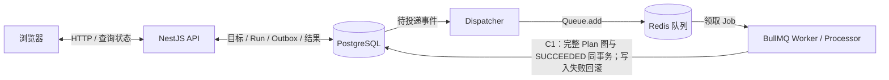

# KnowledgeOps Agent：九月底投递开发与学习计划

## 1. 当前约定

| 项目 | 已确认安排 |
| --- | --- |
| 版本与生效 | 2026-09-05 用户确认减负重排，替代旧版未完成逐日安排 |
| 硬目标 | 最晚 2026-09-30 开始前端实习投递；9/27 冻结功能，9/28 至 9/30 整理并投递 |
| 项目可用时间 | 工作日 2 至 3 小时、周末约 5 小时；前端基础与算法已有独立安排，不在这里另扣时间 |
| 容量估算 | 9/6 至 9/30 共 18 个工作日、7 个周末日，约 71 至 89 小时；偶尔 6 至 7 小时不提前计入 |
| 确定任务预算 | 约 65 小时，控制在 60 至 70 小时；含基础入门、阅读、手写、Review、验证、复述、周问答与文档 |
| 预算性质 | 用户项目投入估算，不是 AI 编码耗时或完成保证；按真实耗时复盘，剩余容量留作缓冲 |
| 当前活动阶段 | 阶段 2：目标、计划与基础工作台，`AI_IMPLEMENTING` |
| 当前活动单元 | 暂无；R02 / C1 已完成，下一单元 R03 为 `NOT_STARTED` |
| 下一步 | R03：按缩小后的阅读范围验证真实模型生成、失败、刷新与确认/开始任务；含 W1，不新增手写，不启动阶段 3 |
| 真相源 | [求职版 PRD](KnowledgeOps-Agent-9月求职版PRD.md)、[协作规则](../AGENTS.md)、[阶段技能](../.agents/skills/run-interview-project-stage/SKILL.md)、[学习档案](../问答.md) |

旧计划剩余 22 个开发日，按此前每个至少 4 小时估算已超过 88 小时，尚未包含阶段收尾。因此本次同时减少实现范围和重复学习关卡，不将旧日期整体顺延。

## 2. 历史与迁移边界

完整旧计划保存在 [2026-09-05 调整前归档](archive/KnowledgeOps-Agent-逐日开发计划-2026-09-05调整前.md)，包括原始逐日状态、验证限制、实际日期和阶段说明。归档只作历史参考，不是活动执行规则。

| 历史成果 | 保留状态与证据 |
| --- | --- |
| 阶段 0 | `DONE`，协作范式于 2026-07-31 建立 |
| 阶段 1，08-01 至 08-05 | `DONE`；阶段核心手写提交 `63c8e64`，阶段收尾 `8f77a6d`，2026-08-07 完成 |
| 阶段 2，08-06 至 08-11 | 六个计划日均 `DONE`；依次为 `f5c7b00`、`9e30a7c`、`01300f6`、`5f4a915`、`d161638`、`03311f1` |
| 阶段 2 整体 | 尚未完成；C1 专用验收、Review、短复述与独立提交完成；真实生成闭环待 R03 验证 |
| 已有问答与练习 | 原文和历史提交保留；本次不补考已完成日期，不将“待复习”改为“已掌握” |

旧阶段 2 的未完成核心手写迁移到 C1/R02；其未进行的宏观考试改为 W1 周问答。旧阶段 3、4、6 的强制核心手写取消，其业务代码与测试进入正常单元；旧阶段 5 的核心手写迁移到 C2/R14。这些是规则调整，不是宣称旧关卡已经完成。

| 旧未完成计划 | 新承接范围 |
| --- | --- |
| 阶段 2 核心与收尾 | R01 至 R03、W1 |
| 08-12 至 08-16 | R04 至 R07 |
| 08-17 至 08-22 | R08 至 R11 |
| 08-23 至 08-27 | R12 至 R15；SSE 受 9/20 检查约束 |
| 08-28 至 09-02、09-03 至 09-06 缓冲 | R16 至 R19 |

## 3. 九月范围与裁剪点

保留主线：创建并确认计划 → 开始 Markdown 任务 → 真实 GitHub Push → Diff Evidence → 笔记验收与可定位引用 → 回答一个必答追问 → 回答验收 → 任务通过并解锁下一项。

- 复用既有 Outbox、BullMQ、Worker、模型端口、Schema 与状态规则。
- 单用户一个活动仓库、一个分支、一个活动计划、一个执行中任务；报告先用简单列表、Diff 文本和可定位行号。
- 暂缓 Monaco、额外报告视图、反馈系统、ReAct/额外工具循环、检索、虚拟列表及装饰性功能。测试、授权、签名、业务幂等、引用有效性和真实失败路径仍保留。
- 运行状态、缓存一致性、刷新恢复、引用定位属于必交付；SSE 保留为本期条件目标，未通过恢复验收时不宣称支持。

### 9/20 的决策

检查证据必须是一条真实仓库 Push 到笔记报告、一个追问回答验收、任务 `PASSED` 与下一任务解锁的运行记录。测试 Fake 或仅有页面不能替代这个证据。

若截至 9/20 收尾仍未跑通上述闭环，执行用户已授权的裁剪：

1. SSE 实现单元 R13 标记 `DEFERRED`，不把它记成完成；暂缓实时通知与订阅能力。
2. R12/R15 保留真实运行快照、轮询、刷新恢复、引用定位、取消和失败重试。
3. C2/R14 改为轮询、刷新恢复和缓存一致性协调，只完成一个版本，不追加 SSE 补考。
4. PRD 条件验收按轮询版本执行，记录裁剪日期与证据；README、演示及简历不得写已实现 SSE。
5. 释放的时间优先补真实验收闭环与上线，不转投其他新功能。

若闭环已通过则继续 SSE；若后续恢复验收失败，作为 blocker 修复，不能把有缺口的 SSE 宣布为通过。需要额外范围变化时先形成具体裁剪建议，不自行降低幂等、授权或证据标准。

决策记录：`PENDING`，尚未到检查点，SSE 当前未延期。

## 4. 里程碑看板

预算是用户总投入，包含相关周问答；不是要求每天清空一个单元。9/27 后冻结功能，若仍存在 blocker 如实记录并修复，投递按实际可展示能力进行，不伪造上线或完成。

| 阶段/里程碑 | 日期窗口 | 预算 | 可验证终点 | 状态 | 下一关 |
| --- | --- | --- | --- | --- | --- |
| M2 阶段 2 收尾 | 9/6 至 9/8 | 7 小时 | C1 通过，真实计划生成、确认、开始任务可连续操作 | `AI_IMPLEMENTING` | R03 |
| M3 GitHub 与证据 | 9/9 至 9/14 | 15 小时 | GitHub 登录/绑定、合法真实 Push 保存 Diff；部署环境提前 smoke | `NOT_STARTED` | M2 完成后的范围讲解与首次授权 |
| M4 自动验收闭环 | 9/15 至 9/20 | 18 小时 | 报告、一个追问、回答验收、任务通过与解锁 | `NOT_STARTED` | M3 完成后的范围讲解与首次授权 |
| M5 前端恢复与联动 | 9/21 至 9/24 | 11 小时 | 恢复、引用、取消/重试可演示；C2 通过；SSE 按决策验收 | `NOT_STARTED` | 先读取 9/20 决策 |
| M6 上线与测量 | 9/25 至 9/27 | 10 小时 | 部署、固定 Demo、核心回归、真实指标与材料初稿 | `NOT_STARTED` | M5 完成后的范围讲解与首次授权 |
| M6 冻结与投递准备 | 9/28 至 9/30 | 4 小时 | 最终 smoke、可复述项目材料、用户开始投递 | `NOT_STARTED` | R16 至 R18 完成；不引入新功能 |
| 合计 | 9/6 至 9/30 | 65 小时 | 九月底投递目标 | — | — |

M6 两行属于同一阶段的不同窗口，不允许形成两个活动阶段。计划落地本身不消耗以上学习预算，也不把后续阶段标为已授权。

## 5. 学习单元队列

每次学习一个主要新概念，首轮约 2 至 3 个核心入口；一个单元可以分为多个时段。预算包含该单元所有用户投入，超出时记录原因，不临时增加作业。未来源码位置、验收用例和真实运行命令在单元启动时给出，不预先生成实现或声称脚本已经存在。

| 单元 | 归属 | 主要学习点与可观察结果 | 用户投入预算 | 手写安排 | 状态 |
| --- | --- | --- | --- | --- | --- |
| R01 | M2 | 最小 BullMQ 接入：入队、消费、停止/恢复；能定位项目装配 | 1 小时 | 基础操作与观察，非考试 | `DONE` |
| R02 | M2 | C1 原子成功落库：完整 Plan 与成功终态同时提交，过期/重复结果安全退出 | 原预算 3 小时；已报告 3.5 小时，后续新增修正/Review/复述时间未报告，不计作 0 | 核心 C1，原编码预算 1 至 2 小时；本轮不追加练习 | `DONE` |
| R03 | M2 | 从浏览器到完整计划的调用链：真实模型成功、失败、刷新与开始任务；阶段收尾 | 3 小时 | 不新增；含 W1 | `NOT_STARTED` |
| R04 | M3 | GitHub 身份与安装授权边界：真实登录、单仓库绑定/解绑 | 5 小时，分时段 | 一项回调 Controller 测试，25 至 35 分钟 | `NOT_STARTED` |
| R05 | M3 | Webhook 可信性：签名校验；复用已学事务与 Outbox 接受 Delivery | 3 小时 | 窄范围 HMAC 校验，25 至 35 分钟 | `NOT_STARTED` |
| R06 | M3 | Commit 快照与行号：compare、路径匹配、Diff/Evidence 持久化，重复 Push 安全 | 4 小时，分时段 | 不新增 | `NOT_STARTED` |
| R07 | M3 | 部署进程边界：在目标环境验证数据库、队列与真实 Webhook 链路 | 3 小时 | 不新增；含 W2 | `NOT_STARTED` |
| R08 | M4 | Markdown AST 到确定性检查与行号：结果可复现、引用可定位 | 4 小时，分时段 | 一项标题 Visitor 或章节检查，25 至 35 分钟 | `NOT_STARTED` |
| R09 | M4 | 候选结论到可信报告：复用模型端口，校验结构、引用、预算与失败输出 | 5 小时，分时段 | 不新增 | `NOT_STARTED` |
| R10 | M4 | 用户等待与后台运行分离：一个追问、回答提交与独立验收 Run | 4 小时，分时段 | 不新增 | `NOT_STARTED` |
| R11 | M4 | 从验收结果推导 Task：拒绝旧证据、通过后解锁；真实完整闭环与固定评测 | 5 小时，分时段 | 一项结果推导纯函数，25 至 35 分钟；含 W3 与 9/20 检查 | `NOT_STARTED` |
| R12 | M5 | 前端实体与页面状态边界：运行/报告、Diff、引用定位、错误/加载/空状态 | 2 小时 | 不新增 | `NOT_STARTED` |
| R13 | M5 | 持久化事件到 SSE：鉴权、cursor、历史/实时衔接与清理 | 3 小时 | 一项 cursor 输入校验，25 至 35 分钟；SSE 延期则整单元延期 | `NOT_STARTED` |
| R14 | M5 | C2 前端运行恢复：按 9/20 决策选择 SSE 或轮询版本 | 3 小时 | 核心 C2，编码 1 至 2 小时，余量用于准备和 Review | `NOT_STARTED` |
| R15 | M5 | 前端命令与持久化状态一致：取消、关联重试、刷新/断网回归及移动端/键盘检查 | 3 小时 | 不新增 | `NOT_STARTED` |
| R16 | M6 | 测试证据的边界：核心 E2E、越权、重复与关键 Worker 故障回归 | 3 小时 | 一项稳定 E2E 恢复断言，25 至 35 分钟 | `NOT_STARTED` |
| R17 | M6 | 发布后的可验证结果：生产迁移、smoke、关联日志、真实测量 | 4 小时，分时段 | 不新增 | `NOT_STARTED` |
| R18 | M6 | 演示与事实一致：固定 Demo、README/ADR、演示、简历初稿、功能冻结 | 3 小时 | 不新增；含 W4 | `NOT_STARTED` |
| R19 | M6 | 项目叙述与投递准备：最终 smoke、链接和简历定稿，用户开始投递 | 4 小时，跨冻结窗口 | 不新增；只复习已有核心手写 | `NOT_STARTED` |

R04 等较长单元按“先一个最小用法，再一个产品行为”拆成时段；若首轮仍依赖三种陌生机制，应继续拆分并保持总预算，不能一次性交付所有文件。周手写是参考频率，不为凑数新增；SSE 延期时 R13 小手写不补做。

2026-09-07 耗时调整：用户确认 C1 初版较快，累计 3.5 小时主要花在多轮修正；这已超过 R02 原单元预算，不将环境、准备和后续 Review 隐藏在编码预算外。R03 缩小阅读范围：首轮只读工作台页面和 Processor 两个入口，导读控制在约 15 分钟，不重新通读队列/数据库模块或展开锁与隔离级别专题；复用已有失败验收，保留真实模型成功、失败、刷新与确认/开始任务的闭环证据。W1 仍计入 R03 原 3 小时上限，不新增练习或以延长每天学习时间追赶。R02 收尾时用户尚未补报新增时间，实际总投入仅能确认至少 3.5 小时；M2 已知投入至少 4 小时 10 分钟（含 R01），不将未报告部分计作 0 或宣称仍在原 7 小时预算内。

### C1：当前保留的阶段 2 核心

- 入口：`apps/worker/src/plan-generation/finalize-plan-generation-run.ts`。
- 现状：用户修正三类 blocking 后再次确认交付；15 项专用验收全通过，140 项常规测试、8 项状态/计划生命周期集成测试及 1 项工作台读取集成测试通过，Review 通过。
- 学习范围：完整 Plan 图与运行终态同事务、运行版本与 deadline、重复/迟到结果的业务幂等。
- 现有专用命令：`pnpm test:handwrite:stage-2-finalization`；专用验收与受影响回归已通过，浏览器与真实模型 smoke 在 R03 执行。
- 旧 08-11 主体理解确认已经取得，不重复导读全部历史代码；本次契约和基础缺口仍需讲清。
- 当前状态：`DONE`；2026-09-07 修正后 Review、短复述与 C1 独立本地提交完成。AI 仅机械整理源码格式，未代改业务逻辑；[C1 手写说明](handwrite/stage-2-plan-generation-finalization.md)保留两轮 Review 证据。用户已报告 3.5 小时，后续新增时间未报告，未虚构总耗时。
- 短复述记录：用户自主说明了合法性检查、事务内行锁与版本复核、图写入失败回滚，以及成功后重放返回既有 `planId`。AI 校准“版本”为 `run.version / expectedRunVersion` 而非 Plan 版本，明确锁的是对应 Run 行、全部 Task 建立后写依赖、图与 Run 的 `SUCCEEDED / version + 1` 同事务。用户本次未单独口述验证步骤；结合此前亲自多轮运行专用验收的证据，补充以重复调用时“一份 Plan、同一 planId、版本只增加一次”为验证依据，本轮理解通过，不追加考试。此为单元复述，未记为 W1 或改写历史问答。

### C2：前端运行状态恢复

- 公共目标：URL 稳定 ID 恢复、请求错误与业务状态分离、查询/实体缓存一致、过期结果不能污染当前页面、终态及卸载清理。
- SSE 版本：在已有事件 API 与纯归并接口上，完成 replay/live 协调、重复/乱序与缺口恢复、重连及订阅清理。
- 轮询版本：在已有 API 与 Query 端口上，完成跨页面刷新恢复、运行 ID 切换后的过期响应隔离、终态停止、确认/重试后的缓存刷新；覆盖整个恢复调用链，不能重复抄写已完成的 08-11 退避函数。
- AI 准备公共接口、基础代码和黑盒验收，用户只完成核心协调逻辑；两个版本都控制在 1 至 2 小时，不能做两份。
- 文件和命令：M5 范围讲解时按实际代码确定。
- 当前状态：`NOT_STARTED`，版本待 9/20 决策；通过 Review 与回归后独立提交。

## 6. 只维护这一张主链路图

Dispatcher 和消费者目前同在 `apps/worker` 进程中，图按职责拆开。C1 成功写回箭头已通过正常图、回滚、终态/版本/deadline 跳过及同 Run 并发验收、Review 与短复述，并随 C1 独立提交；浏览器与真实模型链路待 R03。GitHub/验收/SSE 后续只补本次变化，不把目标架构说成已实现。

每次短复述仅定位本次入口、箭头、状态与一个失败出口。下一次约 5 分钟凭记忆恢复主链路；不要求全文重读已有长文档。

## 7. 周问答与细节记录

| 复盘 | 目标时点 | 约 20 分钟的重点 | 状态 |
| --- | --- | --- | --- |
| W1 | 9/8，R03 收尾 | 队列装配、重复执行与成功落库；复查 08-09/08-10 薄弱点，兼阶段 2 复盘 | `NOT_STARTED` |
| W2 | 9/14，R07 收尾 | 从签名到真实 Evidence 的职责与失败路径，兼阶段 3 复盘 | `NOT_STARTED` |
| W3 | 9/20，R11 收尾 | 笔记/回答 Run 分离、旧证据和任务通过，兼阶段 4 复盘 | `NOT_STARTED` |
| W4 | 9/27，R18 收尾 | 最近核心手写、前端恢复与发布事实，兼阶段 5/6 复盘 | `NOT_STARTED` |

时点可以在同周内调整；只问已经实现和阅读的内容，不因到日子考未来代码。每次一道主问题、最多两个紧密追问；用户回答后评价，结束后立即写入 `问答.md` 并独立提交。已验收单元不等待周问答才能提交，取消旧制每日新题与每阶段追加宏观考试。

普通细节超过 15 分钟记到下表，每周最多选一个深入；权限、数据丢失、重复写入、终态覆盖等关键不变量当场厘清。学习停止依据为能解释用途、输入输出/调用者、最小修改的验证方式和一个关键失败场景，不以清空全部疑问为目标。

| 疑问 | 代码或资料入口 | 何时值得深入 | 当前处理 |
| --- | --- | --- | --- |
| BullMQ 的初始化、配置与 Worker 连接尚未形成完整认识 | `apps/worker/src/worker-runtime.service.ts`、`apps/worker/src/queue/bullmq-plan-generation-queue.ts` | 真实连接或恢复异常再次出现时 | R01 已用最小实践补齐运行模型；更深参数按需查询 |

## 8. 状态、证据与收尾

阶段状态使用 `NOT_STARTED / EXPLAINING / AI_IMPLEMENTING / VERIFYING / DOCUMENTING / DONE / BLOCKED`；单元状态使用 `NOT_STARTED / PREREQUISITE / WORKING / WALKTHROUGH / WAITING_USER_CODE / REVIEWING / RECALL / DOCUMENTING / DONE / BLOCKED / DEFERRED`。可选基础、手写与 Review 分支按技能执行，不要求所有单元遍历所有状态。

完成一个单元需记录：实际日期与用户耗时、可观察结果、真实检查结果、导读理解确认、该单元安排的手写与 Review、短复述结论、已知限制和提交。无手写单元不补练习，纯基础单元保存真实操作与观察即可，不要求添加产品代码。

准备提交时将 `DONE` 与成果放入同一 commit，仅提交成功后才对外确认完成；失败保持或恢复 `DOCUMENTING`。C1/C2 独立提交，周问答独立提交，计划变更和阶段收尾也按明确范围提交。只暂存本次路径，排除既有无关改动、环境文件与密钥；不改写历史，不自动推送。

| 实际记录 | 日期 | 耗时/结果 | 下一步 |
| --- | --- | --- | --- |
| 用户确认九月减负重排 | 2026-09-05 | 文档调整；没有完成新的产品实现、入门实践、手写或问答 | R01 |
| R01 最小 BullMQ 接入 | 2026-09-06 | 约 40 分钟；Redis/PostgreSQL 连通；亲自观察两个 Job 的入队、消费、Worker 停止与恢复，最终 `wait=0 / completed=2`；能复述配置、Queue、Redis 与 Worker 关系 | R02 |
| R02 / C1 手写准备 | 2026-09-06 | 已确认 Finalizer 职责和超时结果跳过规则；WSL 服务恢复后 `infra:check` 通过；专用验收 10 项中 8 项因手写占位未实现失败、2 项仅抛错负例通过，不代表回滚已实现；编码与 Review 尚未完成，单元实际耗时待收尾记录 | 按 C1 说明手写，明确写完后 Review |
| R02 / C1 首轮 Review | 2026-09-07 | 用户报告手写与多轮修正共 3.5 小时，初版较快，主要耗时在反复修正；原 10 项全绿，扩充既有契约边界后 15 项中 10 通过、5 失败；类型与 lint 通过；实现未代改，格式待收尾机械整理 | 修正三类 blocking 后复查；不追加练习，R03 缩小阅读范围 |
| R02 / C1 修正后 Review | 2026-09-07 | 用户明确修正完成；15 项专用验收、140 项常规测试、8 项状态/计划生命周期集成与 1 项工作台集成通过，Worker 类型、相关 lint 与源码格式检查通过；三类 blocking 已修正，AI 仅机械格式化；本轮新增用户耗时待补记 | `RECALL`；约 5 分钟短复述后记录并独立提交，不追加练习 |
| R02 / C1 复述与收尾 | 2026-09-07 | 复述通过，校准 Run/Plan 版本与图写入顺序；提交前再次运行专用验收 15/15、Worker 类型检查通过；此前 140 项常规与 9 项相关集成回归证据保留。已报告 3.5 小时，后续新增时间未报告；本单元独立本地提交，不推送，不混入用户另两份笔记 | R02 `DONE`；下一单元 R03，不新增手写；W1 仍未开始 |
