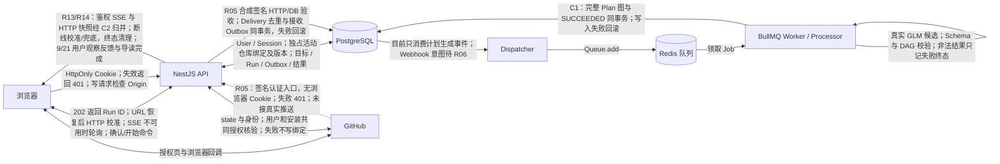

# KnowledgeOps Agent：九月底投递开发与学习计划

## 1. 当前约定

| 项目 | 已确认安排 |
| --- | --- |
| 版本与生效 | 2026-09-05 减负重排；2026-09-16 精简 SSE/C2 前移；2026-09-21 用户选择保留原业务开发顺序，投递不以完整闭环或上线为前置；历史记录不改写 |
| 硬目标 | 原最晚 2026-09-30 投递节点已过去，是否已投递未报告，不自动记为达成；10/9 用户恢复业务开发，投递不以完整闭环/上线为前置的约定保留。9/27 至 9/30 窗口保留为历史，不作为十月恢复开发的永久禁令 |
| 项目可用时间 | 工作日 2 至 3 小时、周末约 5 小时；前端基础与算法已有独立安排，不在这里另扣时间 |
| 容量估算 | 9/21 的九月容量核算仅作历史；十月可用时长未重新报告，不推算中断期投入或新完成日期。当前按 R05 原约 3 小时预算分时段恢复，不靠加班补旧排期 |
| 确定任务预算 | R14 收尾后原未完成单元合计约 47 小时，其中原冻结前任务约 43 小时，超过 9/22 至 9/27 容量约 21 至 25 小时；是待完成工作量，不是月底完成承诺。包含入门、阅读、手写、Review、验证、复述、周问答与文档 |
| 预算性质 | 用户项目投入估算，不是 AI 编码耗时或完成保证；按真实耗时复盘，剩余容量留作缓冲 |
| 当前活动阶段 | 阶段 3 / M3 `AI_IMPLEMENTING`；原 GitHub 范围授权保留；2026-09-17 用户在 SSE 范围讲解后明确“确认，请启动”，新增同步切片首次实现授权已取得 |
| 当前活动单元 | 暂无；R05 `DONE`（2026-10-10，随本次本地提交生效，手写/复述与接收回归通过），下一单元 R06 `NOT_STARTED`；累计已报告约 1.5 小时，其中手写约 45 分钟。R14/C2 DONE（`d7c2419`）、R13 DONE（`7000510`），不重开 |
| 下一步 | 按原业务顺序推进 R06：关联 Submission/AgentRun，读取 Commit/Diff 并保存 Evidence，接入后台消费与绑定重验；原预算约 4 小时，分时段、不新增手写。本轮仅预告，不将合成签名 HTTP 验收当作真实 GitHub 投递或上线证据 |
| 真相源 | [求职版 PRD](KnowledgeOps-Agent-9月求职版PRD.md)、[协作规则](../AGENTS.md)、[阶段技能](../.agents/skills/run-interview-project-stage/SKILL.md)、[学习档案](../问答.md) |

旧计划剩余 22 个开发日，按此前每个至少 4 小时估算已超过 88 小时，尚未包含阶段收尾。因此本次同时减少实现范围和重复学习关卡，不将旧日期整体顺延。

### 10/9 恢复点

用户在 2026-10-09 明确“进入下一步”，沿 9/21 保留原业务顺序的决定及既有 M3 授权恢复 R05。九月冻结与材料窗口已过去，作为历史记录保留，不据此永久阻止十月续做；不推断中断期学习耗时、投递结果或产品完成度。十月不自动恢复任何已延期扩展，单元预算和小步学习规则保留。

本次先以一组本地 HTTP 收发练习观察 Webhook 角色与重复投递，约 10 至 15 分钟计入 R05 原约 3 小时预算；练习只用合成数据，不含签名手写答案、不接数据库或真实 GitHub。恢复时尚无产品接口/Delivery 模型；同日理解确认后已接入主体，见末尾记录，签名手写和对应 Worker 消费仍未完成，不能把练习 202 当作业务可靠接收已完成。

### 9/21 容量复核与用户决策（保留业务顺序的依据）

- 用户已将项目用于简历和面试，并明确选择“保留原业务的开发顺序”，未采纳“先上线现有计划生成版本、自动验收延期”的范围调整建议。此反馈不等于确认已经投递、上线或通过面试，也不代表允许把未实现功能写成成果。
- 开发继续按 **R05 → R06 → R07 → R08 至 R12 → R15 至 R19** 推进。R07 的既定部署 smoke 和后续 M6 正式上线仍保留；不提前插入一轮完整上线，不删除原 GitHub 证据、笔记/回答验收、任务通过与解锁范围。原已延期功能仍 DEFERRED，不恢复额外 SSE 场景。
- 剩余预算核算：M3 的 R05–R07 共 10 小时，M4 共 18 小时，M5 共 5 小时，M6 共 14 小时，合计 47 小时。原冻结前任务 43 小时，未来冻结前容量 18–22 小时，缺口 21–25 小时。不得用加班、压缩基础导读或降低安全/一致性验收假装消除缺口；未完成工作不承诺九月底交付，新完成日期按实际进度复核。
- 求职与产品完成分开：最晚九月底开始投递，不以 M6/R19 完成、公开网址或原 PRD 全闭环为门槛；材料可先使用已实现的登录、异步计划生成、原子落库和 SSE 快照恢复。Webhook、自动验收和生产能力在验证前只能标注规划/开发中。用户的简历文件本轮未审阅或修改，不推断其具体措辞。
- 本次只确认开发顺序和投递不等待上线；**未自动取消原 9/27 冻结及 9/28–9/30 材料窗口**。如需在该窗口继续新功能开发，须另行确认。冻结不代表未完成单元 DONE，也不代表删除后续业务目标。
- 本轮为计划决策，不启动 R05 产品实现，不替代未来阶段授权或手写理解确认，不新增练习；历史手写和完成记录保持原样。

### 9/16 容量与执行顺序更新（历史基线）

- 当前证据仍为 R04 已完成（`49202d4`），不推断 9/11 至 9/15 的投入。9/16 至 9/30 共 11 个工作日、4 个周末日，按原预算约 42 至 53 小时；其中冻结前 9/16 至 9/27 约 36 至 44 小时，冻结后 6 至 9 小时不借作新功能时间。
- 原未完成 R05 至 R19 合计 **53 小时**；R13 收窄为 2 至 3 小时、R14 仍为 3 小时，重排后为 **52 至 53 小时**，不是额外新增 5 至 6 小时。冻结前 R13/R14、R05 至 R12、R15 至 R18 合计仍约 48 至 49 小时，超过冻结前容量约 4 至 13 小时。当前排期有明确缺口，不宣称仅调整顺序即可按时完成，也不擅自删其他 P0。
- 执行顺序：**R13 → R14/C2 → R05 → R06 → R07 → R08 至 R12 → R15 至 R19**。编号保留；R13/R14 从 M5 迁入当前 M3 的前端同步切片，M5 不再重复预算或学习，始终只有一个活动阶段和单元。
- 9/16 起的首个 5 至 6 小时学习窗口用于精简 SSE/C2，不承诺一天完成。达到上限仍有 blocker 时停止扩展并报告取舍，不追加时间硬追赶、不跳过授权或恢复验收。结束后立即回 GitHub 业务主线；9/20 强制复核实际剩余量并提出需要用户确认的其他裁剪，不能自动动用冻结窗口。
- 本次批准的是计划、范围和规则调整，不代表 SSE 已实现或取得首次编码授权。R04 不重开，R05 至 R19 不因日期到达改变完成状态。

## 2. 历史与迁移边界

完整旧计划保存在 [2026-09-05 调整前归档](archive/KnowledgeOps-Agent-逐日开发计划-2026-09-05调整前.md)，包括原始逐日状态、验证限制、实际日期和阶段说明。归档只作历史参考，不是活动执行规则。

| 历史成果 | 保留状态与证据 |
| --- | --- |
| 阶段 0 | `DONE`，协作范式于 2026-07-31 建立 |
| 阶段 1，08-01 至 08-05 | `DONE`；阶段核心手写提交 `63c8e64`，阶段收尾 `8f77a6d`，2026-08-07 完成 |
| 阶段 2，08-06 至 08-11 | 六个计划日均 `DONE`；依次为 `f5c7b00`、`9e30a7c`、`01300f6`、`5f4a915`、`d161638`、`03311f1` |
| 阶段 2 整体 | `DONE`，2026-09-09 收尾；C1、R03、W1 已独立提交，确认范围与失败路径核对通过，本地真实生成/恢复/确认/开始闭环完成；不代表 GitHub 验收或生产上线完成 |
| 已有问答与练习 | 原文和历史提交保留；本次不补考已完成日期，不将“待复习”改为“已掌握” |

旧阶段 2 的未完成核心手写迁移到 C1/R02；其未进行的宏观考试改为 W1 周问答。旧阶段 3、4、6 的强制核心手写取消，其业务代码与测试进入正常单元；旧阶段 5 的核心手写迁移到 C2/R14。这些是规则调整，不是宣称旧关卡已经完成。

| 旧未完成计划 | 新承接范围 |
| --- | --- |
| 阶段 2 核心与收尾 | R01 至 R03、W1 |
| 08-12 至 08-16 | R04 至 R07 |
| 08-17 至 08-22 | R08 至 R11 |
| 08-23 至 08-27 | R12 至 R15；9/16 将 R13/R14 精简并前移，完整历史重放延期 |
| 08-28 至 09-02、09-03 至 09-06 缓冲 | R16 至 R19 |

## 3. 九月范围与裁剪点

保留主线：创建并确认计划 → 开始 Markdown 任务 → 真实 GitHub Push → Diff Evidence → 笔记验收与可定位引用 → 回答一个必答追问 → 回答验收 → 任务通过并解锁下一项。

- 复用既有 Outbox、BullMQ、Worker、模型端口、Schema 与状态规则。
- 单用户一个活动仓库、一个分支、一个活动计划、一个执行中任务；报告先用简单列表、Diff 文本和可定位行号。
- 暂缓 Monaco、额外报告视图、反馈系统、ReAct/额外工具循环、检索、虚拟列表及装饰性功能。测试、授权、签名、业务幂等、引用有效性和真实失败路径仍保留。
- 运行状态、缓存一致性、刷新恢复、引用定位属于必交付；计划生成的精简 SSE 状态同步优先交付，保留轮询兜底。完整历史事件时间线与重放明确 DEFERRED，不因精简 SSE 完成就宣称支持。

### 9/20 的决策

检查证据必须是一条真实仓库 Push 到笔记报告、一个追问回答验收、任务 `PASSED` 与下一任务解锁的运行记录。测试 Fake 或仅有页面不能替代这个证据。

2026-09-16 用户已确认以下规则替代旧版“9/20 未闭环就延期全部 SSE”：

1. 保留优先计划的精简 SSE；不自动撤销已验收能力、不把未完成 R13 标为 DONE。完整历史事件重放已 DEFERRED，无需等到 9/20。
2. C2/R14 固定为 SSE 快照恢复与轮询兜底协调，只做一次；不在 9/20 切换成第二套练习。
3. 未闭环时停止 SSE 新场景、时间线或通知架构扩展，优先回到真实 Push、报告、任务状态与上线；R12/R15 可继续用轮询读取 AgentRun，必须保留恢复、引用、取消和关联重试。
4. 检查 9/27 冻结前剩余容量；若仍有缺口，提出具体 P0 取舍请求，不自动压缩安全、幂等或证据标准，不要求延长每日学习。
5. 简历区分“状态同步/快照恢复”与“完整事件重放”，只写实际通过验证的能力。SSE 自身未通过的恢复问题仍是 blocker，不能以连接成功代替验收。

即使业务闭环提前通过，也不自动恢复已延期的完整事件重放；空余时间优先用于上线、回归与材料。新范围需要另行确认。

决策记录：9/20 检查于 9/21 补做，结论为原业务闭环尚未实现，容量存在明确缺口，不是验收通过。精简 SSE/C2 已 DONE（`7000510` / `d7c2419`），完整历史事件重放仍 DEFERRED。用户选择保留原业务开发顺序，接受产品完整交付/上线不作为九月底投递前置；具体边界见第 1 节 9/21 决策。

## 4. 里程碑看板

预算是用户总投入，包含相关周问答；不是要求每天清空一个单元。以下日期窗口保留原基线，不再视为完整产品的月底交付承诺。原 9/27 冻结与 9/28–9/30 材料窗口暂不改；投递按实际可展示能力进行，不等所有阶段结束，不伪造上线或完成。

| 阶段/里程碑 | 日期窗口 | 预算 | 可验证终点 | 状态 | 下一关 |
| --- | --- | --- | --- | --- | --- |
| M2 阶段 2 收尾 | 9/6 至 9/8 | 7 小时 | C1 通过，真实计划生成、确认、开始任务可连续操作 | `DONE` | 实际 9/9 完成，比目标晚一天；收尾提交 `37cc373`，后续已进入 M3 |
| M3 GitHub 与证据（含前移同步切片） | 原窗口仅作历史；10/10 R05 收尾，完成日期按实际进度复核 | 原 15 小时 + 转入 5 至 6 小时；R04 已超原预算 1.5 至 2 小时 | 精简 SSE/C2；GitHub 登录/绑定、合法真实 Push 保存 Diff；部署环境提前 smoke | `AI_IMPLEMENTING` | R05 已完成；下一单元 R06，不提前插入全面上线 |
| M4 自动验收闭环 | 原 9/15 至 9/20 目标高风险；9/20 如实检查，不视为完成承诺 | 18 小时 | 报告、一个追问、回答验收、任务通过与解锁 | `NOT_STARTED` | M3 完成后的范围讲解与首次授权 |
| M5 前端恢复与联动 | 原 9/21 至 9/24；依赖 M4，9/20 复核容量 | 5 小时（原 11 中 R13/R14 转出，不重复计费） | 复用 C2，报告/引用、取消/重试与恢复可演示 | `NOT_STARTED` | R12/R15；不再安排第二份 C2 或完整事件重放 |
| M6 上线与测量 | 9/25 至 9/27 | 10 小时 | 部署、固定 Demo、核心回归、真实指标与材料初稿 | `NOT_STARTED` | M5 完成后的范围讲解与首次授权 |
| M6 材料与收尾 | 原 9/28 至 9/30；完整产品收尾日期待复核 | 4 小时 | 当前能力材料与投递先行，未来补全完整产品 smoke 与材料 | `NOT_STARTED` | 产品验收依赖 R16 至 R18；投递与当前材料不依赖它们，不等本行 DONE |
| 合计 | 原 9/6 至 9/30 基线，完整交付日期待复核 | 原名义预算 64 至 65 小时；9/21 未完成工作约 47 小时 | 九月底投递目标不变，剩余容量与缺口见 9/21 决策 | — | — |

M6 两行属于同一阶段的不同窗口，不允许形成两个活动阶段。计划落地本身不消耗以上学习预算，也不把后续阶段标为已授权。

## 5. 学习单元队列

每次学习一个主要新概念，首轮约 2 至 3 个核心入口；一个单元可以分为多个时段。预算包含该单元所有用户投入，超出时记录原因，不临时增加作业。未来源码位置、验收用例和真实运行命令在单元启动时给出，不预先生成实现或声称脚本已经存在。

| 单元 | 归属 | 主要学习点与可观察结果 | 用户投入预算 | 手写安排 | 状态 |
| --- | --- | --- | --- | --- | --- |
| R01 | M2 | 最小 BullMQ 接入：入队、消费、停止/恢复；能定位项目装配 | 1 小时 | 基础操作与观察，非考试 | `DONE` |
| R02 | M2 | C1 原子成功落库：完整 Plan 与成功终态同时提交，过期/重复结果安全退出 | 原预算 3 小时；已报告 3.5 小时，后续新增修正/Review/复述时间未报告，不计作 0 | 核心 C1，原编码预算 1 至 2 小时；本轮不追加练习 | `DONE` |
| R03 | M2 | 从浏览器到完整计划的调用链：真实模型成功、失败、刷新与开始任务；阶段收尾 | 原预算 3 小时；R03 约 30 分钟 + W1 约 30 分钟，已报告合计约 1 小时；后续阶段收尾投入另记 | 不新增；W1 独立记账但计入原预算 | `DONE` |
| R04 | M3 | GitHub 身份与安装授权边界：真实登录、单仓库绑定/解绑 | 原预算 5 小时；用户估计累计 6.5 至 7 小时（含小手写约 1 小时），超出约 1.5 至 2 小时；额外代码咨询及 Vitest 不熟悉导致卡顿 | 回调 Controller 测试原预算 25 至 35 分钟，已报告约 1 小时；2026-09-10 修正 B1 后 3 项通过、Review 与短复述通过，不追加练习 | `DONE`（2026-09-10，随本次单元提交生效） |
| R05 | M3 | Webhook 可信性：签名校验；复用已学事务与 Outbox 接受 Delivery，按独占活动仓库定位单一绑定 | 原预算 3 小时；10/10 用户报告累计约 1.5 小时，包含手写约 45 分钟；后续投入未报告，不推算 | 窄范围 HMAC 原预算 25 至 35 分钟，实际约 45 分钟；Review 通过，正则由 AI 经授权补充，不追加练习 | `DONE`（2026-10-10，随本次单元提交生效） |
| R06 | M3 | Commit 快照与行号：compare、路径匹配、Diff/Evidence 持久化，重复 Push 安全；将 R05 中间态补齐为 PRD 12.3 的关联事务与后台消费 | 4 小时，分时段；启动时复核承接量，不追加手写 | 不新增 | `NOT_STARTED` |
| R07 | M3 | 部署进程边界：在目标环境验证数据库、队列与真实 Webhook 链路 | 3 小时 | 不新增；含 W2 | `NOT_STARTED` |
| R08 | M4 | Markdown AST 到确定性检查与行号：结果可复现、引用可定位 | 4 小时，分时段 | 一项标题 Visitor 或章节检查，25 至 35 分钟 | `NOT_STARTED` |
| R09 | M4 | 候选结论到可信报告：复用模型端口，校验结构、引用、预算与失败输出 | 5 小时，分时段 | 不新增 | `NOT_STARTED` |
| R10 | M4 | 用户等待与后台运行分离：一个追问、回答提交与独立验收 Run | 4 小时，分时段 | 不新增 | `NOT_STARTED` |
| R11 | M4 | 从验收结果推导 Task：拒绝旧证据、通过后解锁；真实完整闭环与固定评测 | 5 小时，分时段 | 一项结果推导纯函数，25 至 35 分钟；含 W3 与 9/20 检查 | `NOT_STARTED` |
| R12 | M5 | 前端实体与页面状态边界：运行/报告、Diff、引用定位、错误/加载/空状态 | 2 小时 | 不新增 | `NOT_STARTED` |
| R13 | M3 前移（原 M5） | 计划生成的鉴权 SSE 状态快照、真实跨进程读取与连接清理；非 Token 流 | 原预算 2 至 3 小时；9/17 用户报告累计实际约 35 分钟，含入门、观察、导读与提问 | 取消原 cursor 小手写，预算让给 C2；不新增练习 | `DONE`（观察、导读、短复述与相关验证通过，随本次单元提交收尾） |
| R14 | M3 前移（原 M5） | C2：SSE/HTTP 快照版本协调、刷新/重连恢复、Run 切换隔离与轮询兜底 | 3 小时；R13 实际约 35 分钟，结余作缓冲不扩张范围；用户此前确认 R14 投入在计划之内，最终精确时长未报告 | 核心 C2，编码 1 至 2 小时，准备/Review/验证计入剩余时间；独立提交，只做一次 | `DONE`（2026-09-21，随本次独立提交生效；观察反馈、接入理解及短复述完成） |
| R15 | M5 | 前端命令与持久化状态一致：取消、关联重试、刷新/断网回归及移动端/键盘检查 | 3 小时 | 不新增 | `NOT_STARTED` |
| R16 | M6 | 测试证据的边界：核心 E2E、越权、重复与关键 Worker 故障回归 | 3 小时 | 一项稳定 E2E 恢复断言，25 至 35 分钟 | `NOT_STARTED` |
| R17 | M6 | 发布后的可验证结果：生产迁移、smoke、关联日志、真实测量 | 4 小时，分时段 | 不新增 | `NOT_STARTED` |
| R18 | M6 | 演示与事实一致：固定 Demo、README/ADR、演示、简历初稿、功能冻结 | 3 小时 | 不新增；含 W4 | `NOT_STARTED` |
| R19 | M6 | 项目叙述与投递准备：最终 smoke、链接和简历定稿，用户开始投递 | 4 小时，跨冻结窗口 | 不新增；只复习已有核心手写 | `NOT_STARTED` |

R04 等较长单元按“先一个最小用法，再一个产品行为”拆成时段；若首轮仍依赖三种陌生机制，应继续拆分并保持总预算，不能一次性交付所有文件。周手写是参考频率，不为凑数新增；R13 原 cursor 小手写随重放范围延期，不补做。表按编号保留，执行顺序以 9/16 更新为准。

2026-09-07 耗时调整：用户确认 C1 初版较快，累计 3.5 小时主要花在多轮修正；这已超过 R02 原单元预算，不将环境、准备和后续 Review 隐藏在编码预算外。R03 缩小阅读范围：首轮只读工作台页面和 Processor 两个入口，导读控制在约 15 分钟，不重新通读队列/数据库模块或展开锁与隔离级别专题；复用已有失败验收，保留真实模型成功、失败、刷新与确认/开始任务的闭环证据。W1 仍计入 R03 原 3 小时上限，不新增练习或以延长每天学习时间追赶。R02 收尾时用户尚未补报新增时间，实际总投入仅能确认至少 3.5 小时；M2 已知投入至少 4 小时 10 分钟（含 R01），不将未报告部分计作 0 或宣称仍在原 7 小时预算内。

### C1：当前保留的阶段 2 核心

- 入口：`apps/worker/src/plan-generation/finalize-plan-generation-run.ts`。
- 现状：用户修正三类 blocking 后再次确认交付；15 项专用验收全通过，140 项常规测试、8 项状态/计划生命周期集成测试及 1 项工作台读取集成测试通过，Review 通过。
- 学习范围：完整 Plan 图与运行终态同事务、运行版本与 deadline、重复/迟到结果的业务幂等。
- 现有专用命令：`pnpm test:handwrite:stage-2-finalization`；专用验收与受影响回归已通过，浏览器与真实模型 smoke 在 R03 执行。
- 旧 08-11 主体理解确认已经取得，不重复导读全部历史代码；本次契约和基础缺口仍需讲清。
- 当前状态：`DONE`；2026-09-07 修正后 Review、短复述与 C1 独立本地提交完成。AI 仅机械整理源码格式，未代改业务逻辑；[C1 手写说明](handwrite/stage-2-plan-generation-finalization.md)保留两轮 Review 证据。用户已报告 3.5 小时，后续新增时间未报告，未虚构总耗时。
- 短复述记录：用户自主说明了合法性检查、事务内行锁与版本复核、图写入失败回滚，以及成功后重放返回既有 `planId`。AI 校准“版本”为 `run.version / expectedRunVersion` 而非 Plan 版本，明确锁的是对应 Run 行、全部 Task 建立后写依赖、图与 Run 的 `SUCCEEDED / version + 1` 同事务。用户本次未单独口述验证步骤；结合此前亲自多轮运行专用验收的证据，补充以重复调用时“一份 Plan、同一 planId、版本只增加一次”为验证依据，本轮理解通过，不追加考试。此为单元复述，未记为 W1 或改写历史问答。

### R13 与 C2/R14：精简 SSE 与前端恢复（9/16 替换安排）

- IN：只接现有 PlanGenerationRun，首次 HTTP 完整快照、带权限校验的 SSE 最新状态同步、重连/刷新校准、Run ID 与版本隔离、终态/卸载/切换/退出清理、持续连接失败时轮询兜底。连接错误不写成业务 FAILED；正常 SSE 与兜底轮询不长期并行。
- OUT / DEFERRED：持久化事件日志与 cursor/Last-Event-ID 全历史重放、复杂时间线、模型逐字 Token 流、通用事件平台。本次不提前实现 AgentRun 工作流，也不重开 C1/旧轮询手写。
- R13：按缺口先做最小 EventSource 收发、断开与 close 观察，约 20 至 30 分钟计入 2 至 3 小时，不另开课程。AI 提供后端协议与装配，消息必须来自真实持久化状态；Worker/API 分进程不能靠进程内 emitter 假连通。首轮只读 SSE 接口与前端订阅入口，暂不生成真实 C2 缺口的等价答案。
- R14/C2：AI 准备 HTTP/SSE 端口、生命周期装配和黑盒测试，用户只写有界的快照归并与恢复协调；包含首次查询/订阅竞态、重复或旧版本、Run 切换迟到结果、重连校准、终态/卸载停止和兜底切换。核心编码 1 至 2 小时，Review/回归计入本单元 3 小时；不要求另手写测试夹具。
- 首次查询与订阅之间的变化、掉线期间进入终态必须能通过建连/重连快照恢复，不能只等下一次状态变化；同版本重复应无副作用。鉴权失败不能无限重连或无限轮询；会话失效/退出须停止读取。后端适配、心跳、连接限制、代理不缓冲和资源释放均由 AI 做风险相称验证，不作为额外必读课程。
- 可演示验收：真实生成中观察状态变化；刷新仍恢复；断网期间任务完成，恢复网络后取得终态和结果；从 A 切到 B 后 A 的迟到响应不污染 B；关闭页面/终态不遗留订阅或定时器；SSE 持续不可用时轮询仍恢复正确结果。自动检查覆盖越权与旧版本合并；本地观察不能替代 R07/R17 的部署链路验证。
- 9/17 首次范围授权已取得，R13 已完成并提交 `7000510`；C2 说明见[手写契约](handwrite/r14-plan-run-recovery.md)，唯一手写入口 `apps/web/app/lib/plan-run-recovery.exercise.ts`，命令 `pnpm test:handwrite:r14-recovery`。9/18 手写 Review 与页面集成工程验收通过，9/21 用户观察反馈、接入理解及短复述完成，随本次独立提交记为 DONE。M5 只复用，不补第二份轮询或 SSE 手写；后续手写必须先完成业务上下文导读，不再用旧技术入口理解替代本题准备。
- 讲解与简历边界：可在验证后写“SSE 状态同步、断线快照恢复、缓存一致性与轮询降级”；不能写“完整事件断点续传”“Token 流式生成”或未经测量的性能收益。

## 6. 只维护这一张主链路图

Dispatcher 和消费者目前同在 `apps/worker` 进程中，图按职责拆开。C1 成功写回箭头已通过正常图、回滚、终态/版本/deadline 跳过及同 Run 并发验收、Review 与短复述，并随 C1 独立提交。2026-09-08 R03 已观察浏览器真实 GLM 生成与刷新恢复、失败保留目标且没有 Plan、关联新 Run 重试成功、确认计划与开始任务；两个入口导读获用户确认，短复述通过，校准 Run/Outbox 提交先于 202、Dispatcher 后续投递及刷新可能读到运行中快照。GitHub/验收/SSE 后续只补本次变化，不把目标架构说成已实现。

2026-09-10 R04 登录箭头的真实产品观察由用户确认：GitHub 登录成功后进入工作台，刷新保持会话，退出后访问工作台回登录页。结合 User/Session 与 Cookie 的既有实现和自动测试，登录切片行为、导读、手写 Review 与短复述已通过；不扩张为已验证 API 重启恢复、安装授权、仓库绑定或生产部署。

2026-09-10 绑定箭头已实现并通过 GitHub 上游夹具、真实数据库集成及隔离 UI 检查。真实 App 私钥匹配和 Contents 只读已由 GitHub 返回 200 验证；用户已确认真实仓库页面观察完成，包括绑定、刷新仍存在、解绑、刷新仍未绑定。绑定短复述已完成，校准成功快照直接更新缓存与重复提交的版本例外。图中的绑定箭头不代表 Webhook、后台读取或后续分析停止链路已完成，R05/R06 必须按 enabled 与绑定身份做接收/执行校验。

每次短复述仅定位本次入口、箭头、状态与一个失败出口。下一次约 5 分钟凭记忆恢复主链路；不要求全文重读已有长文档。

## 7. 周问答与细节记录

| 复盘 | 目标时点 | 约 20 分钟的重点 | 状态 |
| --- | --- | --- | --- |
| W1 | 9/8，R03 收尾 | 队列装配、重复执行与成功落库；复查 08-09/08-10 薄弱点，兼阶段 2 复盘 | `DONE`；9/8 至 9/9，实际约 30 分钟。重投方向正确，事务术语需复习；Job ID 追问转为讲解，未记为自主答对；迟到结果跳过回答正确。真实回答、评价和复习动作已归档，随本次独立文档提交保存 |
| W2 | 原 9/14 已错过；随 R07 实际收尾，不补考未来代码 | 从签名到真实 Evidence 的职责与失败路径，兼阶段 3 复盘 | `NOT_STARTED` |
| W3 | 随 R11 实际收尾；9/20 检查独立执行 | 笔记/回答 Run 分离、旧证据和任务通过，兼阶段 4 复盘 | `NOT_STARTED` |
| W4 | 9/27，R18 收尾 | 最近核心手写、前端恢复与发布事实，兼阶段 5/6 复盘 | `NOT_STARTED` |

时点可以在同周内调整；只问已经实现和阅读的内容，不因到日子考未来代码。每次一道主问题、最多两个紧密追问；用户回答后评价，结束后立即写入 `问答.md` 并独立提交。已验收单元不等待周问答才能提交，取消旧制每日新题与每阶段追加宏观考试。

普通细节超过 15 分钟记到下表，每周最多选一个深入；权限、数据丢失、重复写入、终态覆盖等关键不变量当场厘清。学习停止依据为能解释用途、输入输出/调用者、最小修改的验证方式和一个关键失败场景，不以清空全部疑问为目标。

| 疑问 | 代码或资料入口 | 何时值得深入 | 当前处理 |
| --- | --- | --- | --- |
| BullMQ 的初始化、配置与 Worker 连接尚未形成完整认识 | `apps/worker/src/worker-runtime.service.ts`、`apps/worker/src/queue/bullmq-plan-generation-queue.ts` | 真实连接或恢复异常再次出现时 | R01 已用最小实践补齐运行模型；更深参数按需查询 |

## 8. 状态、证据与收尾

阶段状态使用 `NOT_STARTED / EXPLAINING / AI_IMPLEMENTING / VERIFYING / DOCUMENTING / DONE / BLOCKED`；单元状态使用 `NOT_STARTED / PREREQUISITE / WORKING / WALKTHROUGH / WAITING_USER_CODE / REVIEWING / RECALL / DOCUMENTING / DONE / BLOCKED / DEFERRED`。可选基础、手写与 Review 分支按技能执行，不要求所有单元遍历所有状态。

完成一个单元需记录：实际日期与用户耗时、可观察结果、真实检查结果、导读理解确认、该单元安排的手写与 Review、短复述结论、已知限制和提交。无手写单元不补练习，纯基础单元保存真实操作与观察即可，不要求添加产品代码。

准备提交时将 `DONE` 与成果放入同一 commit，仅提交成功后才对外确认完成；失败保持或恢复 `DOCUMENTING`。C1/C2 独立提交，周问答独立提交，计划变更和阶段收尾也按明确范围提交。只暂存本次路径，排除既有无关改动、环境文件与密钥；不改写历史，不自动推送。

| 实际记录 | 日期 | 耗时/结果 | 下一步 |
| --- | --- | --- | --- |
| 用户确认九月减负重排 | 2026-09-05 | 文档调整；没有完成新的产品实现、入门实践、手写或问答 | R01 |
| R01 最小 BullMQ 接入 | 2026-09-06 | 约 40 分钟；Redis/PostgreSQL 连通；亲自观察两个 Job 的入队、消费、Worker 停止与恢复，最终 `wait=0 / completed=2`；能复述配置、Queue、Redis 与 Worker 关系 | R02 |
| R02 / C1 手写准备 | 2026-09-06 | 已确认 Finalizer 职责和超时结果跳过规则；WSL 服务恢复后 `infra:check` 通过；专用验收 10 项中 8 项因手写占位未实现失败、2 项仅抛错负例通过，不代表回滚已实现；编码与 Review 尚未完成，单元实际耗时待收尾记录 | 按 C1 说明手写，明确写完后 Review |
| R02 / C1 首轮 Review | 2026-09-07 | 用户报告手写与多轮修正共 3.5 小时，初版较快，主要耗时在反复修正；原 10 项全绿，扩充既有契约边界后 15 项中 10 通过、5 失败；类型与 lint 通过；实现未代改，格式待收尾机械整理 | 修正三类 blocking 后复查；不追加练习，R03 缩小阅读范围 |
| R02 / C1 修正后 Review | 2026-09-07 | 用户明确修正完成；15 项专用验收、140 项常规测试、8 项状态/计划生命周期集成与 1 项工作台集成通过，Worker 类型、相关 lint 与源码格式检查通过；三类 blocking 已修正，AI 仅机械格式化；本轮新增用户耗时待补记 | `RECALL`；约 5 分钟短复述后记录并独立提交，不追加练习 |
| R02 / C1 复述与收尾 | 2026-09-07 | 复述通过，校准 Run/Plan 版本与图写入顺序；提交前再次运行专用验收 15/15、Worker 类型检查通过；此前 140 项常规与 9 项相关集成回归证据保留。已报告 3.5 小时，后续新增时间未报告；本单元独立本地提交，不推送，不混入用户另两份笔记 | R02 `DONE`；下一单元 R03，不新增手写；W1 仍未开始 |
| 9/7 今日收尾 | 2026-09-07 | 用户确认熟悉 Finalizer 的 Run 时间/版本/状态校验、重复落库幂等、过期结果跳过与事务原子落库，并在实践中熟悉项目数据库模型及 Prisma 常用 API；本轮理解目标达到，不等同于全面掌握 Prisma。C1 已提交 `c891f32`；耗时沿用已报告 3.5 小时，新增部分未报告，不重复计时。本次只补记日收尾，不新增测试、手写或周问答 | 今日停止学习；阶段 2 尚未完成，9/8 收尾目标有风险但截至 9/7 尚未到期。下次先启动现有基础设施与应用，进入 R03 验证一条真实计划生成成功链路，再验证刷新、确认/开始任务及失败路径；R03 含 W1 原预算约 3 小时 |
| R03 启动检查 | 2026-09-07 | 用户再次明确进入下一步；首次检查 PostgreSQL/Redis 连接被拒绝，执行既有 `infra:up` 后 `infra:check` 通过（PostgreSQL 14.23、Redis 7.4.10）。本地模型密钥与目录未配置，仅检查是否存在，未输出密钥。用户选择 GLM-5.3 和自定义 Base URL；现有适配器可传入 Base URL，实际端点、模型访问权限及结构化输出兼容性尚未实测；应用与真实生成验收尚未启动，投入时间未报告 | 确认不含凭据的 Base URL，用户在本地 `.env` 配置后继续真实生成；不使用 Mock 替代，不标记 R03 完成 |
| R03 重启恢复与真实联调 | 2026-09-08 | 用户已启动 WSL/数据库；Windows 到 PostgreSQL/Redis 实测正常，Web/API/Worker 已恢复。修复 Worker 在 tsx 不生成类型元数据时的依赖注入，新增启动回归。首次浏览器调用约 53.478 秒后 FAILED，Plan 数量 0；独立受限诊断发现 SDK 对缺字段输出抛出 Zod 错误，原适配器误归类上游失败。新增显式 JSON 模式配置、提示内 Schema 与错误分类，保留所有业务校验，未改 C1。页面关联重试成功，排队至完成 96.240 秒，3 Stage / 7 Task，仅一份 Plan；DRAFT 确认后 ACTIVE，根任务 READY，开始后 IN_PROGRESS，刷新保持。145 项常规、9 项相关数据库集成、15 项 C1 验收通过，Worker/agent-core 类型及相关 lint/格式通过。两次业务模型调用、一次不落库的诊断调用；非生产性能指标，实际用户学习耗时未报告 | `WALKTHROUGH`；只读两个核心入口，用户确认后短复述并提交；W1 未开始。生成的七个任务是验收数据，不是新增学习作业 |

R03 本地复现入口（保留验收数据，不含密钥）：成功 Run `869dbeb3-e474-4898-85c9-c1314fd78cb8`，关联失败 Run `08e13a2d-413f-4230-acb3-aa7c6714b47d`；Plan `0d8144a2-8a31-454f-ba10-00241d04f773`，已开始 Task `7fde9e69-f607-4707-b814-269c4dc6e389`。可访问 `/app/plan?goal=5d3c66cd-d5da-48c2-86bb-cc8b9dbf043d&run=869dbeb3-e474-4898-85c9-c1314fd78cb8` 与 `/app/tasks/7fde9e69-f607-4707-b814-269c4dc6e389`；失败 Run 仍为 FAILED/version 2，成功 Run 为 SUCCEEDED/version 2。配置方法见[本地开发指南](local-development.md#51-模型目录与计划生成适配层)。R03 成果与 DONE 状态随本次本地提交保存；阶段 2 整体仍待 W1 与阶段收尾。

2026-09-08 R03 导读确认：用户询问 Processor 的 Port 注入，结合 `worker.module.ts` 解释工厂 Provider、运行时 Symbol 标识与构造函数参数的对应关系后，用户明确表示“这两个入口我都明白了”。单元进入 `RECALL`；只做本次链路短复述，不新增手写或自动开始 W1。实际用户投入待补记，本轮未修改产品代码、未重复调用模型。

2026-09-08 R03 复述与收尾：用户报告本单元投入约 30 分钟，自主串起 URL 中 Run ID、TanStack Query 重新查询、API 读取数据库、后台队列/Processor 生成与原子落库、轮询获得结果及缺字段失败路径。AI 校准：目标先单独持久化，生成请求在 Run + Outbox 同事务提交成功后返回 202，不是先返回再落库或由 API 直接投递 Redis；Dispatcher 后续投递携带 Run ID 的 Job。刷新取得的是当前快照，可能仍为 QUEUED/RUNNING；缺字段由模型适配层/候选校验拒绝，Processor 捕获并条件记录 FAILED，前端再查询到失败，不能写半份 Plan。用户已说清稳定 URL/Run ID，但未单独口述 Network 验证；结合此前浏览器证据补充“刷新只有读取请求、没有新增生成 POST、Run ID 不变”，不追加考试。本轮理解目标通过，未虚构为 W1 回答或全面掌握依赖注入。

提交前再次运行 145 项常规测试、Worker 与 agent-core 类型检查全部通过；沿用本单元真实浏览器验收、9 项数据库集成、15 项 C1 专用验收与相关 lint/格式证据。本次只提交 R03 修复、测试、配置示例和文档；排除实际 `.env`、密钥、用户另两份笔记，不改 C1、不重复调用模型、不推送。M2 已报告投入合计约 4 小时 40 分钟（R01 40 分钟 + R02 至少 3.5 小时 + R03 约 30 分钟），R02 后续未报告部分与尚未进行的 W1 不计作 0；不据此宣称完整阶段预算已经结算。

2026-09-09 W1 收尾：问答于 9/8 开始、9/9 完成，用户报告实际约 30 分钟，比原约 20 分钟多约 10 分钟；过程包含 Outbox 两次事务的校准和 Job ID 重投讲解。两道主问题后结束，不扩展为后端专题或追加手写。用户独立判断迟到合法候选应因版本不匹配和超时返回 SKIPPED，AI 补充该 Run 保持 TIMED_OUT/version 2、对应 Plan 不创建；Job ID 追问由 AI 讲解，未伪记自主作答。真实回答、评价、参考答案与一项复习动作见[W1 学习档案](../问答.md#2026-09-09周问答-w1r01-至-r03c1)。仅修改问答与本计划并独立提交，不修改产品代码、不重复运行模型或宣称本次重跑了产品测试，不纳入用户已有笔记和简历。

截至 W1 收尾，M2 已报告投入至少约 5 小时 10 分钟（R01 40 分钟 + R02 至少 3.5 小时 + R03 30 分钟 + W1 30 分钟）；R02 后续未报告部分仍不计作 0，阶段收尾尚未执行，不据此宣称完整阶段预算已结算。W1 比原目标日期晚一天完成，M2 已跨过 9/8 窗口；接下来只核对阶段收尾，不靠加题或叠加学习单元追赶，阶段 3 仍未启动或取得首次实现授权。

## 9. 阶段 2 收尾（2026-09-09）

阶段按已确认范围完成，未新增功能、手写或宏观题。旧 08-06 至 08-11 的源码、练习与历史记录保持原样，后续只由本计划驱动。

| 关闭条件 | 核对证据 |
| --- | --- |
| 接受生成与后台处理 | 目标独立持久化；Run + Outbox 提交后返回 202；Dispatcher 入队、Worker 调模型，真实行为由 9/8 R03 验证 |
| 原子成功与失败边界 | C1 `c891f32`；9/8 专用验收 15/15，覆盖正常图、重放、同 Run 并发、终态/版本/deadline 跳过、身份错误和回滚；既有 Review 前提继续有效 |
| 浏览器纵向闭环 | R03 `277d5d4`；真实失败保留目标且无 Plan，关联新 Run 重试成功生成 3 Stage / 7 Task，刷新恢复，确认后 ACTIVE/根任务 READY，开始后 IN_PROGRESS 与路径持久化 |
| 查询与命令一致性 | 9/8 相关数据库集成 9/9，覆盖领取版本、失败/超时、计划确认与任务开始、所有权及工作台读取；08-11 保留桌面/移动端与真实状态检查记录 |
| 学习关卡 | R01 `d75e080`、C1、R03 均已导读/复述并提交；W1 `7b1450f` 记录真实回答与待复习点，未将 AI 讲解计为自主作答 |
| 本次纯代码回归 | 9/9 `pnpm check` 全部通过：格式、ESLint、所有 workspace 类型检查、Prisma Schema、37 个文件 / 145 项常规测试 |

本次仅复跑 `pnpm check`，没有重复调用真实模型、重跑数据库集成或重做浏览器演示；表中 9/8 和 08-11 证据保留实际日期，不冒充本日新测量。收尾只更新 README、本地指南、ADR 0005 与本计划，检查差异后独立本地提交，不纳入用户笔记、简历或 `.env`，不推送远端。

### 完成边界与后续工作

- 阶段 2 的能力限定于固定开发身份下的本地闭环；production 模式明确禁用该身份，尚无真实 GitHub 登录或生产鉴权。
- GitHub App、单仓库/分支绑定、签名与 Delivery 幂等、Diff Evidence 留给阶段 3；它们是 `NOT_STARTED`，不是阶段 2 的已完成能力。
- 笔记/回答验收、追问与任务通过解锁留给阶段 4；SSE 仍受 9/20 条件决策约束，当前未实现，也未提前标为 DEFERRED。
- 完整生产部署、线上测量与投递材料仍在后续范围；一次真实生成的耗时不能称为生产性能指标。阶段 3 的 R07 保留 VPS 提前 smoke，不等同于全产品发布。
- C1 已记录的 non-blocking 可读性建议、Outbox 事务术语与 Job ID 边界的复习不升级为新的收尾关卡；不要求现在通读长文档或新增练习。

实际收尾为 9/9，比 M2 原目标晚一天；真实闭环已于 9/8 观察，W1 与文档收尾跨日完成。用户已报告投入仍至少约 5 小时 10 分钟，R02 后续未报告部分和本次用户收尾阅读时间未计入，不宣称完整总时长低于 7 小时。保持 9/20 闭环检查、9/27 冻结与九月底投递硬边界，不通过增加每日学习负担追赶。

阶段 2 收尾时，下一阶段仅作预告，尚未实施或取得首次实现授权：M3 共 15 小时，R04（5 小时、分时段）先理解并跑通 GitHub 登录，再接入 App 安装与单仓库绑定；R05/R06 复用现有队列接收可信 Push 并保存真实 Diff Evidence，R07 验证 VPS 部署边界。阶段验收是一条授权仓库目标分支的 Markdown Push 能产生可追溯证据，非法签名不接受、重复 Delivery 不重复创建记录、解绑后停止后续分析；不在本阶段生成笔记验收报告或实现 SSE。后续首次授权与当前入口记录见下节，不一次生成整个阶段。

## 10. R04 启动（2026-09-09）

用户在阶段 3 IN/OUT、验收与失败路径说明之后明确“进入 R04”，记为首次实现授权；不是重复请求授权，也不影响阶段 2 `37cc373` 的完成状态。M3 为唯一活动阶段，R04 为唯一活动单元。

- 本轮主要概念：GitHub 用户授权如何确认身份；“登录”和“安装后获得仓库访问权”分开学习与验收。先以入门方式开始，不据此判断用户完全不懂 OAuth。
- 首个观察目标：真实授权后，API 能查询到 GitHub 用户 ID；之后再接入本项目用户、浏览器会话与既有所有权校验。安装、绑定/解绑属于 R04 后续时段；Webhook 签名、证据收集仍属于 R05/R06，不提前实现。
- 当时入口：[本地指南 5.4](local-development.md#54-r04github-产品登录与会话)和 `apps/api/src/identity/identity.module.ts`；当时仅看固定开发身份 Provider，现两处已随后续产品接入更新。入门时只读练习编号 1/2/3，不要求通读 Schema、所有 Controller 或官方长教程。
- 前置检查：当前身份仍固定，production 明确拒绝该身份；本机常见 GitHub App 登录变量未配置，检查仅输出存在与否，未输出凭据，`.env` 已忽略。未改用户已有笔记、简历或实际 `.env`。
- 准备成果：在既有本地指南和 `.env.example` 增加注册步骤、最小权限与三项登录变量约定。登录路由、配置读取与会话代码尚未实现，填写变量不会自动启用登录；未创建练习源码、未调用 GitHub 登录/模型、未修改数据库，也未虚构成功证据。
- 失败边界：后续回调不能仅凭浏览器传来的用户 ID 或 code 判定已登录；必须匹配本次授权请求，再由服务端换取令牌并查询身份。真实登录不能静默回退到固定开发用户，也不自动接管原开发用户的数据。
- 返回点：用户在自己的 GitHub 账号注册/核对 App 并填写本地凭据后，继续最小运行；配置地址暂约定 `http://127.0.0.1:4000/auth/github/callback`。暂停在入门配置处，不宣布 `WALKTHROUGH` 或 `DONE`，不提前交付回调测试手写。
- 预算与提交：首次入门约 30 至 45 分钟包含注册与最小观察，替换部分原导读并计入 R04 的 5 小时；用户实际耗时未报告。不为启动记录单独伪造完成提交，准备改动保留在工作树，随后续 R04 验收收尾一起提交。

### R04 配置后继续（2026-09-09）

用户报告配置完成。只检查三项是否存在及回调地址是否为约定的回环地址，均通过；未输出或改写密钥。最小练习位于 `apps/api/playground/github-login.mjs`，源码已确认被 Git 忽略，仅 README 可跟踪；没有同时保留第二份活动练习。

练习使用 Node 自带 HTTP 服务，依次演示授权跳转、Cookie/state 与过期/单次使用校验、PKCE 换令牌和 `GET /user`；只输出事件与浏览器中的 ID/用户名，不访问数据库、仓库或模型，不创建产品用户/会话，不提供后续 Controller 测试的等价答案。产品源码未改，不能把临时练习记成产品登录已实现。

实际验证：源码语法、定向 ESLint 通过，按项目 Prettier 规则格式化；13 项本地协议检查通过，覆盖跳转/PKCE/Cookie、直接回调、缺 Cookie、伪造或重复 state、过期、拒绝授权、缺 code、令牌交换拒绝、非法用户响应、网络错误脱敏、夹具成功不泄露令牌与成功后重放拒绝。上述检查使用假凭据和 GitHub 响应夹具，不发真实 GitHub 请求、不属于用户手写验收。另有两个官方主机无凭据 HEAD 请求均 200。

使用真实本地配置启动练习后，确认 302 的目标主机为 github.com、回调匹配约定地址，直接请求回调返回 400；未跟随跳转或代用户点击授权。练习服务当前占用 `127.0.0.1:4000`，结束后需停掉再启动产品 API；若重启电脑导致退出，可按 Playground README 恢复。

返回点为用户浏览器中的真实授权与观察，只需报告事件名和用户名是否符合预期，不分享含 code/state 的完整地址。状态仍为 `PREREQUISITE`，真实登录成功、理解确认、手写、R04 收尾均未发生，实际用户耗时未报告；本轮不提交或开启下一个单元。

### R04 首次真实令牌交换失败（2026-09-09）

用户报告 `token-exchange-failed`，练习日志显示 `callback-state-accepted`，没有 `token-exchanged`。可确认本地 Cookie/state/deadline 校验已通过、已向 GitHub 发起真实换令牌请求，但响应未满足成功条件；原实现没有保留上游错误分类，不能推断用户填错密钥。此前“GitHub 响应夹具的检查没有真实请求”的记录仍成立，本次用户触发的真实调用单独记账。

AI 修正自身练习的统一提示，增加白名单 `reason`、HTTP `upstreamStatus` 和自有说明；原始错误描述、未知错误字符串、令牌、密钥与回调参数不回显或记录。顺带让空/非 JSON/非法 token_type 响应进入明确失败分类，不放宽成功或 state/PKCE 校验。只检查本地凭据形态，未见把纯数字 App ID、私钥或 PAT 填进对应登录字段的明显问题；这不是 GitHub 已验证凭据有效的证据。

验证：9 类错误夹具、成功/重放、直接回调拒绝和响应/日志脱敏检查通过，真实 GitHub 请求 0；定向 ESLint 和格式检查通过。重启时原终端 Ctrl+C 未退出，仅在只读核验命令路径后停止了 AI 启动的旧练习进程，再启动新版；未停止数据库/Worker 或其他项目进程。真实失败根因仍待新鲜授权后的安全分类，用户从登录入口重新开始，不重用旧 code；状态保持 `PREREQUISITE`，不宣布登录已修复或 R04 完成。

### R04 真实身份观察成功（2026-09-09）

用户更新本地 client 配置后询问重启方式，AI 核验并重启自己的练习进程以重新读取 `.env`，未读取或输出新凭据。随后用户贴出真实 `github-user` 结果，包含 GitHub 用户 ID 和用户名；本计划不额外保存账号标识。运行日志依次为 `redirecting-to-github → callback-state-accepted → token-exchanged → github-user-fetched`，与用户观察相互印证，本次确实完成真实令牌交换与 `GET /user`，没有使用测试夹具或固定开发用户代替。

可确认更新配置并重新启动后的请求已成功，但首次失败的具体上游错误未保留，不能追溯断言当时一定是哪项凭据填写错误。后续无需为追查已恢复的普通配置问题重复授权、索取旧凭据或扩大诊断。

本轮只补记成功证据并导读已有练习：① 服务端生成 state/PKCE 材料并将浏览器重定向到 GitHub；② 回调携带 code/state，本地校验 Cookie、state、过期和单次使用；③ 服务端换令牌后查询 GitHub 身份。映射入口仍是产品的 `identity.module.ts`，它尚未改造，当前返回的 GitHub ID 不等于已经创建了本项目 User 或登录会话。

随后用户请求恢复练习服务，AI 确认 4000 端口无监听后重新启动，并检查无参数回调返回 400 / `invalid-oauth-state`。用户继续明确报告“我观察到 invalid-oauth-state 了”，本次补记其亲自观察到失败事件；没有将 AI 的 HTTP 状态检查冒充用户口述。至此真实身份获取和无有效授权尝试时的拒绝均有用户观察，重启后内存尝试失效也是练习本身的边界。

入门短复述已进行：用户串起了 302 跳转、GitHub 返回 code/state、服务端校验 state、用 code 换 Token、用 Token 查询用户信息；其中描述为“前端携带 state 请求服务端”和“GitHub 返回给前端，前端再次发给服务端”，并询问是否正确。评价：后半段 code → Token → 用户信息主干正确，需按当前实现澄清两处职责。AI 说明 state 由练习服务端生成并保存在内存及 Cookie，首次浏览器访问登录入口不必自带 state；GitHub 授权后让浏览器直接访问 4000 端口的后端回调，浏览器自动跟随重定向，并非 Nuxt 页面先拿 code 再用 fetch 转交。state/Cookie/有效尝试不匹配时，在换令牌之前拒绝，关联用户已观察的 `invalid-oauth-state`，不追加一道失败题。

以上首次复述不记为 W2，也不虚构用户当时已经自行说对两处校准内容或完整掌握 OAuth。后续用户主动询问完整流程和响应头/Cookie 的位置，AI 对照练习解释 Location 中的 URL 参数、Set-Cookie/Cookie、临时 state 与未来产品 Session 的区别；这些属于导读答疑，不是追加考试。

用户随后主动提交五步完整复述：已正确说明服务端生成随机 state 并保存过期时间、302 跳转、回调读取 code/state、code 换 Token 和查询用户信息。本轮评价主干正确，补齐四处表达：参数名为 `redirect_uri`；用户在 GitHub 确认身份并授权后由 GitHub 颁发临时 code，不是浏览器生成登录标识；GitHub 指示浏览器请求后端回调，不是 GitHub 服务器直连本机；本实现通过 Set-Cookie 绑定浏览器，校验 URL state、Cookie 与服务端有效/未消费尝试，换令牌还包含客户端凭据与 PKCE 材料。用户未在这份复述展开失败出口，结合其已亲自观察 `invalid-oauth-state` 的证据补充，不再加题。

主链路与两条可观察路径已达到本轮入门学习尺度，以上校准不要求用户重新抄写第三版；不将 AI 补充内容伪记为用户独立复述。本轮仍是复述 Review，状态保持 `PREREQUISITE` 待临时练习收尾和产品接入，不提前删除仍供答疑查阅的源码、不实施产品登录或仓库绑定、不宣布 R04 DONE。实际用户投入仍未报告，不计作 0；只更新学习记录，未再次访问 GitHub、运行产品回归、写数据库或创建提交。

### R04 产品用户与会话切片（2026-09-09）

用户“进入下一步”沿既有阶段授权启动本切片，不重复请求授权。主要新概念仅为“浏览器会话凭据 → 服务端项目用户”；用户观察/导读预算约 45 至 60 分钟，计入 R04 原 5 小时。用户已完成的 OAuth 入门不重开，累计实际投入仍未报告。

实现与边界：

- 复用既有 User、Prisma、CurrentActor、业务所有权查询与 Web 请求封装；新增 Session 表，仅保存随机凭据的 SHA-256 哈希、用户及有效期。GitHub 用户 ID 唯一匹配 User，User/Session 同事务，登录轮换旧会话，退出撤销，拒绝过期、伪造或缺失会话；不再回退固定开发身份，不迁移旧用户数据。
- 登录、回调、会话查询和退出四个入口已接入 Nest。保留 state/Cookie/PKCE、10 分钟且一次消费的尝试、上游失败脱敏；写请求检查 Origin。Cookie 的 HTTPS / HttpOnly / SameSite 约束、单 API 实例尝试/限流及代理部署限制详见本地指南 5.4，不宣称生产部署已完成。
- Web 复用 Tailwind 令牌与 TanStack Query：登录页有隐私与失败提示，工作台显示当前用户名和退出；请求携带 Cookie，路由入口查询会话，身份变化/退出清除缓存。会话读取/退出请求设 10 秒超时。没有实现仓库安装、绑定/解绑、Webhook、Evidence 或新模型流程。
- 首轮只读 `auth.controller.ts` 的四个入口、`auth.service.ts` 编号 2/3（User/Session 写入和后续查询）、`identity.module.ts` 的请求级 CurrentActor。辅助函数、Guard、契约、迁移和测试按职责说明，不要求逐行阅读；不另建一份长必读导读。
- 唯一临时 `apps/api/playground/github-login.mjs` 在已完成观察/复述后删除，README 保留观察入口；源码原本 Git 忽略，不能从 Git 恢复。原用户笔记、领域关系图、简历和实际 `.env` 均未改动。

运行与验证证据：

- 最初检查 PostgreSQL/Redis 停止，启动等待期间用户报告已手动重启；随后 Redis PING 与 PostgreSQL SELECT 1 均通过。不将环境等待算作用户已报告学习时长。
- 迁移状态仅有新会话迁移待执行，已应用 `20260909090000_github_login_sessions`，无重置或旧表数据迁移。
- `pnpm check` 通过：格式、lint、所有 workspace 类型检查、Prisma 校验、38 个文件共 164 项常规测试。此后仅增加 Web 退出请求超时和调整小屏标题字号，定向 12 项 Web/环境测试重跑通过。
- `pnpm test:integration:r04`：7 项通过，包含匿名/伪造/过期拒绝、持久化会话由新服务实例恢复、HTTP CurrentActor 与越权不泄露、Origin、重复身份/轮换、事务失败回滚、退出与旧 Cookie 重放。首次越权测试使用旧模型编号而先被 400 拒绝，改用已配置的合法模型编号后真正验证 404 与零 Run 写入；未放宽产品规则。真实 PostgreSQL + 上游夹具，不调用真实 GitHub 或模型；清理仅涉及本次合成用户/目标的精确 UUID。
- 相关回归：08-07 数据库集成 4 项、08-11 工作台查询集成 1 项、C1 Finalizer 专用 15 项均通过，未修改既有手写答案。
- 浏览器实际 API 检查：健康 ready 为 200，匿名 Session/今日任务为 401，进入工作台重定向登录页，无参数回调返回带 `invalid-state` 提示的登录页。390px / 1440px 登录页面无横向溢出；主要可交互元素至少 44px；键盘首焦点有 2px 可见轮廓；灰色文字与警告色在黑底上的对比度约 7.37 / 8.84。
- 隔离浏览器内使用明确标记 `UI_FIXTURE_ONLY` 的网络夹具，观察工作台身份、加载、无活动计划、退出中按钮禁用与退出失败可重试；实际请求封装包含 credentials。该夹具不创建产品用户/会话，不算真实授权成功；检查结束关闭夹具页。桌面工作台导航和退出均为 44px 且无横向溢出。
- 启动封装曾误启动两套根开发进程，AI 核验本次 PID 后清理重复进程，最终单独启动 Web/API；未停止用户重启的数据库/Redis。Worker 本轮未保持运行，不执行模型生成。

返回点：登录切片进入 `WALKTHROUGH`。请用户在自己的浏览器从 `http://127.0.0.1:3000/login` 重新开始，完成真实产品授权、刷新和退出观察，再按三个入口导读；入门练习的真实成功不替代此项。已有 `github-auth.controller.exercise.ts` 的 3 个 TODO 测试为真实缺口，尚未交付题面、完成或计入通过数；待主体理解确认后交付。仓库绑定仍在后续时段；未完成 R04、未创建本地提交、未推进 R05 或 W2。

### R04 理解确认与小手写交付（2026-09-10）

用户明确“本次的三个入口我已经搞懂，进入下一步”，本轮记录为登录切片主体理解确认，不重复导读或追加问答。依阶段技能进入 `WAITING_USER_CODE`，交付 [回调 Controller 小手写](handwrite/r04-github-callback-controller.md)：只补成功、state 无效、未知异常三个测试，预算 25 至 35 分钟，复用既有 HealthController 测试基础，不增加业务实现。

AI 只准备 Nest 测试装配、假请求/响应记录器、纯假数据、三个明确抛错的 TODO 和独立命令 `pnpm test:handwrite:r04-auth-callback`；没有预写断言或修改产品登录逻辑。专用命令实测三个测试均进入 TODO 后失败，单题过滤也有效，证明脚手架可加载，不表示用户手写通过；常规 Vitest 配置仍不包含本题。

本轮 API 类型检查、定向 ESLint、代码格式与 `git diff --check` 通过；HealthController 与 AuthService 相关回归共 20 项通过。没有运行数据库集成、启动服务、请求真实 GitHub 或写产品数据。真实产品的登录/刷新/退出观察仍待用户确认，不能用入门成功、夹具或本次理解确认替代。

返回点：用户完成三个测试并明确写完后 Review，同时补记实际耗时；R04 累计投入仍未报告，不计作 0。仓库安装/绑定未实现，R04 未完成，未创建提交，未进入 R05 或 W2。

### R04 小手写首轮 Review 与耗时调整（2026-09-10）

用户明确“手写完成，测试全部通过，耗时约 1 小时”，本轮进入 `REVIEWING`。实测专用验收 3 项通过、无跳过，HealthController 与 AuthService 相关回归 20 项通过，API 类型与定向 ESLint 通过；AI 只机械格式化手写文件，没有修改断言或产品逻辑。

Review 已覆盖：三种 Service 结果调用真实 Controller、参数转交和调用次数、302 与目标地址、成功两个 Cookie/失败仅清除 state 的精确数组、不可缓存及结束响应。发现一个 blocking：第三题虽然检查了固定 Location，却没有验证全部响应输出不包含原始错误消息；`objectContaining` 允许额外响应头，`end` 的次数断言也不检查响应体。此为原题已列明的安全验收缺口，不是新增考点，也不是发现当前产品正在泄露错误。详见手写说明 B1，由用户只补这一项后复查；状态返回 `WAITING_USER_CODE`，不提前通过 Review 或安排短复述。

耗时：已报告本次小手写约 60 分钟，比原 25 至 35 分钟预算多约 25 至 35 分钟。答疑记录显示本轮同时补了 fixture 的含义、Mock 结果配置、对象引用/类型视图和响应断言等基础；这是对时间原因的观察，用户未细分各项耗时，不归因为其业务编码慢，也不虚构 R04 累计总时长。AI 原先按“可直接复用 HealthController 基础”估算不足，后续陌生测试接入先确认最小用法，并计入原单元预算。

后续减负：本次只补 B1，不加第四个用例、不为三段相似断言引入新抽象；下一时段先补真实产品观察与约 5 分钟短复述，不同时展开仓库安装/绑定。绑定切片仍按一个可观察行为分时段，首轮阅读收窄至最多两个核心入口，辅助权限/配置由 AI 装配并给验证证据；授权边界与原 P0 不裁掉，不用延长每日学习时间追赶。

真实产品登录/刷新/退出观察仍待用户确认，仓库安装/绑定未实现；本轮未运行数据库集成、请求 GitHub、启动服务、创建提交或推进 R05/W2。格式整理后的检查结果随手写 Review 记录保存。

### R04 小手写修正后 Review 通过（2026-09-10）

用户明确“改好了”。第三题现对 writeHead/end 的每次调用参数执行 `JSON.stringify(call)`，再断言不包含 `f.unexpectedError.message`；保留各方法调用次数、固定失败跳转和 Cookie 精确列表检查。已解决数组与字符串比较导致的假通过，B1 关闭，本项手写 Review 通过，不再追加测试或抽象要求。

AI 仅机械格式化源码；格式化后专用测试 3 项、相关 HealthController/AuthService 回归 20 项、API 类型与定向 ESLint 全通过。测试验证真实 Controller 对模拟 Service 结果的响应编排：成功传递两个 Cookie、失败只清除 state、未知错误返回固定原因且不进入响应输出；不是实际 GitHub 授权或浏览器会话存储的验证。

状态进入登录切片 `RECALL`，下一步约 5 分钟短复述并补真实产品观察。已报告手写约 1 小时，后续修正投入未报告，不虚构累计时长；R04 安装/绑定仍未实现，未创建提交、未宣布单元 DONE，未进入 R05/W2。

### R04 登录测试短复述通过（2026-09-10）

用户复述：Controller 是真实的，response/request 和登录方法等采用模拟；测试可以发现成功/失败响应是否正确、Cookie 是否正确设置，以及未知报错是否泄露内部信息。评价：已说明测试边界、用途与关键失败场景，本轮理解通过。校准两处表述：Controller 调用 Service 的动作真实发生，被替换的是 Service 方法实现与返回结果；Cookie 断言验证写入响应头的字符串，不证明浏览器已保存 Cookie。上述校准由 AI 补充，不伪记为用户独立回答；不要求再背一遍。

最小修改的验证方式结合用户此前亲自修改断言、运行专用命令并完成 B1 修正的证据确认，不追加考试。此为单元短复述，仅在计划记录，不记作 W2。小手写 Review 与复述均已通过，后续不重开；仍待真实产品登录/刷新/退出观察确认及仓库安装/绑定实现，未满足整个 R04 收尾条件，因此不创建单元完成提交或标记 DONE。本轮仅补学习记录，未改源码、重跑测试、启动服务或发起真实授权；耗时沿用已报告约 1 小时，后续新增时间未报告。

### R04 真实产品登录闭环确认（2026-09-10）

用户明确报告已在产品页面完成“登录成功 → 刷新仍保持登录 → 退出后访问工作台会回到登录页”。本条作为用户亲自操作的真实产品观察记录，不是此前的 OAuth Playground 身份观察或 UI 网络夹具；不索取 Cookie、code、state 或完整回调地址，也不要求重复授权。

至此登录切片的可观察行为、既有相关自动检查、三个入口理解确认、Controller 小手写 Review 和短复述均已通过。自动检查沿用本日最后一轮 3 项专用、20 项相关回归及类型/lint/格式通过的证据，数据库集成沿用 9/9 记录；本轮未重新运行测试或访问服务，不将用户观察写成 AI 独立复测，也不据此宣称生产部署或其他恢复场景通过。

R04 仍含尚未实现的 GitHub App 安装授权与单仓库绑定/解绑，因此登录分时段学习关卡结束后，活动单元回到 `WORKING`，下一时段按既有授权继续剩余范围，不新建第二活动单元，不再次验收登录。首次只聚焦身份登录与仓库授权的区别，保留最多两个核心阅读入口；Webhook 签名/事件处理留给 R05，不新增手写。小手写随所属 R04 收尾提交，本轮不创建部分成果的完成提交或把整个 R04 标为 DONE。

耗时沿用用户已报告的小手写约 1 小时，其余入门/导读、修正与真实观察的完整投入仍未报告，不计作 0；原单元总预算 5 小时不是已测实际。本轮只更新学习记录与下一步，未启动安装/绑定实现、修改 GitHub App 设置或推进 R05/W2。

### R04 安装授权时段启动（2026-09-10）

用户“进入下一步”，沿已取得的阶段授权继续，不重复登录关卡。依阶段技能的陌生机制最小观察，本时段只区分登录身份、安装权限与产品绑定，预计用户投入 20 至 30 分钟，计入 R04 原预算；未取得实际耗时，不记作已投入。先由用户在 GitHub 将 Contents 设为只读、安装现有 App 并仅选择一个学习仓库，说明保存在[本地指南 5.5](local-development.md#55-r04-安装授权最小观察登录已验收绑定尚未实现)，不新增手写或产品代码阅读。

AI 已核对当前源码/配置与 GitHub 官方安装、权限变更和 Setup URL 文档。本机只确认现有三个登录配置项非空，未输出值；未确认 GitHub 远端实际设置。GitHubInstallation/Repository 尚未实现，不能把用户已有登录身份或将来的浏览器 installation_id 当作仓库授权证明。安装后产品接入仍须验证用户与安装关联；首次导读继续限制为最多两个核心入口，凭据装配与测试由 AI 处理并提供证据，不在本轮叠加 JWT 与 Webhook 课程。

当前等待用户亲自选择仓库并反馈 GitHub 安装观察；AI 没有代改外部权限、读取仓库内容、修改实际 .env、启动服务或运行代码测试。暂不生成私钥、填 Setup URL 或开启 Webhook，不提前加入未实现箭头。R04 保持 `WORKING`，不创建单元完成提交、不推进 R05/W2，也不宣称产品绑定已可用。

### R04 安装观察确认与凭据准备（2026-09-10）

用户回复“已安装，仅授权 owner/repo”。按用户自报记录 GitHub 安装及单仓库选择观察；owner/repo 视为示例占位，未取得或核验实际仓库名，不写死目标，不伪记 AI 已独立查验权限。产品绑定、服务端用户/安装关联校验与仓库访问仍未完成。

下一项必要配置是 App 私钥。AI 已补 GITHUB_APP_PRIVATE_KEY_PATH 的可选绝对路径解析、对应测试，以及 `.secrets/` / `*.pem` 的 Git 忽略规则；实际 .env 和密钥不由 AI 填写。说明见[本地指南 5.6](local-development.md#56-r04-仓库接入凭据准备产品绑定仍待实现)，预计用户配置 5 至 10 分钟计入 R04 原预算，实际耗时未报告。现有 Client ID 可用于应用认证，不新增 App ID 配置，不将本步骤扩展为 JWT 专题或新手写。

验证：环境配置、AuthService 和 HealthController 共 29 项测试通过；API 类型检查、定向 ESLint、源码格式及范围内 diff 检查通过。已创建空的本机 `.secrets/` 目录，并用 `git check-ignore` 确认该目录中的示例私钥路径及下载格式的 PEM 文件会被忽略；没有生成或保存测试私钥。这些检查不证明真实凭据有效或产品绑定完成。

返回点：依技能保留安全配置关卡，等待用户私钥路径配置后继续应用身份验证与绑定主体。当前只有路径解析和忽略规则，没有加载真实密钥、申请令牌、读取仓库、修改远端权限、写业务数据库或重启服务；R04 保持 `WORKING`，不提前进入 `WALKTHROUGH`、宣布 DONE 或创建单元提交。登录已通过的导读/手写/复述不重开，R05/W2 未启动。

### R04 私钥文件格式检查阻塞（2026-09-10）

用户确认“私钥路径已配置”。只读检查证实配置非空、目标文件存在且可读，但 `.secrets/github-app.pem` 只有 51 字节，Node 私钥解析返回 `ERR_OSSL_UNSUPPORTED`。未发现 PEM 私钥标记，UTF-16 检查和 DER 私钥解析也未通过；文件来源与实际内容未输出，不能据此猜测用户填入了什么。首次检查在本地解析阶段停止，未发出 GitHub 请求，不把本次失败误记为网络、App 不匹配或仓库权限问题。

依技能在必要凭据无效处暂停，R04 记 `BLOCKED`，保留恢复点 `WORKING`。请用户把 GitHub 下载的原始 PEM 私钥文件放到既有配置路径，不发送私钥、Token 或文件正文；修正后只重做受影响的凭据验证，不重开登录/手写。AI 未修改实际 .env 或现有私钥文件、生成替代密钥、访问仓库、写业务数据库、重启服务或新增产品代码；未运行代码测试、提交或推进 R05/W2。新增用户投入未报告，不计作 0。

### R04 仓库绑定主体交付（2026-09-10）

用户“文件已更正”后，RSA 私钥解析通过，真实 GitHub `GET /app` 返回 200，Client ID 匹配、Contents 为 read；未输出私钥、JWT、用户 Token 或上游原文。原外部阻塞解除，依既有授权恢复 `WORKING` 并实现绑定切片；交付后进入 `WALKTHROUGH`。本时段核心概念是“外部仓库授权 → 本地用户级绑定”，观察/导读预计 45 至 60 分钟计入 R04 原预算；尚无本时段实际投入，不据此宣称 R04 总耗时在 5 小时以内。

实现边界：

- 复用登录、AuthGuard、Origin、PostgreSQL 和 TanStack Query；新增 GitHubInstallation 授权核验快照、Repository 绑定历史和 User.repositoryVersion。用户行锁与活动绑定部分唯一索引保证一人一条 enabled 绑定，命令版本阻止解绑后的迟到绑定复活，绑定与版本同事务。重绑创建新绑定身份；重放旧解绑不会关闭新绑定。
- GitHub 适配器先验证用户可访问的安装和交集仓库，再通过 App 凭据复核安装、申请仅限所选仓库且 contents/metadata 只读的短期安装 Token，读取仓库元数据；可选自定义分支须存在，留空使用默认分支。暂停安装、非 selected 范围、缺少只读权限、越权或上游失败不落库。固定 GitHub 主机、每次操作 20 秒、分页最多 10 页；超限失败，不静默截断，不读取文件内容。
- 登录获得的 GitHub 用户 Token 改为仅在单 API 进程内存保留最多 10 分钟，以会话哈希隔离、最多 200 条，访问/新增时清理过期项，退出或当前会话轮换时移除旧项。不写数据库或前端；过期/重启/容量淘汰后新增绑定需要重新核验，但项目 Session、现有绑定读取与解绑不依赖这份短期授权。授权返回沿用 `/app/plan`，从导航回“仓库接入”，不是重新验收登录。
- Web 有授权安装/仓库选择、默认/自定义分支、隐私说明确认、绑定快照恢复、解绑二次确认、加载/空/错误/重新核验提示，mutation 成功前不乐观宣布绑定。单元没有新增手写；首次导读仅 `repository-binding.service.ts` 的 current/bind/unbind 和 `repository.vue` 的查询/命令调用，其余契约、GitHub 凭据装配与测试按职责和证据说明。
- 解绑停用数据库绑定、保留历史，不卸载 GitHub App、不删除既有计划；Webhook/后台处理仍未实现，不能据此宣称已实测停止 Push 分析。后续 R05/R06 必须检验 enabled/当前绑定身份，避免旧事件跨重绑处理。

验证与运行证据：

- 初次数据库检查在沙箱内 P1001，获准在沙箱外检查后正常，仅新迁移待执行；已应用 `20260910130000_github_repository_bindings`，没有重置或删除旧数据。
- `pnpm check` 通过格式、lint、各 workspace 类型、Prisma 和 39 个文件 179 项常规测试。首轮一个 AI 新增客户端测试复用了已消费的 Response，修正为每次返回新 Response 后通过；不是放宽产品校验。原回调小手写专用 3 项仍通过，未修改用户断言。
- 最终 `pnpm test:integration:r04` 共 18 项通过（原登录 7 + 新绑定 11），真实 PostgreSQL/HTTP、GitHub 上游模拟。覆盖会话/Origin/所有权、恢复、并发单绑定/重复幂等、旧版本/解绑重放、事务回滚和直接写库唯一约束；只清理本次合成 UUID 与唯一安装 ID。
- 浏览器发现多语句内联点击事件经格式化后不能被 Vue 编译，AI 改为显式函数；修正后 Web 生产构建通过，并补定向格式/lint。构建存在上游包 DEP0155 警告，无失败，不据此声明生产已部署。
- 实际 API ready 200，匿名绑定/安装接口 401，匿名页面最终回登录。隔离 `UI_FIXTURE_ONLY` 网络夹具验证加载、空、待提交禁用、错误重试、绑定快照恢复、解绑确认和授权过期恢复入口；夹具恢复使用浏览器模拟状态，不冒充真实数据库或 GitHub 端到端证据，完成后关闭该页。
- 390px / 1440px 无横向溢出；主要按钮/选择框至少 44px，复选框由大于 44px 的整行 label 提供点击区域，键盘焦点 2px 可见；灰字/警告黑底对比度约 7.37 / 8.84。未测生产性能指标。
- 当前 Web/API 已单独启动用于用户观察，Worker 未启动，不调用模型。真实仓库绑定、刷新与解绑仍待用户亲自观察，不伪造会话代替登录、不写死 owner/repo、不代替用户选择或修改 GitHub 权限。

返回点：打开 `http://127.0.0.1:3000/app/repository`，按本地指南 5.7 观察后进行两个入口导读与本切片短复述。登录的既有理解/手写/复述不重开，R04 整体尚未 DONE、未创建单元提交，R05/W2 未启动。

### R04 绑定导读确认（2026-09-10）

用户明确“本轮阅读已完成。进入下一步”，本轮绑定服务、仓库页面及相关授权调用链的阅读与理解确认完成，进入 `RECALL`，不重复导读或新增手写。真实仓库列表、绑定、刷新恢复与解绑的产品观察尚未收到用户确认；下一步补此观察证据和约 5 分钟绑定链路短复述，并补报本时段或 R04 累计投入。此前仅明确小手写约 1 小时，其余不计作 0。

GitHub 用户 Token 的短期内存保留限制已解释，当前计划未安排自动续期或授权体验优化；本轮没有获得新增需求授权，不新增实现或将其记为已排期。本次仅更新学习状态，未改产品代码、重跑测试、操作真实绑定或创建提交；R04 尚未 DONE，R05/W2 未启动。

### R04 绑定短复述反馈（2026-09-10）

用户自主说明前端提交安装 ID、仓库 ID 和期望版本，后端检查登录与 GitHub 授权后，在事务与行锁内处理幂等、绑定并返回快照；认为前端清缓存后重新请求、落后版本会报错。核心调用链已说清，AI 对照源码校准：成功回调取消未完成的旧查询，再用响应快照 setQueryData，不是清缓存再请求；页面刷新才重新读取数据库快照。版本落后并非一律冲突，紧邻成功且安装/仓库/分支相同的重放返回现有快照，其余版本不匹配返回 409，不写绑定。补充锁对应 User 行，绑定写入与 repositoryVersion 自增同事务，授权核验还包含 App/安装侧权限，不能只凭用户 Token 或前端列表。

此为短复述反馈，不新增周问答或要求重写整段；真实页面观察与本轮耗时仍待用户报告，未将理论表述算作实际操作证据。保持 RECALL，未改产品代码、重跑测试、提交或推进 R05。

### R04 真实观察与学习收尾确认（2026-09-10）

用户先确认“表述已完成”，报告 R04 累计估计 6.5 至 7 小时，超时原因是咨询部分计划外代码，以及 Vitest 手写不熟悉导致卡顿；随后确认“真实页面观察也已完成”。按此前明确的观察步骤记录真实仓库列表、绑定、刷新保持绑定、解绑及刷新保持未绑定；这是用户操作证据，不冒充 AI 独立端到端复测，也不声称 Webhook 或生产验收已完成。登录与绑定的学习关卡完成，不重开复述或新增测试框架课程。绑定版本/幂等与缓存更新已经校准，并解释 ConflictException 经事务回滚、Controller Promise 向上传播，由 NestJS 内置异常处理层响应 409。

预算偏差：比原 5 小时超出约 1.5 至 2 小时（30% 至 40%），累计估计已包含此前约 1 小时手写，不重复相加。按原 R05 至 R07 合计 10 小时估算，M3 当前预测约 16.5 至 17 小时，超过原 15 小时；这是预测而非已投入，不承诺靠加长学习日追回。

后续减负按技能执行：R05 首轮只读签名校验入口与 Delivery 接收事务入口；复用已学 Outbox/BullMQ，不重新导读整套队列。HMAC 小手写仅保留窄范围校验，测试夹具、HTTP 装配和机械断言准备由 AI 承担，先用无关最小示例讲清测试输入/输出，不泄露手写答案；不重复考 mock.calls 或 Controller 响应模拟。预计超过 45 分钟时先缩题，普通额外细节达到 15 分钟停止条件即登记疑问，签名、授权与幂等仍当场讲清。R05 原 3 小时目标不变，不将 Token 自动续期或新抽象塞入本期。

进入 DOCUMENTING；AI 仅机械格式化绑定服务的构造函数空括号，保留用户注释与业务逻辑。真实数据库集成 18 项、既有回调手写 3 项收尾重跑通过，常规检查继续核对；未重新请求 GitHub、修改用户绑定或启动 R05。最终提交只包含 R04 产品、测试、迁移与必要文档，不包含用户复习笔记、领域图、简历、实际 .env 或私钥。

最终验证：`pnpm check` 的格式、lint、全 workspace 类型、Prisma 校验及 39 文件 179 项测试通过；`pnpm test:integration:r04` 18 项、`pnpm test:handwrite:r04-auth-callback` 3 项、Web 生产构建均通过。构建仅有既有上游 DEP0155 警告，未宣称生产部署。状态随本次 R04 本地提交记 DONE；若提交失败恢复 DOCUMENTING。M3 仍在进行，R05/W2 未启动，下一次不再重复本单元阅读、手写与复述。

### 9/16 精简 SSE 与 C2 前移（计划调整）

用户因简历移除另一个 SSE 项目，希望本项目优先体现前端 SSE 能力，在讨论范围与时间取舍后明确“可以，你帮我修改计划”。本次仅授权文档与规则调整；不视作产品首次实现授权或新单元启动。

已将原 R13/R14 预算与职责移入 M3，下一步先讲解并授权新增同步切片，再按 R13 → R14/C2 → R05 执行。精简范围、C2 题型、验收、延期内容与 9/20 新规则见本计划第 1、3、5 节；PRD、AGENTS.md 与阶段技能同步，旧历史记录只作追溯。R04 保持 DONE（`49202d4`），SSE/C2 均 NOT_STARTED，完整历史事件重放 DEFERRED；主链路图仍反映已实现轮询，不提前加入 SSE 成果箭头。

本次不改产品代码、不运行模型或真实 GitHub、不新增业务数据，不把前次测试当作 SSE 验收。计划文档做格式、差异与一致性检查后独立本地提交，不混入个人复习笔记和简历，不推送远端。冻结前容量缺口约 4 至 13 小时已明确记录，其他 P0 未获裁剪授权，后续按实际投入复核，不用未报告学习时间或 AI 执行时间填平缺口。

### R13 首次授权与最小 SSE 观察准备（2026-09-17）

用户在范围、预算和 C2 缺口说明后明确“确认，请启动”，新增 SSE 同步切片获得首次实现授权，后续不重复索要同一授权。依技能先进入 PREREQUISITE，准备约 20 至 30 分钟最小观察，计入 R13 原 2 至 3 小时；实际用户投入尚未报告。

唯一活动练习在 `apps/api/playground/`：`sse-basics.mjs` 提供本机 4103 端口 HTTP/SSE，HTML 使用原生 EventSource 与文本日志；每条连接每秒发送合成计数，5 条后故意 end，浏览器约 2 秒后重连。Console 的 `stopSse()` 调用 close，刷新可重新开始。服务不读取 .env、Cookie 或业务数据，不依赖 WSL/数据库/Redis，不调用模型或 GitHub，不实现 Run 版本归并、历史补发、Query 缓存或兜底协调。

AI 已核对 WHATWG 协议，完成 Node 语法、示例格式和服务端 ESLint 检查，并验证源码被 Git 忽略。真实本机 HTTP 验证返回 200、text/event-stream、5 条 tick 与消息分隔空行；隔离浏览器中观察到 open → 5 条 tick → error/readyState=0 → 新连接 open，以及主动 close 后 readyState=2。这只是协议练习证据，不能冒充用户已观察或产品 SSE 已验收。

返回点：用户完成连续接收、自动重连和主动关闭观察并反馈，再映射到真实 Run 的两个产品入口。保留练习服务供用户使用；完成学习观察后按规则清理临时源码。R13 尚未 DONE/提交，R14/C2 与 R05 未启动，真实 Run 仍使用既有轮询，主链路图不变。

### R13 最小观察确认与产品传输入口（2026-09-17）

用户在相对 URL、浏览器原生自动重连的解释后明确“明白了，观察完毕”。按既有授权从 PREREQUISITE 进入主体实现；4103 练习服务已停止，忽略的两份临时源码清理，说明文件保留观察记录。实际用户投入尚未报告，不以 AI 执行时间填充预算。

本轮范围：HTTP 快照暴露已有 Run.version（无迁移）；新增鉴权 SSE 路由，调用现有归属查询、串行读取 PostgreSQL 并发送完整快照；每轮重验会话、有限连接、心跳、终态/断开/应用关闭清理和安全错误。前端仅新增 EventSource 传输端口与协议校验，不接 Query 缓存或实现 C2 的版本协调/兜底。旧用户轮询手写保留原样，页面仍依赖它。读取数据库而非进程内 emitter 可跨 API/Worker 边界，但后端仍在轮询，不宣称减少数据库负载；无历史事件或 Token 流。

验证：`pnpm check` 通过（41 文件、199 项常规测试及格式/lint/全仓类型/Prisma 校验）；`pnpm test:integration:r13` 6 项通过，实际 HTTP + PostgreSQL、独立数据库连接写入，覆盖 QUEUED → RUNNING → FAILED、终态重新订阅、匿名/过期/越权、长连接会话撤销/过期与名额释放；`pnpm test:integration:r04` 原 18 项通过；Web 生产构建通过。单元覆盖三种终态、重复快照、心跳、迟到查询丢弃、不叠加查询、连接上限、慢读者与安全错误。真实集成不调用 GitHub/模型，仅清理本次 UUID 隔离夹具；不是实际 Worker 生成或用户浏览器恢复验收。

环境：起初 PostgreSQL/Redis 未监听；检查 WSL 后获准启动 PostgreSQL，未重置数据。分别启动 API 4000 与 Web 3000，HTTP 检查均可达，新 SSE 路由匿名返回 401。第一次启动命令意外进入根 dev，已停止并检查无残留后修正为各 workspace 独立启动；未发起模型请求。当前不运行 Worker，Redis 仍未启动，故不能宣称 readiness 全部通过；本轮只需查询既有 Run，不要求新建生成。用户需要生成时再恢复 Redis/Worker。

导读入口、协议及观察步骤见[本地指南 5.8](local-development.md#58-r13真实-run-的-sse-传输入口页面恢复待-c2)。新增主图箭头只表示已验证的 SSE 传输接口，不表示页面已消费 SSE。返回点是两入口阅读与理解确认，随后短复述、耗时记录和本地提交；R13 保持 WALKTHROUGH、未提交/DONE，R14/C2 仍 NOT_STARTED。个人复习笔记及简历未改，不重新验收 R04。

### R13 导读确认（2026-09-17）

用户追问 `open()` 的 request 来源，已结合真实 Controller 说明 `@Req()` 获取本次 HTTP 请求，再显式传入 Service，长连接期间复用该请求中的 Cookie 重验数据库会话。随后用户明确“两个入口已观察完毕”，R13 进入 RECALL，下一步仅做约 5 分钟链路/失败路径复述并报告累计实际投入。尚未收到用户复述或耗时，不提前记为通过/DONE，不提交，不启动 R14/C2；本轮没有改产品代码或重跑测试，也不把入口观察扩写成页面恢复验收。

### R13 短复述（2026-09-17）

用户真实回答要点：浏览器携带 Cookie 向目标 URL 发起 GET，后端鉴权并设置响应头，间隔查询数据库向前端发送数据，前端通过 handlers 处理；会话失效时后端“关闭连接并推送 streamError”，前端交给 handlers，不影响 Run 业务状态。

评价：请求、持久化读取、前端回调及订阅错误不等于业务失败的主链路正确，本轮复述通过。AI 校准：首次归属查询成功后才发送 SSE 响应头，立即发送完整快照；后续串行读取、有变化才发送快照，无变化定期心跳；会话失效时先发送 `stream-error` 再结束响应，前端校验后先主动 close/移除监听，再调用 `handlers.onIssue`，防止继续自动重连。上述补充不记为用户独立答出，不要求重写或新增题目。

R13 进入 DOCUMENTING，累计用户投入尚未报告，待补记后收尾提交；尚未 DONE 或创建 commit，C2 未启动。只更新学习记录，未改产品代码或重新运行测试，不将本轮短复述写成正式周问答。

### R13 收尾（2026-09-17）

用户报告本单元累计投入约 35 分钟，包含最小练习、观察、导读和提问，不将 AI 执行/等待时间混入，不重复加算入门。低于原 2 至 3 小时预算，结余留作后续缓冲；R14/C2 仍按约 3 小时、核心编码 1 至 2 小时准备，不追加课程或功能，不由单元提前完成推断整体已追上排期。

R13 的行为观察、两个入口理解确认、短复述及耗时记录齐备；本单元没有额外手写。收尾复跑 34 项定向测试与 6 项真实 PostgreSQL/HTTP 集成均通过，结合主体交付时的 `pnpm check`（199 项常规测试）、R04 集成（18 项）与 Web 生产构建证据，按路径纳入 R13 产品、测试和文档改动创建本地提交，不推送远端。个人复习笔记、领域图和简历不纳入；环境文件、密钥及临时练习源码不纳入。

完成边界仅为状态快照 SSE 的服务端与前端传输端口，不是页面恢复闭环。页面保持原轮询，C2 的版本归并、Run 切换隔离、HTTP 校准、生命周期协调和轮询兜底仍 NOT_STARTED，真实浏览器恢复与生产代理验证尚未完成；后续复用本轮已确认的入口，不重新开课。本次提交内将 R13 记为 DONE，只有 commit 成功后对外确认完成。

### R14/C2 骨架与手写交付（2026-09-17）

R13 已成功提交 `7000510` 后，用户明确“进入下一步”。沿 9/17 既有 SSE/C2 范围授权推进，复用 R13 的阅读确认与复述，不再补一次入门或重开旧轮询手写。核心手写按技能的复用规则，在补齐本次接口、不变量、验收与分层提示后进入 WAITING_USER_CODE；用户实际投入尚未报告。

本次只引入一个主要概念：HTTP/SSE 的消息统一进入一个纯状态归并函数，再由配套代码执行资源操作。用户只写 `plan-run-recovery.exercise.ts` 的 `reducePlanRunRecovery(state, event)`；输入和输出类型、初始状态已提供，函数目前原样返回 state。职责包括 Run/本地批次隔离、快照版本/终态保护、重连校准和兜底/停止决策，不在相邻文件提供等价答案。

AI 配套：`plan-run-recovery-driver.ts` 按返回状态持有/释放 EventSource、串行 HTTP、连接等待和轮询计时器，并转交缓存写入；`use-plan-run-recovery.ts` 准备 URL/身份监控、卸载、Query key 与登录失效出口，页面只展示归并后的快照。未修改 plan.vue，也未启动这份空实现；原页面与旧用户轮询源码保持原样，不能宣称 C2 已接入产品页面。通过 Review 后再切换并验证浏览器刷新、断网、切换、终态与退出，以及页面真实状态/UI 回归。

有界策略：初始/重连 HTTP 校准；普通 SSE 错误先允许原生重连并探测 HTTP，连接等待 10 秒超时或明确不可用后转 HTTP；轮询每次请求完成再等 2 秒，不叠加；同一 Run 降级后不自动升级 SSE，新选择/刷新页面再尝试。完整历史重放、Token 流、自动升级策略和通用状态机库不在本题范围。

验证：配套适配器 3 项固定输出夹具测试通过，不含用户状态决策算法；常规 `pnpm check` 通过（42 文件、202 项测试）。10 项 C2 专用验收已运行，全部因真实核心缺口预期失败，并非数据库故障；额外独立检查专用验收 TypeScript 通过。专用验收不混入常规测试，常规全绿不是 C2 通过。最后精简 composable 的缓存展示方式后补跑相关类型/lint/格式检查；没有临时填入参考答案验证后再删除的做法。

手写只需阅读[题面](handwrite/r14-plan-run-recovery.md)与唯一入口，目标编码 1 至 2 小时；其余文件按职责查询，不要求通读。达到上限仍卡住时先报告场景和耗时，不连续死磕或增加范围。当前没有 C2 Review、真实浏览器恢复验收或 Git 提交，不改主图为已恢复，不推进 R05；个人笔记与简历未改。

### R14/C2 页面接入导读确认（2026-09-21）

用户重启项目后反馈“已观察”，随后围绕 `usePlanRunRecovery` 与 `createPlanRunRecovery` 完成导读，明确“我明白了。两处接入位置已看完”。本轮澄清了异步回调不等于持续递归、driver 普通状态通过 `changed` 写入 Vue 响应式状态，以及创建控制器与 `select` 启动同步的区别。记录为接入理解确认，不将 AI 讲解视为用户独立复述。

R14 从 WALKTHROUGH 进入 RECALL，下一步仅做约 5 分钟链路与关键失败场景短复述，随后记录并创建 C2 独立提交；不新增手写、不重开已通过 Review、不推进 R05。用户此前报告投入在计划之内，最终精确时长仍未报告，不按中断天数推算。用户观察未附逐项现象或 Run 记录，不扩写为额外真实模型或生产验证证据。本轮仅更新进度文档，未改产品代码或重跑测试，尚未提交或标记 DONE。

### R14/C2 短复述与收尾（2026-09-21）

用户真实回答：打开带 runId 的页面，通过 usePlanRunRecovery 连接并接收进度；SSE 断线后 mode 转 connecting，recovery 发起 HTTP 查询，拿到完整快照后 reducer 转 stopped，将快照交给前端并停止请求。

评价：在题设“HTTP 最终查到成功结果”的场景下，主链路复述通过，不要求重写。AI 校准：接收到的是连接错误事件，由 reducer 决定 connecting 并触发校准；完整快照不等于终态，RUNNING 快照也完整，只有确认 SUCCEEDED/FAILED/TIMED_OUT 等终态才停止本轮同步。driver 根据 stopped 清理 SSE、请求和计时器，再由 changed 写入 Vue 响应式状态；不是页面另外发请求确认终态。未取得终态时，连接等待超时或通道明确不可用才转串行 HTTP 轮询；连接故障不改写 Run 的业务状态。上述校准不记为用户独立答出。

9/21 收尾复跑专用验收 10/10、Web 回归 19/19 通过；9/18 的常规检查 207 项、真实 PostgreSQL/HTTP SSE 集成 6 项、Web 构建及独立手写类型检查证据保留，未用夹具冒充真实模型或生产验证。此前用户反馈投入在计划之内，最终精确时长未报告，按未知保留。本轮未修改产品逻辑、未新增手写、未发起模型请求，不写正式周问答档案。只按 C2 明确路径提交，个人复习笔记、面试技能、简历和环境文件不纳入；提交成功前不对外宣布 DONE，失败则保留 DOCUMENTING。

本轮进一步完整重跑 `pnpm check` 通过（格式、lint、类型、Prisma Schema 及 43 文件 / 207 项测试），不是仅沿用 9/18 常规检查记录。R14 状态随本次独立提交写为 DONE，成功后报告哈希；未重跑真实数据库集成或生产构建，不宣称新增生产证据。下一步先复核剩余范围与容量，R05 及后续阶段保持原未开始状态。

### R05 最小收发入门准备（2026-10-09）

用户“进入下一步”后按既有 M3 授权恢复 R05，先进入 PREREQUISITE，不直接要求手写 HMAC。临时脚本在 `apps/api/playground/`，源码被 Git 忽略；receiver 只绑定本机 4105，sender 用完全合成的 Push 形状 JSON 和固定 Delivery ID，不访问 GitHub、不加载凭据、不依赖 WSL/数据库/Redis。业务说明区分 GitHub → API 的 Webhook 与 API → 浏览器的 SSE。

AI 自测：两份脚本 `node --check` 通过；启动 receiver 后两次发送相同通知，均返回 202，日志显示相同 deliveryId、receivedCount 分别为 1/2，表明 HTTP 接收本身没有去重能力。随后用 Ctrl+C 停止本次启动的练习进程，未删除练习源码，留给用户观察。文档格式和 diff 检查通过；未运行产品测试、未修改数据库、未推送远端、未配置真实 Webhook 或实现签名校验。

返回点：用户运行并反馈收发观察，再映射到产品可信接收；后续手写前必须补齐输入来源、签名与原始字节的关系、正常/失败场景及调用去向，并取得用户理解确认。本轮不把 AI 自测当作用户观察/掌握，不进入 WAITING_USER_CODE，不宣布 R05 DONE，也不创建单元完成提交。当前实际用户投入未知。

### R05 用户收发观察反馈（2026-10-09）

用户提供 receiver-ready 及两条 notification-received 日志：同一合成 deliveryId、push/main、原始体 218 字节，receivedCount 分别为 1 和 2。本地接收与重复通知的观察已取得，不推断真实 GitHub 投递、验签、数据库幂等或用户概念掌握。开始解释签名校验与 Delivery 去重的职责差异；保持 PREREQUISITE，等待简短理解确认后转产品接入，不提前交付小手写。未操作用户终端进程、删除临时代码、运行产品测试或创建提交；实际投入未报告。

### R05 入门确认与接收主体（2026-10-09）

用户真实回答：“不能。验签只负责验证当前请求是否为真正来自github的请求，不负责处理重复请求。”来源检查与去重的区分正确，入门理解通过；AI 补充验签也检查原始请求体完整性，不把它等同于 Delivery 唯一性或任务验收。此确认仅覆盖入门，不代表 HMAC 小手写上下文已理解。沿既有 M3 授权从 PREREQUISITE 经 WORKING 进入 WALKTHROUGH，不交付编码任务。

接收范围：`POST /webhooks/github` 保留原始字节并转交 Service；验签接口通过后校验元数据、Push 形状及数据库内 installation/repository/branch 活动绑定；Delivery 唯一键防重复，最小接收数据与 `GITHUB_PUSH_RECEIVED` Outbox 同事务写入，提交后 202。无效签名 401、不写库；同 ID 不同正文/事件 409；非支持事件、分支删除/标签及无活动绑定记 IGNORED，不创建处理意图。并发接收与解绑共享 User 锁并重查绑定；Outbox 保存绑定 ID/用户版本，后续执行仍须重验。只存后续取证必要字段，不存完整 commit message/sender 私有内容。

明确中间边界：尚无 Submission/AgentRun 关联、Diff/Evidence、Webhook 队列消费者或真实 GitHub Push 验收。`ACCEPTED` 只表示接收意图落库，不是 Task 的 VERIFYING/PASSED；现有 Dispatcher 只扫描计划生成事件，新类型保持待处理，不能宣称已经入队。R06 必须补齐 PRD 12.3 的关联事务和后台执行、稳定业务键及解绑后执行隔离，再形成完整接收闭环；本轮不修改 PRD 的最终原子性要求或另起产品方案，不能将本中间形态直接作为生产交付。

唯一小手写入口 `apps/api/src/webhooks/github-webhook-signature.exercise.ts` 默认返回 false，没有相邻参考实现、运行时 bypass 或自动放行；未配置 Secret 时接口 503，配置后仍须手写通过才能接收合法通知。专用 5 项验收已准备并自测：1 项合法签名预期失败、4 项拒绝用例通过；这不代表完成 80%，只是安全关闭结果。先导读 `github-webhook.controller.ts` 和 `github-webhook.service.ts`，理解后再用具体请求讲清 rawBody/签名/Secret 的来源、输出去向与失败场景，取得确认后开始 25 至 35 分钟小题。

初版验证（同日独占收窄前的历史证据）：启动已有 WSL PostgreSQL，应用新增表/枚举迁移 `20261009120000_github_webhook_intake`，无 reset 或业务数据清空。`pnpm check` 通过（44 文件 / 212 项常规测试）；R05 真实 PostgreSQL/HTTP 与既有 Dispatcher 回归共 13 项通过；R04 18 项、R13 6 项集成回归通过。R05 成功路径使用明确标注的验签结果替身，不证明真实 HMAC 或 GitHub 验收；真实数据库验证并发去重、重建服务后重投、冲突、忽略分支、多人绑定、Outbox 失败回滚及解绑竞态。测试只删除自身 UUID 合成数据，未修改用户现有数据或凭据。多人绑定行为随后经用户确认取消，以以下收窄规则及新版验收为准。

入门两份忽略的临时脚本已按规则清理，观察证据保留于本计划和 Playground README；无 Git 历史可还原，可按记录重建。用户自己启动的接收进程未被操作、是否停止未知，提醒在原终端 Ctrl+C。没有启动常驻 Web/API/Worker 或 Redis，没有公开本机接口、修改 GitHub App 或调用模型；产品导读、手写、Review、短复述及本地提交仍待完成。实际用户投入未报告，未改个人笔记/简历，不推送远端。

### R05 活动仓库独占收窄（2026-10-09）

用户在 Service 导读中质疑：不同学习者的内容和进度不同，是否应允许绑定同一个仓库；随后明确“是的，收窄吧”。据此确认：一名用户最多一个活动仓库、一个 GitHub 仓库最多一个活动用户；按 `githubRepositoryId` 独占，不因安装或分支不同而允许重复活动绑定。此前模型允许多人绑定，不代表本期已确认共享学习产品范围，也不意味着此前不同用户的数据已经混用。本次同步 PRD 与当前接收实现，不引入协作、迁移学习进度或新的手写任务，不重开已完成 R04。

实现：绑定先完成既有 GitHub 权限核验，再事务检查占用；部分唯一索引兜底跨用户并发，冲突返回不含绑定者身份的 409，整笔事务回滚。解绑只停用原记录、释放活动占用；历史记录不删除、不转移，新绑定产生新 ID。Webhook 只查一条 `matched`，锁该 User 后复查相同绑定 ID/用户和活动条件；中途解绑或换人重绑时忽略，不转交新的绑定者。Outbox 保留已存在的 `schemaVersion=1` 数组格式，但新事件 `bindings` 固定一个元素；不重写既有接收意图，R06 消费前仍须核验绑定身份与版本。

迁移前仅聚合检查本地冲突数量，结果为 0；追加并应用 `20261009130000_repository_exclusive_binding`，不修改已应用迁移、不自动解绑或删除旧数据。其他环境若已有重复活动绑定，唯一索引创建应失败并要求明确处理，不能任意选人保留。新约束必须先部署，API 才能依赖“最多匹配一条”。

验证：`pnpm db:format`、共享包构建、迁移部署和 API 类型检查通过；`pnpm test:integration:r04` 23 项、`pnpm test:integration:r05` 15 项通过；完整 `pnpm check` 通过（格式、lint、全 workspace 类型、Prisma 校验及 44 文件 / 212 项常规测试）。真实数据库覆盖跨用户同时抢占只一人成功、换安装/分支不能绕过、失败事务不留下安装或版本变更、解绑后可由别人重绑且旧归属不变，以及接收期间解绑/换人重绑不误转旧通知。测试仅清理自身合成数据；未重复真实 GitHub/产品页面观察，未启动或重启常驻服务。

当前仍为 M3 `AI_IMPLEMENTING` / R05 `WALKTHROUGH`：本次收窄实现通过不等于单元完成。HMAC 手写安全关闭缺口未改，接收成功测试仍使用验签结果替身，Webhook 消费留待 R06。继续主体导读，再单独确认手写业务上下文；实际用户累计耗时未报告，不推算、不加新练习。不创建未完成单元的收尾提交，不推送远端。

### R05 主体理解确认与手写准备（2026-10-10）

用户已复述 Service 的接收、Delivery 去重、仓库绑定查询、User 行锁、复查和 Outbox 主链路。AI 校准前置验签、事件类型来自请求头、目标分支属于绑定查询条件，以及 Outbox 保存待处理意图而非完整验收任务；随后解释后续 Worker 的取证/任务匹配与验收边界。用户明确“明白了，请继续”，记录主体理解确认，不将这些校准点记成用户独立答出。

下一步按手写前先带懂业务规则，仅导读 `verifyGitHubWebhookSignature` 的输入来源、调用时机、布尔结果去向及正常、正文改变、重复投递场景。用户尚未确认本题上下文，不进入 WAITING_USER_CODE，不交付完整实现或等价算法；签名缺口和验收不改，原 25 至 35 分钟小题预算不追加。保持 M3 `AI_IMPLEMENTING` / R05 `WALKTHROUGH`，实际累计耗时未知。本轮仅更新进度与导读，未运行产品测试、修改凭据、启动服务、接入真实 Webhook 或创建收尾提交；10/9 验证记录不扩写为本日证据。

### R05 HMAC 上下文确认与小手写交付（2026-10-10）

用户真实回答：函数拿到 Webhook 的原始请求体、请求头和 Service 传入的 Secret，检查请求头并利用 Secret 运算核对 HMAC；不一致返回 false，由 Service 抛错，否则返回 true 继续后续代码。用途、输入和结果去向理解通过。AI 仅校准：输入不是整个 request/headers，而是原始字节、签名头字符串与 Secret；使用标准 HMAC-SHA256，不是普通哈希或自行拼接密钥。上述校准不记为用户独立答出，不要求重新复述。

按手写前导读规则进入 R05 `WAITING_USER_CODE`，题面、五组验收范围、命令及分层提示补在本地开发文档 5.10；明确恒定时间比较与同字节长度前提，不把安全要求留到 Review 才提出。仅实现已有签名函数，不增加数据库/队列工作，不改黑盒验收或提供相邻答案；原编码预算 25 至 35 分钟，卡住先问，预计超 45 分钟则收窄机械工作。

10/10 复跑 `pnpm test:handwrite:r05-signature`：1 项合法签名预期失败、4 项拒绝用例通过，仍为默认 false 的安全关闭基线，不是手写完成 80%。本次只改进度、题面和入口注释，未实现用户函数、运行完整回归、启动服务、修改凭据或创建提交。实际用户累计耗时未报告；M3 仍 `AI_IMPLEMENTING`，用户明确写完后才 Review。

### R05 HMAC 初版 Review（2026-10-10）

用户明确“我完成了，测试1 failed 4 passed”，进入 REVIEWING。复跑专用验收与用户结果一致，唯一失败是合法公开签名被返回 false；API TypeScript 检查通过。初版已正确使用原始 Buffer、HMAC-SHA256、单次 digest、长度检查和 timingSafeEqual，但不据此宣布通过。

三项 blocking 一并反馈：`slice(6)` 未移除七字符前缀末尾的等号，导致 hex 解码为空、合法签名也被拒绝；`startsWith` 只校验前缀，没有落实题面要求的完整 64 位十六进制内容和无尾随字符；空 Secret 缺少明确拒绝，Node 接受空密钥，不能以现有不匹配夹具通过代替这一不变量。独立合成输入只读诊断确认前缀长度为 7、错误截取后解码长度为 0、合法 hex 后附额外内容仍可能解码成 32 字节，以及 Node 可创建空密钥 HMAC；未临时修补或运行参考验签函数。

保持 M3 `AI_IMPLEMENTING` / R05 `REVIEWING` 等待用户修正，不进入短复述/提交。本次不改用户实现或测试、不运行无关全量回归、不启动服务、不接真实 GitHub；格式与命名细节留到正确性修复后处理。投入时长仍未报告，不按聊天时间差推算。按技能只给原因、具体现象和提示，不代写 blocking 修复。

### R05 HMAC 复审：格式边界待补齐（2026-10-10）

用户反馈“ok，我改好了，现在测试都通过了”。复跑原专用验收确为 5/5 通过，API 类型检查也通过；前缀截取与空 Secret 明确拒绝两项已解决。当前格式检查为正确前缀、总长度 71 及解码后字节长度相等，尚无十六进制字符集限制。

额外只读反例：在官方公开签名中将第一个摘要字符 `7` 替换为非十六进制字符 `\u0137`，字符串总长度仍为 71；在本机 Node v24.18.1 直接调用用户函数，实际返回 true，违反题面“64 个十六进制字符”的既有要求。此为纯函数边界验证，不宣称已通过真实 HTTP 构造攻击或伪造任意正文签名。原五组测试未覆盖这一等长非 ASCII 输入，测试全绿不能替代完整 Review；并非追加新业务范围。

本轮不改用户实现或原验收，只反馈剩余的字符集校验缺口；原始字节、HMAC 计算与安全比较主线无需重写。R05 保持 REVIEWING，未跑全量或数据库回归、未进入短复述/提交、不改凭据或启动服务。修正后需重测本反例及既有验收，防止仅依赖 Buffer 解码宽容行为；实际耗时仍待用户报告。

### R05 HMAC 辅助修正与 Review 通过（2026-10-10）

用户明确“你来补充正则检查吧”，仅授权 AI 补齐剩余格式检查。AI 在解码前增加 64 位 ASCII 十六进制校验，保留用户的前缀/长度检查、HMAC 计算与等长安全比较；另做机械格式化并移除过时 TODO。正则与新增回归归为 AI 辅助，不记为用户独立手写，也不修改后续手写规则。

先把 `\u0137` 等长反例补入原畸形签名组，复跑确认 1 failed / 4 passed；修正后同组反例被拒绝，5/5 通过，并在合法组补充大写十六进制可用性检查。完整 `pnpm check` 通过：格式、lint、全 workspace 类型、Prisma 校验及 44 文件 / 212 项常规测试。Review 无剩余 blocking。此次未重跑数据库集成，相关证据仍为 10/9；未接真实 GitHub、启动常驻服务或修改凭据，不将纯函数验收写成完整 Webhook 上线验证。

R05 进入 RECALL，待说明这处格式校验并完成短复述、实际耗时记录与本地提交；实际投入仍未报告，不根据聊天时间推算。M3 保持 AI_IMPLEMENTING；R05 未 DONE、未提交，不自动启动 R06。

### R05 首次收尾复述与耗时（2026-10-10）

用户报告 R05 累计约 1.5 小时，其中手写约 45 分钟；手写较原 25 至 35 分钟目标多约 10 至 20 分钟，具体耗时归因未报告，不按聊天时间或后续 AI 工作推算。保留代码 Review 通过，不追加编码练习。

真实回答要点：后端 Secret 验签，通过 Delivery 写入数量是否为零识别重复，查询绑定、锁 User 并复查后写 Outbox；但将 count 称作更新行数，并认为 Outbox 写入失败应保留 Delivery，理由是请求记录与最终任务记录无直接关联。未明确说明相同通知重投会在去重分支提前返回，不能记成失败恢复理解已通过。

本轮校准：count 是本次成功插入条数；已存在且正文/事件一致时提前返回，不再新建 Outbox。对于应继续处理的合法 Push，Delivery 同时承担去重凭据职责，必须与接收 Outbox 在同一事务提交；写 Outbox 抛错应一并回滚新 Delivery，否则重投会被去重分支跳过，缺失处理意图无法靠重投补回。这不同于后续 Worker 执行失败，也不要求已明确 IGNORED 的通知创建 Outbox。

保持 R05 RECALL，只待用户确认上述失败恢复因果；不把 AI 解释记为用户已掌握、不重复整段导读、不记正式周问答。本轮仅核对现有源码与回滚/重投集成用例并更新进度，未重跑产品测试、修改业务代码或创建收尾提交。

### R05 复述确认与收尾校验（2026-10-10）

用户补充回答：“因为此时deliver表中无记录，之前的deliver回滚了”。结合前次主体复述，确认理解接收事务失败后重投能够重新插入、再次尝试持久化处理意图；本次是在 AI 纠正后确认，不改写初次错误回答为独立答对。R05 短复述通过，进入 DOCUMENTING，不重开已通过手写或追加学习任务。耗时沿用用户报告约 1.5 小时，其中手写约 45 分钟，不将本次 AI 工程修正时间虚算为用户投入。

收尾复核发现 AI 主体接入遗漏：原 HTTP 夹具未包含全局 AuthGuard，真实 AppModule 会先以缺失 Origin 拒绝 Webhook，合法签名返回 403。新增完整 AppModule 的签名 HTTP 回归复现 2 failed / 6 passed。修正仅为 Webhook 接收方法增加显式签名认证入口标记，由守卫跳过浏览器 Origin/Cookie，Service 仍在任何数据库操作前执行 HMAC；普通 PublicRoute 写请求的 Origin 检查、受保护接口的会话检查均保持，相关正反用例通过。此修正属于 AI 配套实现，不是用户手写缺陷。

R05 数据库集成的 HTTP 成功路径改用完整 AppModule、真实 HMAC 与真实 PostgreSQL，合成 Secret/Push，不再以验签替身充当该路径证据；其余事务场景继续使用明确标注的签名结果替身。收尾专用手写 5/5、Webhook 常规回归 8/8、R05 集成 15/15、R04 集成 23/23 已通过。完整工程检查与最终暂存核对完成后才提交；不包含个人笔记、简历、面试技能或真实环境文件，不推送远端。

能力边界不变：接收意图已持久化不代表已入 BullMQ 或已启动验收；R06 仍需关联 Submission/AgentRun、读取 Diff/Evidence、接入后台消费并重验绑定，真实 GitHub 投递与部署验证尚未进行。本轮不启动常驻服务、不改 GitHub 配置或凭据；数据库测试仅清理自身合成记录。

最终收尾检查：完整 `pnpm check` 通过（格式、lint、全 workspace 类型、Prisma 校验及 44 文件 / 215 项常规测试）；新增 3 项为真实全局守卫与签名 HTTP 的边界回归。R13 SSE 集成 6/6 通过，专用手写 5/5、R05 15/15、R04 23/23 的本轮证据均保留。单元状态与成果随本次本地提交写为 DONE；只有 commit 成功后对外确认并报告哈希，失败恢复 DOCUMENTING。下一单元 R06 保持 NOT_STARTED，不把投递或产品上线状态自动记为完成。
