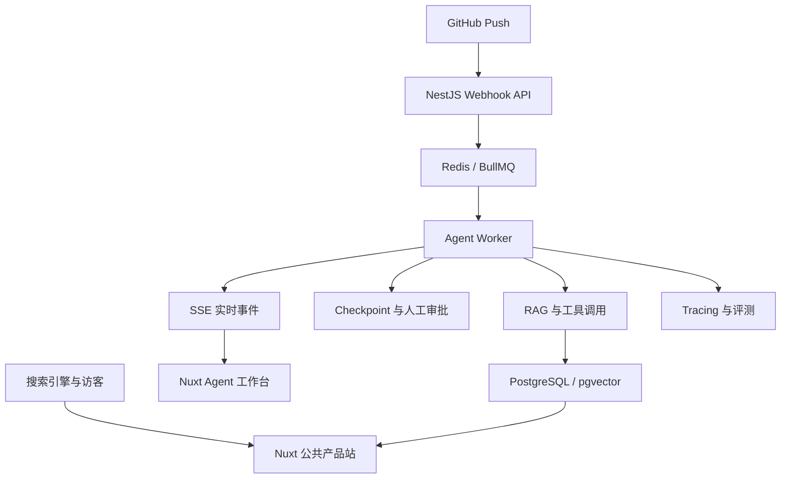

# KnowledgeOps Agent 项目概要

## 1. 项目定位

KnowledgeOps Agent 是一个面向个人学习仓库与技术知识库的 AI 智能评审平台，由可被搜索引擎访问的公共产品站、公开报告页面和登录后的 Agent 工作台组成。

平台监听 GitHub 仓库中的 Markdown 笔记或代码变更，在用户 Push 后自动获取增量 Diff，并通过 AI Agent 完成内容总结、知识检查、关联检索、问题生成和结果发布。访客可以通过公共产品站了解功能、阅读文档和查看公开报告；登录用户可以在工作台中查看 Agent 的执行过程、引用来源与评审结果，并对高风险操作进行人工确认。

项目重点不是实现一个简单的 AI 聊天页面，而是构建一套具备异步任务、工具调用、知识检索、执行恢复、效果评测和可观测能力的生产级 Agent 应用。

## 2. 核心目标

- 将 GitHub 学习笔记的提交、分析、复习和发布流程自动化。
- 展示 Vue 复杂交互、Node.js 全栈开发及 AI Agent 工程能力。
- 让 Agent 的执行过程可查看、可中断、可恢复、可评测。
- 通过 Nuxt 混合渲染兼顾公共页面 SEO 与登录后工作台的交互体验。
- 通过真实部署、性能数据和故障测试证明项目的工程质量。

## 3. 核心功能

### 3.1 GitHub 仓库接入

- 绑定用户的 GitHub 仓库。
- 通过 Webhook 监听 Push 事件。
- 获取本次提交新增、修改和删除的文件及 Diff。
- 使用 Webhook Delivery ID 实现幂等，避免重复处理同一事件。
- 将耗时分析任务投递到消息队列，快速响应 Webhook 请求。

### 3.2 增量知识库

- 解析 Markdown 标题、段落、代码块和链接等结构。
- 只重新处理本次提交发生变化的内容。
- 保存原文、提交版本、内容哈希和分块信息。
- 使用关键词检索与向量检索组合查找相关知识。
- 在 Agent 输出中展示引用文件、原文片段和提交位置。

### 3.3 AI Agent 智能评审

- 总结本次笔记或代码的核心改动。
- 检查潜在的知识错误、概念遗漏与表述歧义。
- 检索仓库中的相关旧笔记，发现重复或冲突内容。
- 根据新增知识生成复习问题和面试追问。
- 通过工具调用访问仓库内容、提交历史和知识库。
- 支持结构化输出，保证评审结果能够被前端稳定展示。

### 3.4 Agent 工作流管理

- 保存 Agent 的任务状态、执行步骤和工具调用结果。
- 支持运行中取消、失败重试、超时处理和断点恢复。
- 对重要或具有副作用的工具调用增加人工审批。
- 记录任务失败原因，并允许从最近的 Checkpoint 继续执行。
- 后续可扩展模型切换、模型降级和多 Agent 协作。

### 3.5 公共产品站与 SEO

- 提供产品首页、功能介绍、使用文档和更新日志。
- 提供可公开分享的 Agent 分析报告与复习内容。
- 公共静态内容使用预渲染，动态公开报告使用服务端渲染或缓存渲染。
- 配置页面标题、描述、Canonical、Open Graph 和结构化数据。
- 生成 Sitemap 和 robots.txt，确保公共内容可以被正确收录。
- 对登录后的私人工作台设置禁止索引，避免隐私数据进入搜索结果。

### 3.6 Agent 工作台

- 展示仓库、提交记录和 Agent 任务列表。
- 使用 SSE 实时接收文本、状态和工具调用事件。
- 展示 Agent 执行时间线、引用来源和各步骤耗时。
- 支持任务取消、重新执行、人工审批和错误重试。
- 使用 Diff 编辑器对比提交前后的 Markdown 或代码。
- 对长任务时间线和大文件内容进行虚拟滚动及性能优化。

### 3.7 评测与可观测

- 记录模型、Prompt、Token、首字时间、总耗时和调用成本。
- 追踪一次任务经过的队列、Agent、工具和检索步骤。
- 建立固定测试集，对不同 Prompt 和检索方案进行回归评测。
- 保存用户对评审结果的采纳、修改和否定反馈。
- 提供任务成功率、失败原因和资源消耗统计。

### 3.8 结果发布

- 将 Agent 评审结果保存为平台报告。
- 支持生成博客草稿或复习卡片。
- 可扩展飞书通知、GitHub Issue/Comment 等发布渠道。

## 4. 系统流程



## 5. 技术栈

### 5.1 前端

| 技术 | 用途 |
| --- | --- |
| Nuxt | 公共产品站、路由管理与混合渲染 |
| Vue 3 | Agent 工作台与复杂交互界面 |
| TypeScript | 类型安全与前后端事件协议定义 |
| Route Rules | 为公共页面和登录后工作台选择不同渲染策略 |
| Pinia | 用户状态、界面状态和运行中任务状态 |
| TanStack Query for Vue | 服务端数据请求、缓存与失效管理 |
| Tailwind CSS | 页面样式与设计系统 |
| Monaco Editor | Markdown、代码和 Diff 展示 |
| SSE / Fetch Stream | 接收 Agent 流式事件 |
| Web Worker | 大文件解析、Diff 和 Markdown 计算 |
| SEO / Sitemap / Open Graph | 搜索收录、规范链接与社交平台分享预览 |
| Vitest / Playwright | 单元测试与端到端测试 |

前端采用按路由划分的混合渲染策略：

- 产品首页、功能介绍和固定文档采用预渲染。
- 公开 Agent 报告采用服务端渲染或缓存渲染。
- `/app/**` 登录后工作台采用客户端渲染，避免不必要的服务端开销和 Hydration 复杂度。

### 5.2 后端

| 技术 | 用途 |
| --- | --- |
| NestJS | 模块化后端框架 |
| Express Adapter | HTTP 服务与中间件运行时 |
| REST / OpenAPI | 普通业务接口与接口文档 |
| PostgreSQL | 用户、仓库、文档、任务和评测数据 |
| Prisma | 数据模型、迁移与数据库访问 |
| pgvector | 文档向量存储与相似度检索 |
| Redis | 缓存、限流、任务状态和分布式协调 |
| BullMQ | Webhook 后台任务与 Agent 异步执行 |
| SSE | 向前端推送 Agent 执行事件 |

### 5.3 AI Agent

| 技术或模块 | 用途 |
| --- | --- |
| TypeScript Agent Harness | Agent Loop、状态与执行控制 |
| Tool Calling | 调用仓库、检索和发布工具 |
| RAG | 从个人知识库检索相关内容 |
| MCP | 标准化接入外部数据和工具 |
| Structured Output | 生成稳定、可校验的结构化结果 |
| Checkpoint | 保存任务状态并支持故障恢复 |
| Human-in-the-loop | 对重要操作进行人工审批 |
| Evaluation Dataset | 对 Prompt、RAG 和模型效果进行回归评测 |

### 5.4 工程与部署

| 技术 | 用途 |
| --- | --- |
| pnpm Workspace | Monorepo 依赖与项目管理 |
| Docker Compose | 本地及服务器环境编排 |
| GitHub Actions | 测试、构建和自动部署 |
| OpenTelemetry | API、Agent 和工具调用链路追踪 |
| Grafana / Tempo | 指标与 Trace 可视化 |
| PM2 或 systemd | VPS 进程管理 |

## 6. 建议的项目结构

```text
knowledgeops-agent/
├─ apps/
│  ├─ web/            # Nuxt 公共产品站与 Agent 工作台
│  ├─ api/            # NestJS API 服务
│  └─ worker/         # BullMQ 与 Agent Worker
├─ packages/
│  ├─ contracts/      # DTO、事件协议和共享类型
│  ├─ agent-core/     # Agent Loop、工具和上下文管理
│  ├─ retrieval/      # 文档解析、索引与检索
│  └─ observability/  # 日志、指标与 Trace
├─ prisma/            # 数据库模型与迁移
├─ tests/             # 集成测试和 Agent 评测集
└─ deploy/            # Docker 与部署配置
```

## 7. 首个可用版本范围

第一版优先完成以下闭环：

1. 使用 Nuxt 完成可被收录的产品首页与登录后工作台。
2. GitHub Push 触发 Webhook。
3. BullMQ 异步获取并处理 Markdown Diff。
4. Agent 总结改动并生成复习问题。
5. PostgreSQL 保存任务、文档和结果。
6. Agent 工作台通过 SSE 展示实时执行过程。
7. 支持任务失败重试和结果查看。

RAG、MCP、人工审批、完整评测和多渠道发布可在基础闭环稳定后逐步加入，避免第一阶段技术范围失控。
