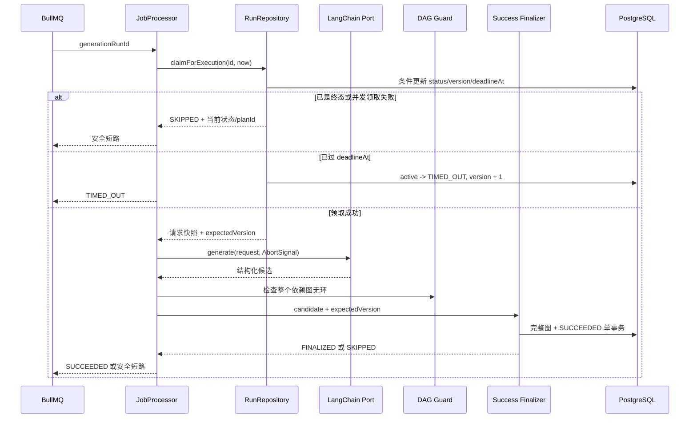

# 计划生成 Worker 状态机与计划启动链路

本文记录 08-10 建立的后端纵向链路，重点回答四个问题：Worker 怎样把 BullMQ Job 变成一次受控模型调用，超时和重复执行怎样处理，前端怎样查询可信状态，以及计划确认后为什么只有部分任务可以开始。

## 1. 模块职责

| 模块 | 进程 | 职责 |
| --- | --- | --- |
| `PlanGenerationJobProcessor` | Worker | 编排领取运行、调用模型、校验候选、记录失败和调用成功落库边界 |
| `PlanGenerationRunRepository` | Worker | 使用 PostgreSQL 条件更新领取运行、记录失败、扫描超时，并提供 fencing version |
| `LangChainPlanGenerator` | Worker / `agent-core` | 把项目请求适配到 LangChain 模型调用并返回结构化候选 |
| DAG Guard | `agent-core` | 在 Schema 引用完整性之后拒绝依赖环；08-10 每日手写点 |
| `PlanGenerationSuccessFinalizer` | Worker | 原子写完整 Plan 图并推进 `SUCCEEDED`；阶段 2 核心手写点 |
| `PlanGenerationRepository.findStatusForUser` | API | 按当前用户查询可安全返回浏览器的运行快照 |
| `PlanLifecycleRepository` | API | 事务化确认计划、解锁根任务和开始一个 READY 任务 |

PostgreSQL 仍是状态真相源。BullMQ 的 completed/failed 只表示 processor 是否返回或抛错，不能替代 `PlanGenerationRun.status`、Plan 或 Task 的业务状态。

## 2. Worker 从 Job 到候选结果

模型拿到的是运行创建时已经保存的模型、Prompt 和 Schema 版本快照，而不是当前环境中新修改的用户偏好。API Key 只由 Worker 环境注入 `LangChainPlanGenerator`，不在 Job payload、数据库快照或状态查询响应中出现。

## 3. `version` 为什么叫 fencing token

假设执行 A 领取运行后得到 `expectedVersion = 1`，随后停顿。BullMQ 或恢复机制又启动执行 B，B 领取后把版本推进到 2。即使 A 更晚拿到模型响应，它也只能提交 `id + RUNNING + version = 1` 的条件更新，而数据库中的版本已经是 2，所以 A 影响 0 行并放弃结果。

这和“先查询再更新”不同：普通预查只能说明查询瞬间的状态，不能约束稍后的写入。真正阻止迟到结果的是带版本条件的原子写。系统不承诺外部模型只调用一次；它承诺重复调用不能产生两份有效业务结果。

## 4. 两条超时防线

第一条在单次 Worker 执行内：根据持久化 `deadlineAt` 创建 `AbortSignal`，到期时中止模型调用，并尝试把仍属于本轮版本的运行记为 `TIMED_OUT`。

第二条是独立的 `PlanGenerationTimeoutSweepLoop`：即使 Job 丢失、Worker 崩溃或失败回调没有机会执行，它仍会周期性扫描过期的 `QUEUED/RUNNING` 记录。扫描使用 `FOR UPDATE SKIP LOCKED` 控制批量并发，并在超时时递增版本，使迟到 Worker 的成功落库条件失效。

两条防线解决不同故障：调用内计时器及时停止资源消耗，数据库扫描器保证页面不会永久停在处理中。

## 5. 失败为什么不会留下半份计划

模型调用、结构化输出和 DAG 校验都发生在成功落库器之前。任何失败只调用 `recordFailure` 更新 `PlanGenerationRun`，不会创建 Plan、Stage、Task、Criterion 或 TaskDependency。

成功路径必须由 `PlanGenerationSuccessFinalizer` 在一个 Prisma 事务中完成“写完整图 + `RUNNING → SUCCEEDED`”。该事务体属于阶段 2 核心手写，目前 08-10 只提供接口和黑盒测试，因此不能把现阶段的成功候选误称为已经完成产品落库。

## 6. 浏览器轮询读取什么

API 暴露 `GET /plan-generation-runs/:generationRunId`。Repository 在同一次查询中加入 `goal.userId = currentActor.userId`，因此他人的 ID 与不存在的 ID 都返回 404，不泄露资源是否存在。

响应只包含：运行 ID、目标 ID、状态、排队/开始/结束时间、稳定错误信息，以及成功后关联 Plan 的 ID 和状态。真实模型名、provider 配置和 API Key 都不返回。08-11 的 TanStack Query 将以这份 PostgreSQL 快照决定继续轮询、显示失败，或读取完整计划。

## 7. 确认计划和开始任务

确认入口为 `POST /plans/:planId/confirm`：

1. 锁定当前用户行，使同一用户的并发确认串行执行；
2. 校验 Plan 属于用户且状态为 `DRAFT`，并排除另一份 `ACTIVE` Plan；
3. 把 Plan 改为 `ACTIVE`；
4. 只把没有任何 prerequisite 的根任务从 `BLOCKED` 改为 `READY`；
5. 相同确认重放时直接返回当前 ACTIVE 结果，不再次修改任务版本。

开始入口为 `POST /tasks/:taskId/start`：

1. 锁定当前用户行并校验 Task 属于其 ACTIVE Plan；
2. 要求 Task 当前为 `READY`，并确定仓库相对 Markdown 路径；
3. 排除该用户另一项 `IN_PROGRESS/VERIFYING/NEEDS_REVISION/NEEDS_EVIDENCE` Task；
4. 使用 `id + READY + version` 条件更新为 `IN_PROGRESS`；
5. 相同 Task 与路径的重放返回当前结果，不重复推进版本；不同路径的重放返回冲突。

用户行锁负责串行化同一用户的两个 API 请求，Task version 负责抵御不遵守该锁的其他进程或未来 Worker 并发更新，两者不能互相替代。

## 8. 当前明确未完成的边界

- DAG 环检测函数保留为 08-10 每日手写，不在本文给出算法实现。
- 成功落库事务保留为阶段 2 的 1 至 2 小时核心手写；当前只有接口和黑盒验收。
- 生成状态轮询、计划预览和今日任务页面属于 08-11。
- 计划执行后的 Task 验收、通过后解锁后继任务属于后续阶段。
